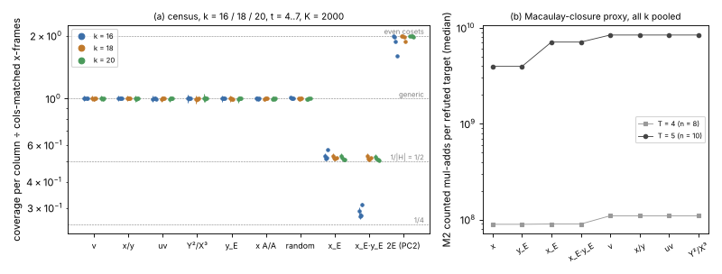

# Coordinate types as decomposition variables (wave 7, lead L2, 2026-11-22)

**Class:** a mechanism measurement on the algebraic track. It uses exact coverage counts,
exact summation polynomials and a counted Macaulay proxy, at k = 16, 18 and 20. It is not a
leaderboard row, not a benchmark row and not a speed claim. It records no gain over the
index-calculus baseline [pcc:unverified].

- Protocol: [PROTOCOL.md](PROTOCOL.md), frozen before the smoke test and before data.
- Run record: [run.log](run.log) (launched 2026-11-22T03:26:37Z at commit `b0a6957edb`).
- Mechanical verdicts: [analysis/summary.md](analysis/summary.md) and
  [analysis/summary.json](analysis/summary.json).
- PDF: [REPORT.pdf](REPORT.pdf).

## Question

Projective, Jacobian, XZ, inverted and extended coordinates are not functions on points, because
they scale. The only functions they give are their weight-0 ratios, which are rational functions
on E. The question has two parts:

- Does such a function of degree ≥ 3 give an m = 2 factor base that covers more order-r targets
  per column than an x-frame?
- Is its m = 2 decomposition system cheaper to solve than x's, like for like?

## Answer

**No positive result. By the frozen verdict rule the outcome is formally "no verdict:
inconclusive, no positive"** [pcc:unverified].

- **Why not formally negative.** The rule requires P1, P1x and P6 for a negative verdict. P1x
  failed in one of its 24 cells: x_E·y_E at k = 16, t = 7. That cell's band was 1/4 ± 20%, so at
  most 0.300; it read 0.311 [0.306, 0.316] [pcc:unverified]. Its 1/4 prediction is the post-hoc
  one (§ Blindness). On the blind cells alone P1x held [pcc:unverified]. A failed prediction stays
  failed.
- **What the data show:**
  1. **No degree ≥ 3 chart function covers more per column.** v, Weierstrass x/y, Montgomery
     uv and Jacobian Y²/X³ read coverage per column ÷ cols-matched x-frames of 0.989–1.007, in
     45/45 qualifying cells [pcc:unverified]. No cell came near the positive threshold of 1.5
     [pcc:unverified].
  2. **Functions with a rational translation in their stabiliser lose coverage.**
     - Edwards x (Montgomery X/Y) reads 0.508–0.568 [pcc:unverified].
     - Extended-Edwards T/Z = x_E·y_E reads 0.507–0.534 at k = 18 and 20 (|H| = 2) and
       0.274–0.311 at k = 16 (|H| = 4) [pcc:unverified].
  3. **The per-value advantage of odd functions is a sign bit.** It reads 3.27–3.93 for the odd
     degree ≥ 3 functions, close to the predicted 4, and the decomposition pays for that bit as
     a Boolean variable [pcc:unverified]. The mean number of rational points per value is
     1.001–1.004 for every function of every degree (exact, full tables) [pcc:unverified].
  4. **The dense systems are harder, not easier.**
     - v, x/y, uv and Y²/X³ give a reduced Boolean equation of full degree n at every T, so the
       degree-D closure refutes only at D = n [pcc:unverified].
     - x refutes at D = 6 at n = 8 and n = 10 on every target. The engine's F4 also reports
       degree 6 [pcc:unverified].
     - At n = 10 the counted proxy costs 2.12× x per target for every dense function
       [pcc:unverified].
     - Per relation, the dense functions cost 1.01–12.3× x on the same [0, 2^t) base
       [pcc:unverified].
     - At these sizes the proxy has little power to show a large gap; see the Macaulay section.



Figure: (a) census coverage per column ÷ cols-matched x-frames, each cell with its 95%
bootstrap interval. (b) median counted M2 mul-adds per refuted target. Script:
[figure.py](figure.py). SVG: [l2_coverage.svg](l2_coverage.svg).

## Desk part: chart functions, degrees and symmetries

All functions are on the Montgomery model v² = u³ + A u² + u (B = 1). The short Weierstrass
model has x = u + A/3 and y = v. The twisted Edwards model has a = A + 2, d = A − 2,
x_E = u/v and y_E = (u − 1)/(u + 1). Ed25519 scales x_E by a constant, which changes nothing
here. The derivations from divisors are in PROTOCOL §2.

| chart | weight-0 function | on (u, v) | deg | name |
|:--|:--|:--|--:|:--|
| Montgomery XZ ladder, projective X/Z, Jacobian X/Z² | x | u + A/3 | 2 | x |
| Montgomery / Weierstrass projective Y/Z, Jacobian Y/Z³ | y | v | 3 | v |
| Weierstrass projective X/Y, Jacobian XZ/Y | x/y | (u + A/3)/v | 3 | q |
| Montgomery projective XY/Z² | uv | u·v | 5 | uv |
| Jacobian Y²/X³ | y²/x³ | (x³ + a₄x + a₆)/x³ | 6 | jac6 |
| Montgomery projective X/Y = Edwards x | x_E | u/v | 2 | xe |
| Edwards Y/Z, extended T/X | y_E | (u − 1)/(u + 1) | 2 | ye |
| extended Edwards T/Z | x_E·y_E | u(u − 1)/(v(u + 1)) | 4 | xeye |
| projective / inverted Edwards X/Y | x_E/y_E, y_E/x_E | u(u + 1)/(v(u − 1)) | 4 | (desk only) |

Hessian, twisted Hessian, Jacobi intersection and Huff models are not defined over F_p for this
family. The Jacobi quartic coordinate is a degree-2 frame (`curve25519_frame_search_20261103`).

Each function's signed stabiliser, measured against the desk prediction (P4):

| f | f(−P) | + stabiliser | H (rational translations in a fibre) | max rational fibre (k = 16 / 18 / 20) | S^f degree per variable / total / terms |
|:--|:--|:--|:--|:--|:--|
| x | +f | {1, −1} | {O} | 2 / 2 / 2 | 2 / 4 / 13 |
| ye | +f | {1, −1} | {O} | 2 / 2 / 2 | 2 / 6 / 9 |
| xe | −f | {1, P ↦ T0 − P} | {O, T0} | 2 / 2 / 2 | **4** / 12 / 11 |
| v | −f | {1} | {O} | 3 / 3 / 3 | 9 / 18 / 315 |
| q | −f | {1} | {O} | 3 / 3 / 3 | 9 / 21 / 429 |
| xeye | −f | {1, τ_T0, P ↦ ±Q₁ − P} | ⟨Q₁⟩ (k = 16), {O, T0} (k = 18, 20) | 4 / 2 / 2 | 4 / 12 / 11 |
| jac6 | +f | {1, −1} | {O} | 6 / 6 / 6 | 18 / 54 / 6495 |
| uv | −f | {1} | {O} | 5 / 5 / 5 | 25 / 50 / 5894 |

Notes on the second table:

- The symmetry sets and fibre maxima are the measured ones; they equal the prediction on every
  curve [pcc:unverified].
- The S^f columns are identical on the three curves [pcc:unverified]. Every kernel had
  dimension 1. All 1,000 fresh zeros vanished and all 1,000 random triples did not
  [pcc:unverified].
- The split-fibre counts equal the per-variable degree wherever a fully rational fibre exists
  [pcc:unverified]. x_E·y_E has none at k = 18 or 20.

One result corrects the scope of the frame theorem. Edwards x has degree 2 as a map E → P¹, but
it is a Möbius frame of x∘τ_Q with 2Q = T0, not of x itself. Its summation polynomial has degree
4 per variable, and its coverage per column is halved [pcc:unverified]. The frame search measured
only Möbius frames of x itself, so this was blind.

## Census (exact counts, K = 2000 frames per cell, t = 4..7)

R_col = mean covered ÷ cols-matched x-frames. R_val = mean covered ÷ x-frames with the same
|V|. The ranges run over the cells shown; per-cell values with 95% bootstrap intervals are in
`analysis/summary.md` [pcc:unverified].

| arm | curves | R_col range | predicted R_col | R_val range | predicted R_val |
|:--|:--|:--|:--|:--|:--|
| v | 16, 18, 20 | 0.997–1.005 | 1 | 3.31–3.93 | [3, 5] |
| q (x/y) | 16, 18, 20 | 0.993–1.007 | 1 | 3.29–3.92 | [3, 5] |
| uv | 16, 18, 20 | 0.994–1.001 | 1 | 3.27–3.92 | [3, 5] |
| jac6 (Y²/X³) | 16, 18, 20 | 0.989–1.004 | 1 | 0.99–1.07 | [0.75, 1.33] |
| xe (Edwards x) | 16, 18, 20 | 0.508–0.568 | 1/2 | 1.87–2.04 | [1.5, 2.67] |
| xeye (T/Z) | 18, 20 | 0.507–0.534 | 1/2 | 1.97–2.03 | [1.5, 2.67] |
| xeye (T/Z) | 16 | 0.274–0.311 | 1/4 (post-hoc) | 1.03–1.24 | [0.75, 1.33] |
| ye (control) | 16, 18, 20 | 0.993–1.004 | 1 | 0.99–1.02 | – |
| x A/A (control) | 16, 18, 20 | 0.993–1.003 | 1 | – | – |
| random classes (control) | 16, 18, 20 | 0.990–1.010 | 1 | – | – |
| x-frame on 2E (positive control) | 16, 18, 20 | 1.606–2.001 | [1.6, 2.4] | – | – |

The coset-selection gain (the frame-search effect) appears at about the same size in every arm:
argmax-J frame ÷ mean is 1.4–6 at t = 4–7 for both f-frames and x-frames [pcc:unverified]. That
statistic was descriptive, with no threshold.

## Macaulay proxy (counted, like for like; low power)

- **System.** The engine's bits system with m = 2: n = 2T Booleans, z² = z. Odd functions use
  T − 1 magnitude bits plus a sign bit.
- **Same targets.** The same 10 random order-r targets are used per curve for every function,
  plus 3 covered targets per cell.
- **Ŝ_R** is exact (grid evaluation followed by the Möbius transform).
- **M2** is the degree-D Macaulay closure with degree falls (MutantXL rule).
  - D_ref is the first D at which 1 lies in V_D.
  - D_root is the first D at which V_D pins the Boolean roots.
- **Mul-adds** are counted rows × pivots × active columns, from the closure code. They are a
  proxy, not the engine's F4 count.

| f | e at T = 4 / 5 / 6 | D_ref at n = 8 / 10 (all targets) | D_root at n = 8 / 10 | M1 multiplier degree | median M2 mul-adds, T = 4 / T = 5 |
|:--|:--|:--|:--|:--|:--|
| x | 4 / 4 / 4 | 6 / 6 | 6 / 6 | n | 8.9·10⁷ / 3.96·10⁹ |
| ye | 4 / 4 / 4 | 6 / 6 | 6 / 6 | n | 8.9·10⁷ / 3.96·10⁹ |
| xe | **6** / 8 / 8 | 7 / 9 | 7 / 9 | **n − 2** | 9.0·10⁷ / 7.10·10⁹ |
| xeye | **6** / 8 / 8 | 7 / 9 | 7 / 9 | **n − 2** | 9.0·10⁷ / 7.10·10⁹ |
| v, q, uv, jac6 | 8 / 10 / 12 (= n) | 8 / 10 (= n) | 8 / 10 | n | 1.09·10⁸ / 8.41·10⁹ |

Every value in the table holds on all three curves and on every target [pcc:unverified].

**Engine calibration (C2).** `curve25519_family-5abc70ba f4cost k bits T 0 10 …` reports
`solving_degree_max` 6 at every (k, T ∈ {4, 5}), equal to M2's D_ref(x) = 6 [pcc:unverified].
It also reports `poly_terms_per_specialisation` 121 and 256, equal to Ŝ_x's terms
[pcc:unverified].

**Power.** At n ≤ 10, x's closure already spans most of the cube: Σ_{i≤6} C(10, i) = 848 of 1,024
monomials. So the proxy cannot show a large cost gap at these sizes. The structural results are
these (P5a–c):

- the dense functions need D = n at every n;
- x refutes at D = 6 at both n = 8 and n = 10.

The size of the gap at larger n is not measured.

**Cost per relation (P6)** = median M2 mul-adds ÷ the exact coverage of the same single
[0, 2^t) base. The ratios against x at T = 5 [pcc:unverified]:

| k | v ÷ x | q ÷ x |
|--:|--:|--:|
| 16 | 2.06 | 1.61 |
| 18 | 2.80 | 12.3 |
| 20 | 1.01 | 2.62 |

The coverage of one base is a single draw, so these ratios are noisy; for example, k = 18, q
rests on one small coverage count.

## Predictions

| | threshold | outcome |
|:--|:--|:--|
| PC1 frame-search replay | 42, 162, 198, 536 exactly | **held**: 42, 162, 198, 536 |
| PC1b selection gain | ≥ 1.5 at k = 20 | **held**: 2.89 and 1.88 |
| PC2 even cosets | R_col ∈ [1.6, 2.4], every cell | **held**: 1.606–2.001 |
| PC3 S^x ∝ S₃ | proportional | **held** on all curves |
| NC1 A/A | ∈ [0.95, 1.05] in ≥ 90% | **held**, 12/12 |
| NC2 random | ∈ [0.9, 1.1], every cell | **held** |
| NC3 ye | ∈ [0.9, 1.1], every cell | **held** |
| P1 no per-column gain | ∈ [0.85, 1.15] in ≥ 90%, no lower bound > 1.15 | **held**, 45/45 (cells with mean xm ≥ 50; the 3 jac6 t = 4 cells are below that) |
| P1x translation collapse | ∈ [0.8/\|H\|, 1.2/\|H\|], every cell | **failed**, 23/24: x_E·y_E at k = 16, t = 7 reads 0.311 against a bound of 0.300 (post-hoc cell); the blind cells alone held |
| P2 per value | ranges in § Census, ≥ 90% | **held**, 72/72 |
| P3 points per value | ∈ [0.99, 1.01] | **held**, 1.001–1.004 |
| P4 max fibre, symmetries, per-variable degree, kernel, verification | exact | **held** |
| P4 total degree | x = 4; others ≤ 2 × per-variable | **failed**: xe 12 (bound 8), q 21 (18), xeye 12 (8), jac6 54 (36); x 4, v 18, ye 6 and uv 50 were within |
| P5a reduced degree e | dense = n; xe and xeye = 8; x and ye = 4 | **failed**: xe and xeye give e = 6 at T = 4 on all three curves; every other cell held |
| P5b dense D_ref = n | every target | **held** |
| P5c x D_ref ≤ n − 2 | ≥ 90% | **held**: 6 at n = 8 and n = 10 |
| P5d mul-adds v ÷ x and q ÷ x | ≥ 1.0 | **held**: 1.227 (T = 4), 2.123 (T = 5) |
| P5e ye within 1 of x | | **held** (equal) |
| P5f xe and xeye ≥ x + 1 | | **held** (9 against 6) |
| P5g M1 multiplier degree = n | ≥ 90% of targets | **failed**: xe and xeye give n − 2 on every target; all other arms give n |
| P6 cost per relation ≥ 1.0 | v and q against x, T = 5 | **held**: 1.01–12.3 |
| census–system consistency, rank check, C1 terms | must hold | **held** |
| C2 engine degree within ±1 | | **held** (equal) |
| lead-positive criteria | | **not met** in the census or the proxy |

Every outcome in this table is [pcc:unverified].

## Blindness

- **Before the protocol was written,** two functional checks at k = 16 were seen: the fibre-size
  table of all eight functions, and a census of K = 50 frames at t = 5 for v, xeye, even, rand
  and xAA (PROTOCOL §0).
  - The x_E·y_E deficit in that check led to the translation-collapse mechanism.
  - So **the xeye prediction at k = 16 (1/4) is post-hoc**; it is the one P1x cell that failed.
  - The xe predictions, and the xeye predictions at k = 18 and 20, are blind.
- **The smoke test** (k = 16 only, after the freeze) exposed values that already contradicted P4
  total degree and P5a for xeye at T = 4. The predictions were not edited.
- **The smoke and the data run share seeds:**
  - the 20 smoke census rows per arm at k = 16, t = 4 are identical to the first 20 of the
    2,000 data rows (1%), checked by comparing arrays;
  - one smoke Macaulay target (log 47248) is one of the 10 data targets at k = 16, with
    identical closure histories for x, q and xeye at T = 4 and 5;
  - one covered xeye target (T = 4, log 17664) also coincides;
  - the k = 16 interpolations of x, ye, xe, v, q and xeye are identical;
  - the engine smoke used the same seed with 2 targets instead of 10, so its outputs carry no
    per-target identity to compare.

## Instrument fixes after the agent's freeze and before the commit freeze

From PROTOCOL §0. None changed a prediction or threshold.

1. An int64 overflow in PC3's explicit S₃.
2. Vacuous verdicts over empty lists, and numpy booleans in `analyse.py`.
3. Macaulay output split per curve, to keep each file under 1 MB.
4. Root mode for covered targets, which always have at least 2 roots.

## Derived against measured

- **Measured exactly:** coverage counts, fibre tables, symmetries, summation polynomials, e,
  D_ref and D_root, and the engine degrees.
- **Measured by counting in this proxy:** M2 mul-adds. They are not the engine's F4 mul-adds.
- **Derived:** cost per relation, which is mul-adds ÷ the coverage of the same base.
- **Interpretation, not tested:** the drift of R_col with t in the k = 16, t = 7 cells (x_E·y_E
  0.311, xe 0.568, 2E 1.606). It is consistent with coverage saturating near r = 8209: the
  x-frames cover 3,264 of 8,209 points there.

## Distance to rho (imported, not measured)

The figures come from `curve25519_frame_search_20261103`, README "Costs and scope":

- a rho solve takes 547–936 group operations at k = 20;
- the best algebraic arm measured 18× (w = 0) to 5.9·10⁶× (w = 1) behind rho-neg;
- the generic baseline is 7.8× rho at k = 20.

L2 found no factor that would shorten that distance [pcc:unverified].

## Reproduce

```bash
bash scripts/run_all.sh          # sumpoly, census, macaulay (per curve), engine, analyse
python3 figure.py                # l2_coverage.svg / .png
python3 export_json.py --check   # reload check of the JSON mirrors
bash smoke/run_smoke.sh          # smoke, not data
```

## Data

- `data/*.npz` and `smoke/*.npz` are git-ignored (`.gitignore`, the 64 KB data-file policy; the
  artifact store refused uploads from this runtime).
- Their lossless JSON mirrors are in `data_json/`: arrays carry dtype and shape, and files above
  900 KB are split into numbered parts. `export_json.py --check` reloaded all 130 NPZ files
  exactly.
- `data/SHA256SUMS` covers the 120 data NPZ files and the data JSON files. `smoke/SHA256SUMS`
  covers the smoke NPZ files. `data_json/SHA256SUMS` covers the mirrors.
- No log, CSV or other output under `data/` exceeds 64 KB. The JSON outputs (sumpoly.json is 442
  KB; each macaulay file is about 134 KB) are tracked as written.

## Disclosures

- There was no Conductor task, no EKS route, no S3 resume checkpoint (the upload token had
  expired; see run.log), no `bench.record` and no pcc claim. Every result is
  [pcc:unverified].
- The run took one core of a host shared with leads L1, L3 and L5. No measurement is a timing.
- The research knowledge base and the lead atlas were unreachable.
- Sources checked: the repository files listed in PROTOCOL §10.

## Errata

