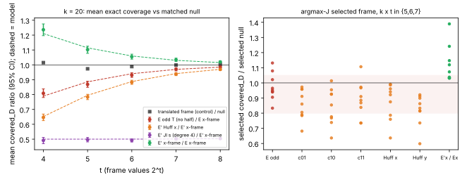

# Wave 7, lead L3: translated involutions and the E' models (2026-11-22)

**Class.** This is a mechanism measurement: exact coverage counts on the algebraic
(summation-polynomial) track for the family miniatures k = 16, 18 and 20. It is not a leaderboard
row, it is not a solve, and it does not change any order against the generic baseline or Pollard
rho. The protocol ([PROTOCOL.md](PROTOCOL.md)) was frozen before any data (`FREEZE.sha256`, hash-checked
at launch, commit 0e3c0fbda0). The desk derivations are in [DESK.md](DESK.md), and the run was
committed at e783d12a5b [pcc:unverified]. The PDF is [REPORT.pdf](REPORT.pdf).

## Question

The frame theorem covers degree-2 functions invariant under negation. Every other degree-2 function
on E is invariant under some translated involution P ↦ T − P with T ≠ O, and so is outside the
theorem. The Huff and Jacobi-intersection coordinates of the 2-isogenous curve E' = E/<T0> were
proposed as such functions.

Do these functions give more exact order-r coverage than x-frames at equal t?

## Answer

**No. No function in this family beats the x-frames, and the only gain found is a small one on E'
(item 5).** [pcc:unverified]

1. **Functions whose T has a rational half are exactly x-frames, translated by that half.**
   - Their mixed-sign relations are the x-frame relations.
   - Their same-sign relations are x-frame relations for the shifted targets R ∓ T.
   - This was checked frame by frame on 89,966 of 90,000 frames. The remaining 34 frames had too few
     points to test, and none violated it. [pcc:unverified]
2. **Functions whose T has no rational half are a genuinely different F_p base, but a worse one.**
   - These are half of all T on E and three quarters on E', and they include both Huff coordinates.
   - Within a fibre {P, T − P} no difference lands in the order-r subgroup, so these bases lose the
     relations x-frames get from P − (−P).
   - Mean coverage is 0.79–0.81× the x-frame null at t = 4 on E and 0.64–0.67× on E', rising toward
     1 as t grows. This matches the pair-count model in every cell. [pcc:unverified]
   - The best frame chosen by the log-free selector is not better either: the geometric means are
     0.82–0.97× the selected null. [pcc:unverified]
3. **The Jacobi-intersection coordinates have degree 4, not 2.**
   - They are x-frames on the other 2-isogenous curves, pulled back to E'.
   - They give 0.48–0.70× the coverage of E' x-frames at equal t, as predicted, before counting their
     higher polynomial degree. [pcc:unverified]
4. **The extra signed relations of a translated involution are bookkeeping, not a gain.**
   - These are the same-sign sums D ± T, which give about 3× the coverage.
   - An x-frame with the same T-shifted targets gets 1.00–1.17× of that count.
   - Either way, the decomposition degree in the target is 3× larger. [pcc:unverified]
5. **The one predicted positive held.**
   - Plain x-frames on E' cover more than plain x-frames on E: 1.21–1.24× at t = 4, 1.10–1.12× at
     t = 5 and 1.01–1.02× at t = 8, with confidence intervals excluding 1 at every t. [pcc:unverified]
   - The selected E' frame is 1.12× the selected E frame (geometric mean over 9 cells).
     [pcc:unverified]
   - This is a component effect on the algebraic track that fades as 1/N. It needs an engine check
     before anyone relies on it (see "The one positive").

The left panel shows k = 20: mean exact coverage relative to the matched null, with 95% bootstrap
intervals, and the pair-count model dashed. The right panel shows the coverage of the frame chosen by
the log-free selector, divided by the selected null, for each (k, t ∈ {5, 6, 7}); the shaded band is
P6's acceptance range.

## Desk results (DESK.md)

`scripts/desk_checks.py` passed 30/30 checks at each of k = 16, 18 and 20 (`data/desk_k*.json`).
[pcc:unverified]

- **Curve facts, checked exactly.**
  - p and r are prime, #E = 8r by a character sum, E(F_p) is cyclic, and A² − 4 is a non-square.
  - E' was built with Vélu's formulas for kernel <T0>: y² = (x + A)(x − 2)(x + 2), with
    φ(x, y) = (x + 1/x, y − y/x²).
  - #E' = #E by a character sum, and E'(F_p) ≅ Z/2 × Z/4r.
  - φ is a homomorphism mapping E[r] injectively into E'[r], checked on 2000 samples.
  - So targets transported by φ are covered exactly when their E'[r] images are.
- **Every degree-2 f is an ι_T function with T ∈ E(F_p).** Its four ramification points are the
  halves of T. This is derived.
- **Theorem 1.** If S ∈ E(F_p) with 2S = T, then f = μ∘x∘τ_{−S} with μ ∈ PGL2(F_p), and the base is
  S plus an x-frame base. For the targets:

  | relation | as an x-frame relation |
  |:--|:--|
  | R = P_i − P_j | x-frame relation for R |
  | R = P_i + P_j | x-frame relation for R − T |
  | R = −P_i − P_j | x-frame relation for R + T |

  This was checked on every frame of the three control arms: the identity holds pointwise and the
  census equals the x-frame census on the matched frame. [pcc:unverified]
- **Lemma 2.** For every T, B + B = T + (B − B), so all signed pair sums are D ∪ (D ± T). The
  mixed-sign coverage depends only on the class of T modulo 2E(F_p). This is derived; P4a tests it.
- **Lemma 3: which T have no rational half.**
  - On E: the T with odd log, equivalently x_T a non-square, half of all points. Checked exactly on
    2000 points per curve. T0 does have a rational half, so Montgomery y/x is a translated frame.
  - On E': three of the four classes of E'/2E' ≅ (Z/2)², three quarters of all points. The
    class-to-2-torsion map was computed with explicit F_{p²} halving.
- **Theorem 4.** With no rational half, no within-fibre difference lies in E[r]. This is derived; P1
  tests it.
- **Huff (E').**
  - a x(y² − 1) = b y(x² − 1) via x = b(u + a²)/v, y = a(u + b²)/v; the curve equation was checked on
    every point.
  - Huff x is an ι_T function for T = Wa, and Huff y for T = Wb. Both are 2-torsion points outside
    2E', in class (0,1).
- **Jacobi intersection (E').**
  - αs² + c² = 1, βs² + d² = 1, with α = A + 2, β = A − 2, checked on every point.
  - s, c and d have degree 4, read off the fibre histograms.
  - Their invariance groups show that c and d are x-frames pulled back from E'/<eβ> and E'/<eα>.
  - s is a translated E x-frame pulled back by the dual isogeny. That last identification is derived
    from the invariance groups, not checked pointwise.

## Corrections to the brief

- **The halves are defined over F_{p⁴}, not F_{p²}.** On E, a T with no rational half has no half
  over F_{p²}: N(x_T − e1) = x_T² + A x_T + 1 is a non-square, and the Galois argument puts the
  halves over F_{p⁴}. On E' the brief's F_{p²} is correct: every T has a half there.
- **The Jacobi-intersection coordinates have degree 4.** They are therefore not ι_T functions. The
  premise holds for Huff.

## Census (exact counts, 2000 random Möbius frames per cell; `analysis/summary.json`)

Mean covered_D, the number of distinct points R ≠ O of the order-r subgroup with R = P_i − P_j. For
x-frames this equals `frame_search` coverage. [pcc:unverified]

| k = 20 arm | t = 4 | t = 5 | t = 6 | t = 7 | t = 8 |
|:--|--:|--:|--:|--:|--:|
| E x-frame (null) | 18.9 | 71.0 | 269.9 | 1043.1 | 4082.7 |
| E translated frame, T = 2S (control) | 19.2 | 69.1 | 266.7 | 1041.9 | 4098.1 |
| E Montgomery y/x, T = T0 (control) | 18.9 | 70.4 | 266.6 | 1051.3 | 4085.7 |
| E odd T, no rational half | 15.3 | 61.7 | 251.2 | 1012.2 | 4022.6 |
| E' x-frame (null) | 23.3 | 78.2 | 284.6 | 1078.3 | 4162.2 |
| E' T ∈ 2E' (control) | 22.7 | 79.4 | 282.8 | 1084.7 | 4128.7 |
| E' class (0,1), no rational half | 15.6 | 62.3 | 253.5 | 1013.2 | 4044.6 |
| E' class (1,0), no rational half | 15.1 | 61.3 | 251.2 | 1021.3 | 4036.1 |
| E' class (1,1), no rational half | 14.9 | 62.0 | 252.3 | 1008.8 | 4018.0 |
| E' Huff x | 15.1 | 61.3 | 251.2 | 1010.7 | 4034.5 |
| E' Huff y | 15.0 | 62.5 | 250.8 | 1016.2 | 4018.3 |
| E' Jacobi-intersection s (degree 4) | 11.5 | 38.8 | 139.9 | 541.8 | 2096.9 |
| E' Jacobi-intersection c (degree 4) | 15.6 | 47.9 | 158.6 | 573.0 | 2152.4 |
| E' Jacobi-intersection d (degree 4) | 11.2 | 39.9 | 140.1 | 536.4 | 2098.5 |

The k = 16 and k = 18 tables have the same shape (`analysis/summary.json`). [pcc:unverified]

Ratio to the matched null, with 95% bootstrap intervals and the model in brackets, at k = 20:
[pcc:unverified]

| comparison | t = 4 | t = 5 | t = 6 | t = 8 |
|:--|:--|:--|:--|:--|
| E odd T / E x-frame | 0.808 (0.780–0.839) [0.790] | 0.869 (0.849–0.890) [0.886] | 0.931 (0.916–0.947) [0.940] | 0.985 (0.978–0.993) [0.985] |
| E' Huff x / E' x-frame | 0.646 (0.625–0.669) [0.652] | 0.784 (0.766–0.802) [0.795] | 0.883 (0.869–0.896) [0.888] | 0.969 (0.962–0.976) [0.970] |
| E' Jacobi-intersection s / E' x-frame | 0.492 (0.469–0.512) [0.500] | 0.496 (0.482–0.512) [0.500] | 0.492 (0.481–0.502) [0.500] | 0.504 (0.499–0.509) [0.504] |
| E' x-frame / E x-frame | 1.236 (1.196–1.275) [1.210] | 1.102 (1.078–1.126) [1.114] | 1.055 (1.038–1.072) [1.060] | 1.020 (1.012–1.027) [1.015] |

## Predictions and controls (all decided by the frozen `scripts/analyse.py`)

**Calibration.**

- **CAL1 held, 30/30.** The bits_lo0 and edwards frames reproduce `frame_search` exactly.
  [pcc:unverified]
- **CAL2 held, 15/15.** The x-frame null means are within 3 SE of `frame_search`'s Möbius means.
  [pcc:unverified]
- **CAL3 held, 30/30.** The model matches both nulls to within 0.990–1.012. [pcc:unverified]

**Controls.**

- **C1 held, 89,966/90,000 frames, with 0 violations.** [pcc:unverified]
  - All 34 exceptions are code 2, all at t = 4: frames with fewer than 3 fibres, where the Möbius map
    cannot be fitted.
  - That is 0.04% of frames against the protocol's 1% allowance.
  - No frame gave code 0, which would have been a violation.
- **C2 held, 45/45.** Control means relative to the null are 0.973–1.025. [pcc:unverified]
- **A/A held, 28/30.** [pcc:unverified]
  - The two intervals that exclude 1 are k = 20, t = 4, E' x-frame (1.073, CI 1.026–1.121) and
    k = 20, t = 6, E x-frame (0.971, CI 0.951–0.993).
  - Two misses in 30 is in line with the 5% nominal rate, and the threshold was ≥ 27.
- **PC1 held, 24/24.** The planted removal of within-fibre pairs was detected at t = 4–6 in every k
  (CI upper bound ≤ 0.992), and it matches the model in 15/15 cells. [pcc:unverified]
- **PC2 held, 9/9.** The frame-search selection gain was reproduced: 2.62–2.75 at t = 5, 1.98–2.18 at
  t = 6 and 1.55–1.72 at t = 7. [pcc:unverified]

**Predictions.**

- **P1 held, 36/36 direction and 90/90 model cells.** No-half arms sit below the null at t = 4 and 5,
  and every cell is within tolerance of the model. [pcc:unverified]
- **P2 held, 6/6 direction and 15/15 model cells.** E' x-frames beat E x-frames at t = 4 and 5, and
  every cell matches the model. [pcc:unverified]
- **P3 held, 27/27 direction and 45/45 model cells.** Jacobi-intersection coverage is about half.
  [pcc:unverified]
- **P4a held, 36/36.** Huff x, Huff y and class (0,1) have the same distribution: mean ratios within
  3.7% of 1 and KS distance at most 0.0585, against a critical value of 0.0617. [pcc:unverified]
- **P4b held, 36/36.** The three no-half classes are indistinguishable: pairwise ratios 0.984–1.017.
  [pcc:unverified]
- **P5 held, 60/60.** The full signed set matches the T-shifted x-null model. Full ÷ mixed-sign
  coverage is 2.0–4.1× (the low end is the saturated cell k = 16, t = 8). [pcc:unverified]
- **P6 held, 6/6.** The selected no-half frame divided by the selected null frame has geometric means
  of 0.971 (E odd T), 0.853, 0.836 and 0.884 (E' classes), and 0.865 and 0.815 (Huff x, Huff y). The
  single-cell maximum is 1.13. [pcc:unverified]
- **P7 held.** E' selected over E selected has a geometric mean of 1.117, with cells ranging 1.03–1.39.
  [pcc:unverified]

## Derived vs measured

**Derived (exact algebra, with the numerical checks listed above):** Theorem 1, Lemmas 2–3, Theorem 4,
the Huff and Jacobi-intersection invariance groups, the field of definition of the halves, the
pair-polynomial multidegree (2,2,2) for mixed-sign relations, and the 3× target degree of the full
signed set. The last two are sketches and are not engine-tested.

**Measured:** exact integer coverage counts per frame. There are no timings and no F4 runs.

## The one positive: E' x-frames over E x-frames

**What was measured.** Mean coverage is up 21% at t = 4 and 11% at t = 5. The best selected frame is
up about 12% on geometric mean. This is a measured component effect of coverage alone.
[pcc:unverified]

**Why.** E' has full rational 2-torsion, so 4 of its 8 cosets are self-paired under negation, against
2 of 8 on E. That adds about N/4 within-fibre relations.

**Why it needs an engine check before anyone relies on it.**

1. Coverage is not cost. Whether F4 on E' has the same solving degree and polynomial size as on E has
   not been measured. Only the multidegree argument says it should.
2. The gain fades as 1/N with N ≈ 2^{t−1}: it is 1.5% at t = 8, and it has no bearing at 255 bits.
3. The isogeny transport, a few field operations per target and per base point, has to be charged.
4. The selected-frame ratio is noisy, ranging 1.03–1.39 across cells.

The check needed is a `pkm-semaev` run on E' against E, with the same seeds, in the engine.

## Distance to rho (imported, not measured here)

These figures are from `research/curve25519_frame_search_20261103/README.md`, which imports
`curve25519_algebraic_ecbench_20261102`. [pcc:unverified]

- The generic baseline is 7.8× rho at k = 20.
- The best algebraic arm against rho-neg is 18× at w = 0, 9.6·10⁵× at w = 0.1 and 5.9·10⁶× at w = 1.

Coverage differences of the size found here, ≤ 1.24× in mean, do not change any of those orders across
the §5a band. [pcc:unverified]

## Data and reproduction

- The binary per-cell outputs `data/k*/*.npz` exceed the 64 KB data-file policy and are git-ignored.
  - Their sha256 values are in `data/SHA256SUMS`.
  - Lossless JSON mirrors are in `data_json/`, with sums in `data_json/SHA256SUMS`, written by
    `scripts/export_json.py`.
  - `export_json.py --check` reloads every mirror. It reproduces all 1470 arrays of the 45 files
    exactly (`data_json/CHECK.txt`). [pcc:unverified]
- Run with `cd scripts && ./run_all.sh`: about 20 minutes on one core, with a peak RSS of 253 MB.
- Make the figure with `python3 scripts/figure.py`.

## Disclosures

- No Conductor task, no EKS route, and no S3 resume checkpoint: the upload token had expired, as
  recorded in `run.log`. No `bench.record` and no pcc claim were filed.
- The host was shared with four other lead agents. Every quantity is an exact count, so timing noise
  does not enter.
- The research knowledge base and the lead atlas were unreachable.
- Sources checked (repository files actually read):
  - `research/curve25519_wave7_untried_20261122/BRIEF.md`
  - `research/curve25519_frame_search_20261103/` README.md, PROTOCOL.md, scripts/frame_census.py,
    scripts/analyse.py, scripts/run_confirm*.sh and analysis/summary.json
  - `research/curve25519_autolab_20261104/ideas/STRUCTURE-R4.md`: lines 154–155 and record
    R4-I2-linear-2torsion-quotient-family

## Errata

(none)
