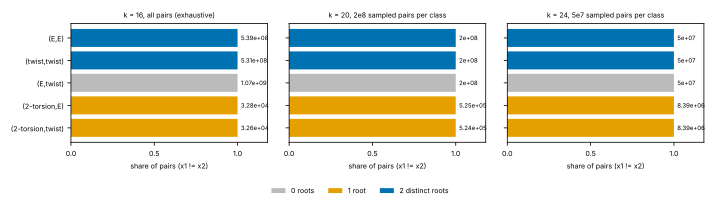

# Mixed curve/twist summation roots on the Curve25519 family (2026-11-22)

**Class:** exact-count mechanism measurement, a unit test of idea record 6 of
`research/curve25519_autolab_20261104/ideas/STRUCTURE-R4.md`. It is not a leaderboard row, not a speed
claim, and it records no gain over the index-calculus baseline [pcc:unverified]. Protocol: [PROTOCOL.md](PROTOCOL.md),
frozen in `e897b1a0f8` before the confirmatory run (the Phase 1 smoke saw 1.2 % of the k = 16 population, 400 of 65,437 rows). Run record: [run.log](run.log); numbers:
`data/results_main.md`. PDF: [REPORT.pdf](REPORT.pdf).

## Question

On the Montgomery curve `y^2 = x^3 + A x^2 + x` over F_p, does the summation polynomial `S3(x1, x2, X)`
have F_p roots when `x1` is the x-coordinate of a point on E and `x2` of a point on the quadratic twist?
Where do the F_p roots of the (E,E) and (twist,twist) pairs lie?

## Answer

1. **No mixed pair has an F_p root** [pcc:unverified]. Over all 1,070,453,835 (E,twist) pairs at k = 16, over 2e8 sampled
   pairs at k = 20 and 5e7 at k = 24, the number of (E,twist) pairs with an F_p root is 0
   [pcc:unverified]. The 95% upper limit on the rate is 1.5e-8 per pair at k = 20 [pcc:unverified].
   There is no exceptional pair to explain outside the 2-torsion x = 0 [pcc:unverified].
2. **Same-class pairs behave as the derivation says** [pcc:unverified]. Every non-degenerate (E,E) and (twist,twist) pair
   has exactly 2 distinct F_p roots, and every root lies on the pair's own curve or at x = 0
   [pcc:unverified].
3. **The only roots at x = 0 come from 2-torsion translates** [pcc:unverified]. The number of
   same-class pairs with a root at x = 0 equals the count predicted from `x(P+T)` exactly at k = 16
   (16417 (E,E) and 16300 (twist,twist) pairs) [pcc:unverified].
4. **For a factor base (derived from the S3 counts, not measured):** twist x-coordinates give no
   relation with a target on E in `S3` [pcc:unverified], so they cannot enlarge the usable base for E
   [pcc:unverified]. They would lower the density of usable columns [pcc:unverified]. The ratio for the
   lever "twist" stays 1.00 against the baseline, as STRUCTURE-R4.md recorded (derived, not an
   improvement) [pcc:unverified].

9 of 10 predictions held as worded; P6 held on the (E,E) and (twist,twist) diagonals and fails on the x = 0 diagonal pair, which the protocol did not except (erratum E1) [pcc:unverified]. No distance to rho is
stated here; it is imported from earlier studies, not measured by this one.

## Erratum to the task text: the S3 coefficients

The L4 task text (dispatch) writes `S3 = (x1 x2 - 1)^2 x3^2 - 2[...] x3 + (x1 - x2)^2`. The standard Montgomery polynomial
has the two outer coefficients the other way round: `(x1 - x2)^2 x3^2 - 2[...] x3 + (x1 x2 - 1)^2`, with
roots `x(P1+P2)` and `x(P1-P2)`. The task text's form is the reverse polynomial; its roots are
`1/x(P1 +- P2) = x(P1 +- P2 + T0)`. The explicit point arithmetic of control C1 confirms the standard form
(19999 of 19999 (E,E) and 19998 of 19998 (twist,twist) sample pairs at k = 16) [pcc:unverified], and the
reverse relation was checked on 20000 pairs per curve (100%) [pcc:unverified]. Both polynomials were run;
the "given" cells (task text's form) give the same classification at k = 16 and k = 20 [pcc:unverified].

## Instrument and curves

`l4core.py` computes the exact distinct F_p roots of `S3` for arrays of pairs (discriminant, Legendre,
square-root and inverse tables, integer arithmetic mod p) and the class of each root by the Legendre
symbol of `f(x) = x^3 + A x^2 + x`: **E** (nonzero square), **T** (non-square, on the twist only), **Z**
(`f = 0`, 2-torsion, on both curves). Curve facts recomputed in the run [pcc:unverified]:

| k | p | A | #E | twist order | x in Z / E / T |
|--:|--:|--:|:--|:--|:--|
| 16 | 65437 | 1058 | 65672 = 8 * 8209 | 65204 = 4 * 16301 | 1 / 32835 / 32601 |
| 20 | 1048573 | 926 | 1049624 = 8 * 131203 | 1047524 = 4 * 261881 | 1 / 524811 / 523761 |
| 24 | 16777141 | 7842 | 16784072 = 8 * 2098009 | 16770212 = 4 * 4192553 | 1 / 8392035 / 8385105 |

At every k the only rational 2-torsion x is 0 (`A^2 - 4` is a non-square) [pcc:unverified]. The k = 24 member is the
brief's (p = 16777141, A = 7842), not the family tool's k = 24 (p = 16777213, A = 318).
Seeds: first 8 bytes of sha256 of `L4|k|tag|stratum|chunk`; tag `main`.

## Results

### Exhaustive k = 16: all 2,141,033,203 unordered pairs (305 wall s on a shared host) [pcc:unverified]

| pair class | x1 = x2 | pairs | 0 roots | 1 root | 2 roots | roots on E | roots on twist | roots at x = 0 |
|:--|:--|--:|--:|--:|--:|--:|--:|--:|
| (E,E) | no | 539,052,195 | 0 | 0 | 539,052,195 | 1,078,087,973 | 0 | 16,417 |
| (E,E) | yes | 32,835 | 0 | 32,835 | 0 | 32,834 | 0 | 1 |
| (E,twist) | no | 1,070,453,835 | 1,070,453,835 | 0 | 0 | 0 | 0 | 0 |
| (twist,twist) | no | 531,396,300 | 0 | 0 | 531,396,300 | 0 | 1,062,776,300 | 16,300 |
| (twist,twist) | yes | 32,601 | 0 | 32,601 | 0 | 0 | 32,600 | 1 |
| (Z,E) | no | 32,835 | 0 | 32,835 | 0 | 32,835 | 0 | 0 |
| (Z,twist) | no | 32,601 | 0 | 32,601 | 0 | 0 | 32,601 | 0 |
| (Z,Z) | yes | 1 | 1 | 0 | 0 | 0 | 0 | 0 |

### Sampled k = 20 (601,048,573 pairs, 97 wall s on a shared host) and k = 24 (166,777,141 pairs, 52 wall s on a shared host) [pcc:unverified]

Sampled strata: 2e8 (k = 20) and 5e7 (k = 24) ordered pairs per class, drawn uniformly with
replacement; the 2-torsion strata are exhaustive. The columns now follow the order of the exhaustive table (the first version swapped E and twist; values were under the right headers). Diagonal rows (k = 20: 370 (E,E) and 387 (twist,twist) pairs; k = 24: 3 and 3) and the (Z,Z) pair are in the totals but not listed.

| k | pair class | pairs | 0 roots | 1 root | 2 roots | roots on E | roots on twist | roots at x = 0 |
|--:|:--|--:|--:|--:|--:|--:|--:|--:|
| 20 | (E,E), x1 != x2 | 199,999,630 | 0 | 0 | 199,999,630 | 399,998,870 | 0 | 390 |
| 20 | (E,twist) | 200,000,000 | 200,000,000 | 0 | 0 | 0 | 0 | 0 |
| 20 | (twist,twist), x1 != x2 | 199,999,613 | 0 | 0 | 199,999,613 | 0 | 399,998,806 | 420 |
| 20 | (Z,E) / (Z,twist) | 524,811 / 523,761 | 0 | all | 0 | 524,811 / 0 | 0 / 523,761 | 0 |
| 24 | (E,E), x1 != x2 | 49,999,997 | 0 | 0 | 49,999,997 | 99,999,990 | 0 | 4 |
| 24 | (E,twist) | 50,000,000 | 50,000,000 | 0 | 0 | 0 | 0 | 0 |
| 24 | (twist,twist), x1 != x2 | 49,999,997 | 0 | 0 | 49,999,997 | 0 | 99,999,992 | 2 |
| 24 | (Z,E) / (Z,twist) | 8,392,035 / 8,385,105 | 0 | all | 0 | 8,392,035 / 0 | 0 / 8,385,105 | 0 |

The k = 16 and k = 20 secondary cells with the task text's polynomial (5e7 pairs per stratum) show 0 of
5e7 (E,twist) pairs with a root at each k, and 100% two-root same-class pairs with x1 x2 != 1 [pcc:unverified]. In those cells the flag column of `data/results_main.md` headed `x1=x2` is really `a = 0`, that is x1 x2 = 1, because a = (x1 x2 - 1)^2 for this polynomial; the pairs with x1 x2 = 1 (1595 (E,E) and 1594 (twist,twist) at k = 16, 94 and 99 at k = 20) have one finite root, the other being at infinity [pcc:unverified].

### Predictions (frozen in PROTOCOL.md section 5)

| id | statement | outcome |
|:--|:--|:--|
| P1 | (E,twist) pairs with an F_p root: 0 | held: 0 of 1,070,453,835 (k = 16), 0 of 2e8 (k = 20), 0 of 5e7 (k = 24, both polynomials at k = 16, 20) [pcc:unverified] |
| P2 | (Z,E): exactly 1 root, on E; (Z,twist): exactly 1 root, on the twist | held: 32,835 and 32,601 pairs at k = 16, exhaustive at k = 20 and 24 [pcc:unverified] |
| P3 | non-degenerate same-class pairs: exactly 2 distinct roots, 100% | held: 539,052,195 and 531,396,300 pairs at k = 16 [pcc:unverified] |
| P4 | (E,E) roots on the twist and (twist,twist) roots on E: 0 | held: 0 and 0 in every cell [pcc:unverified] |
| P5 | pairs with a root at x = 0 are the `x(P+T)` translates: 16417 (E,E), 16300 (twist,twist), 0 mixed at k = 16; within 4 sigma at k = 20, 24 | held: exact at k = 16; k = 20 observed 390 and 420 against about 381 and 382 expected, k = 24 observed 4 and 2 against about 6 and 6 [pcc:unverified] |
| P6 | x1 = x2: one finite root x(2P) on the point's own curve | held on the diagonals of (E,E) and (twist,twist): 32,835 and 32,601 pairs at k = 16; fails as worded on the one x = 0 diagonal pair, 1 of 65,437 diagonal pairs at k = 16 (2 T0 = O, no finite root), also in the k = 20 and k = 24 2-torsion strata [pcc:unverified] |
| P7a | explicit chord arithmetic equals the root set, 100% | held: 19999 of 19999 (E,E), 19998 of 19998 (twist,twist) at k = 16 [pcc:unverified] |
| P7b | mixed pairs over F_p^2: both x(P1 +- P2) are S3 roots, conjugate, outside F_p | held: 20000 of 20000 at k = 16 [pcc:unverified] |
| P8 | wrong constant A+1: root fraction in [0.47, 0.53]; true A: 0 and 1 | held: k = 16 mixed 0.5004, (E,E) 0.4996, (twist,twist) 0.4996; k = 20 mixed 0.4998; k = 24 mixed 0.5006; true A gave exactly 0 and 1 [pcc:unverified] |
| P9 | discriminant identity `disc/4 = 4 f(x1) f(x2)`; task text's polynomial has the inverse roots | held: identity exact, 20000 of 20000 inverse matches [pcc:unverified] |
| P10 | curve facts: #E = 8r, twist 4r', r and r' prime | held, read from the run's curve facts (no machine verdict in `analyze_l4.py`); confirmed by the validator at k = 16, 20, 24 [pcc:unverified] |

Positive controls (P7a, P7b) show the counter and the mechanism are visible [pcc:unverified]. The wrong-A control (P8)
shows the counter returns F_p roots in the mixed class at rate 0.5 when the structure is absent, far
above the 1.5e-8 bound of P1 [pcc:unverified].

## What the outcome implies for twist points in a factor base

This section is **derived** from the S3 counts above; it is not measured [pcc:unverified].

- The F_p x-line splits into two classes that never mix in `S3`, apart from x = 0 [pcc:unverified].
- A relation `S3(x_Q, x1, x2) = 0` with the target `x_Q` in class E can use only E-class base points or
  x = 0: an (E,twist) pair has no F_p root, and a (twist,twist) pair has roots on the twist or at x = 0
  [pcc:unverified]. The point x = 0 (T0) does give relations, `S3(x_Q, 0, 1/x_Q) = 0`, but translation by
  T0 leaves the subgroup generated by the base point [pcc:unverified].
- Twist points therefore add no relations for a target on E [pcc:unverified]. They serve only the twist's
  own discrete logarithm, in a group of order 4r' (r' differs from r), which carries no information about
  E [pcc:unverified].
- The only mixed rational relations run through translation by 2-torsion (P5) [pcc:unverified].
- A factor base using twist x-coordinates lowers the density of usable columns [pcc:unverified]. This is a
  statement about `S3`, a degree-2 sum.

## Derived versus measured

- **Measured (exact counts, frozen code):** every number in the tables above and every PASS in the
  prediction table [pcc:unverified].
- **Derived (argued, not measured):** the Frobenius mechanism (for P1 in E(F_p) and P2 on the twist,
  pi(P1+P2) = P1-P2, so the roots are conjugate); the discriminant identity is checked by computation
  (P9) but its use for all p is a derivation.
- **Derived (argued from the S3 counts, not measured): the factor-base implication** of the section above
  [pcc:unverified].
- **Argued, not measured: S_m for m > 3.** A rational x-only relation `sum(+-P_i) = O` that mixes E and
  twist points has an E-part sum `R` in E(F_p) equal to minus the twist-part sum. Then pi(R) = R and
  pi(R) = -R, so `2R = 0`: mixed rational relations of any degree run only through E[2]. No S4 or higher
  count was taken, so this generalisation is untested here [pcc:unverified].
- **Scope:** three curves of the family (k = 16, 20, 24) and S3 only. Counts at k = 20 and 24 are samples
  with an upper bound, not exhaustive counts.

## Disclosures

- No Conductor task, no EKS/Iso Lab submission, no S3 resume checkpoint (the upload token had expired), no
  `benchrec` record and no pcc claim were made for this run. Results are unverified assertions
  [pcc:unverified].
- The run used the shared host (4 cores shared by five agents; one core used), so times are not
  benchmark figures; the seconds in the tables are wall-clock intervals (the JSON field is named
  `cpu_seconds`), not CPU time.
- The research knowledge base and the lead atlas were unreachable; "not tried" or novelty statements are not
  made.
- No replay certificate, validator report or matched rho reference exists, so nothing here is a
  leaderboard or `benchmarks/README.md` row.

## Sources checked

Repository files actually read: `research/curve25519_wave7_untried_20261122/BRIEF.md`;
`research/curve25519_autolab_20261104/ideas/STRUCTURE-R4.md` (lines 14, 112-150, 296-310);
`research/curve25519_frame_search_20261103/README.md` (first 40 lines), its `PROTOCOL.md` (family rule)
and `scripts/run_confirm.sh` (k = 16 curve); the output of `curve25519_family-5abc70ba family` (k = 20
member). The other studies named in the brief were not read.

## Errata

Validator errata E1 to E10 (`validator-report.json`, verdict pass_with_errata; no erratum changes a count
or the P1 conclusion). What changed in this README [pcc:unverified]:

- **E1:** the summary lines now say 9 of 10 held as worded; P6 held on the (E,E) and (twist,twist)
  diagonals and fails on the x = 0 diagonal pair (2 T0 = O, no finite root), which the protocol did not
  except. The P6 row of the prediction table says the same.
- **E2:** the given-cell flag column is a = 0, that is x1 x2 = 1, not x1 = x2; the two-root sentence is now
  restricted to x1 x2 != 1 and the x1 x2 = 1 counts are listed. `data/` is unchanged and keeps the old label.
- **E3:** the factor-base section is labelled derived and every sentence is tagged. A bullet for it was
  added to "Derived versus measured". The phrase "as in the torsion leads" was dropped (that study was not
  read). The text now says "only E-class base points or x = 0".
- **E4:** [pcc:unverified] added to the lead sentences of Answer items 1 to 4, the 2-torsion sentence and
  the positive-controls sentence.
- **E5:** the section is retitled "Erratum to the task text"; the S3 formula is in the L4 task text, not in
  `BRIEF.md`.
- **E6:** the times are relabelled wall seconds on a shared host (the JSON field `cpu_seconds` is a
  wall-clock interval).
- **E7:** replay environment recorded: python 3.13.18, numpy 2.5.3 (the validator's replay reproduced every
  sampled draw). `run.log` does not echo the command lines and neither it nor the JSONs record the commit
  or versions; the commands are those of the frozen `run_all.sh`. `complete=True` printed for sampled cells
  is a default, not a recorded field.
- **E8:** P10 is read from the run's curve facts, with no machine verdict in `analyze_l4.py`; confirmed by
  the validator.
- **E9:** the sampled table now uses the exhaustive table's column order (E before twist); a note lists the
  rows left out of the sampled table.
- **E10:** "frozen before any data" became "frozen before the confirmatory run (the smoke saw 1.2 % of the
  k = 16 population)".

## Files

`PROTOCOL.md`, `l4core.py`, `run_l4.py`, `controls.py`, `analyze_l4.py`, `run_all.sh`, `figure.py`,
`l4_roots.svg`, `l4_roots.png`, `run.log`, `validator-report.json`, `data/` (JSON and `results_main.md`), `smoke/` (smoke, not data),
`README.md`, `REPORT.typ`, `REPORT.pdf`.
