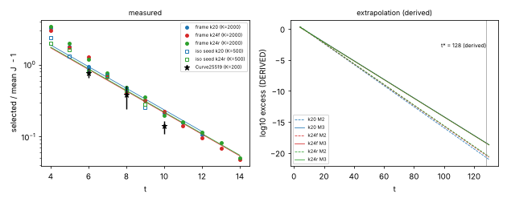

# L5: frame and seed selectors toward 255 bits (wave 7, 2026-11-22)

**Class:** a component measurement on the algebraic track (exact counts, counted group operations and Legendre
symbols, no timings) plus a derived extrapolation to Curve25519. It is not a leaderboard row: there is no replay
certificate, no validator report and no matched rho arm, so the validation gate was not attempted. Protocol:
[PROTOCOL.md](PROTOCOL.md), frozen before data. PDF: [REPORT.pdf](REPORT.pdf). Every result sentence below is
[pcc:unverified]: no pcc claim was filed.

## Question

How fast does the coverage gain from choosing the coordinate frame (or the isogeny-tower seed) with the log-free
coset selector J fall as the factor-base exponent t grows? What does the selection cost in group operations? And
what are the gain and the cost on the real Curve25519 at the t that an m = 2 Semaev attack would use?

## Answer

1. **The gain dies like 2^(−t/2).** The one-parameter form gain − 1 = C·2^(−t/2) (M3) wins the preregistered
   held-out test on every curve, for frames and for seeds [pcc:unverified]. With α free (M2), the fitted α is
   0.553–0.565 for frames (k20, k24f, k24r) and 0.561–0.590 for seeds [pcc:unverified]. M1 (ln gain linear in t)
   predicts gain < 1 on the held-out t and fails [pcc:unverified].
2. **The gain is a column-count effect.** Picking frames by the column count c alone captures 96–100% of the
   J-selector's excess at every t ≥ 8 [pcc:unverified]. The class-composition part falls like 2^(−t)
   (α_Φ = 1.03–1.05) [pcc:unverified]. An iid model (binomial column count, multinomial labels) reproduces the
   real excess: the geometric-mean ratio is 0.96–1.03 per curve [pcc:unverified]. The mechanism prediction
   CV(J) = 2√D·2^(−t/2) matches the measured CV to within 2% at t ≥ 7 [pcc:unverified].
3. **The real Curve25519 behaves like the miniatures.**
   - At t = 6, 8 and 10 the real-curve excess at K = 200 is compatible with k24f's [pcc:unverified].
   - The column dispersion index D is 0.88–0.96 at t = 12, 14 and 16 [pcc:unverified].
   - At t* = 128, 64 sampled frames are homogeneous, and a frame selected from half the samples shows no excess
     on the other half [pcc:unverified].
4. **At 255 bits the selector is worthless (DERIVED EXTRAPOLATION).**
   - The derived t* is 128 for m = 2.
   - The extrapolated excess there is about 4·10⁻¹⁹ at K = 2000, and about 1·10⁻¹⁸ even at K = 2⁶⁴.
   - Enumerating a single frame with full labels costs about 2^136 group operations, about 1.1·10³ × rho.
   - The Legendre-only selectors cost 0, 0.68 and 6.8 × rho per frame at 0, 0.1 and 1 GAE per symbol.
   - Selection could only pay for an index-calculus attack that is already more than about 2.8·10²¹ × rho.

## Gain vs t (measured)

Left panel: the measured excess (gain − 1) against t for frames (K = 2000), seeds (K = 500) and Curve25519
(K = 200), with the M3 fits. Right panel: the M2 and M3 extrapolations to t* (DERIVED) [pcc:unverified].

Column keys:
- "J-sel, J" is the J-selector (key J, cols, −L; the frame-search rule) scored on J.
- "c-only" uses the key c. "S1" is the descent-skip one-bit score.
- "Φ-sel, Φ" selects on and scores the composition factor Φ = 4J/c².
- "J-sel, covered" scores the exact coverage; it is computed for t ≤ 9 (k20) and t ≤ 10 (k24).
- "decoy" uses a key that is independent of the frame.

**k20** (N = 4000 frames per t; gain = selected ÷ mean; K = 2000 unless stated; 95% calibrated bootstrap) [pcc:unverified]

| t | mean c | J-sel, J | J-sel, J (K = 100) | c-only, J | S1, J | Φ-sel, Φ | J-sel, covered | iid surrogate | decoy |
|--:|--:|:--|--:|--:|--:|--:|:--|--:|--:|
| 4 | 8 | 4.230 [2.569, 5.017] | 2.900 | 2.774 | 3.119 | 4.363 | 4.228 [2.297, 4.998] | 4.253 | 1.251 |
| 5 | 16 | 2.783 [2.217, 3.178] | 2.205 | 2.298 | 2.294 | 2.808 | 2.784 [2.218, 3.191] | 2.879 | 0.914 |
| 6 | 32 | 1.935 [1.739, 2.038] | 1.719 | 1.790 | 1.874 | 1.610 | 1.927 [1.746, 2.027] | 2.123 | 1.332 |
| 7 | 64 | 1.703 [1.521, 1.810] | 1.507 | 1.655 | 1.696 | 1.292 | 1.704 [1.517, 1.814] | 1.705 | 0.921 |
| 8 | 128 | 1.468 [1.370, 1.552] | 1.349 | 1.466 | 1.467 | 1.166 | 1.458 [1.362, 1.541] | 1.455 | 1.069 |
| 9 | 256 | 1.322 [1.255, 1.357] | 1.233 | 1.322 | 1.322 | 1.083 | 1.299 [1.227, 1.335] | 1.288 | 0.959 |
| 10 | 513 | 1.215 [1.178, 1.241] | 1.160 | 1.207 | 1.207 | 1.037 | – | 1.256 | 1.096 |
| 11 | 1025 | 1.157 [1.103, 1.186] | 1.104 | 1.157 | 1.157 | 1.015 | – | 1.162 | 1.005 |
| 12 | 2050 | 1.107 [1.065, 1.134] | 1.073 | 1.107 | 1.107 | 1.009 | – | 1.104 | 1.005 |

**k24f** (N = 4000 frames per t; gain = selected ÷ mean; K = 2000 unless stated; 95% calibrated bootstrap) [pcc:unverified]

| t | mean c | J-sel, J | J-sel, J (K = 100) | c-only, J | S1, J | Φ-sel, Φ | J-sel, covered | iid surrogate | decoy |
|--:|--:|:--|--:|--:|--:|--:|:--|--:|--:|
| 4 | 8 | 4.039 [2.850, 4.825] | 2.976 | 2.574 | 3.394 | 5.496 | 4.039 [2.891, 4.869] | 4.098 | 0.938 |
| 5 | 16 | 2.760 [2.224, 3.062] | 2.204 | 2.493 | 2.524 | 2.164 | 2.760 [2.217, 3.064] | 2.795 | 0.741 |
| 6 | 32 | 2.275 [1.433, 2.905] | 1.753 | 1.949 | 2.073 | 1.677 | 2.275 [1.492, 2.905] | 2.106 | 1.056 |
| 7 | 64 | 1.677 [1.589, 1.720] | 1.492 | 1.666 | 1.668 | 1.297 | 1.677 [1.585, 1.722] | 1.634 | 1.114 |
| 8 | 128 | 1.408 [1.354, 1.439] | 1.317 | 1.404 | 1.405 | 1.128 | 1.407 [1.350, 1.439] | 1.482 | 1.018 |
| 9 | 256 | 1.322 [1.242, 1.355] | 1.233 | 1.318 | 1.320 | 1.068 | 1.320 [1.241, 1.352] | 1.313 | 0.927 |
| 10 | 512 | 1.225 [1.180, 1.243] | 1.160 | 1.224 | 1.224 | 1.028 | 1.220 [1.177, 1.237] | 1.230 | 0.925 |
| 11 | 1024 | 1.142 [1.114, 1.162] | 1.111 | 1.142 | 1.142 | 1.015 | – | 1.142 | 0.990 |
| 12 | 2048 | 1.096 [1.080, 1.107] | 1.074 | 1.096 | 1.096 | 1.009 | – | 1.116 | 1.000 |
| 13 | 4096 | 1.069 [1.062, 1.074] | 1.055 | 1.069 | 1.069 | 1.004 | – | 1.076 | 0.998 |
| 14 | 8196 | 1.048 [1.038, 1.055] | 1.036 | 1.048 | 1.048 | 1.002 | – | 1.055 | 1.007 |

**k24r** (N = 4000 frames per t; gain = selected ÷ mean; K = 2000 unless stated; 95% calibrated bootstrap) [pcc:unverified]

| t | mean c | J-sel, J | J-sel, J (K = 100) | c-only, J | S1, J | Φ-sel, Φ | J-sel, covered | iid surrogate | decoy |
|--:|--:|:--|--:|--:|--:|--:|:--|--:|--:|
| 4 | 8 | 4.406 [2.122, 5.999] | 2.880 | 2.970 | 2.879 | 3.830 | 4.406 [2.313, 6.030] | 4.373 | 0.599 |
| 5 | 16 | 2.972 [2.033, 3.333] | 2.222 | 2.691 | 2.769 | 2.524 | 2.973 [2.215, 3.332] | 2.682 | 0.627 |
| 6 | 32 | 2.182 [1.673, 2.526] | 1.770 | 2.062 | 2.065 | 1.501 | 2.182 [1.672, 2.566] | 2.194 | 0.899 |
| 7 | 64 | 1.768 [1.574, 1.879] | 1.521 | 1.712 | 1.717 | 1.284 | 1.768 [1.571, 1.890] | 1.677 | 0.918 |
| 8 | 128 | 1.490 [1.364, 1.596] | 1.343 | 1.470 | 1.474 | 1.119 | 1.488 [1.360, 1.597] | 1.490 | 0.942 |
| 9 | 256 | 1.353 [1.203, 1.481] | 1.241 | 1.348 | 1.348 | 1.082 | 1.351 [1.202, 1.474] | 1.299 | 1.029 |
| 10 | 512 | 1.195 [1.169, 1.212] | 1.155 | 1.193 | 1.193 | 1.034 | 1.193 [1.162, 1.213] | 1.198 | 1.060 |
| 11 | 1024 | 1.159 [1.110, 1.191] | 1.112 | 1.159 | 1.159 | 1.015 | – | 1.156 | 1.010 |
| 12 | 2048 | 1.115 [1.079, 1.140] | 1.081 | 1.115 | 1.115 | 1.009 | – | 1.114 | 0.994 |
| 13 | 4095 | 1.083 [1.063, 1.094] | 1.058 | 1.083 | 1.083 | 1.004 | – | 1.077 | 0.983 |
| 14 | 8192 | 1.050 [1.042, 1.054] | 1.039 | 1.050 | 1.050 | 1.002 | – | 1.058 | 0.999 |

**Seed selector (arm I)** (N = 1000 seeds per t; K = 500; J-selector) [pcc:unverified]

| t | k20 mean cols | k20 gain on J | k20 gain on covered | k24r mean cols | k24r gain on J | k24r gain on covered |
|--:|--:|:--|:--|--:|:--|:--|
| 4 | 8.0 | 3.384 [1.892, 3.945] | 3.384 [1.993, 3.965] | 8.1 | 2.967 [2.499, 3.320] | 2.967 [2.551, 3.307] |
| 5 | 16.0 | 2.321 [1.782, 2.804] | 2.321 [1.671, 2.776] | 16.0 | 2.623 [1.661, 3.095] | 2.623 [1.725, 3.057] |
| 6 | 32.1 | 1.846 [1.712, 1.964] | 1.844 [1.694, 1.975] | 32.0 | 1.820 [1.626, 1.941] | 1.820 [1.638, 1.952] |
| 7 | 64.0 | 1.713 [1.425, 1.931] | 1.706 [1.421, 1.923] | 63.9 | 1.694 [1.268, 2.022] | 1.694 [1.199, 2.005] |
| 8 | 128.5 | 1.463 [1.158, 1.704] | 1.451 [1.143, 1.657] | 127.9 | 1.434 [1.282, 1.529] | 1.434 [1.281, 1.525] |
| 9 | 255.3 | 1.256 [1.211, 1.286] | 1.238 [1.194, 1.270] | 256.4 | 1.279 [1.176, 1.369] | 1.277 [1.189, 1.368] |

**Real Curve25519 (arm R1) vs miniatures** (K = 200; J-selector, value J) [pcc:unverified]

| t | frames | Curve25519 | k24f | k20 |
|--:|--:|:--|:--|:--|
| 6 | 2000 | 1.776 [1.651, 1.896] | 1.847 [1.636, 2.085] | 1.786 [1.677, 1.884] |
| 8 | 1000 | 1.388 [1.242, 1.514] | 1.345 [1.296, 1.390] | 1.386 [1.326, 1.443] |
| 10 | 400 | 1.139 [1.109, 1.163] | 1.178 [1.141, 1.211] | 1.177 [1.146, 1.205] |

## Model comparison and decision (preregistered rule)

Each form was fitted on t ≤ 10 (seeds: t ≤ 7) and asked to predict the held-out t (frames: 11–12 or 11–14;
seeds: 8–9). The score is the RMS of ln(predicted excess ÷ observed excess) [pcc:unverified].

| arm | curve | M1 | M2 | M3 |
|---|---|--:|--:|--:|
| frames | k20 | ∞ (predicts gain < 1) | 0.110 | 0.089 |
| frames | k24f | ∞ | 0.157 | 0.174 |
| frames | k24r | ∞ | 0.421 | 0.062 |
| seeds | k20 | 1.427 | 0.183 | 0.140 |
| seeds | k24r | ∞ | 0.157 | 0.106 |

The decision table above is [pcc:unverified].
- **Frames:** the worst scores are M1 ∞, M2 0.421 and M3 0.174, so the winner is M3. It is adequate, since
  0.174 ≤ ln 2 [pcc:unverified].
- **Seeds:** the worst scores are M1 ∞, M2 0.183 and M3 0.140, so the winner is M3 and it is adequate
  [pcc:unverified].
- **α from M2 on all t, 95% interval** [pcc:unverified]:
  - frames: k20 0.565 [0.501, 0.618], k24f 0.555 [0.530, 0.579], k24r 0.553 [0.514, 0.588];
  - seeds: k20 0.590 [0.506, 0.682], k24r 0.561 [0.452, 0.678];
  - descriptive, J-selector scored on exact covered in unsaturated cells: 0.60–0.67.

## Predictions

Every prediction held [pcc:unverified]:

| # | prediction | outcome |
|---|---|---|
| P0-PC1 | the verbatim frame-search instrument reproduces the published k20 cells exactly | **held**: t = 5 L = 976503, covered 198, gain 2.8377 vs the mean frame; t = 6 L = 908172, covered 536, gain 1.9775 |
| P0-PC2 | the fast instrument equals it on 3 × 2001 frames | **held**: 0 mismatches |
| P0-PC3 | the published gains fall inside the 2.5–97.5% range of 80 independent fresh pools | **held**: t = 5 2.84 in [2.44, 3.45]; t = 6 1.98 in [1.87, 2.48] |
| P0-iso | arm I rows equal the isogeny-seed study's rows | **held**: 8,000/8,000 rows (k = 20, 24; t = 4–7; seeds 0–999) |
| P1 | M1 does not win; frame α in [0.35, 0.65] | **held**: M3 wins; α 0.553–0.565 |
| P2 | the winning form is adequate (worst held-out score ≤ ln 2) | **held**: 0.174 |
| P3a | composition-only α_Φ ≥ 0.8 | **held**: 1.029–1.055 |
| P3b | c-only share of the excess ≥ 0.7 at every t ≥ 8 | **held**: minimum 0.959 |
| P4 | real ÷ iid-surrogate excess, geometric mean over t ≥ 6, in [0.75, 1.33] | **held**: 0.968 (k20), 0.959 (k24f), 1.026 (k24r) |
| P5 | [r]P costs 1.0–1.6·log₂ r group ops per point; labels correct | **held**: 20, 27, 25 ops = 1.18, 1.29, 1.19·log₂ r; 200/200 labels correct per cell |
| P6 | the real-curve excess is compatible with k24f at t = 6, 8, 10 | **held** (table above) |
| P7 | seed α in [0.35, 0.65] | **held**: 0.590 (k20), 0.561 (k24r) |
| P8 | decoy \|z\| ≤ 3.5 in every cell | **held**: maximum \|z\| 2.73 |
| P9 | excess ratio K = 2000 ÷ K = 100, geometric mean over t ≥ 8, in [1.1, 1.6] | **held**: 1.406, 1.320, 1.386 (Gaussian 1.370) |
| R1 | real-curve D in [0.7, 1.4] at t = 12, 14, 16 | **held**: 0.961, 0.884, 0.945 |
| R2 | t* frames homogeneous; pooled class proportions as expected; each p ≥ 0.001 | **held**: classes χ² 259.1 (df 252, p = 0.37); on-curve rates χ² 68.5 (df 63, p = 0.30); pooled χ² 13.5 (df 4, p = 0.0091) |
| R3 | cross-validated selection at t* finds nothing | **held**: excess −0.0038, inside the null range [−0.067, 0.076] |
| R3b | (−1)^label = χ(u) on every labelled point | **held**: 0 mismatches over 659,525 labels |
| R4 | DERIVED: extrapolated excess at t*, upper 95% end, ≤ 10⁻¹⁵ | **held**: 4.37·10⁻¹⁹ |

R2's pooled-proportion p = 0.0091 passes the preregistered threshold of 0.001, but not a 0.01 threshold. It is
reported as is [pcc:unverified].

## Selection cost (measured, counted units)

These costs are [pcc:unverified]:
- **Miniatures, per base point:** [r]P by double-and-add costs 20 group ops (k20), 27 (k24f) and 25 (k24r).
- **Miniatures, per frame:** full labels cost c·ops plus 2^t Legendre symbols. At t = 10 that is 10,254 (k20),
  13,825 (k24f) and 12,794 (k24r) group ops plus 1,024 Legendre symbols. At t = 14 it is 221,300 (k24f) and
  204,790 (k24r) group ops plus 16,384 Legendre symbols.
- **Legendre-only selectors:** the one-bit (S1) and c-only selectors cost 0 group ops and 2^t + c Legendre
  symbols per frame.
- **Seeds:** the tower build costs 1,529–19,643 group ops per seed (k20, t = 4–9) and 2,317–25,614 (k24r). The
  [r]P selector costs 20 (k20) or 25 (k24r) ops per signed base point. The engine's reported selector count also
  includes O(c²) pair additions, which the class-count form of J does not need.
- **Curve25519:** each label costs 506 counted ladder ops (xDBL + xADD per bit of r), and 659,525 labels were
  computed. A double-and-add count for r would be 324 ops (251 doublings, 73 additions). Arm R used about 9.9·10⁶
  Legendre symbols for on-curve tests, plus one more per label for the parity check.

## Real Curve25519 (arm R, measured)

These results are [pcc:unverified]:
- **R1 (enumerated frames).**
  - Excess at K = 200: t = 6 0.776 [0.651, 0.896]; t = 8 0.388 [0.242, 0.514]; t = 10 0.139 [0.109, 0.163].
  - Dispersion D: 1.032, 0.994, 0.941 at t = 6, 8, 10.
  - Pooled class proportions are within 0.005 of (1/8, 1/4, 1/4, 1/4, 1/8).
- **R1c (column counts only):** D = 0.961 (t = 12, 400 frames), 0.884 (t = 14, 200 frames), 0.945 (t = 16, 50 frames).
- **R2 (t* = 128, sampled):**
  - 64 frames × 4,096 on-curve samples; on-curve fraction 0.49995.
  - The per-frame relative SD of Ĵ_rel from 2,048 samples is 0.032.
  - The between-frame variance estimate is 3.1·10⁻⁵, which is not distinguishable from 0.
- **R3, R3b:** see the table above.

## DERIVED EXTRAPOLATION to Curve25519 (not a measurement)

Every number in this section is DERIVED from fitted miniature laws and counting formulas, not measured.
- **t\* = 128 for m = 2.** This t is derived, not taken from a cited study. It is where mean J/r = 1: log₂ mean J
  = 2t − 3.95 is fitted on k24f, and r ≈ 2²⁵². Rough values for m = 3 and m = 4 are 86 and 65.
- **Excess at t\* (M3, K = 2000):** 4.09·10⁻¹⁹ (k20), 3.73·10⁻¹⁹ (k24f), 3.81·10⁻¹⁹ (k24r); the largest upper
  95% end is 4.37·10⁻¹⁹. M2 gives 2–5·10⁻²¹ (upper ends up to 3.7·10⁻¹⁹). The mechanism's frozen point
  prediction was 3.7·10⁻¹⁹. Scaling with the Gaussian tail to K = 2⁶⁴ gives 1.09·10⁻¹⁸. At m = 3 (t = 86) the M3
  excess is about 8·10⁻¹³; at m = 4 (t = 65) it is about 1.2·10⁻⁹.
- **Rho:** √(πr/4) = 2^125.83 group operations.
- **Cost of enumerating one frame at t\*, against rho:**

  | GAE per Legendre symbol | full labels (2^127 × 506 ops + 2^128 symbols) | one-bit / c-only (2^128 + 2^127 symbols) |
  |--:|--:|--:|
  | 0 | 2^135.98 = 1,142 × rho | 0 group ops |
  | 0.1 | 1,142 × rho | 2^125.26 = 0.68 × rho |
  | 1 | 1,146 × rho | 2^128.58 = 6.8 × rho |

- **Sampling instead of enumerating:** resolving an excess of 4·10⁻¹⁹ needs about 2^126.8 samples per frame
  (s₁ = 1.43 per sample). That is more than the frame's 2^127 columns, so sampling saves nothing; with full
  labels it costs about 974 × rho per frame.
- **Break-even:** a selection costing even one Legendre-only frame enumeration (the 0.1 GAE column) pays only if
  the index-calculus attack itself costs at least 2.8·10²¹ × rho. At w = 0 the Legendre-only selector costs no
  group operations, but its gain of 1 + 4·10⁻¹⁹ is still not a usable improvement [pcc:unverified].
- **Isogeny-tower base at t\*:** the base needs an auxiliary E′/F_p with 2^128 dividing #E′(F_p). Only about
  4√p / 2^128 ≈ 2^1.5 traces qualify. No construction for such a curve is known here, so the seed arm's base may
  not be buildable at 255 bits. This is a derived note, not checked.

## Measured vs derived

- **Measured:** all gains, fits, costs and controls on k20, k24f and k24r; on Curve25519, the R1 gains at
  t = 6, 8, 10, the column dispersion up to t = 16, the class homogeneity and cross-validation at t = 128, the
  label parity, and the counted ladder cost.
- **Derived:** t*, every excess at t* or at K = 2⁶⁴, every per-frame cost at t* and its ratio to rho, the
  break-even cost, and the isogeny-tower note. The bridge from one to the other rests on M3 holding up to
  t = 14 (held-out test) and on Curve25519 matching the miniatures up to t = 10 and D ≈ 1 up to t = 16.

## Distance to rho (imported only)

No rho arm was measured here. Imported from earlier studies at k = 20:
- The best algebraic arm is 18.3× (w = 0), 6.9·10⁵× (w = 0.1) and 4.4·10⁶× (w = 1) behind rho-neg
  (`curve25519_isogeny_seed_20261103`, session `ECBS1h405f20219036`).
- The generic baseline is 7.8× rho (`curve25519_frame_search_20261103`).

A coverage factor of at most about 4.4× at t = 4, shrinking to 1.05× at t = 14, does not change any of those
orders across the §5a band [pcc:unverified].

## Disclosures

- **Infrastructure.** No Conductor task, no isolab-eks route, no benchrec record and no pcc claim. The S3 resume
  checkpoint was unavailable because the upload token had expired (`run.log`). The run started at
  2026-11-22T03:20:33Z at commit 7be4f368e5.
- **Host.** The host is shared, with four cores across five agents and one core used. Units are deterministic
  counts, so host load does not change any number.
- **Research KB.** The knowledge base and the lead atlas were unreachable; the sources checked are listed below.
- **k = 24 members.**
  - k24f (p = 2²⁴ − 75, A = 7842) is the brief's faithful member.
  - k24r (A = 318) is the family-rule member. It was used by the frame-search census and is the only k = 24 curve
    the engine's `iso-census` builds, so arm I runs on k24r, not k24f.
  - Every curve fact was verified by computation (`data/verify_curves.json`).
- **Bootstrap calibration.** The raw frame bootstrap underestimates the spread of the selection statistic by a
  factor of 2.3–3.8 (from the 80 independent pools). All intervals are therefore widened by the preregistered
  factor f = 3.05 [pcc:unverified].
- **Smoke vs data seeds.** The smoke run (`smoke/`, "SMOKE, NOT DATA") used the same derived-seed rule as the
  data run. I checked the overlap explicitly:
  - frame census: the 121 smoke rows (bits_lo0 + 120 frames) at k20, t = 4–12 equal the first 121 data rows
    exactly; the iid-surrogate rows do not coincide (1 row equal at t = 4 by chance);
  - PC1 and PC2: identical by design (fixed frame-search seed);
  - PC3 pools: the 4 smoke pools at t = 5 and t = 6 equal the first 4 of the 80 data pools;
  - arm I: seeds 0–39 at k20, t = 4–7 equal the data rows (40/40 per cell);
  - Curve25519 R1: the first 40 frames (t = 6) and 12 frames (t = 8) equal the data rows; R1c: the first 6
    frames at t = 12;
  - Curve25519 R2: the data frames differ from the smoke frames; only frame 0's start point coincides;
  - the smoke subsets are part of the data; no prediction was revised after the smoke run.
- **Data files.** These are git-ignored:
  - `data/**/*.npz` and `data/**/*.jsonl` (64 KB data-file policy; the artifact store refuses uploads from this
    runtime). `data/SHA256SUMS` lists all 49 of them and verifies. `data_json/` holds lossless JSON mirrors
    (`export_json.py`; exact reload check 49/49; hashes in `data_json/SHA256SUMS`).
  - `analysis/gains.csv` (89 KB). Its exact mirror is `analysis/gains.json`, and `analysis/gains.csv.sha256`
    binds it.
- **Phase 2 edit by the lead.** The lead rewrote `.gitignore` once in phase 2 before the coordinator's
  append-only note arrived. It was restored with the original lines plus `analysis/gains.csv`, and the jsonl
  lines were appended.
- **Run warning.** One RuntimeWarning (log of a non-positive value in an M1 bootstrap refit) is in `run.log`. It
  affects only M1 bootstrap replicates, and M1 lost.

## Files

- [PROTOCOL.md](PROTOCOL.md)
- `scripts/`: the frozen run and analysis code (`run_all.sh`, `selector_scan.py`, `run_iso.sh`,
  `real25519_sample.py`, `pc_replay.py`, `pc3_pools.py`, `iso_pc.py`, `verify_curves.py`, `l5common.py`,
  `analyse.py`, the verbatim `frame_census_orig.py`).
- `data/`: run outputs and `SHA256SUMS`.
- `data_json/`: lossless mirrors.
- `export_json.py`
- `make_tables.py` and `tables.md`: the tables above, generated from `analysis/gains.csv`.
- `analysis/`: `results.json`, `verdicts.json`, `gains.json`, `gains.csv.sha256`, `fig_gain_vs_t.png` (39 KB)
  and `.svg`.
- `smoke/`
- `REPORT.typ` and `REPORT.pdf`

## Sources checked (repository files read)

- `research/curve25519_wave7_untried_20261122/BRIEF.md`
- `research/curve25519_frame_search_20261103/` README, PROTOCOL, scripts (frame_census.py, analyse.py,
  run_confirm*.sh, run_engine.sh), analysis/summary.json, confirm logs
- `research/curve25519_descent_skip_20261114/` README, PROTOCOL, frame_selection.py, parity_check.py,
  rate_ratio.py and their outputs
- `research/curve25519_isogeny_seed_20261103/` README, PROTOCOL, scripts, analysis/summary.json, data/k20.jsonl, data/k24.jsonl
- `research/curve25519_isogeny_seeds_20261114/` README, PROTOCOL, summary.txt, run_seed.sh, summarise_seeds.py
- `research/curve25519_wave6_runs_20261115/L1_faithful/faithful_search.txt`
- `src/bin/curve25519_family.rs` (`iso_census`), `src/cryptanalysis/ic_framework/prime_tower.rs`
- `tools/pcc/pcc.py` (lint-prose)

## Errata

