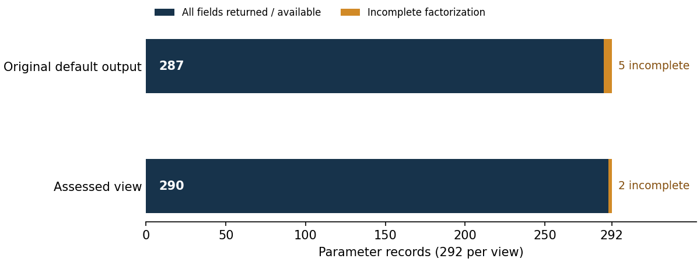

# Supplied curve candidates: ICV1 and DiSSECT assessment

**Follow-up:** [selected-versus-skipped weakness hypotheses](hypotheses/REPORT.md)
connects these four candidates to the existing seed census and compares them
with the published P-224 and P-256 curves using a native C++/PARI diagnostic.
The [supplement PDF](hypotheses/HYPOTHESES.pdf), exact inputs, six native
records and prospective protocol accompany it. Both weakness hypotheses
remain unresolved; the original external assessment below is preserved.

This PR archives the completed external assessment of four supplied curve
parameter sets. The [PDF](REPORT.pdf) includes the exact input parameters,
full canonical ICV1 identities, certified arithmetic findings, the recorded
DiSSECT defects and the incomplete extension-field factorizations.

The curves and representations are identified in the frozen
[ICV1 records](evidence/curves.icv1.json). Candidate numbers remain input
labels; the supplied generation run and its rejection history were not replayed.
The three 224-bit candidates and one 256-bit candidate use the corresponding
NIST prime fields and differ from the standardized curves.

## Requirement and evidence status

| Requested deliverable | Status | Evidence |
| --- | --- | --- |
| Assess the four exact supplied models | Verified arithmetic checks | [Certificates](evidence/assessment-certificates.json), full raw records in the evidence archive |
| Encode the models in the existing ICV1 format | Complete for the frozen assessment | [ICV1 records](evidence/curves.icv1.json), including canonical model JSON and model SHA-256 |
| Run DiSSECT | All 292 default calls across 22 traits executed | [Evidence archive](evidence/curve-assessment-evidence.zip), `dissect-results.json` |
| Follow up the five incomplete results | Three resolved; two partial | [Continuation summary](evidence/continuation-summary.json) |
| Check the reported DiSSECT defects | Six coordinate checks and eight patched trace checks completed | Archive members `continuation/coordinate-torsion-certificates.json` and `continuation/patch-verification.json` |
| Produce a PDF and PR | PDF included; this change is the report/evidence PR | [PDF](REPORT.pdf), [graph](figures/availability.svg) |

## Recorded findings

All four full group orders and field characteristics were proven prime in
SageMath. Independent affine arithmetic and SageMath verified `nG = O` for
the supplied nonidentity generator. Its order and the unique multiple of
`n` in the Hasse interval establish the full cardinality and cofactor 1.
The seed expansion and supplied root and generator conventions match.
Each fundamental Frobenius discriminant certifies endomorphism conductor 1.
The exact embedding degrees and base-field twist factors have separate
proof-enabled checks in the archived certificates.

The original tool output returned all fields for 287 of 292 calls and
timed out on five parameter combinations. Two source defects affect ten
otherwise populated records: six torsion-extension degree records and four
degree-2 trace fields. Their corrections are independently checked; the
two-line [DiSSECT patch](evidence/dissect-corrections.patch) is preserved as
an artifact for upstream review. It targets DiSSECT commit
`8edc3030fb91411a55aa6c07d050507d840c5e55`.

The assessed view has every field available in **290 of 292 records**.
It retains the original results and identifies the evidence for every
changed field; it does not represent a fresh 292-call run of patched code.
The [availability graph](figures/availability.svg) shows deterministic record
counts, not mathematical certification or a performance improvement.



The two remaining cases are quadratic-twist orders over `Fp^2`, with
327-bit and 444-bit proven-composite residuals. Their known prime factors,
exact cofactor values, budgets and unsuccessful attempts remain in the
archive. The [problem record](../../problems/supplied-curve-fp2-twist-factorizations.md)
states the exact remaining acceptance conditions. Base-field curve and
twist orders are already completely certified.

Generic square-root work estimates and the smaller base-field twist primes
are described in the PDF. They are arithmetic estimates, not measured
attacks, a statistical outlier finding or a deployed-security certification.

## Frozen external evidence and repository scope

The archive is a byte-preserved import of the previously delivered
SageMath/Python analysis and its continuation. The Python provenance remains
explicit. No Python research execution path is introduced into this
repository; the two Python files under `reports/` only lay out already
recorded values and inspect the resulting PDF, as permitted by the
research-visuals workflow.

The ICV1 records are frozen study evidence, not a mutation of the active
curve catalogue. There is no new solver, IC/rho comparison, scientific state
promotion or benchmark row. The active curve registry, IC scoreboard,
leaderboard and lab-browser data remain unaffected by this evidence import;
there is no catalogue or performance result to regenerate in this change.

The PDF embeds the same complete evidence ZIP plus the ICV1 JSON and patch.
The external snapshot's manifests bind its members; `SHA256SUMS` additionally
binds this repository's imported files, figures and report.

## Inspect and reproduce the report

```sh
cd research/curve_candidates_dissect_20261021
sha256sum -c SHA256SUMS
unzip -t evidence/curve-assessment-evidence.zip
pdfinfo REPORT.pdf
```

To rebuild only the document in a scratch directory outside the repository:

```sh
study="$PWD"
report_stage="$(mktemp -d)"
unzip -q "$study/evidence/curve-assessment-evidence.zip" -d "$report_stage"
cp "$study/reports/make_pdf.py" "$study/reports/draw_report_figures.py" "$report_stage/curve-assessment/"
cp "$study/evidence/curve-assessment-evidence.zip" "$report_stage/curve-assessment-continued.zip"
MPLCONFIGDIR="$report_stage/mpl-cache" python3 "$report_stage/curve-assessment/draw_report_figures.py"
python3 "$report_stage/curve-assessment/make_pdf.py"
```

Rendering uses ReportLab, PyMuPDF, matplotlib and installed DejaVu fonts.
The cryptographic execution scripts inside the external snapshot are
historical evidence. Any future repository-native research execution must
follow the current native-code policy and preserve the frozen snapshot.

## Validation and workflow limits

The PDF opens, includes eight pages and three byte-checked attachments,
retains every exact input parameter and full canonical identity in its
extractable text, and passes page-boundary checks. All rendered pages were
inspected. ZIP CRC checks and all imported-file hashes pass. The source
patch applies cleanly to the pinned upstream checkout, and its 14 recorded
checks pass. The continuation's recovered prime factors, integer products
and composite residuals were rechecked with proof-enabled SageMath before
the external archive was finalized.

`cargo test --release --lib` was attempted and could not start because this
runtime has no `cargo` executable; [the actual output](validation/cargo-library-check.txt)
is retained. There are no Rust or active-library changes. The Conductor
pre-edit check likewise could not start because its CLI is absent, and the
referenced `.conductor/WORKFLOW.md` is not tracked on this checkout's base.
This limitation is recorded rather than represented as a successful check.
No Lean formalization or independent-host replay is claimed by this import.
