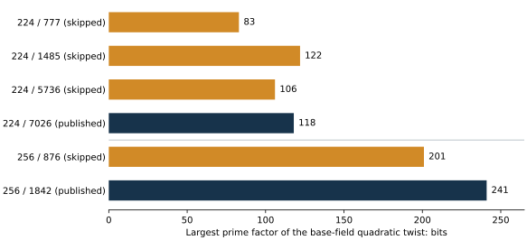

# Selected versus skipped curves: two open hypotheses

21 October 2026. Exploratory six-curve diagnostic and prospective research plan.

The questions are (H1) whether the published curve has an exploitable weakness,
and (H2) whether an exploitable weakness in earlier eligible curves explains
why they were skipped. Both hypotheses remain open. They are not mutually
exclusive, and an undocumented engineering rule is a separate explanation.

## Scope and identities

The [prior census](https://github.com/aburan28/crypto/blob/43e01b10e0e5ec6bb74a1cd24f283ef006da586d/research/nist_seed_provenance_20261016/README.md)
and its exact order rows identify these within-stream cohorts:

- P-224, `srand48(891607927)`: eligible indices 777, 1485, 5736 and 7026;
  index 7026 is the published curve.
- P-256, `srand48(871696354)`: eligible indices 876 and 1842;
  index 1842 is the published curve.

Here **eligible** means passing the recorded known checks: a nonsingular
seed-derived model, prime full order, permitted order bit length,
non-anomalous order and no embedding degree below 1024. It is not an
attestation of the historical decision process. **Skipped** means an earlier
eligible candidate that was not published. The many blocks failing the
known checks form a separate population; finding composite orders among
those blocks would not explain skipping these four eligible candidates.

[inputs.tsv](inputs.tsv) freezes the exact models, supplied or standardized
generators, subgroup orders and full ICV1 identities. [sources.json](sources.json)
pins the census, standard parameter and identity sources to a commit and Git
blob IDs. Standard generators are retained; their unexplained historical
selection is not replaced with the first-x rule used for the supplied curves.

## Observed arithmetic comparison

The native C++ diagnostic uses PARI's C library and OpenSSL, with no Python
research execution. Each of the six rows proves field and order primality,
reconstructs its stream seed and X9.62 relation, checks the generator and
unique multiple of its order in the Hasse interval, and checks that the
embedding degree is at least 1024. Complete factorizations below are checked
by prime proofs and exact products. No DLP recovery or timing comparison ran.

| Field / index | Role | Largest twist prime: bits | Twist work: log2, approximate | Largest prime in n-1: bits | Largest prime in n+1: bits | Frobenius-order conductor |
| --- | --- | ---: | ---: | ---: | ---: | ---: |
| 224 / 777 | skipped | 83 | 41.50 | 145 | 182 | 1 |
| 224 / 1485 | skipped | 122 | 60.54 | 74 | 102 | 1 |
| 224 / 5736 | skipped | 106 | 52.69 | 204 | 142 | 1 |
| 224 / 7026 | published | 118 | 58.55 | 196 | 177 | 3 |
| 256 / 876 | skipped | 201 | 100.15 | 242 | 232 | 1 |
| 256 / 1842 | published | 241 | 120.45 | 92 | 215 | 1 |

The twist work column is half the logarithm of the largest twist prime;
it estimates generic group operations, without a measured attack or a
protocol acceptance assumption. Main-curve square-root estimates remain
about 112 and 128 bits. Records are in [records/](records/).



### What these differences discriminate

**Twists.** P-224's published curve has a smaller largest twist prime than
skipped index 1485. Thus the rule "publish the eligible candidate with the
largest twist prime" does not explain the P-224 choice. P-256's published
curve has the larger twist prime of its pair. These facts do not exclude
a threshold combined with other filters, or a weakness in another mechanism.
Twist exposure requires a protocol or implementation accepting twist points;
it is a different hypothesis from solving the valid prime-order curve's DLP.

**Nearby integers.** The published P-256 order has a much smoother `n-1`
than skipped index 876 (largest factors 92 versus 242 bits). Conversely,
P-224 index 1485 has the smoothest `n-1` and `n+1` in its cohort. A Cheon-style
route needs the specified auxiliary powers or an applicable oracle. The
usual pair `(G, [x]G)` alone does not supply that input. Smoothness of `n-1`
is not a Pohlig-Hellman factorization of the prime group order `n`.

**P-224 structure.** The published curve's Frobenius discriminant has square
part 9, giving Frobenius-order conductor 3. All three skipped P-224 curves
have fundamental Frobenius discriminants and conductor 1. The published
curve's 3-division polynomial splits into four linear factors; each skipped
curve has factor degrees 1 and 3. The native records also retain the square
characters of the corresponding rational x-coordinate right-hand sides.
For the published curve, all four characters are -1: the full nonzero
3-torsion has coordinates over the quadratic extension, not the base field.
These are concrete inputs for a local 3-isogeny/endomorphism investigation.
Conductor 3 here refers to the order generated by Frobenius; it must not be
silently equated with the actual endomorphism-ring conductor. No executable
attack follows from the difference or from extension-field small torsion alone.

**Selection direction.** A single rule "the published curve is stronger on
every listed proxy" does not fit these observations. Neither does a single
rule "the published curve is weaker on every proxy." This six-curve,
unblinded comparison reports arithmetic differences, not a statistical
outlier finding, a historical motive or evidence of a trapdoor.

## Separate obligations for H1 and H2

| Track | Evidence that would advance it | Current status |
| --- | --- | --- |
| H1: published-curve ordinary-input DLP weakness | An explicit applicable reduction or algorithm, preserved prime subgroup, verified recovery and complete cost against matched rho | Not established; routine checks pass |
| H1: retained secret witness or hidden route | Specify witness, public reconstruction alternatives, map construction/evaluation, subgroup action, destination solver and recovery | No such witness or route supplied or constructed |
| H1: conditional protocol exposure | A protocol that actually supplies the twist or auxiliary-power input and an applicable attack with full cost | Preconditions untested |
| H2: weakness of earlier eligible curves | The same attack contract tested on every eligible candidate and the published control in each stream | Four earlier curves checked arithmetically; no ordinary-input attack established |
| H2: weakness explains rejection | A rule frozen before new results, explaining the skipped labels and predicting held-out choices beyond known filters | Unexplained; prior census's exploratory skip-filter tests found no separating rule |

A meaningful advantage may remain expensive: an intermediate exponent below
one half is within scope. Separate algorithm existence, executable transfer,
correctness, public discovery cost, retained-witness setup, per-target work,
reuse, memory and hardware. An efficient known-scalar multiplication or an
available small isogeny does not itself establish unknown-scalar recovery.
An unpublished family-wide method could apply to both selected and skipped
curves; absence of a selection anomaly would not exclude that scenario.

Recovering the drand48 seed stream narrows a generation model. It neither
proves nor disproves a curve-specific weakness, a hidden family-wide method
or a private construction witness. Predictable public parameter generation
does not imply predictable private keys or signing nonces.

## Next discriminating work

1. **Complete the matched trait baseline.** Port the corrected trait path to
   native code and apply the same 22-trait parameter grid to both published
   curves and the supplied four, preserving partial results and the original
   frozen outputs. This six-curve diagnostic is a subset, not that full run.
2. **Probe the P-224 structural difference.** Use the four rational
   3-division x roots, their y characters and the certified discriminant to
   determine the actual local endomorphism order. For a proposed route, retain
   kernels, explicit maps, their working fields and action on the original
   prime subgroup. Test a map/dual composition as a scalar control. A faster
   unknown-scalar route needs its own reduction and complete cost evidence.
3. **Make nearby-order leads conditional and executable.** For each factor
   choice in `n-1` or `n+1`, specify the exact auxiliary points and queries
   required. Establish whether the proposed protocol supplies them before
   interpreting any attack complexity. Validate applicable algorithms on
   public known-answer fixtures; keep full-size extrapolation separate.
4. **Broaden the selection test.** The pinned census has 21 eligible prime
   curves: 10 published and 11 skipped. These six cover two published and four
   skipped curves; profile the other 15 with the identical native feature
   definitions. Treat that census as exploratory because its outcomes and
   earlier feature searches are already public. Commit hypotheses, primary
   scores, control sampling and a multiple-testing policy before generating
   fresh matched streams for a prospective test. Condition on field, `a=-3`,
   root convention and every known acceptance rule; do not pool raw bit sizes.

The exact unknown selection rule and missing attack witnesses are tracked
in the [problem record](../../../problems/nist-candidate-selection-weakness-hypotheses.md).
These next steps are planned, not background jobs or completed experiments.

## Validation, limits and reproduction

```sh
PARI_PREFIX=/path/to/pari sh native/run.sh
sh native/controls.sh
```

The driver builds the C++ code, runs each of six fixed rows with a 90-second
process limit, and stops on failure. Inputs are the exact frozen table. No
factorization residual is accepted as prime: every factor is proved and its
product checked. Native seed checks include adjacent-run and adjacent-block
negative controls. Additional fixed seed, coefficient, point and order
corruptions must fail without producing a result. The initial native API
integration failure and its correction are preserved under `records/`.

The original four-curve Sage evidence is unchanged. This follow-up's native
computations are one-host checks using a shared PARI backend, not an
independent SEA implementation, independent-host replay or Lean proof.
Cargo and Conductor are unavailable in this runtime; attempted commands and
their actual outputs are retained. This limits workflow verification, not
the definition of either hypothesis.

The figure plots recorded integer bit lengths for six curves from two
streams, with no statistical interval inferred. Plotting and PDF code only
renders existing records. The original assessment graph and PDF, active
curve catalogue, scoreboard and leaderboard remain unchanged: this adds
a diagnostic supplement, with no solver timing or performance promotion.
