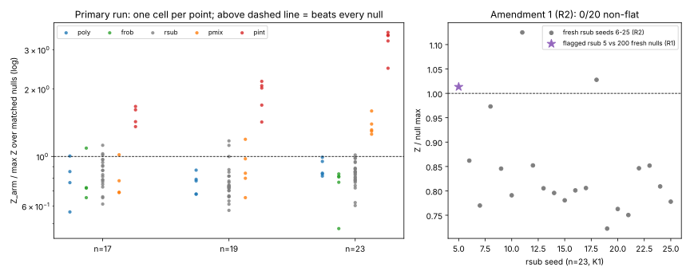

# EXP-DSPEC-001: is there a sieve for elliptic decomposition? (binary curves, m = 2)

**Date.** 2026-11-16. **Type.** Preregistered toy experiment (exact combinatorics, no timing).
**Standing.** `[pcc:unverified]`: single local host, no independent replay, no pcc claim filed.
**Outcome.** **FLAT at this scope.** The frozen rule fired once (SIGNAL, 1 of 95 cells). The
replication in Amendment 1 did not uphold it (R2: 0 of 20). Only an x-coordinate subspace factor
base with an exponentially rare spectrum could still carry sieve-type structure; none was found.



## Question

The user's thesis (2026-11-16) was that index-calculus relation finding needs a number-theoretic
oracle rather than an algebraic one. Over F_p^* that oracle is sieving, and sieving exists because
"divisible by ell" is periodic along candidates.

The elliptic analogue would be a factor base FB whose m = 2 decomposable set
D = {+-(k1 +- k2) : k1, k2 in FB} (discrete-log coordinates) has a biased indicator along some
arithmetic progression R0 + jG. All progressions together are the Fourier transform of 1_D on Z/N,
so the test statistic is Z = max_{a != 0} |hat 1_D(a)| / sd.

## Design (frozen: [PROTOCOL.md](PROTOCOL.md), sha256 in [PROTOCOL.sha256](PROTOCOL.sha256))

- **Fields.** F_{2^17}, F_{2^19}, F_{2^23}.
- **Curves.** 14 in total: the Koblitz curves K0 and K1 where #E = hN (K0 at n = 17 was skipped because its order is not of that form), plus 3 seeded random a = 1 curves per n.
  Subgroups have N from 65 419 to 4 196 903.
- **Arms.**
  - `poly`: the low-degree polynomial-basis subspace, dimension ceil(n/2). This is the Diem / Petit–Quisquater / Courtois factor base.
  - `frob`: a Frobenius-stable F_2-subspace ker((s+1)g(s)), dimension 9 at n = 17 and 12 at n = 23.
  - `rsub`: random subspaces, 5 seeds.
- **Controls.**
  - Null: 20 random index sets per arm, size-matched.
  - Positive `pint`: a DL interval.
  - Sensitivity `pmix`: 10% planted interval.
- **Exact check.** On the Koblitz curves the `frob` factor base is invariant under k -> lambda k: 0 violations in all 3 cells.
- **Tool.** Rust: [native/](native/) (`dspec`, `score`, `rep`), built from commit 92b7b35f + this branch. Python ([plot.py](plot.py)) only plots the recorded TSV.
- **Host.** Local container, 4 vCPU, 15 GiB, about 10 min in total. This deviates from the default route: isolab-eks was not reachable because the container has no AWS identity. The values are exact counts, so the host does not affect them.

## Results (measured; [runs/SCORE.tsv](runs/SCORE.tsv), raw `runs/*.jsonl`, hashes in [runs/SHA256SUMS](runs/SHA256SUMS))

| arm | cells | non-flat (frozen rule) | Z / null max, range | yield |D|/null |
|---|---|---|---|---|
| `poly` | 14 | 0 | 0.56 – 1.00 | 0.989 – 1.013 |
| `frob` | 9 | 0 | 0.48 – 1.09 | 0.966 – 1.008 |
| `rsub` | 70 | 1 (n=23 K1 seed 5) | 0.57 – 1.17 | 0.984 – 1.014 |
| `pint` (positive) | 14 | 14 | 1.36 – 3.58 | — |
| `pmix` (10% planted) | 14 | 3 (all at n = 23) | 0.65 – 1.60 | — |

- **Detector.** Valid: `pint` is non-flat on all 14 curves. Its margin grows with n (1.36–1.67x at n = 17, 2.48–3.58x at n = 23).
- **Sensitivity.** A 10% planted structure is detected only at n = 23, on 3 of 5 curves. The instrument therefore sees biases of roughly Z ≈ 1.5x the null median at n = 23 and nothing weaker. This bounds what "flat" means here.
- **Yield.** Relation counts for every subspace factor base are within 3.4% of a random factor base of the same size: the subspace adds no extra decompositions.
- **`frob` arm.** On the Koblitz curves this arm sits at or below its nulls (0.48–0.84). That is consistent with the lambda symmetry: |hat f| is constant on lambda-orbits, so there are fewer independent coefficients to take a maximum over.

## Amendment 1 (frozen before replication data: [AMENDMENT-1.md](AMENDMENT-1.md); scores in [runs/AMENDMENT1_SCORE.txt](runs/AMENDMENT1_SCORE.txt))

- **R1.** The flagged factor base against 200 fresh nulls: Z = 23.96, null 99th percentile 21.23, maximum 23.64, empirical p = 0.005. The protocol counts this as replicated. However, the cell was *selected* as the extreme of 95, so p = 0.005 is a winner's-curse figure: Bonferroni over 95 cells gives about 0.48.
- **R3.** Base rate of the frozen rule on null-versus-null comparisons: 10 / 1860 = 0.54%. One hit in 95 cells (expected 0.51) is in line with that rate.
- **R2.** 20 fresh random subspaces on the same curve: **0 / 20 non-flat**, binomial p = 1.0. Not replicated.
- **Verdict.** The amendment requires both R1 and R2, so the SIGNAL is not upheld. Reading: **FLAT**.
- **n = 29.** Not attempted. It needs FFTs over more than 2^28 points (over 16 GiB) and has no EKS route here.

## Reading at this scope

- For m = 2 on binary curves with n ≤ 23, no x-coordinate factor base tested shows progression structure in its decomposable set. That covers the low-degree polynomial subspace, Frobenius-stable subspaces and 25 random subspaces.
- No arithmetic progression of targets is easier to decompose than a random target, at the instrument's sensitivity.
- A sieve-type, number-theoretic decomposition oracle therefore does not arise from these factor bases.
- This agrees with the earlier prime-field spectrum result (IDEA-20261109-032af4, interval / mu_B / Legendre bases, flat, `[pcc:unverified]`).

**Not covered:**
- m ≥ 3;
- n ≥ 29;
- non-linear families of targets: Frobenius orbits are multiplicative and are covered only through the lambda-invariance check;
- factor bases not defined by x-coordinates;
- prime fields in this run.

A large Fourier coefficient on a set defined by x-coordinates would amount to a linear DL leak on that set. If such leaks exist, they are rarer than this sampling can see.

## Sources checked

- `research-kb` was not available in this container (no executable). The repos were searched with grep instead.
- Prior closures this builds on:
  - `crypto:research/non_semaev_decomposition_20261113/README.md` (Lemma T);
  - `crypto:research/iwasawa_leads_20261113/REPORT.md` I-12 (Kolyvagin classes);
  - `crypto:research/lead_sweep_20261110/LEAD-EXO-elliptic-code-list-decoding/RESULT.md`;
  - `crypto:research/prime_leads_chase_20261113/L2-lattice/REPORT.md`;
  - `crypto:research/prime_ic_lead_heatmap_20261114/TABLES.md` (IDEA-032af4, IDEA-d881c1, IDEA-dd7eed, IDEA-879c4f).
- Literature: Galbraith–Gaudry, "Recent progress on the ECDLP", §2; Courtois, "On splitting a point with summation polynomials in binary elliptic curves", §5. Both were read from the user's photographs.

## Reproduce

```
cd native && cargo build --release && cd ..
for n in 17 19 23; do native/target/release/dspec $n runs/n$n.jsonl; done
native/target/release/score runs/n17.jsonl runs/n19.jsonl runs/n23.jsonl > runs/SCORE.tsv
DSPEC_ONLY_CURVE=K1 DSPEC_RSUB_FROM=5 DSPEC_RSUB_TO=5 DSPEC_NULLS=200 DSPEC_SALT=63717 native/target/release/dspec 23 runs/rep_R1.jsonl
DSPEC_ONLY_CURVE=K1 DSPEC_RSUB_FROM=6 DSPEC_RSUB_TO=25 DSPEC_NULLS=20 DSPEC_SALT=63717 native/target/release/dspec 23 runs/rep_R2.jsonl
native/target/release/rep runs/rep_R1.jsonl runs/rep_R2.jsonl runs/n17.jsonl runs/n19.jsonl runs/n23.jsonl
```

Note: the `DSPEC_*` options were added after the primary run, for Amendment 1. With the variables
unset, the null seeds are identical to those of the primary run.
