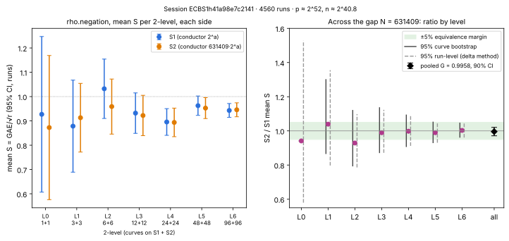

# Run report: run-20261022T0844Z (deep 2-volcano, prime conductor gap)

Descriptive record of the measurement run. The results report is
[`../../README.md`](../../README.md); its readings are not repeated as
claims here.

## What ran

| item | value |
|:--|:--|
| protocol | [`PROTOCOL.md`](../../PROTOCOL.md), frozen in commit `f7b4d94` before any measurement; erratum (190, not 191, curves per side) written as the sessions started and committed at 08:53 UTC while they ran, before any result was read |
| build | `run_pipeline.sh build run 52 6 16384 20261022 2 6 4 2` (construct, two `volcano-rho --ecbench` exports, certify, spec) |
| run | `run_pipeline.sh run run`: three `ecbench run --cpus none --allow-busy` sessions, concurrently, one lock each |
| start / end (UTC) | sessions started 08:45:19 (BSGS), 08:45:43 (A/A), 08:47:14 (main); ended 08:51:20, 08:57:11, 09:20:39 (2026-10-22) |
| host | Intel Xeon Processor @ 2.10 GHz, 4 vCPU shared cloud VM, Linux; isolation L0; no PMU |
| ecbench binary | sha256 `a59c4014ff52100ed10c06b5d27a0572f9474d24c137fd18b24798237024f81f` |
| sessions' git | `f7b4d94`, `git_dirty: true` (untracked run directory) |

## Sessions

| session | arm (method) | workloads | runs planned / recorded / verified | failures |
|:--|:--|:--|:--|:--|
| main | `rho-neg` (`rho.negation`) | 760 curve models × 6 targets | 4560 / 4560 / 4560 | 0 |
| A/A | `rho-neg-aa` (`rho.negation`, seed ⊕ 0xAA0000000) | 380 × 4 | 1520 / 1520 / 1520 | 0 |
| BSGS | `bsgs-neg` (`bsgs.negation`) | 380 × 2 | 760 / 760 / 760 | 0 |

Session and spec ids:

- main: session `ECBS1h41a98e7c2141`, spec `ECS1h7d9934575ec8` (`run/specs/spec.json`)
- A/A: session `ECBS1h4034bfcbccc4`, spec `ECS1h0d34427ad5a6` (`spec-aa.json`)
- BSGS: session `ECBS1h658495a369ec`, spec `ECS1ha55be72ab53f` (`spec-bsgs.json`)

- **Seeds.** Measurement seed 20261022. Target law `planted_shared`
  (`uniform_scalar_sha256_shared_v1`), target seed 20261022.
- **Settings.** Warmup 0, rounds 1, order shuffle, timeout 600 s; no run
  timed out.

## Audit

`ecbench verify --replay 24 --exit-code` on each session:

| session | result |
|:--|:--|
| spec | `audit OK: 4560 records, 4560 verified, 24 replays reproduced, 0 problems` |
| spec-aa | `audit OK: 1520 records, 1520 verified, 24 replays reproduced, 0 problems` |
| spec-bsgs | `audit OK: 760 records, 760 verified, 24 replays reproduced, 0 problems` |

The receipts are `../../run/sessions/*.audit.json`.

## Recorded values (measured; computed by `volcano-stats`, `../../analysis.json`)

| quantity | S1 | S2 |
|:--|--:|--:|
| `rho-neg` runs | 2280 | 2280 |
| `rho-neg` mean S | 0.94288 ± 0.0203 | 0.93889 ± 0.0208 |
| per-curve mean solve wall time, min–max (ms, both sides) | 224.3–571.3 | (pooled) |
| per-curve mean solve wall time, mean (ms, both sides) | 394.2 | (pooled) |

The intervals are 95% over runs.

## Raw records

- `../../run/sessions/{spec,spec-aa,spec-bsgs}/records.jsonl.gz`
  (uncompressed bytes pinned by `../../run/sessions/MANIFEST.sha256`)
- `session.json`, `host.json`, `spec.json` and `plan.json.gz` in each
  session directory
- the sidecars `../../run/export-s{1,2}/curves.jsonl`
- the class and isogeny `../../run/pair.json`
- the side certificates `../../run/certificates.json`
