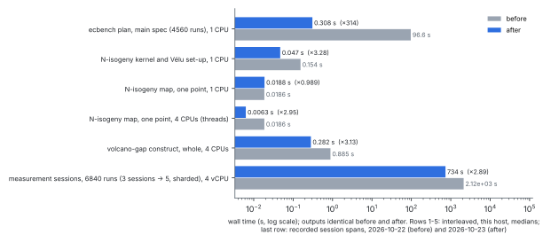
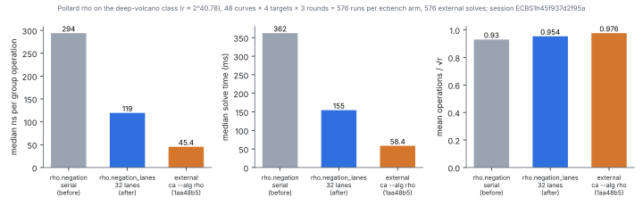

# Speed-ups to the deep-volcano prime-gap study (2026-10-23)

The request was "make it faster", for four parts:

1. the cross-gap N-isogeny;
2. the measurement pipeline;
3. the rho solve;
4. CI turnaround.

Each change below keeps the computed output identical, or, for rho, keeps the walk law. Each is measured before and after on this host. The study's result ([`../README.md`](../README.md)) does not change; nothing here re-measures or re-reads it.

All numbers below are **measured**, except where marked *derived*. The source
of each is `summary.json`, written by `summarize.sh` (jq) from the raw files
listed under "Raw data".



## Summary

| stage | before | after | ratio | output |
|:--|--:|--:|--:|:--|
| `ecbench plan`, main spec (4560 runs), 1 CPU | 96.6 s | 0.308 s | 314× | plan text byte-identical |
| N-isogeny kernel and Vélu set-up, 1 CPU | 0.154 s | 0.047 s | 3.28× | isogeny identical (28 runs) |
| N-isogeny map, one point, 1 CPU | 0.0186 s | 0.0188 s | 0.99× (none) | identical |
| N-isogeny map, one point, 4 CPUs | 0.0186 s | 0.0063 s | 2.95× (threads) | identical |
| `volcano-gap construct`, whole, 4 CPUs | 0.885 s | 0.282 s | 3.13× | identical |
| measurement sessions, 6840 runs, 4 vCPU | 2120 s | 734 s | 2.89× | all 6840 records identical |
| rho solve, median per solve, same session | 362 ms | 155 ms | wall ratio 0.419 [0.417, 0.421] | same walk law; counted cost +2.5% [2.1, 2.9]% |

The first five rows come from `timing.sh`. Its runs are interleaved before/after and pinned (`taskset`). They report the median of 3 rounds (plan) or 7 rounds (construct). The before binaries are `volcano-gap` built at `54178db75` and `ecbench` built at this commit with `src/cryptanalysis/ecbench/workload.rs` reverted to `bec9df9e8`'s (sha256s in each row).

The sessions row is the recorded span from the first session start to the last session end:
- before: `../run/sessions`, 2026-10-22, three sessions;
- after: `rerun-sharded/sessions`, 2026-10-23, five sessions.

Both ran on the same container class, but on different days and as different session sets, so that row is descriptive.

The rho row is from one paired ecbench session (`ECBS1h45f937d2f95a`), with both arms interleaved. Its interval is `ecbench compare`'s.

## 1. The N-isogeny (`volcano-gap`, commit `bec9df9e8`)

- **Kernel.** The kernel abscissae `x(iK)`, `i = 1 … (N−1)/2`, are accumulated in Jacobian coordinates by mixed additions, with one batch inversion at the end. Before, they took one affine addition and inversion each. The counted field multiplications of the set-up fall from 43,882,856 to 8,524,264 (`run/pair.json` against `rerun-sharded/pair.json`), and the dual's from 75,454,536 to 36,942,784.
- **Map.** The map `φ(P)` runs in Montgomery form, split into one chunk per thread, with one batch inversion per chunk. On one CPU it is no faster (0.99×). The 2.95× on four CPUs comes from the threads, not from less work. The study needs only two map evaluations per instance, so this matters little.
- **Test.** `fast_isogeny_matches_reference` checks both against the affine code they replaced (kept under `cfg(test)`), on the study's own class.

## 2. The measurement pipeline (commit `0bf3db1a3`)

- **Planning.** `ecbench plan` re-parsed the 4.7 MB embedded curve registry (`docs/curves/registry.json`) for every workload curve's slug lookup. The registry is now parsed once into a `LazyLock`, with a slug index: the first entry per slug wins, as the linear scan found it. The plan output is byte-identical (one sha256 over all six timed runs). Planning was most of the old 2 m 40 s `run_pipeline.sh build`, and the build now takes about 3 s.
- **Sharding.** `volcano-gap spec --shards K` writes `spec-shard{k}.json` (every K-th curve), and `run_pipeline.sh` runs the shards alongside the A/A and BSGS sessions. ecbench's algorithm seed is `derive_u64(measurement seed, workload, round)`, which does not depend on execution order. So the sharded run must record exactly what the original did.
- **Sharded re-run.** All 6840 records are identical by arm, workload, target, round, warmup, counted cost, recovered value and every counter: `rerun-sharded/compare.sh`, digests in `compare.sha256`. Every session passes `ecbench verify --replay 8` (`rerun-sharded/sessions/*.audit.json`).

## 3. The rho solve: `rho.negation_lanes` (commit `d81da47d5`)



**Where the time went.** `rho.negation` spent most of each step in one modular inversion of the affine addition. A microbenchmark of `invmod` on this host (not committed; descriptive) took about 200 ns, of the measured 294 ns per group operation.

**What changed.** `rho_walk_lanes` advances 32 tuned walks in lockstep. It hands each round's additions to the prime curve's native lane adder (`PrimeCurve::native_lane_walk_adder`: Montgomery form, one batch inversion per round).

**What stays the same.** Each walk follows `TunedWalker::walk`'s rules from the same start:
- the same set-up and seed draws, the same jumps;
- the same Wiener–Zuccherato look-ahead and cycle escape by doubling;
- the same distinguished points and cap;
- starts are handed out in order as lanes finish.

What changes is the order in which distinguished points reach the table, so a seed's collision, and its count, differ. At one lane it reproduces `rho_walk_with` exactly: the same steps, collision and counters on 24 seeds (`lane_rho_recovers_replays_and_batches_its_inversions`).

| arm | runs | verified | median ns / GAE | median solve | mean S |
|:--|--:|--:|--:|--:|--:|
| `rho.negation` (serial) | 576 | 576 | 293.9 | 362.1 ms | 0.9303 |
| `rho.negation_lanes` (32 lanes) | 576 | 576 | 119.4 | 154.6 ms | 0.9538 |

- **Setting.** 48 curve models (every 16th of the main spec: both sides, every level), 4 targets each, 3 rounds, warmup 1. Isolation L1/L2, `--cpus auto`.
- **Counted cost.** `ecbench compare` gives lanes/serial = **1.0252 [1.0213, 1.0295]** over 576 pairs. The lanes cost 2.5% more operations, mostly the walks still in flight when the collision is found (32 walks of about 2^10 steps each).
- **Wall time.** The median wall ratio is **0.4193 [0.4173, 0.4214]** over all 576 pairs. Of those, 306 pairs ran at L2 on both sides; their median is 0.4179 (validator). The lanes run was faster in all 576 pairs.
- **Audit.** The session passes `ecbench verify --replay 24` (`rho-lanes/session.audit.json`). The §5a band is in `rho-lanes/band.json`. At 0, 0.1 and 1 GAE per unpriced canonicalisation the mean S is 0.9303 / 1.0233 / 1.8604 (serial) and 0.9538 / 1.0492 / 1.9073 (lanes). The band ranks serial as cheaper in counted cost on 48/48 curves at every weight: the lanes arm buys wall time with 2.5% more operations.

### Against the fastest external rho at hand (AGENTS.md §15)

**What ran.** `ca solve --alg rho --threads 1`, from `aburan28/cryptanalysis` 1aa48b5 (`ca` 0.1.0), pinned to CPU 2 and timed by its own internal timer. It ran on the same 192 workload targets (`external_ca.inputs.tsv`, taken from the session's records), with 3 seeds each. All 576 solves recovered the planted scalar.

| implementation | median ns / op | median solve | mean ops / √r |
|:--|--:|--:|--:|
| ecbench `rho.negation_lanes` | 119.4 | 154.6 ms | 0.954 (GAE) |
| `ca solve --alg rho` | 45.4 | 58.4 ms | 0.976 (its own count) |

- **The gap.** *Derived* from these medians: `rho.negation_lanes` is still about **2.6×** slower than `ca` per solve (154.6/58.4) and per operation (119.4/45.4). That is the distance remaining.
- **The operation counts.** Their ops/√r are close, so the gap is per-operation cost, not walk length. `ca` counts its own operations. We have not established that its count matches ecbench's GAE line for line, so the per-operation ratio is an estimate. The per-solve ratio does not depend on it.
- **Where the rest of the time likely goes.** In ecbench, each step still converts points between canonical and Montgomery form, hashes the point twice, and runs the cycle window on a `VecDeque`. These are the obvious next targets.

## 4. CI turnaround (commit `6d7390d78`)

`tools/lean/proof-gate.sh` passes the auditor's flags after `--`, and `AuditAxioms.lean` drops a `--` itself. Lean 4.19 needs the separator and 4.34 passes it through to the script. The `research/sea_point_count_20261016/lean` job, red on `main` before this change, is the check: its result on this PR's CI is the evidence, and the self-test passed locally on 4.34.1.

## Caveats (from the independent validation)

- **Sessions.** The 2.89× session span comes from running the main spec as three parallel shards, plus removing the old planning delay. The total solve CPU time across the sessions rose, from 2738 s to 2988 s, because the shards contend for 4 vCPUs. It is a turnaround gain, not less work.
- **`construct` on one CPU.** On 1 CPU the whole `volcano-gap construct` is only about 1.25× faster. The 3.13× in the summary is on 4 CPUs.
- **Per-operation gap to `ca`.** `ca` counts one operation per addition or doubling, like GAE, but about 7% of its count (validator's estimate from its source) are scalar multiplications priced at double-and-add counts while computed with fixed-base tables. Its walk also differs (256 walks, 512 multipliers, 7 distinguished-point bits). So the 2.63× per operation is approximate; the 2.65× per solve is not affected.
- **Provenance.** The `ca` binary's sha256 was recorded after the run (`rho-lanes/external_ca.binary.sha256`; the binary was not rebuilt in between). The run report's "alone on the host" is not established by the evidence. The ecbench binaries of the two sessions were built from dirty trees and not kept; the validator's replays tie their counted results to the committed code (`d81da47d5`, and the merged `b67532210`), not their wall times.
- **Batching alone.** The 2.46× per operation mixes Montgomery arithmetic with batch inversion. No arm isolates the batching.
- **Missing test.** No test compares a multi-lane walk with the serial walks from the same starts, walk by walk. The one-lane equality and the per-record invariant (steps + look-ahead = 32 × rounds on 768/768 lanes records) are the checks that exist.

## What is not claimed

- No change to the study's result or its counted measurements. The rho method the study used (`rho.negation`) is unchanged. The re-run sessions, whose records equal the committed ones, replay exactly with the new binary.
- No improvement in counted cost (GAE), and no index-calculus improvement or leaderboard progress: this speeds up the rho comparator, not the IC baseline. An IC distance measured against ecbench's rho in wall-clock time would now flatter IC, because `ca` is 2.6× faster than `rho.negation_lanes` on this host.
- `rho.negation_lanes` is not a new reference rho for the IC leaderboard. It costs 2.5% more counted operations than `rho.negation` and runs 2.4× faster in wall time on this host. An IC row priced in GAE against matched rho is unaffected either way.
- The wall times are from one shared 4-vCPU cloud VM (Intel Xeon @ 2.10 GHz). Expect ±5–10% residual noise (AGENTS.md §10); no A/A run was made for the timing script.

## Raw data

- `rho-lanes/`:
  - `spec.json`, `spec.plan.txt`;
  - `session/` (`records.jsonl.gz`, `plan.json.gz`, `session.json`, `host.json`), `session.log`, `session.audit.json`;
  - `session/comparisons/rho-neg__rho-neg-lanes.json`, `band.json`;
  - `external_ca.sh`, `external_ca.inputs.tsv`, `external_ca.jsonl`.
- `rerun-sharded/`:
  - `specs/` (the shards, A/A and BSGS), `sessions/` (records gzipped), `*.audit.json`;
  - `compare.sh`, `compare.sha256`, `pair.json`;
  - the build logs.
- `timing.sh`, `timing-plan.jsonl`, `timing-construct.jsonl`.
- `MANIFEST.sha256` pins the uncompressed records and plans. `summarize.sh` → `summary.json`, and `plot.py` → `figures/`.
- Validation: [`validation/`](validation/).

## Reproduce

```
cargo build --release --bin ecbench --bin volcano-gap
D=research/deep_volcano_prime_gap_20261022
$D/run_pipeline.sh build $D/speedups-20261023/rerun-sharded 52 6 16384 20261022 2 6 4 2 3
$D/run_pipeline.sh run   $D/speedups-20261023/rerun-sharded
$D/speedups-20261023/rerun-sharded/compare.sh
target/release/ecbench run --spec $D/speedups-20261023/rho-lanes/spec.json --out <dir> --cpus auto --allow-busy
target/release/ecbench compare --dir <dir> --a rho-neg --b rho-neg-lanes
$D/speedups-20261023/rho-lanes/external_ca.sh      # needs aburan28/cryptanalysis built at 1aa48b5
$D/speedups-20261023/timing.sh OLD_ECBENCH NEW_ECBENCH OLD_VOLCANO_GAP NEW_VOLCANO_GAP 3
```
