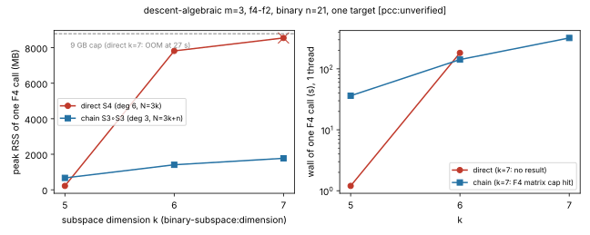

# `descent-algebraic:m=3` memory blow-up on binary n21: diagnosis `[pcc:unverified]`

Follow-up to `research/tableb_binary_descent_pilot_20261115/README.md` (commit `3a9e85e644`), whose m = 3 arm produced no
completed run (watchdog at `binary-subspace:dimension=5,6`; OOM at 13.9 GB at dimension 7, 8). Every number here is an
unverified assertion: one target, one host shared with other sessions, no `bench.record/v1` (profiling, not a benchmark),
no replay, no validator. No leaderboard or benchmark row. research-kb was not available in this session; no novelty claim.

Notation: `k` = subspace dimension (`binary-subspace:dimension=k`, the pilot's "D"; 2^k base points), `n` = 21,
`N` = Boolean unknowns. The pilot's "D" is the base dimension, not an F4 degree cap; `f4-f2` has no degree cap.

## Where the code is

- Oracle: `DescentAlgebraicOracle` in `src/cryptanalysis/ic_framework/plugins.rs` (from `ecbench` `methods.rs` and
  `ic_run.rs`). Per target it calls `pq_descent_symbolic::descend(gf, b, x_R, V, 3)`: the resultant form
  `S_4 = Res_X(S_3(x1, x2, X), S_3(x3, x_R, X))` with `x_i = Σ v_ij e_j`, expanded symbolically in
  `F_{2^n}[v]/(v² − v)` and split into `n` Boolean equations in `N = 3k` unknowns. Nothing is rebuilt per trial beyond
  that one system (descent takes 2-14 ms; field equations are built into the ring, so no reduction is missing).
- Solver: `F4F2` (`ic_framework/solvers.rs`) → `pq_f4_f2::groebner_basis_f4`, the full reduced Boolean Gröbner basis,
  normal strategy (all lowest-degree pairs per step), bit-packed dense rows per step, guard
  `MAX_MATRIX_WORDS = 2^27` words (1 GiB) per matrix.

## Profile (one target x_R = 232919, curve `icv1-f2m21-t2591-de54d72e`, V = <1, z, …, z^(k-1)> = the default `prefix` basis, `RAYON_NUM_THREADS=1`, `ulimit -v 9000000`)

Driver: [`profile_example.rs`](profile_example.rs) (temporary cargo example, removed after use; it calls the library's
`descend` and `groebner_basis_f4` unchanged, and samples `/proc/self/status` every 2 s). Raw output: [`raw/`](raw/).

| form | k | N | eqs | system degree | terms (sum) | F4 degree reached | max matrix (rows × cols) | dense peak | peak RSS | wall | word XORs | outcome |
|:--|--:|--:|--:|--:|--:|--:|:--|--:|--:|--:|--:|:--|
| direct S_4 | 5 | 15 | 21 | 6 | 35,268 | 7 | 6,039 × 10,546 | 7 MB | 0.22 GB | 1.2 s | 7.8e8 | unsat (GB = 1) |
| direct S_4 | 6 | 18 | 21 | 6 | 99,076 | 7 | 66,381 × 62,959 | 0.52 GB | **7.8 GB** | 183 s | 4.3e11 | unsat |
| direct S_4 | 7 | 21 | 21 | 6 | 235,931 | 7 | (step 5 never built) | – | **> 8.5 GB, OOM at 27 s** | – | – | killed (allocation of a 30,170-term row failed) |
| chain S_3∘S_3 | 5 | 36 | 42 | 3 | 2,677 | 4 | 68,943 × 65,650 | 0.57 GB | 0.67 GB | 36 s | 2.0e10 | unsat |
| chain S_3∘S_3 | 6 | 39 | 42 | 3 | 3,352 | 4 | 87,905 × 90,572 | 0.97 GB | 1.4 GB | 142 s | 5.9e10 | unsat |
| chain S_3∘S_3 | 7 | 42 | 42 | 3 | 4,107 | 4 | 60,692 × 121,355 (next one larger) | 0.90 GB | **1.8 GB** | 322 s | 6.2e10 (partial) | **oversize** (next matrix > 1 GiB): `BudgetExceeded`, no answer |

Direct k = 7 with a 5 s budget stopped after step 4 (degree 7, 3,658 new elements, 44,443 pairs still queued, RSS 1.6 GB);
with 12 s and 22 s budgets it was killed like the unbudgeted run, because the budget is only checked inside the
elimination and step 5 never reaches it.

### Where the memory goes (direct form, k = 7)

1. The direct S_4 descent has Boolean degree 6 (S_4 is quartic in each abscissa and `x³ = x·x²` is a Boolean
   quadratic; per summand ≤ 2, three summands), as the K2 study found. Its solving degree under F4 is **7**
   (measured at k = 5, 6; `degree_reached = solving_degree = 7`).
2. The degree-7 Macaulay space has M(3k, ≤ 7) columns: 16,384 / 63,004 / **198,440** / 536,155 at k = 5 / 6 / 7 / 8
   (measured at k = 6: 62,959 columns, 66,381 rows, so rows ≈ columns). At k = 7 the degree-7 matrix is therefore
   about 2·10^5 × 2·10^5 bits ≈ **4.9 GB dense** — 4.6 × F4's own 1 GiB guard; at k = 8 (n24) ≈ 36 GB.
3. The process dies before that guard is consulted: F4's symbolic preprocessing materialises every S-pair half and
   reducer as a sparse term list (`Vec<F2BoolMono>`, 8 bytes a term) and only then compares `rows × words` to
   `MAX_MATRIX_WORDS`. Step 5 at k = 7 selects the ~4.4·10^4 degree-7 pairs (≈ 9·10^4 rows of 1-3·10^4 terms each,
   ≈ 10-20 GB of sparse rows), growing RSS at ~0.37 GB/s until the 9 GB cap (the pilot's unconstrained run: 13.9 GB).
   Set-up is negligible; it is all growth inside one F4 call (call 1 of the first target).

### (a) inherent or (b) implementation?

**Mostly (a).** The binding quantity is the degree-7 Macaulay matrix of a degree-6 system in 3k unknowns, ≈ 5 GB
dense at k = 7 and ≈ 36 GB at k = 8 — and 3k ≥ n (k ≥ 7 at n21, k ≥ 8 at n24) is exactly where decompositions start to
exist. No storage change brings a single call below minutes: at k = 6, where it fits, one call already takes 183 s
and 4.3·10^11 word XORs.

**(b) contributes the failure mode, not the cost:** materialising sparse rows before the matrix-size check turns what
should be a clean `oversize` → `BudgetExceeded` into an OOM kill, and the wall budget is not checked during symbolic
preprocessing. A pre-materialisation estimate (selected pairs × (cols/64) words before building the rows) in
`pq_f4_f2.rs` would fix that — but it would only turn the kill into "no answer", outside the oracle files this task
was scoped to, so it is not done here.

**The chain presentation (K2's construction) fixes memory but not cost.** S_3(x1, x2, U) = 0, S_3(U, x3, x_R) = 0 with
U free in n Boolean unknowns (N = 3k + n, 2n equations of degree 3) solves at degree **4** under F4 on every size
measured (confirms K2 at n = 21), peak RSS 1.8 GB at k = 7 versus > 8.5 GB. But the degree-4 space is M(3k + n, ≤ 4)
= 124,314 columns at k = 7 (213,053 at n24, k = 8), the F4 matrix exceeds the 1 GiB guard after 322 s, and per call it is
not cheaper than the direct form where both finish (142 s vs 183 s at k = 6; 36 s vs 1.2 s at k = 5).

## Why no fix was implemented, and why no sizing pilot was run

The task's fix condition is a contained change that makes the arm runnable. `form=chain` is contained (about 30 lines
in `pq_descent_symbolic` plus a parameter) and bounds memory, but the measured per-call cost makes a pilot run
impossible on this host:

- Relations per target ≈ the base's columns (2^k / 2 ≈ 64 at k = 7); expected solutions per call ≈ 2^(3k−n)/3!
  (0.17 at k = 7, 0.021 at k = 6), times the chance that the three abscissae lift to base points (≈ 1/8). So ≈ 50
  calls per relation at k = 7, ≈ 400 at k = 6.
- At ≥ 322 s per call (k = 7 chain, and that call did not even finish) that is ≥ 3,000 calls ≈ **≥ 270 CPU-hours per
  target** at n21; at k = 6 (32 columns, 183 s/call) ≈ 12,000 calls ≈ 600 CPU-hours. Rho-neg at n21 finishes in ≈ 1.4·√r ≈ 1.4·10^3
  group additions (milliseconds; pilot table S = 1.38).
- Pricing: the `f4-f2` arm reports its solver work as unpriced native `bitop/v1` primitives (word XORs and the other
  tallied word ops; `SolverCost.op_unit = "word XORs (elimination only)"`, complete tally in `extra`). In `ecbench band`
  at w = 0 the solver is free and S would count only the lift additions — **not comparable** to rho or ksum5 at w = 0.
  At w = 0.1 GAE per word op, **one** k = 6 call (4.3·10^11 word XORs) is ≈ 4·10^10 GAE ≈ 3·10^7 × the whole
  rho-neg run (≈ 1.4·10^3 GAE); one partial k = 7 chain call (6.2·10^10) ≈ 6·10^9 GAE. Order holds at w = 0.1 and 1;
  at w = 0 the band cannot rank the arms (the solver term is unpriced). All derived, `[pcc:unverified]`.

A sizing pilot (success rate, S, peak RSS at n21/n24 next to ksum5 and rho-neg) would therefore record zero completed
targets for the descent arm in any budget this host has, which the tableb pilot already recorded. Per the task's stop
rule ("inherent and no contained fix"), no `src/` change was made and no session was run.

## Recommendation

**No frozen study** of `descent-algebraic:m=3` (direct or chain) on binary Table B sizes (n21, n24). The blow-up is the
formulation's degree-7 (direct) / degree-4-in-3k+n (chain) Macaulay matrix at the only sizes where decompositions
exist (3k ≥ n); at w = 0.1 one relation (≈ 50 calls of ≥ 6·10^10 word ops) costs ≥ 10^8 × a whole rho-neg run, before the memory question arises.

What would have to change first (engineering, not a hypothesis):

1. `pq_f4_f2`: estimate matrix words before materialising the step's rows (and check the deadline in symbolic
   preprocessing), so an oversize step returns `BudgetExceeded` instead of an OOM kill. Worth doing for every
   `f4-f2` user; small and separate from this lane.
2. Only if someone wants the m = 3 algebraic arm at all: `form=chain` (K2's construction) plus a degree-truncated
   solver (degree-4 closure / linearisation, which K2 shows suffices), sparse or structured (block-by-summand)
   elimination. Even then the per-call work must fall ~10^4× before one n21 target fits in an hour; nothing measured
   here suggests that is reachable. The decisive cells for the K2 flatness question (N = 42, 48 chain at degree 4) are
   a separate, isolab-eks-scale measurement with its own protocol.

ksum5 stays the binary generic comparator (pilot: 5.3× and 6.3× of rho-neg at n21, n24, w = 0; unverified).

## Files

- [`profile_example.rs`](profile_example.rs) — the profiling driver (not built in-tree).
- [`raw/`](raw/) — stdout (system shape, `F4Stats`) and RSS traces: `k5`, `k6`, `k7` (direct; `k7b5/12/22` with 5/12/22 s
  budgets), `c5`, `c6`, `c7` (chain).
- [`make_figure.py`](make_figure.py), [`figures/`](figures/) (`f4_memory_wall.{svg,png,pdf}`).

## Sources checked

- research-kb: unavailable in this session (no MCP tool); KB pass owed before any novelty claim.
- `research/tableb_binary_descent_pilot_20261115/README.md`, `research/k2_flatness_20261115/README.md` and `k2close.rs`
  (chain construction), `research/fes_then_batched_20261112/RESULTS.md` (m = 2 reference, via the pilot).
- `src/cryptanalysis/pq_descent_symbolic.rs` (`descend`, `s4_symbolic_poly`), `src/cryptanalysis/ic_framework/plugins.rs`
  (`DescentAlgebraicOracle`), `src/cryptanalysis/ic_framework/solvers.rs` (`F4F2`), `src/cryptanalysis/pq_f4_f2.rs`
  (`groebner_basis_f4`, `MAX_MATRIX_WORDS`, symbolic preprocessing), `src/cryptanalysis/ecbench/claim.rs`.
