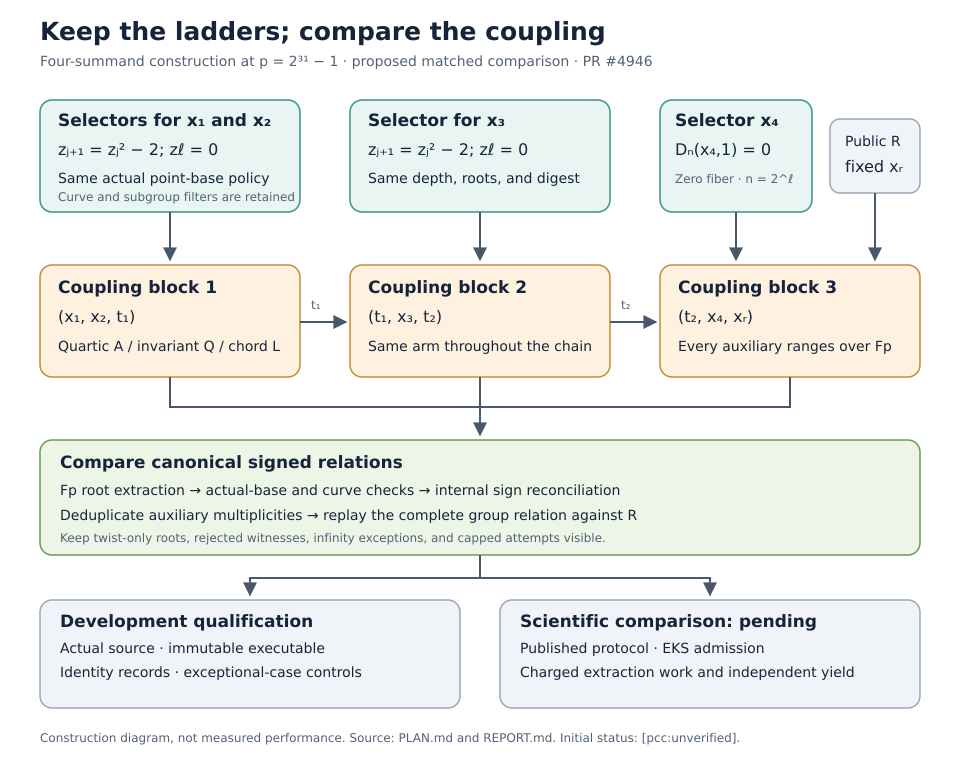

# Dickson ladders with quadratic S3 coupling

**Development qualification checkpoint — 2026-11-22**

[Implementation PR #4946](https://github.com/isogeny-labs/crypto/pull/4946) · [Work plan](PLAN.md) · [Editable diagram](diagram.svg)

## Result at this checkpoint

The Rust example now constructs quartic S3, invariant-Q and line-L systems with the same production Dickson selectors. Its frozen source-bound qualifier reports five constructor/extraction tests and seven identity-record tests passing. It also completes one tiny F31 extraction fixture in all three arms and exports an m=4, depth-three M31 system. M31 work here consists of root and planted-assignment checks; there is no M31 solving measurement or speed claim. [pcc:unverified]

The exact source and raw development records are bound by commit `69fad1271054225a95d5682f5fdcd11fd2a692d7` and unsigned statement record [`PCC-20261123-d1c503`](../../pcc/claims/PCC-20261123-d1c503.json). The [qualification receipt](evidence/qualification-receipt.json) links immutable binary hashes, source inventories and distinct pre/post-call records. Registration and same-team review do not establish signed scientific verification. [pcc:unverified]



*Construction diagram; no plotted performance data. Every arm uses the same selector coordinates and actual point-base policy. Raw auxiliary assignments are projected, lifted, deduplicated, and replayed before comparison.*

## Fixed mathematical problem

The inherited fixture is `Y^2 = X^3 + 847514846 X + 2087444724` over `Fp`, with `p=2147483647`, recorded subgroup parameter `n=2147446831`, and generator `G=(625037715,2100627251)`. These are copied from [`examples/prime31_wz_rho_frontier.rs`](../../examples/prime31_wz_rho_frontier.rs); this checkpoint does not independently establish the full group order or its factorization. Exact ICV1/EC1 linkage remains unresolved after the coefficient search of the base registry. [pcc:unverified]

The selector is the **fiber** `D_(2^ell)(x,1)=0`, represented by `z0=x`, `z_(j+1)=z_j^2−2`, `z_ell=0`. Existing [`dickson_abscissae`](../../src/cryptanalysis/ic_framework/pkm_semaev.rs) supplies this convention. At this prime the zero fiber has `2^ell` distinct field coordinates for `ell≤29`; actual curve/subgroup membership remains a separate filter. An unrestricted parametrization `x=D_(2^ell)(t,1)` has a different, large image and is not substituted for that membership condition. [pcc:unverified]

For a general index, the binary state `(u,v,c,d)=(D_k,D_(k+1),a^k,a^(k+1))` advances as follows. The bit is fixed by the prescribed index.

| Bit | New state `(u',v',c',d')` |
|---|---|
| 0 | `(u^2−2c, uv−xc, c^2, cd)` |
| 1 | `(uv−xc, v^2−2d, cd, d^2)` |

These are polynomial identities with quadratic update equations. For fixed `a`, the powers are constants. The implemented power-of-two zero selector only needs the scalar square-minus-two ladder; an arbitrary-index/arbitrary-parameter implementation is outside this checkpoint. The two evaluated identity records below cover the S3 and line coefficient identities, not a general-index Dickson implementation. [pcc:unverified]

## Three matched coupling representations

For one triple `(x,y,z)`, let `e1=x+y+z`, `e2=xy+xz+yz`, and `e3=xyz`. Expansion of the standard Semaev polynomial gives `S3=(e2−A)^2−4e1(e3+B)`. The native evaluated record is `IDC1hd994b0d5226e6c27` in [identity issuance](evidence/identity-issue-01.stdout); it has `proof:null`. [pcc:unverified]

| Arm | Equations per triple |
|---|---|
| Quartic A | Existing `S3(x,y,z)=0` |
| Invariant Q | `r=xy`; `e2=r+z(x+y)`; `e3=rz`; `(e2−A)^2=4(x+y+z)(e3+B)` |
| Chord L | `r=xy`; `lambda^2=x+y+z`; `r+z(x+y)=A−2 lambda nu`; `rz+B=nu^2` |

Q has uniquely determined auxiliaries for each triple and projects to the same S3 zero set. L follows by comparing coefficients in `T^3+AT+B−(lambda T+nu)^2=(T−x)(T−y)(T−z)`. With all variables in `Fp`, it supplies the collinear points `(x,lambda x+nu)`, and likewise for y and z. For an isolated unconstrained triple, this excludes twist-only S3 roots. It does not establish an additional filter for a connected rational-target chain; the prior rational-tree theorem below supplies that distinction. [pcc:unverified]

The coefficient expansion has native evaluated record `IDC1hfb0e29a3d5d6734b`. Both records were checked at 32 issuer points and 32 further points selected for a separate checker invocation over `F_(2^61−1)`; wrong signs, a wrong mixed coefficient and digest mutation were rejected. The [replay](evidence/identity-replay-01.stdout) is within the same assistant team and uses the production checker. These finite evaluations are not formal proofs over the integers. Q has one auxiliary assignment per ordered triple. L generally has two simultaneous-sign choices, but only one when `lambda=nu=0`; tuple permutation multiplicities are separate. [pcc:unverified]

For the twist model `dY^2=X^3+AX+B`, the corresponding equations are `d lambda^2=e1`, `e2=A−2d lambda nu`, `e3+B=d nu^2`, still quadratic for fixed d. Twist support must be tested on its own exact model and cannot be inferred from common x-coordinates. [pcc:unverified]

**Comparison contract.** Use the same actual point base and target. Compare accepted signed relations after curve/subgroup checks, field-root extraction, internal sign reconciliation, deduplication, and complete group replay. Preserve raw counts separately: Q and L have different auxiliary multiplicities and different base-field lifting behavior. All intermediates range over `Fp`, not the factor base. An affine partial sum equal to O requires an explicit exception; it is not silently counted as covered.

**Rational-chart exception.** On `e1≠0`, `t=(e2−A)/(2e1)` and `w=(e3+B)/e1` give `w=t^2`. An inverse witness must enforce the chart. The original surface at `e1=0` requires only `e2=A`; naively cleared equations also force `e3=−B` and lose valid horizontal-line relations. Q and L avoid that division. [pcc:unverified]

## Existing same-prime work and comparison boundary

Merged [PR #4928](https://github.com/isogeny-labs/crypto/pull/4928) already develops rational S3 chains and quadratic orientation on the same M31 curve. This review read its published head `fc184b03d47e13ec922c9b489f3b3f8a976a8bd9`, merged as `2051d2f5b2c0a717deb5d47b8bdd7599264689e0`. Its [iteration-six mathematical note](https://github.com/isogeny-labs/crypto/blob/fc184b03d47e13ec922c9b489f3b3f8a976a8bd9/research/prime31_summation_compression_20261122/iteration6/MATHEMATICAL_NOTE.md) is direct prior work for this checkpoint, not a result first established by the present Q/L harness. The published mathematical claims retain their unverified PCC standing. [pcc:unverified]

At an internal node with oriented parent `(r,s)`, child abscissae x,z, and `s!=0`, that note gives

```text
lambda = ((x-r)(z-r) - (3r^2+A)) / (2s)
y_x = lambda(x-r) - s
y_z = lambda(z-r) - s.
```

This recovers children whose sum is the actual signed parent. Applying it from a finite nonzero rational target through an all-`Fp` affine S3 tree proves rational leaf recovery on an odd-order source curve. Under those hypotheses the connected quartic chain, and hence Q, already excludes twist-only leaves. **The isolated twist-only control in this study implies no additional global M31 twist-filtering gain for L.** L admits independent `(lambda,nu)` sign reversals at its nodes; the root-oriented formulation fixes the orientations consistently. The inherited group-order hypotheses still require the corresponding source checks before this theorem is applied. [pcc:unverified]

The prior quadratic system keeps a slope at each internal node and an ordinate at each nonroot internal node. It imposes `lambda_v^2=x_left+x_right+x_v`, `2y_v lambda_v=(x_left−x_v)(x_right−x_v)−(3x_v^2+A)`, and `y_w=lambda_v(x_w−x_v)−y_v` on internal child edges. Coupled to the same depth-ell Dickson ladders, its counts are smaller than the current Q/L counts:

| Representation | Variables | Equations |
|---|---:|---:|
| Current quartic A | `m ell + m - 2` | `m ell + m - 1` |
| Current invariant Q / chord L | `m ell + 4m - 5` | `m ell + 4m - 4` |
| Published parent-oriented lift | `m ell + 3m - 5` | `m ell + 3m - 4` |

The smaller parent-oriented arm is **not implemented in this checkpoint**. It is required in the eventual admitted comparison and is the next encoding to integrate. Its m-variable and m-equation saving does not itself determine solving cost. The present three-arm source and pending qualification placeholders are not evidence for a fourth arm. [pcc:unverified]

The existing [Rust chain guard](https://github.com/isogeny-labs/crypto/blob/fc184b03d47e13ec922c9b489f3b3f8a976a8bd9/examples/prime31_rational_chain_guard.rs) accepts supplied leaf/prefix coordinates, performs top-down recovery, and replays signed points. Its repeated-leaf, nonrational-auxiliary, cancellation and m=3/m=4 controls are reusable. The present example includes actual production `solve_visit` calls with full-field domains on the tiny fixture recorded in [correctness-02](evidence/correctness-02.stdout); no ground-truth root list or planted assignment is supplied to the solver. This is an extraction-harness distinction from the supplied-certificate verifier, not a claim that target solving is new. The older [native m=2 pair solver](https://github.com/isogeny-labs/crypto/blob/fc184b03d47e13ec922c9b489f3b3f8a976a8bd9/research/prime31_ic_20261115/native/lib.rs) already has `decompose`, finite quadratic-tower extraction, signed replay, resource-limit outcomes, and a downstream `solve`/rank path. The [oriented m8 example](https://github.com/isogeny-labs/crypto/blob/fc184b03d47e13ec922c9b489f3b3f8a976a8bd9/research/prime31_ic_20261115/native/examples/prime31_m8_oriented_f4.rs) is a mixed S3/S4 F4 input/resource gate with no complete root-extraction claim. [pcc:unverified]

#4928 also proves that, in a prime-order group of order n, a nonzero-total signed multiset of `m<=n` nonidentity points has some ordering with no zero prefix. This supports a freely ordered affine chain for unordered-multiset completeness; it does not cover every ordered tuple, a forced sorted order, or every balanced tree. Its retained `P,P,P,-P` balanced-tree exception must remain in any extension of the current finite-chart contract. [pcc:unverified]

The [iteration-seven fixed-curve density theorem](https://github.com/isogeny-labs/crypto/blob/fc184b03d47e13ec922c9b489f3b3f8a976a8bd9/research/prime31_summation_compression_20261122/iteration7/FIXED_CURVE_FIBRE_DENSITY.md) applies to a **selectable** regular fibre on a supplied nonsingular odd-order curve, with `p>=4096`, power-of-two `4<=q<=sqrt(p)/16`, and `4q | (p+1)`. It accounts for selecting a fibre with at least `q/4` liftable coordinates, including failed trials and setup. It explicitly does not guarantee that density for fixed `c=0`. At M31 the largest eligible power of two is 2048; the present 4096-root zero-fibre correctness check has neither that size guarantee nor a fixed-fibre density guarantee. The older native `Base::build` selects a terminal value by a seed scan, so its recorded `N=64, B=31` fixture must not be treated as this harness's identical zero fibre. Neither density nor a compact quadratic representation supplies the missing target-solving bound. [pcc:unverified]

## What is being investigated

The isolated selector ladder has a quadratic Gröbner basis for a degree-compatible order, while its single-coordinate eliminant and quotient dimension grow as `2^ell`. Thus input degree, solving degree, eliminant degree, and extraction cost are distinct observables. The coupled Q/L systems may improve or worsen the production solver; the extra variables and point-lifting work must be charged. This checkpoint states a testable encoding comparison, not a derived speed bound. [pcc:unverified]

The historical [`pkm_dickson_torus_20261015`](../pkm_dickson_torus_20261015/README.md) already contains coupled m=2/3/4 experiments and reports equal torus/split solving degrees in its measured cells. This study preserves that evidence and tests the coupling choice explicitly. It makes no “Dickson towers were never tried” or literature-priority claim. [pcc:unverified]

An asymptotic claim would additionally require a growing parameter family, its conditions on `p−1` or `p+1`, and bounds for every dominant phase. Success at a single prescribed prime cannot establish that claim. Enumerative truth tables are qualification controls; an enumerative or pair-table fallback remains generic decomposition rather than the requested nonenumerative extractor.

## Executed development checks

The final [correctness output](evidence/correctness-02.stdout), [example-test log](evidence/example-tests-02.stdout) and [identity-test log](evidence/identity-tests-01.stdout) are raw Rust outputs. The scoped library uses exact production field arithmetic, point operations, Dickson root construction, S3 evaluation and F4 visitor source; the [source manifest](evidence/source-manifest-02.json) identifies each complete file or verbatim selected range. Its deliberately unoptimized correctness profile supplies no comparative timing evidence. [pcc:unverified]

| Check | Observed scope and outcome |
|---|---|
| Local coupling identities | All 468 triples over F5 and F7 checked against production S3; Q/L input degree at most two |
| Exceptional charts | Horizontal zero-denominator witness retained; isolated F5 twist-only witness retained by Q and excluded by L |
| Dickson zero selector | 4,096 distinct M31 roots at depth 12 checked through the forward ladder |
| M31 assignments | All nine m=2/3/4 × three-arm planted cases satisfy their equations and signed target replay |
| Rejection controls | Wrong target sign, altered selector/product auxiliaries, and an infinity prefix rejected |
| Actual extraction | On F31, A=2, B=3, target (20,18), all three arms completely return the ordered leaf set {(8,23),(23,8)} |
| Identity records | Seven focused tests pass; two evaluated records and fresh-seed replay produce their expected outcomes |

Every variable, including all ladder, intermediate, product, invariant and line variables, has a `None` domain entry, meaning the full coefficient field. The complete tiny solve reports zero full-field fallback branches. That observation concerns this fixture only; all audit counters remain in the raw record and are not used as a comparative performance result. The CLI check is repeated by the focused example test. [pcc:unverified]

Signed recovery uses finite sign enumeration and returns one witness for each accepted ordered leaf tuple. These checks do not enumerate all signed relations, certify subgroup membership, or prove that the recovered prefixes match every possible supplied auxiliary assignment. The M31 m=3/4 checks are planted assignments, not extracted public-target decompositions. [pcc:unverified]

For the exported m=4, depth-three fixture, quartic has 14 variables and 15 equations; Q and L each have 23 variables and 24 equations. The smaller prior oriented construction would have 19 variables and 20 equations, but is not implemented or measured in this example. The exact three-arm polynomial export is retained in [export-m4-depth3-01](evidence/export-m4-depth3-01.stdout). [pcc:unverified]

## Retained failures and repairs

The first actual-source build failed on inherited missing method delimiters/default expressions in `ic_boundary.rs`. Eleven tracked source lines restore those delimiters, the documented `None` defaults and a local field binding; no generated qualifier bytes were secretly repaired. The scope includes three missing root Cargo target headers found by the first full-library build attempt. [Raw build records and repair rationale](evidence/baseline-source-repair.md). The BinaryGroup behavior is outside the scoped qualifier; [source review](evidence/source-review.md) records a further inherited initializer issue for the full-root gate. [pcc:unverified]

The first frozen correctness run then caught an error in the new builder: it used F4's monic normalization during intermediate arithmetic. Rescaling an intermediate expression changes later equations. The correction merges monomials without rescaling, preserving coefficients until the completed equation reaches F4. The initial test log records one pass/four failures; the corrected log records five passes. [Original source, cause and unchanged assertions](evidence/constructor-correction.md). The failed binaries' hashes, separate pre/post-call records and original outputs remain retained. [pcc:unverified]

## Requirement-to-evidence status

| Requirement | Status and evidence |
|---|---|
| PR and study | Implementation PR #4946 follows the independently merged tracking PR #4940; source and raw records remain at the exact commit named above |
| Native quartic/Q/L constructors | Implemented and exercised by the scoped production-source qualifier |
| Identity and exceptional-case checks | Evaluated IDC records, fresh-seed replay and explicit chart controls retained |
| Accepted relation projection | Ordered leaf-tuple equality on one complete F31 fixture; M31 planted checks only |
| Immutable build/call provenance | Distinct build requests/results, no-overwrite pre-call records and frozen executable hashes retained |
| Full root-library validation | Open; final no-run build reached its 600-second cap before a test executable was produced |
| Matched m=2/3/4 solver comparison | Four-arm plan pending oriented adapter, protocol, checkpoint, live budget and EKS admission |
| Nonenumerative production extractor | Open integration obligation; fallback classification must remain visible |
| Complete scalar recovery / cost comparison | Open downstream obligation; no total or speed ratio reported |

**Execution flow:** three scoped build attempts, with the first failing and the next two completing; one failed initial correctness call followed by the corrected complete call; the example tests retain both failed and corrected outcomes. Seven identity tests, issuance, and a separate fresh-seed checker invocation completed. The proposed scientific comparison has at most 84 slots, with zero admitted, attempted or completed in this session. The proposal supplies no permission to spend. [pcc:unverified]

The [admission audit](evidence/admission-status.json) records the actual read-only pool preflight failing because kubectl is absent, no AWS CLI or EKS connector route, and no authenticated gh session or workflow-dispatch connector. Live budget, checkpoint and remote image admission are unresolved. This session submitted no remote job. Full-root build-stage receipts are retained separately from the scoped source closure. [pcc:unverified]

The root gate was attempted without weakening default features. After the manifest repair and exact path-dependency hydration, the offline attempt stopped on missing jemalloc packages. A normal locked dependency fetch succeeded. The final `cargo test --release --lib --no-run` attempt then reached its explicit 600-second limit, exiting 124 while the dependency build was at `isogeny_algos`; no full-library tests ran. This is a build-timeout outcome, not evidence of an OOM or a test failure in the new equations. [Final root receipt](evidence/root-build-03-result.json), [raw build log](evidence/root-build-03.stderr.log). The PR remains a draft because the required root gate and admitted comparison are unfinished. [pcc:unverified]

## Sources, reporting, and next action

Sources checked (KB): MCP tools and repository wrapper were unavailable; the explicit fallback was the production source files, historical study, and direct published #4928 source reads at the immutable head cited above. The original reference is Semaev ([2004/031](https://eprint.iacr.org/2004/031)); direct PDF retrieval was unavailable, so the formula was inspected in [Galbraith–Menezes](https://cacr.uwaterloo.ca/techreports/2005/cacr2005-02.pdf). [Kosters–Yeo](https://arxiv.org/abs/1503.08001) supplies the fall-degree caution. Existing [`symmetrized_semaev.rs`](../../src/cryptanalysis/symmetrized_semaev.rs) and [`f4_fp.rs`](../../src/cryptanalysis/f4_fp.rs) are the implementation references. #4928 itself credits Semaev's 2015 rational-auxiliary chains and the older native oriented-pair source; this study makes no priority claim for either mechanism.

The scoreboard, IC leaderboard, progress timeline, and lab browser receive no new priced result at this checkpoint: no new comparison or registered curve is supplied. Their numeric views are unchanged by this study, with that exclusion recorded here under AGENTS §7d. The study includes an editable diagram and a complete PDF; layout provenance and page-by-page visual review are retained under `qa/`.

Publication follows the independently merged tracking PR #4940 in implementation PR #4946. The [main-integration audit](evidence/main-integration.md) preserves concurrent source changes and finds every selected production range unchanged from the qualified core; only the surrounding file's reviewed hash pin changes. The [ledger reconciliation receipt](evidence/pcc-reconciliation.json) preserves main's exact prefix, the unchanged claim and the original local registration records. These are static publication checks, not additional scientific executions. [pcc:unverified]

Next: close the full-library validation gate, integrate the smaller existing parent-oriented formulation and its sign propagation, and freeze the full-field visitor contract for the admitted four-arm comparison. Reuse the prior oriented recovery and m=2 extraction controls at their proper scopes. The proposed small grid is an initial diagnostic; four-summand extraction and the complete-cost objective remain in the work plan.
