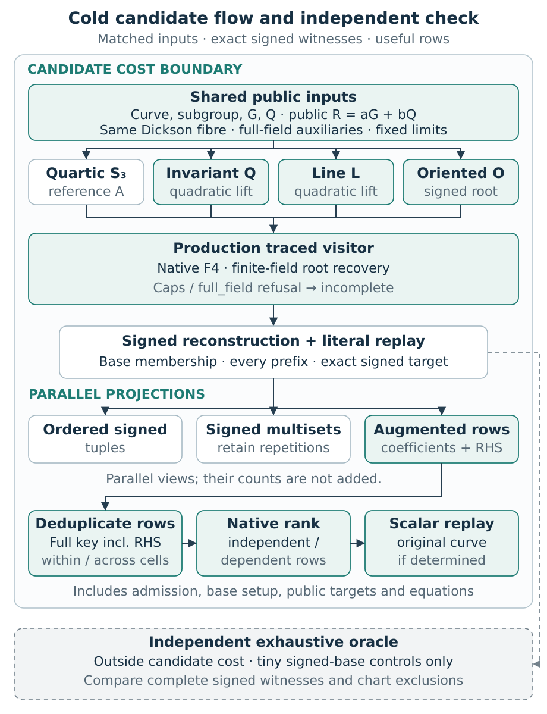

# Oriented Dickson-S3 extraction

**Fourth-arm implementation, complete signed accounting, and fixed native controls**

PR [#4950](https://github.com/isogeny-labs/crypto/pull/4950). Qualified source core: `b39cd981b8bf4dcc110ec8ab29343fbcaa7fe268`. The [qualification receipt](evidence/qualification-receipt.json), [source manifest](evidence/source-manifest-01.stdout), immutable executable hashes and separate pre/post-call records bind the observations below. Unsigned data statement [PCC-20261123-d1c504](../../../pcc/claims/PCC-20261123-d1c504.json) records their provenance; its standing remains unverified. Same-team review and successful native controls are not a signed independent scientific verdict. [pcc:unverified]

## 1. What this phase establishes

The smaller oriented O arm is implemented beside the quartic, invariant Q and rational-line L arms. All four use the same Dickson selector, finite prefix chart and signed public target. The matched extraction module now covers native elimination, univariate root recovery, sign reconciliation, exact point replay, duplicate projections, full relation-row construction, incremental rank and final scalar replay. Every arm starts cold, including admission and base construction. [Source](../../../examples/dickson_s3_quadratic/accounting.rs). [pcc:unverified]

The complete F7 controls agree with an independent exhaustive signed-base oracle. They distinguish additional witnesses from additional useful rows and recover the tiny target scalar by native elimination plus group replay. The single fixed M31 control also completes in every arm, producing one independent relation against the same eight-point signed base. That row leaves the M31 target scalar undetermined. This is a bounded known-answer correctness control, with no independent target cohort or comparative timing claim. [F7 record](evidence/tiny-accounting-01.stdout); [M31 record](evidence/m31-accounting-01.stdout). [pcc:unverified]

## 2. Smaller quadratic formulation

For children with abscissae x,z and actual signed parent (r,s), O imposes:

```text
lambda^2 = x + z + r
2 s lambda = (x-r)(z-r) - (3 r^2 + A)
y_child = lambda (x_child-r) - s
```

The last equation is explicit only for a nonroot internal child; leaf ordinates are recovered afterward. Sharing the internal ordinates avoids a separate three-variable invariant or line block at every node. No equation divides by s, so a finite 2-torsion parent remains supported. The cubic identity and signed induction, including exceptional charts, are derived in the [mathematical note](MATHEMATICAL_NOTE.md). This reuses the published [#4928 parent-oriented formulation](https://github.com/isogeny-labs/crypto/blob/fc184b03d47e13ec922c9b489f3b3f8a976a8bd9/research/prime31_summation_compression_20261122/iteration6/MATHEMATICAL_NOTE.md); no novelty priority is asserted. [pcc:unverified]

| Arm | Variables | Equations |
| --- | --- | --- |
| Quartic S3 | m l + m - 2 | m l + m - 1 |
| Invariant Q | m l + 4m - 5 | m l + 4m - 4 |
| Rational line L | m l + 4m - 5 | m l + 4m - 4 |
| Oriented O | m l + 3m - 5 | m l + 3m - 4 |

O saves m variables and m equations relative to Q/L. Every quadratic arm has input degree at most two; that fact alone says nothing about solving degree. The selector here is specifically D_(2^l)(x,1)=0. General arbitrary-index/parameter binary ladders remain background in the earlier study, not a new implemented selector in this phase. [Builder](../../../examples/dickson_s3_quadratic.rs). [pcc:unverified]



*The cold candidate boundary includes setup, native extraction, signs, all duplicate handling and rank. Independent exhaustive enumeration supplies ground truth outside that boundary. The three duplicate projections overlap and are not additive losses.*

## 3. Signed witnesses and scalar-field rows

A/Q recover a local slope from the signed parent when its ordinate is nonzero. When it is zero, they retain both square-root choices, or one if the root is zero. L reconciles its supplied local line with the negative parent; at a zero-ordinate parent the two line signs remain separate raw assignments. O consumes the solved slopes and shared internal ordinates. The zero-y control explicitly checks both L assignments against their original equations before decoding. Repeated children, tangents, horizontal chords and equal parent/child abscissae are supported. Infinite nonroot prefix sums are outside this finite affine chart and are reported separately by the oracle. [Decoder and controls](../../../examples/dickson_s3_quadratic/accounting.rs); [independent oracle](../../../examples/dickson_s3_quadratic/controls.rs). [pcc:unverified]

Every accepted signed witness must satisfy the original equations, use actual factor-base points, reproduce all intermediate abscissae, and sum literally to the signed public target. Deduplication retains full leaf-and-intermediate x chains before comparing ordered signed witnesses and signed multisets with multiplicity. Distinct multisets can still cancel to the same coefficient row. The emitted duplicate counts are parallel projections of all accepted occurrences and must not be added together. [Accounting source](../../../examples/dickson_s3_quadratic/accounting.rs). [pcc:unverified]

For a fixed unknown public Q and public schedule R=aG+bQ, the row is:

```text
c_1 X_1 + ... + c_B X_B - b d = a  (mod r)
X_i = log_G(B_i),  d = log_G(Q)
```

The scalar modulus r is separately admitted as prime. A nonidentity G killed by r, together with a Hasse upper bound below 2r, establishes the implemented h=1 scope. Q and all base points are also checked. No known base logs are supplied. A factor-base point equal to the public G may supply the charged log(G)=1 seed row; seed rank is separate from relation rank. Full augmented row keys include the RHS. An inconsistent row is a correctness failure. A pinned target scalar must pass [d]G=Q before recovery is reported. [Admission and rank implementation](../../../examples/dickson_s3_quadratic/accounting.rs). [pcc:unverified]

## 4. Complete F7 accounting

The frozen control uses y^2=x^3+3 over F7, r=13, G=V=(4,2), U=(3,3), Q=(1,2), depth one, and the same schedule (a,b)=(0,1) for m=2,3,4. Each arm has its own fresh base, row set and cumulative rank state. The following values agree with the independently enumerated signed base, and with predictions recorded before execution. [Raw F7 output](evidence/tiny-accounting-01.stdout); [pre-call](evidence/tiny-accounting-01-pre-call.json). [pcc:unverified]

| m | Raw A/Q/O | Raw L | Ordered signed | Multisets | Rows in cell | Added rank |
| --- | --- | --- | --- | --- | --- | --- |
| 2 | 2 | 4 | 2 | 1 | 1 | 1 |
| 3 | 4 | 16 | 4 | 2 | 2 | 1 |
| 4 | 16 | 128 | 16 | 2 | 1 | 0 |

Each arm begins with the same single public-G anchor. Cumulative rank is 2,3,3, with two independent rows gained from extraction, one new dependent row at m=3, and no inconsistent row. The m=4 coefficient row is already present from m=2. All arms pin d=3 and verify [3]G=Q. [Raw rank/replay fields](evidence/tiny-accounting-01.stdout). [pcc:unverified]

For m=4 the oracle finds 24 full-group ordered decompositions. Eight cross infinity at a nonroot prefix, leaving 16 in the finite chart. Those 16 have only eight distinct ordered leaf-x tuples but 16 full x chains. The two surviving signed multiset types reduce to the same row U+V=Q. In particular, the ordered leaf abscissae (3,4,4,4) support three different signed chains; deduplicating those leaf coordinates before sign recovery would lose valid witnesses. [Oracle and candidate records](evidence/tiny-accounting-01.stdout); [derivation](MATHEMATICAL_NOTE.md). [pcc:unverified]

The separate curve y^2=x^3+3x+3 over F7 checks parent (1,0), retaining both simultaneous signs of (3,2),(4,3). It makes no odd-prime rank claim for that even-order curve. [Zero-y decoder record](evidence/tiny-accounting-01.stdout). [pcc:unverified]

## 5. First matched M31 target extraction

The fixed development request uses p=2147483647, A=847514846, B=2087444724, r=2147446831 and G=(625037715,2100627251). It has m=2, depth three and public Q=(846657598,621322278), formed once as 2P for P=(69204140,78579263). Fixture construction is separately charged. The solver receives the public equations and unrestricted variable domains; neither P nor the selector roots are given as solution hints or finite domains. The actual base contains four unknown-log columns and eight signed points. [Frozen protocol](PROTOCOL.md); [request and base](evidence/m31-accounting-01.stdout). [pcc:unverified]

| Arm | Variables / equations | Raw assignments | Signed witnesses | Independent rows |
| --- | --- | --- | --- | --- |
| Quartic S3 | 6 / 7 | 1 | 1 | 1 |
| Q | 9 / 10 | 1 | 1 | 1 |
| L | 9 / 10 | 2 | 1 | 1 |
| O | 7 / 8 | 1 | 1 | 1 |

All four traversals report complete. Their signed, multiset and full-x-chain sets equal the independent exhaustive result over all 64 ordered signed pairs. There are no invalid equation assignments, sign/membership/replay rejections, timeouts or full-field fallback attempts. L's two line orientations produce the same signed witness and row. The retained augmented row is (2,0,0,0,-1 | 0) modulo r, expressing 2X_0-d=0. G is not in this base, so seed rank is zero. Each arm reaches rank one of five unknown columns; the target scalar remains unpinned. [Raw M31 output](evidence/m31-accounting-01.stdout); [post-call](evidence/m31-accounting-01-post-call.json). [pcc:unverified]

The native diagnostic counters below are useful for inspecting this exact fixture. They are not total primitive work or an algorithm ranking. The two multiplication columns describe disjoint, partial native scopes. [Native reports](evidence/m31-accounting-01.stdout). [pcc:unverified]

| Arm | F4 calls | Peak rows / cols | Row-reduction muls | Root-finder muls |
| --- | --- | --- | --- | --- |
| Quartic S3 | 6 | 148 / 127 | 178542 | 12746 |
| Q | 9 | 279 / 230 | 361490 | 14612 |
| L | 10 | 486 / 405 | 697752 | 16609 |
| O | 7 | 213 / 172 | 297471 | 10460 |

The maximum native productive step degree is four in every arm, despite quadratic input for Q/L/O. This uses the maximum of F4Report.solving_degree_max across native calls. The legacy visitor.solving_degree is preserved unchanged and describes its first native call; it must not be relabelled as this maximum. Peak rows and columns are separate maxima, not a certified simultaneous peak-memory measurement. [Visitor instrumentation](../../../src/cryptanalysis/f4_fp.rs); [raw diagnostics](evidence/m31-accounting-01.stdout). [pcc:unverified]

## 6. Accounting coverage and interpretation

| Boundary | Work retained |
| --- | --- |
| Cold arm | Admission, selector/base/index construction, public targets, equations, all cells, rank setup, scalar recovery and final replay, record assembly, residual overhead |
| Visitor | Selected native F4 call path; recognized univariate preparation and root extraction; solution callback; all remaining traversal work |
| Callback | Original equation validation; sign reconciliation; membership and group replay; key/sort/set/row work; native rank insertion; residual callback overhead |
| Independent control | Full signed enumeration and fresh finite-prefix checks, reported outside candidate cost |
| Outer call | Immutable executable and source checks, finite time/address-space limits, process exit and output hashes |

Native visitor timings are opt-in and default off. Their four exclusive buckets sum exactly to the measured visitor total; callback subphases and outer residuals close the enclosing intervals. Early callback, trace, empty-root and timeout paths preserve time already spent. Plain, traced, batched and certified trace-reuse paths are covered by the exact-source timing tests. Trace-pool native timing includes the selected dispatch's profile/statistics bookkeeping and certification, not only one inner function. The cold clock runs through initial in-memory record assembly. Final timing-field insertion, return/destruction bookkeeping, final JSON encoding and process startup are outside that interval and inside the external executable call; its receipts retain timestamps and exit/hash custody, not a nanosecond process-total counter. [Timing tests](evidence/timing-tests-02.stdout); [source](../../../src/cryptanalysis/f4_fp.rs). [pcc:unverified]

Group JSON explicitly exposes additions, doublings, scalar calls, field multiplications/squarings/inversions and Montgomery reductions. Scalar calls already contain their additions/doublings. Root-finder multiplications and F4 row-reduction multiplications remain partial counters. Unmetered primitive details include selector construction, validation and sign-formula arithmetic, sorting comparisons, allocation and runtime work. These operations remain inside measured wall boundaries; no invented total field-operation or bit-operation price is assigned. Local elapsed values are retained for accounting diagnostics only: this unoptimized development closure, fixed order and one target do not support performance comparisons. [Machine-readable scope](evidence/m31-accounting-01.stdout). [pcc:unverified]

The shared solver is deliberately solve_visit_traced, with original incoming generators retained. This differs from the earlier plain-visitor control and is stated in every record. A full-field branch would be refused before recursive enumeration, and its attempted-branch counter would not mean values were enumerated. Time, trace or assignment caps retain valid lower-bound rows and an incomplete outcome; they never become UNSAT or a complete miss. [Frozen policy](PROTOCOL.md); [stopping tests](evidence/example-tests-02.stdout). [pcc:unverified]

## 7. Qualification and current gate

The final immutable build passes 13 focused example/oracle tests, eight unchanged native visitor-timing tests, and seven identity-record tests. The declared production closure is compiled without substituting field arithmetic, group operations, F4, root finders or rank logic. The qualifier still excludes the rest of the root library's unit suite. Earlier successful build/control records are preserved; no test failure or capped attempt was silently removed. [Build request](evidence/build-03-request.json); [build result](evidence/build-03-result.json); [example tests](evidence/example-tests-02.stdout); [timing tests](evidence/timing-tests-02.stdout); [identity tests](evidence/identity-tests-01.stdout). [pcc:unverified]

The full-root release test compilation reached its 600-second limit, exit 124, before a test executable or build-finished event. It emitted no compiler-error diagnostics and progressed through isogeny_algos to aws-sdk-s3. All 1780 inventoried inputs remained unchanged afterward. Missing sparse path dependencies had been restored from exact tracked bytes; the request preserves its original tracking head plus working-source inventory, rather than pretending the later publication commit existed at launch. The full-root suite was not executed, so this gate remains open and the PR stays draft. [Gate request](evidence/root-build-01-request.json); [terminal result](evidence/root-build-01-result.json); [compiler stderr](evidence/root-build-01.stderr.log).

## 8. Next technical step

The next extraction extension is a published, admitted M31 m3/m4 public-target schedule with the same cold boundaries, exact row/RHS deduplication and target-column rank. The current control establishes m2 plumbing and exceptional-sign correctness; it supplies no m3/m4 M31 relation-yield estimate. Higher-arity finite-chart exclusions must remain explicit, and effective rows must be accumulated across genuinely matched public schedules. The current environment has no authenticated admitted scientific-submission route, so no target cohort or parameter sweep was launched. [Protocol](PROTOCOL.md); [source-review scope](evidence/source-review.md). [pcc:unverified]

The parser accepts a JSON request through `--extract-accounting REQUEST.json`; the [F7 public request](requests/f7-public.json) and [M31 m2 public request](requests/m31-m2-public.json) are extracted directly from the corresponding frozen records. `--check-accounting` and `--check-m31-accounting` run the fixed development controls with separate independent oracles. New cohorts require their own frozen specifications and admission. The unchanged earlier study is available in the [parent report](../REPORT.md).
