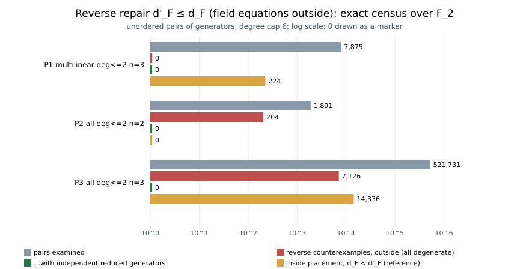

# Two attack-graph claims disproved by exact computation (2026-11-02)

**Verdict.**
- **Target A, the reverse repair of Nagao's Lemma 4** (`d'_F ≤ d_F`, field equations outside): REFUTED as stated. The repair survives only with an added hypothesis.
- **Target B, "last fall degree ≤ degree of regularity" with the Bardet–Faugère–Salvy `d_reg`:** REFUTED.

Both results are exact. Each witness has a hand proof, an independent native or exact
computation, and a core-Lean `decide +kernel` module awaiting the repository proof gate.

No speedup, cost or cross-method claim is made, so there is no matched-rho row.

Protocol: [`PROTOCOL.md`](PROTOCOL.md), frozen before computing.

## Target A: the candidate repair `d'_F ≤ d_F` (outside)

After Nagao's Lemma 4 (`d_F ≤ d'_F`) was refuted (papers/ic-negative-results, S5), the
corpus recorded the reverse inequality, with the field equations outside the generating
set, as a candidate repair (`GAP-LEMMA4-REVERSE`). The prior census had no
counterexample, but it contained only multilinear generators.

**Witness R.** Over `F_2`, take `f_1 = X` and `f_2 = X^2 + X`.

- **True first fall degree `d_F = 2`.**
  - `X·f_1 + 1·f_2 = X^2 + X^2 + X = X`. Both products have degree 2 and the sum has
    degree 1 and is nonzero, so this is a fall at degree 2.
  - At degree ≤ 1 the only admissible multiples are constants times `X`, and the sum of
    those has the same degree as its largest product, so there is no fall below 2.
- **No fake fall at any degree (`d'_F = ∞`).**
  - Modulo `X^2 + X`, `f_2` reduces to `0`, so every product `g·f_2` reduces to `0`.
  - The reduced sum is then the single product `red(g·X)`, whose degree equals the
    maximum, so it can never drop.

Hence `d'_F = ∞ > 2 = d_F`.

**Census.** The instrument is `reverse_census.rs`. Its first 384 lines are a byte-for-byte
copy of the fall computations in `blindspots_19_checks.rs` (sha256 `751277a8…`); the new
driver adds the census and the degeneracy classification. Unordered pairs, degree cap 6:

| population | pairs | `d_F > d'_F` out / in | reverse counterexamples, outside | of which reduced generators independent | inside, `d_F < d'_F` |
|---|---:|---:|---:|---:|---:|
| P1 multilinear, deg ≤ 2, n = 3 (control) | 7,875 | 6,138 / 4,830 | 0 | 0 | 224 |
| P2 all, deg ≤ 2, n = 2 | 1,891 | 1,446 / 480 | 204 | **0** | 0 |
| P3 all, deg ≤ 2, n = 3 | 521,731 | 500,108 / 312,718 | 7,126 | **0** | 14,336 |



- **P1 reproduces the prior census exactly** (the control passes). It has no "no fake
  fall" pairs, so the prior "0 outside" was not missing such cases.
- **Every outside counterexample is degenerate.** The two generators become linearly
  dependent after reduction: one reduces to `0`, or both reduce to the same polynomial.
  The reduced system then has at most one effective generator and cannot fall.
- **Every counterexample in the census is of the no-fake-fall kind** (`d'_F = ∞`). None
  has both degrees finite with `d'_F > d_F`.

**What survives.** `d'_F ≤ d_F` (outside) for systems whose reduced generators are
linearly independent: 0 counterexamples among the 531,497 pairs of P1–P3 (P2's
polynomials also occur in P3). This is the new open form of `GAP-LEMMA4-REVERSE`.

**Deviation.** P4 (multilinear, degree ≤ 3, n = 4) was not run. Its 2^15 polynomials give
about 5·10^8 pairs, which is not feasible as an exhaustive census here. The next census
should be a seeded sample or three-generator systems (`RT-LEMMA4-REVERSE`).

## Target B: last fall degree versus BFS degree of regularity

HKYY state that the last fall degree is bounded by "the degree of regularity". In their
paper that means a solving degree, and the statement holds (`CLAIM-GB-LFD-LE-DREG`). Later
introductions repeat the sentence, where the reader takes `d_reg` in the BFS sense. The
corpus recorded Salizzoni's Example 3.9 as the counterexample, but its last-fall value
was inferred, not computed.

**Witness.** `F = {x^2 + y, y^2 + x, xy}` (Salizzoni Ex. 3.9, k = 2).

- `d_reg = 2`:
  - the top-degree parts `x^2, y^2, xy` span all of `R_2`;
  - no generator has degree ≤ 1, so `(F^top)_1 = 0 ≠ R_1`.
- `x, y ∉ V_{F,2}`: all generators have degree 2, so `V_{F,2}` is their span with
  constant coefficients, and no such combination equals `x` or `y`.
- `x, y ∈ V_{F,3}`, with every product of degree ≤ 3:
  - `x = (y^2 + x) + y(x^2 + y) + x(xy)`;
  - `y = (x^2 + y) + x(y^2 + x) + y(xy)`.

  These identities hold over `F_2`; over other fields the computation finds the
  corresponding combinations.
- `V_{F,d} = (x, y) ∩ R_{≤d}` for `d = 3..6`: the dimension check passes in every field
  tried.
- Hence `d_x = d_y = 3`. Caminata–Gorla Theorem 2.9, with the reduced Gröbner basis
  `{x, y}`, gives last fall degree `3 > 2 = d_reg`.

`salizzoni_ex39.py` runs these checks with exact linear algebra over `F_2`, `F_3`, `F_5`
and `Q`; all PASS (`results/salizzoni_ex39.txt`).

## Formal status

| module | statements | state |
|---|---|---|
| `papers/ic-negative-results/lean/IcNegative/Lemma4Reverse.lean` | `reverse_fails_witnessR`: the true fall at 2, no fall below 2, no fake fall at any degree | written, core Lean `decide +kernel`, pending the proof gate |
| `research/disprove_easy_targets_20261102/lean/SalizzoniEx39.lean` | top parts and `d_reg`, `x, y ∉ V_{F,2}`, the two `V_{F,3}` certificates (over `F_2`) | written, core Lean, standalone, pending the proof gate |

No Lean toolchain is available on the authoring host. A Python mirror of the same
functions agreed with every statement before the modules were written.

## What this does not say

- Nothing about Nagao's Proposition 5, or about any cost estimate. Neither refuted claim
  is a premise of a repository cost row; the attack graph shows no claim resting on
  either.
- The surviving form of the reverse repair is supported only for pairs, degree ≤ 2 and
  n ≤ 3.
- Target B refutes a misreading, not HKYY's statement. It matters wherever a repository
  file uses "degree of regularity" without saying which one (`RT-GB-DREG-READING-AUDIT`).

## Reproduce

```sh
D=research/disprove_easy_targets_20261102
rustc --edition 2021 -C opt-level=3 -o /tmp/rc $D/reverse_census.rs
/tmp/rc p1; /tmp/rc p2; /tmp/rc p3          # ~0.4 s, ~0.04 s, ~30 s on the session container
python3 -I $D/salizzoni_ex39.py
python3 -I $D/plot_census.py                # results/census.svg from results/p*.txt
```
