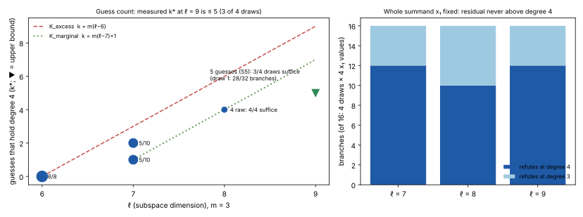

# Results: five guesses hold degree 4 at ℓ = 9 on 3 of 4 draws; the guess count stopped growing (m = 3)

Scored by `score.sh` (`score-output.txt`) against `PREREGISTRATION.md` (frozen at 37129b4253,
with Amendment 1 made before any S5 branch other than d1.b0 existed) and `PREREG_SUMMAND.md`.
Class: **stage diagnostic** (exact algebra on frozen draws). No `S`, no rho ratio, no speed
claim, no leaderboard row. Every number is an unverified assertion `[pcc:unverified]`.

*Figure: left, the guesses needed to hold the MutantXL closure at degree 4 against ℓ (m = 3).
The ℓ = 6–8 points are transcribed from `kstar_recorded.json`; ▼ is this study's ℓ = 9 upper
bound. The lines are the two registered models. Right, the refutation degree of the
whole-summand residual, 16 branches per ℓ. Data: `results_recorded.json`, from
`score-output.txt`.*

## Registered verdicts

- **Controls valid.**
  - Gate A: the pe engine matches the committed dense records. A1 refutes at degree 4; A2
    saturates unrefuted with closure rank 131,588, as committed.
  - The positive control P refutes at degree 4 on 4 of 4 draws.
  - `identity_check` is true on every one of the 128 S5 records.
- **ℓ = 9: "k\* ≤ 5 at ℓ = 9 (saturation reading)".** S5 suffices on 3 of 4 draws. This
  contradicts `K_marginal`, which predicted 7. My registered prediction (0.7 on "does not
  suffice") failed.
- **Whole summand: "mixed"** by the literal rule ("constant" needs every branch at one
  degree).
  - Read beside it: the residual **never needs more than degree 4** at ℓ = 7, 8 or 9, and
    every nonzero x₁ at ℓ = 7 and ℓ = 9 refutes at exactly 4.
  - The degree-3 branches are x₁ = 0, which is degenerate (4 per ℓ), plus 2 nonzero
    assignments on ℓ = 8 draw 6.

## The measurement

| draw (3, 25, 9) | S5 branches refuting at degree 4 | saturated, not refuted | verdict |
|---|--:|--:|---|
| 1 | 28 / 32 | 4 (b28–b31) | does not suffice |
| 4 | 32 / 32 | 0 | suffices |
| 5 | 32 / 32 | 0 | suffices |
| 7 | 32 / 32 | 0 | suffices |

- **Shape of a branch.** Each S5 branch has 195,709 columns at degree 4. It ran for
  1,790–2,480 s at about 4.7 GB peak, with `RAYON_NUM_THREADS=2`.
- **Draw 1's failures share one corner.** They are exactly the branches with x₃[8] = e₁[0]
  = e₁[1] = 1, and all four saturate at the same closure rank (188,151), whatever the two
  invariant guesses are. A sixth guess on that corner alone was not run.
- **Whole-summand residual.** At degree 4 the branches took 9–12 s at ℓ = 7, 147–174 s at
  ℓ = 8 and 563–594 s at ℓ = 9.

| ℓ | refute at 3 | refute at 4 | nonzero x₁ only |
|--:|--:|--:|---|
| 7 | 4 | 12 | 12 at 4 |
| 8 | 6 | 10 | 10 at 4, 2 at 3 |
| 9 | 4 | 12 | 12 at 4 |

## What it does and does not say

- **The recorded guess count is 0, 1–2, ≤ 4 and ≤ 5 at ℓ = 6, 7, 8 and 9.** From ℓ = 8 to
  ℓ = 9 it grew by at most one. `K_marginal` (m per step, 3 here) predicted three. This is
  one step, at m = 3, with one guess set; it is not a law.
- **Agreement with the whole-summand result.** Fixing the whole of x₁ (k = ℓ) always lands
  at degree ≤ 4. So k\* ≤ ℓ holds at constant degree 4 on every cell measured. The hybrid's
  exponent is therefore at most about ℓ bits plus a polynomial-size closure, which is the
  pair table's exponent (derived).
- **No row moves.**
  - Derived: at m = 3 a growth of one guess per step from k = 5 at ℓ = 9 would give
    k ≈ 29 at ℓ = 33.
  - The priced ECC2K-130 cell is m = 4, which is unmeasured, and its break-even is 6.
  - The change is that the registered extrapolation of 105 is contradicted. The guess route
    is not shown to beat rho, and nothing here is a speedup `[pcc:unverified]`.
- **Choice of guesses.** The guesses matter: invariant coordinates of s = x₁ + x₂ were
  measured to beat raw ones at ℓ = 8 `[pcc:unverified]`. A different 5-set might suffice on draw 1, or fail
  elsewhere.

## Disclosures

- **Amendment 1 came after one S5 result.** It moved the remaining branches to a RunPod
  pod after S5.d1.b0 had been recorded as refuting. The decision rule was not changed.
  Fail-fast was dropped, so every branch of every draw ran. Owner-approved; pod
  `u7l00cmnbcvnn3` (cpu3g, 64 vCPU, 256 GB, $2.56/h) ran 18:22–20:49Z on 2026-11-06,
  about $6.30, and was deleted (the API then returned 404). The binary's SHA-256 on the pod
  (`runs/pod/host.txt`) equals the local build's (`runs/binary.sha256`).
- **Interruptions, none of which changes a record.**
  - The local `gateA` invocation exited 2 after both runs completed, because `run.sh` was
    edited while bash read it.
  - Two container restarts and one 2-hour task limit killed in-flight runs. Their empty
    attempts are kept in `runs/attempts/` and every killed run was repeated.
  - All are noted in `runs/queue.log`.
- **Hosts.** Gate A, the controls, S5.d1.b0 and most whole-summand runs ran in the 16 GB
  container. The rest ran on the pod. Closure outcomes are exact algebra; times are
  indicative only.
- **Two preregistration flaws.**
  - The whole-summand `h ∈ {0, 0x55, 0xAA, 0xFF}` includes the degenerate x₁ = 0.
  - For ℓ = 9, `h = 0xFF` truncated to 9 bits leaves the top bit at 0.

## Next (not run)

1. **The draw-1 corner.** Add a sixth guess on x₃[8] = e₁[0] = e₁[1] = 1 only. That tests
   whether k\* = 6 there, or whether that corner needs degree 5.
2. **ℓ = 10 with the same rule.** k = 6 at S = −2 is cell (3, 28, 10). It needs a pod, at
   about 236k columns.
3. **m = 4.** The priced cell is m = 4. Whether the second link's invariant `e₁ + x₃`
   plays the same role is the open question from `dreg_invariant_guess_more_20261029`.
