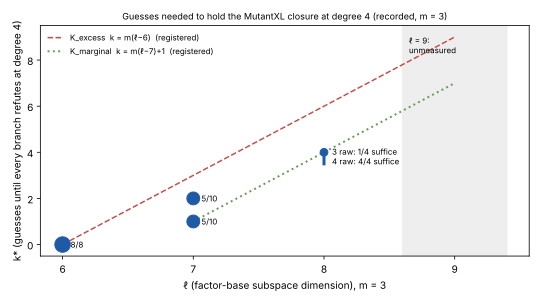

# Survey: what the last-fall-degree theory gives, and how the guess count grows with ℓ (2026-11-06)

Class: **research search** (reading and consolidation). No new measurement, no `S`, no
rho ratio, no speed claim. Every number below is transcribed from a committed file and
is an unverified assertion `[pcc:unverified]` until a pcc claim covers it.

## Question

Where can the degree of regularity, or the total solve time, of the descended Semaev
decomposition system still be lowered? This note gathers the theory and the recorded
data, and names the one measurement that decides the guess-and-determine route.

## Sources checked

- KB unavailable: the `research-kb` MCP server is not attached to this session, and
  `scripts/research-kb` reports "no executable found". I used the lead atlas
  (`python3 tools/lead_atlas.py --brief` and `--match` in crypto-autoresearcher,
  reviewed 2026-10-30) and `rg` over both repositories instead.
- Atlas leads read:
  - `LEAD-ICE-descent-closure-degree-at-scale` (open_blocked);
  - `LEAD-ICE-boolean-f4-f5-f6-engines` (closed_dominated);
  - `LEAD-ICE-hybrid-guess-determine-l7` (open_next_step);
  - `LEAD-ICE-chained-semaev-dreg-vs-semiregular`;
  - `LEAD-ICE-gag-contraction-planner`.
- Knowledge records read: `KR-IC-58213c`, `KR-IC-49c882` and `KN-LIT-a2f7b3`.
- Papers read in full (arXiv PDFs fetched 2026-11-05):
  - Huang–Kosters–Yang–Yeo, arXiv:1505.02532 (HKYY);
  - Huang, arXiv:2103.07282.
- Program notes read: `research/notes/index-calculus/RESEARCH_FALL_DEGREE_BOUNDS.md`
  (§2, the HKYY row) and `research/notes/ecc2k130/RESEARCH_KOBLITZ_INDEX_CALCULUS.md`
  (the multilinear section).

## 1. Theory: what is already known, and one correction

**The closure the program measures is the HKY object.** The MutantXL fixed-degree
closure is the space `V_{F,D}` of Huang–Kosters–Yeo. For an unsatisfiable Boolean system,
its refutation degree is the polynomial-calculus degree, and it is at most the last fall
degree `d_F`. `RESEARCH_FALL_DEGREE_BOUNDS.md` §1 already states this. The measured rise
from degree 4 to degree 5 at ℓ = 7 is therefore a lower bound on `d_F` there.

**HKYY can be applied through the subspace polynomial.** HKYY §6 explains why its
theorem does not reach summation systems: they are not zero-dimensional until the field
equations are added. Adding `L_V(X_i)`, the vanishing polynomial of the factor-base
subspace, makes the big-field system zero-dimensional. This step is **not new**: the note
already has it as the row "…applied to `F = {S_3, L_V(X_1), L_V(X_2)}` … `d_{F'} ≤ 4n'+6`",
and marks it "THEOREM modulo the injective-projection hypothesis, which fails for `S_3`".

**Correction (derived here, not formally checked).** The injective-projection hypothesis
can always be met by a linear change of variables, provided `2^n > C(s,2)`.

- Take `t = X_1 + c·X_2` with `c ∈ F_{2^n}`. Two distinct solutions `(a,b)` and `(a',b')`
  collide under `t` for exactly one value of `c` when `b ≠ b'`, and for none when
  `b = b'`. So at most `C(s,2)` values of `c` are bad.
- An `F_{2^n}`-linear change of the `X` descends to an invertible `F_2`-linear change of
  the descended variables. In characteristic 2 squaring is additive, so that change maps
  the field-equation ideal to itself.
- The last fall degree is invariant under an invertible linear change of variables
  (HKYY Prop. 2.6).

So the row's bound becomes unconditional on projection whenever `C(s,2) < 2^n`. It still
needs radicality, and it is still linear in `n'`. **It changes no cost:** a Macaulay
matrix at degree about `4n'` costs more than enumerating the factor base. Its only use is
to make "the proved last-fall bound is linear in ℓ" a theorem rather than a conditional `[pcc:unverified]`.

**Huang 2021 (arXiv:2103.07282), body read.** It proves
`max(d_{F_1}, q·deg F) = max(d_{F_1'}, q·deg F)` (Thm 1.1) `[pcc:unverified]`. The cyclic-variable system
`F_1` and the descended `F_1'` therefore agree on last fall degree above `q·deg F`; with
`deg L_V = 2^ℓ`, that threshold is `2^{ℓ+1}`. Its bound `d ≤ max((q−1)m+1, qd)`
(Thm 2.6) applies only to systems of **linearized** polynomials, and a Semaev polynomial
is not linearized. The paper does not name summation polynomials.

This bears on the discrepancy `KN-LIT-a2f7b3` recorded against `KN-LIT-7605`. Read in
full, 2103.07282 does **not** support the summary "bounded independently of `n` for
summation-polynomial systems over `F_2`". The corpus record lives in crypto-autoresearcher,
which this session cannot push to, so this is an open thread.

**Net.** No proved bound explains, or lowers, the measured degree of 4–5 `[pcc:unverified]`. The usable
levers are empirical: the presentation, the guesses, and the engine.

## 2. Recorded data: guesses needed to hold degree 4

*Figure: k\* (the fewest guessed variables for which every branch refutes at degree 4),
m = 3, from `kstar_recorded.json`, which transcribes the committed RESULTS files named in
it. Point size is the number of draws; the labels give draws over total. Dashed and
dotted lines are the two registered models of
`research/dreg_closure_guess_20261022/PREREGISTRATION.md`.*

| ℓ | cell(s) | unspecialised closure | k\* | source |
|--:|---|---|---|---|
| 6 | (3,16,6), (3,18,6) | degree 4, 8 of 8 | 0 | `dreg_closure_slope_20261018` |
| 7 | (3,19,7), (3,21,7) + 2 fresh | degree 5 (C1, draws 0 and 3) | 1 on 5 draws, 2 on 5 | `dreg_hybrid_guess_20261024`, `koblitz_ic_leads_build_20261024` |
| 8 | (3,22,8) | does not refute at 4 (4 of 4) | 3 raw: 1 of 4 suffice; 4 raw: 4 of 4; 3 invariant: 7 of 12 | `dreg_closure_guess_20261022`, `…guess3_20261023`, `dreg_invariant_guess_20261029`, `…more_20261029` |

**Reading.**

- k\* has grown at every step: from 0 to about 1.5 to 4. The registered `K_marginal`
  model `k = m(ℓ−7)+1` fits ℓ = 8 exactly, and `K_excess` (6 at ℓ = 8) is rejected there.
- Invariant guesses beat raw guesses (`…more_20261029`, p = 0.031) `[pcc:unverified]`. That changes which
  coordinates to guess, not yet how many.
- `K_marginal` predicts **7 at ℓ = 9** and `4·26+1 = 105` at the priced ECC2K-130 cell
  (m = 4, ℓ = 33). The program's break-even there is 6.
- So the guess-then-degree-4 route reaches ECC2K-130 only if k\* **stops growing**. The
  data so far show no sign of that.

## 3. The deciding measurement, and why it does not run here

- **The question:** does k\* saturate? At ℓ = 9 that means testing whether k = 5
  suffices. If it does, k\* is ≤ 5 rather than the 7 that `K_marginal` predicts.
- **Fail-fast design.** Under `K_marginal` a draw fails on its first branch that
  saturates without refuting. The expected cost is therefore one branch per draw. Only
  the hopeful outcome needs all 32 branches.
- **The surplus confound.** The cell must keep the surplus of the ℓ = 7 and ℓ = 8 cells,
  S = n − 3ℓ = −2. `dreg_surplus_control_20260925` found that the degree rises at
  S = −5, so (3, 22, 9) would test the surplus, not ℓ. The fair cell is (3, 25, 9), with
  N = 52.
- **Memory (derived).**
  - At k = 5 a branch has C(47, ≤4) = 195,709 columns. The dense closure used 8.5 GB at
    136,698 columns. Scaling quadratically gives about 17–20 GB per branch, above this
    16 GB container.
  - The lab image (`taskq/deploy/eks-karpenter/image.json`) carries only `ecbench`.
    Publishing a new image needs the trusted GitHub workflow (`publish-image` requires
    `GITHUB_RUN_ID`), so there is no compliant lab route for `dreg_linear_guess` today.
  - The precedent is C1, which ran on RunPod under an owner-approved budget.
- **Status:** blocked on compute. It needs an owner budget for a ≥ 32 GB host, or a
  closure engine that fits the cell in 16 GB (Phase 3 below).

## 4. What could still lower the degree or the time

1. **Exploit the multilinear block structure** (the never-built Faugère–Safey El
   Din–Spaenlehauer route in `RESEARCH_KOBLITZ_INDEX_CALCULUS.md`). The descended chain
   has degree ≤ 1 in every block. Rows that the block-bilinear Jacobian syzygies force to
   reduce to zero can be skipped. That saves memory and time at fixed degree, and could
   bring the ℓ = 9 cell into this container. It does not lower the degree itself.
2. **Choose the guesses by invariants** (measured to help at ℓ = 8). The next registered
   step is the second link's invariant `e₁ + x₃`.
3. **Prefer degree 5 over 2^k branches when k\* is large.** The hybrid beats the
   degree-5 closure by 116–260× at ℓ = 7, where k\* ≤ 2 `[pcc:unverified]`. With k\* growing about one per
   unit of ℓ per summand, the crossover in ℓ is where 2^{k\*}·C(N−k\*, ≤4)^ω exceeds
   C(N, ≤5)^ω. This has not been estimated on measured `secs`.

## Limits

- Transcribed values only. No closure ran in this survey.
- Theory corrections are derivations, not machine-checked proofs.
- m = 3 only.
