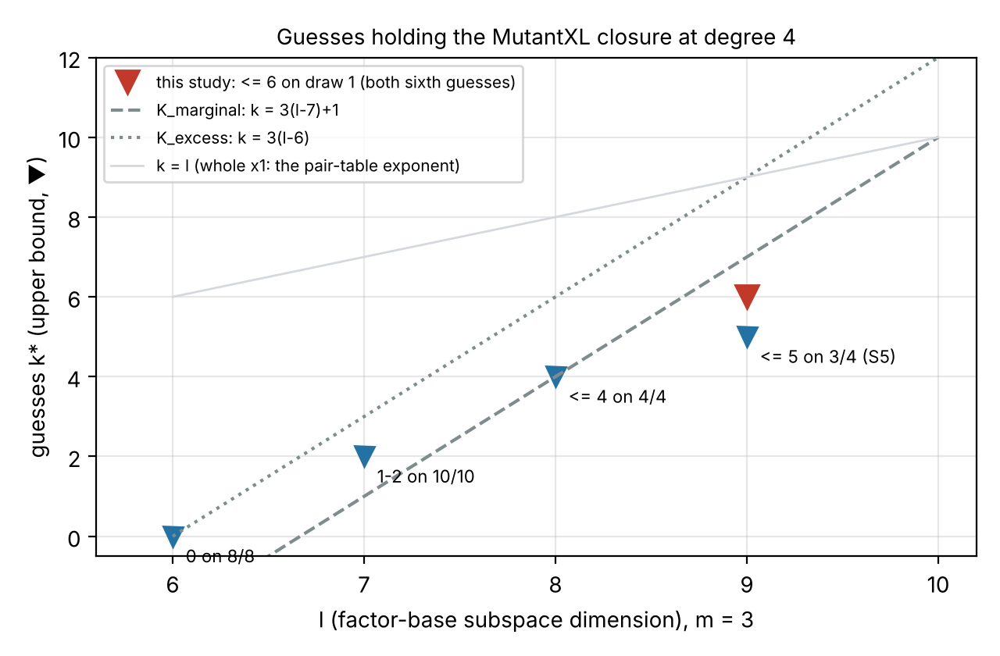

# A sixth guess clears draw 1: k* ≤ 6 at ℓ = 9 on all four draws (m = 3)

Follow-up to `research/dreg_guess_scaling_20261106`. Scored against `PREREGISTRATION.md`, which was frozen
before any run (commit `b7c770207f`). **Class:** stage diagnostic (exact algebra). There is no `S`, no rho ratio,
no row and no speed claim. Every number is an **unverified assertion** `[pcc:unverified]`.

*Figure: the guesses that hold the MutantXL closure at degree 4, against ℓ, for m = 3.*
- *Blue points are the recorded upper bounds from the parent studies.*
- *The red point is this study's result.*
- *The dashed and dotted lines are the two registered models; the faint line is k = ℓ.*

## Verdicts (decision rule of PREREGISTRATION.md)

- **N, identity control: valid.** S5.d1.b28 re-run with this build (`dreg_linear_guess` sha256 `858f4f9a…`)
  equals the committed `research/dreg_guess_scaling_20261106/runs/pod/S5.d1.b28.jsonl` on every field except
  `secs` and `source`. It saturates at degree 4 with closure rank 188,151 and is not refuted.
- **I, next invariant `--sum 15=6+f`: suffices.** 8 of 8 runs refute at degree 4.
- **E, next e₁ coordinate `--fix 29=g`: suffices.** 8 of 8 runs refute at degree 4.
- **Reading: "k\* ≤ 6 on draw 1".** With the parent study, **k\* ≤ 6 at ℓ = 9 on 4 of 4 draws.**
  It is ≤ 5 on draws 4, 5 and 7.
- **Predictions.** I suffices 0.55, E suffices 0.45, at least one 0.7. Both arms suffice, which was more
  than predicted.

| arm | runs | refute at degree 4 | occurring variables | closure rank at refutation | columns | wall (s) |
|---|--:|--:|--:|---|--:|---|
| N (S5.d1.b28) | 1 | 0 (saturates) | 47 | 188,151 | 195,709 | 936 |
| I (s[6]) | 8 | **8** | 46 | 179,380 on every run | 179,447 | 719–735 |
| E (e₁[2]) | 8 | **8** | 46 | 171,553–171,781 | 179,447 | 654–698 |

Every record has `identity_check` true.

## What it says and does not say

- **The recorded counts** are 0, 1–2, ≤ 4 and ≤ 6 guesses at ℓ = 6, 7, 8 and 9 on every draw, with ≤ 5 on 3 of 4
  at ℓ = 9.
  - `K_marginal` (k = 3(ℓ−7)+1) predicted 7 at ℓ = 9. On every draw, the count needed is at most that.
  - From ℓ = 8 to ℓ = 9, the bound needed on the worst draw grew by 2, to ≤ 6. On the other three draws it grew by at most 1.
- **It is still about ℓ guesses at constant degree.** That is the pair table's exponent (parent study, "What it
  does and does not say"). One cell at m = 3 with one guess family is not a scaling law. The priced ECC2K-130 cell
  is m = 4, which is unmeasured.
- **Choice of guesses.** Either sixth guess works on the corner. The invariant guess does it with a single
  closure rank on all 8 branches, 179,380. The raw guess needs a slightly lower rank. This is descriptive only.
- **No row moves**, and nothing here is a speed-up.

## Host and cost

- **Runs:** RunPod CPU pod `jz9bxj2lrlcuco` (cpu5c, 64 vCPU, 128 GB, $1.92/h). All 17 runs went in parallel,
  01:33–01:49Z on 2026-11-11. Results were fetched before termination (`runs/`).
- **Failed launches:**
  - `kdzlthr0uk5ctj` never answered on `:8000` in 22 min and was terminated (about $0.95).
  - `zvj6n0mzhma3qu` landed on the same machine and was terminated at once.
- **Total:** about $2.30, against the $15 cap.
- **Inputs:** uploaded with hash checks (`pod/`): binary, draw file, `commands.txt`, `job.sh`.
