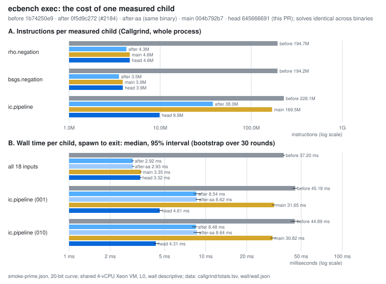

# The cost of one measured ecbench child

**Date.** 2026-10-24. **Status.** Measured. Instruction counts are
Callgrind's. Wall time is descriptive: shared 4-vCPU VM, L0, no hardware
counters. **Class.** Engineering. The counted cost (GAE) of every method is
unchanged, every solve is identical across binaries, and there is no ECDLP
cost change and no rho comparison. Protocol, frozen before timing, with two
amendments made before any timing: [`PROTOCOL.md`](PROTOCOL.md).

Every measured run of every ecbench session is a fresh `ecbench exec`
child process. This study measures what one child costs. The arms are:

- before #2184 (`1b74250e9`);
- after its two child-path commits (`0f5d9c272`);
- `main` as it stands (`004b792b7`; this branch's own commits do not touch
  the child path);
- this PR (`645666691`), which removes an alias-table parse that `main`
  had grown into every index-calculus child.



## Instructions per child (Callgrind, whole process)

| method (input) | before | after #2184 | `main` | this PR |
|:--|--:|--:|--:|--:|
| `rho.negation` (008) | 194.7M | 4.26M | 4.64M | 4.64M |
| `bsgs.negation` (012) | 194.2M | 3.53M | 3.89M | 3.89M |
| `ic.pipeline` (001) | 228.1M | 37.96M | 169.47M | **9.86M** |

Each count sums every Callgrind dump part of the process
([`callgrind/totals.tsv`](callgrind/totals.tsv) has the parts).

- **#2184** removed the per-child parse of the 4.7 MB curve registry. Each
  child had parsed it whole; it now parses one entry, cut from the text by
  its slug. The registry accounted for 190M instructions, about 98% of a
  rho or BSGS child.
- **This PR** removes the IC child's parse of the 2.8 MB curve alias table.
  `ic_boundary::pinned_ratios` built the whole map to match one curve name
  against the frozen calibration table's 25 rows. That cost 27M
  instructions at `0f5d9c272` and 154M on `main`, after the table grew with
  the registry. `curve_id::find_same_curve` now resolves each name by
  binary search over the sorted table text. Its answers equal the map's on
  every name the table holds (`curve_id::tests`).

## Wall time per child (spawn to exit)

30 rounds; in each, every one of the 18 inputs runs once under every arm,
in shuffled order. The median is shown with a 95% interval from 2,000
bootstrap resamples of whole rounds ([`wall/wall.json`](wall/wall.json),
[`wall/run.log`](wall/run.log)).

| comparison | inputs | ratio of medians | 95% interval |
|:--|:--|--:|:--|
| after / before | all 18 | **0.0786** (37.20 → 2.92 ms) | [0.0769, 0.0802] |
| after-aa / after (A/A) | all 18 | 1.0032 | [0.9820, 1.0288] |
| this PR / `main` | all 18 | 0.9910 | [0.9754, 1.0083] |
| this PR / `main` | `ic.pipeline` 001 | **0.1457** (31.65 → 4.61 ms) | [0.1403, 0.1534] |
| this PR / `main` | `ic.pipeline` 010 | **0.1400** (30.82 → 4.31 ms) | [0.1322, 0.1499] |
| `main` / after | all 18 | 1.1460 | [1.1278, 1.1685] |

- The A/A control holds on the pooled inputs. Per input it does not always
  hold: one BSGS input reads 0.94 [0.89, 0.99]. So per-input wall ratios
  carry about ±6% host noise. The IC ratios (about 0.14) are far outside
  that.
- Pooled over all 18 inputs, this PR and `main` do not differ (two of the 18
  are IC). The IC children are 6.9–7.1× faster.
- `main` is about 15% slower per child than `0f5d9c272`, with about 9% more
  instructions, on rho and BSGS. That comes from measurement-hygiene work
  merged since (allocator trim before the solve, per-solve observations).
  It is not addressed here.

## What a child still spends

On the rho child under this PR, the parts before the solve are about 3.2M
instructions:

- the registry entry search, 1.2M: a linear `find` over 4.7 MB, because
  the registry is not sorted by slug;
- the command-line parser, 0.8M;
- the curve's ICV1 identity (with its modular exponentiation), 0.35M.

The solve itself is about 1.1M. The next candidates are a slug index for
the registry and a lighter argument path for `exec`.

## Reproduce

```bash
# binaries: cargo build --release --bin ecbench at each commit, same Cargo.lock
cargo build --release --example ecbench_child_overhead
S=research/ecbench_child_overhead_20261024
./target/release/examples/ecbench_child_overhead inputs --spec docs/ecbench/specs/smoke-prime.json --count 18 --out $S/inputs
valgrind --tool=callgrind --callgrind-out-file=cg.out BIN exec < $S/inputs/008-rho-neg.json   # sum every cg.out* part
./target/release/examples/ecbench_child_overhead time --inputs $S/inputs --rounds 30 --seed 20261024 \
  --bin before=… --bin after=… --bin after-aa=… --bin main=… --bin head=… --out wall.json
python3 -I $S/figures/plot.py
```

Binary digests are in `callgrind/totals.tsv` and `wall/wall.json`.
