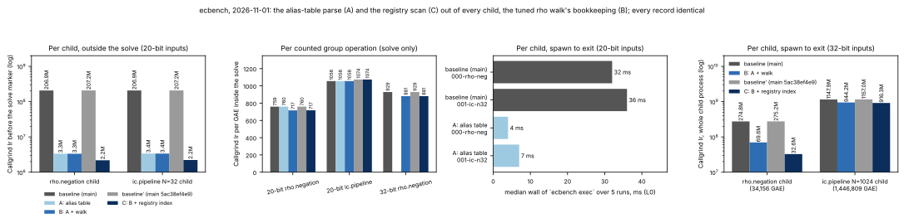

# ecbench: the alias-table parse and the registry scan out of every child, and the tuned rho walk's bookkeeping

**Date.** 2026-11-01. **Status.** Measured. Instruction counts are
Callgrind's (`ecbench audit-ir`, deterministic). Wall time is descriptive:
a shared 4-vCPU cloud VM (Intel Xeon @ 2.10 GHz), L0, no hardware counters.
**Class.** Engineering. Every record of the two scratch sessions replays
exactly under every binary (`verify --replay-all`), so the counted cost
(GAE) of every method, every `S` and every row of the leaderboard are
unchanged; there is no ECDLP cost change and no rho comparison. **No
`benchmarks/README.md` row**: the validation gate admits a row only with a
replay certificate, a validator report and a matched rho reference; the
2026-10-24 child-overhead entry is the precedent, and the browsing copies
are in `benchmarks/20261101-ecbench-child-walk-ir/`.



Three changes, measured as steps from the same baseline:

- **A.** `curve_id::resolve` answers by the binary search over the alias
  table's text (`resolve_key`, already there since #2525) and
  `curve_id::warm` no longer builds the `HashMap<String, String>` from a
  `serde_json::Value` of the 3.6 MB, 42,697-name table. The call to `warm()`
  in `record::child_main` entered `main` with the merge of cbf19ae9af
  (authored 2026-10-16, when the table was about 750 KB and the parse cost
  24M instructions; it reached `main` after the 2026-10-24 child-overhead
  study, which measured a 4.6M-instruction rho child). On `main` 8a208fa570
  every measured child paid 197M instructions before its solve marker.
- **B.** `TunedWalker::walk` (the walk of `rho.negation`, `rho.plain` and
  the automorphism-class variants) computes a point's key and mix once per
  step and carries them to the next step's jump index; the jump index masks
  when the table has 4, 8 or 16 jumps (`rho_jumps_for`) instead of
  dividing; and `rho_canon` negates the reduced coefficients for the
  negation class instead of two `mulmod(·, r − 1, r)`. Every value is the
  one the old code computed.
- **C.** `registry_entry` (`ecbench::workload`) finds a curve's entry in
  `docs/curves/registry.json` (20.8 MB, 20,848 entries, not sorted by slug)
  through `src/cryptanalysis/ecbench/registry_index.txt`, an index written
  beside the registry by `scripts/build_curve_registry.py` (for every
  `"slug": "…"` pair's first occurrence, the byte offset of its value, one
  per line, ordered by slug: 177 KB; the reader takes each probe's slug from
  the registry at the offset; `registry_index_text` in
  `scripts/curve_id.py`), binary-searched as text and the entry cut out at
  that offset; the slug scan and the full parse stay as the fallback and
  the entry is still checked to carry the slug, so every answer is the one
  the full parse gives. `check_curve_names.py` and the unit test fail when
  the index is stale, as for the alias table. (A `build.rs` generating the
  index was tried first: it makes Cargo list every file of the package to
  fingerprint the build script, which CI's partial clones fail. A 754 KB
  `<slug>\t<offset>` form came next and needed an artifact-policy `keep`
  entry, which the repository's `migrate` gate refuses from a pull request;
  the offsets-only form is under the policy's limit for text. The arm C rows
  were re-measured with the final index.) Under B the 32-bit child still spent 37.0M of its
  39.2M pre-solve instructions in that scan (`str::find` from
  `Instance::facts`), because its curve's entry sits deep in the document;
  the 20-bit curve's entry is near the start, which is why the 20-bit
  children showed only 0.9M of it.

## Baseline, arms, inputs

| arm | `ecbench` built from | sha256 (first 16) |
|:--|:--|:--|
| baseline | `main` 8a208fa570 (2026-10-31) | b8775974f8d8d876 (rebuilt for the 32-bit rows: see below) |
| A | baseline + `curve_id.rs` | e6a5053058cd1b0b |
| B | A + `ic_boundary.rs` | 0eff84e84d22b1a6 |
| baseline′ | `main` 5ac38ef4e9 (2026-11-01, the PR's base after merging `main`) | 9dd9e01b6b6b18a2 |
| C | baseline′ + the three source files of A and B + `registry_index.txt` | 0038806674a3af21 |

Inputs: the planned executions of two reduced copies of the frozen 20-bit
holdout spec of `research/prime_base_oracle_tuning_20261029`
(`inputs/spec-p20-profile.json`: arms `rho-neg`, `inc`, `sel`, 12 public
targets, one round; `inputs/spec-p32-profile.json`: `rho-neg` and `inc` at
`N = 1024`, two targets, 32 bits). The exact child inputs
`audit-ir` and `profile-input` export are in `inputs/`. Sessions
ECBS1haae438ff6051 (20-bit, 36 records) and ECBS1h8f9347fe1d3e (32-bit, 4
records) were run with the baseline binary, L0 (`--cpus none`), and are
replayed by every binary. A and B are read against the baseline; C, built
after `main` was merged into the branch, against baseline′ (the same
`main`): between the two bases the `ic.pipeline` solves grew 1.7% at 20
bits for both arms (upstream changes to the IC code), which is why C's IC
solve counts sit above B's.

## Instructions, 20-bit inputs (`audit-ir`; `data/audit_ir_20bit.tsv`)

| child | arm | before the solve marker | solve | GAE | Ir / GAE |
|:--|:--|--:|--:|--:|--:|
| `rho.negation` (seq 0) | baseline | 206,896,333 | 1,295,567 | 1,706 | 759.4 |
| | A | 3,341,048 | 1,296,509 | 1,706 | 760.0 |
| | B | 3,331,282 | **1,222,380** | 1,706 | **716.5** |
| | baseline′ | 207,188,998 | 1,296,397 | 1,706 | 759.9 |
| | C | **2,170,921** | 1,222,979 | 1,706 | 716.9 |
| `ic.pipeline` N=32 (seq 1) | baseline | 206,928,755 | 14,889,758 | 14,101 | 1,055.9 |
| | A | 3,371,805 | 14,885,744 | 14,101 | 1,055.6 |
| | B | 3,362,189 | 14,887,062 | 14,101 | 1,055.7 |
| | baseline′ | 207,239,335 | 15,142,243 | 14,101 | 1,073.8 |
| | C | **2,203,287** | 15,144,353 | 14,101 | 1,074.0 |
| `ic.pipeline` N=45 (seq 2) | baseline | 206,920,193 | 10,123,197 | 10,632 | 952.1 |
| | baseline′ | 207,250,032 | 10,275,946 | 10,632 | 966.5 |
| | C | **2,203,287** | 10,267,488 | 10,632 | 965.7 |

- A takes 98.4% of the pre-solve instructions out of every child
  (206.9M → 3.3M). The 3.3M that remain are the registry entry search, the
  argument parser and the ICV1 identity, as the 2026-10-24 study listed
  them.
- A moves the solve by less than 0.1% in both directions (the name lookups
  a solve makes now go through the binary search rather than a hash map).
- B takes 5.7% of the instructions out of the `rho.negation` solve. The IC
  relation walk is `collect_and_solve_relations_scaled`, not
  `TunedWalker`, and is unchanged. The 20-bit rho solve is 1,706 GAE, so its
  set-up (56 additions, 76 doublings) and verification are a visible share
  of the per-GAE figure; the 32-bit row below is the steady state.
- C takes a further 1.2M out of every 20-bit child's pre-solve count
  (B 3.3M → 2.2M; against baseline′, 207.2M → 2.2M): the scan to the
  20-bit curve's entry near the start of the registry. What remains is
  process start and the loader (0.6M), the argument parser (0.5M, `clap`),
  the entry's own parse, the ICV1 identity and the alias-table binary
  searches. The solve counts move by at most 0.1% between baseline′ and C
  (the name lookups a solve makes).

## Instructions, 32-bit inputs (`data/audit_ir_32bit.tsv`)

Whole-process Callgrind counts (`Collected`: spawn to exit, every dump part)
of `ecbench exec` on the exported 32-bit inputs, and for the rho child the
marker split (`ecbench callgrind-ir`, the split `audit-ir` prints). The
`ic.pipeline` child dumps a part at every relation marker (hundreds of
thousands of files at this size), so its runs discarded the dump data
(`--combine-dumps=yes --callgrind-out-file=/dev/null`) and have no split.
The baseline was rebuilt from the same `main` sources (sha256
b661f953d79dccd8); it reproduces the 20-bit rho child within 0.03%
(206,888,568 Ir before the solve marker, 1,295,929 in the solve). Every
child report (phases, GAE, counters, recovered logarithm) is byte-identical
across the binaries; only wall-clock, scheduler and placement fields differ.

| child | arm | whole process | before the solve marker | solve | GAE | Ir / GAE |
|:--|:--|--:|--:|--:|--:|--:|
| `rho.negation` (seq 0) | baseline | 274,792,709 | 242,782,512 | 31,726,911 | 34,156 | 928.9 |
| | B | 69,591,262 | 39,232,509 | **30,093,469** | 34,156 | **881.1** |
| | baseline′ | 275,220,629 | 243,219,672 | 31,727,893 | 34,156 | 928.9 |
| | C | **32,598,131** | **2,207,376** | 30,092,881 | 34,156 | 881.0 |
| `ic.pipeline` N=1024 (seq 1) | baseline | 1,147,910,545 | — | — | 1,446,809 | — |
| | B | 944,194,507 | — | — | 1,446,809 | — |
| | baseline′ | 1,157,017,508 | — | — | 1,446,809 | — |
| | C | **916,254,438** | — | — | 1,446,809 | — |

- The parse is the same constant per child at 32 bits: 203.5M Ir before
  the rho child's solve marker (242.8M → 39.2M; the 20-bit difference is
  206.9M − 3.3M = 203.6M) and 203.7M of the IC child's whole process
  (1,147.9M → 944.2M). The IC child has no marker split, so its 0.2M
  remainder is not resolved; the 20-bit rows bound the solve-side change of
  an IC child at 0.02%.
- Of the 39.2M that remained before the 32-bit rho child's solve marker
  under B, 37.0M were the registry scan (`callgrind_annotate`: one
  `str::find` from `Instance::facts`); C cuts the entry out at the indexed
  offset and leaves 2.2M, the same floor as the 20-bit children's 2.2M.
  Against baseline′ the rho child's pre-solve count falls by 241.0M (the
  203.5M parse and the 37.5M scan) and the IC child's whole process by
  240.8M (1,157.0M → 916.3M).
- `rho.negation` solve: 31.73M → 30.09M Ir for 34,156 GAE, 928.9 → 881.1
  Ir/GAE (−5.1%). The saving is in the walker's bookkeeping, which is a
  smaller share of a 32-bit step than of a 20-bit one (the extended-Euclid
  inversion runs more steps on 32-bit operands), hence 5.1% here against
  5.7% at 20 bits.
- Whole process, the three changes together, baseline′ → C: 275.2M →
  32.6M for the 32-bit rho child (−88.2%) and 1,157.0M → 916.3M for the
  IC child (−20.8%); at 20 bits, where the solves are 1.2M and 15.1M, the
  child's count goes from 208.5M to 3.4M (rho) and from 222.4M to 17.4M
  (IC N=32).

Run report with the command lines, host and completed runs:
`reports/run-20261101T0130Z/REPORT.pdf`.

## Wall time per child, 20-bit inputs (`data/child_wall_20bit.tsv`)

`ecbench exec` on the exported input, spawn to exit, bash `time`, five
runs each; the first run after a rebuild reads the binary from disk and is
excluded from the medians.

| child | baseline (median of 5) | A (median of runs 2–5) |
|:--|--:|--:|
| `rho.negation` | 32 ms | **4 ms** |
| `ic.pipeline` N=32 | 36 ms | **7 ms** |

Descriptive only (L0, no A/A on this quantity). At 20 bits the solve is
0.3–2 ms of the child, so the saving is the whole of what the child did
besides solving; a 1,008-record 20-bit holdout session spent about 30 s of
its wall on this parse.

## What is left in a `rho.negation` step

Under C, the 20-bit solve spends about 350 Ir per affine addition in
`PrimeCurve::add_raw` (an extended-Euclid inversion by hardware division
and seven reductions by division: for `p ≤ 2^32` one `div` each, for larger
`p` the 128-bit library remainder) and about 360 Ir per step in the walker
(the cycle window's `VecDeque` scan, the look-ahead, the distinguished-point
and Brent tests). The division latency, not the instruction count, is most
of the wall; the lane walker with Montgomery arithmetic exists as the
`walk-prime-lanes` target source and charges its conversions, and the
frozen `targets: walk` arms are measured as built. Not changed here: a
Montgomery or Barrett form inside `add_raw` would do multiplications the
tallies do not count.

## Reproduce

```sh
cargo build --release --locked --bin ecbench
S=research/ecbench_child_walk_ir_20261101
target/release/ecbench run --spec $S/inputs/spec-p20-profile.json --out /tmp/p20 --cpus none --allow-busy
target/release/ecbench verify --dir /tmp/p20 --replay-all --exit-code
target/release/ecbench audit-ir --spec $S/inputs/spec-p20-profile.json --seq 0 1 2 --out /tmp/p20-ir
for s in 0 1; do target/release/ecbench profile-input --spec $S/inputs/spec-p32-profile.json --seq $s > /tmp/in$s.json; done
valgrind --tool=callgrind --cache-sim=no --branch-sim=no --combine-dumps=yes --callgrind-out-file=/dev/null \
  target/release/ecbench exec < /tmp/in1.json > /tmp/out1.json      # whole process: the "Collected" line
ECBENCH_CALLGRIND_SOLVE=1 valgrind --tool=callgrind --cache-sim=no --branch-sim=no --callgrind-out-file=/tmp/cg0 \
  target/release/ecbench exec < /tmp/in0.json > /tmp/out0.json && target/release/ecbench callgrind-ir --prefix /tmp/cg0
/tmp/report-venv/bin/python $S/plot.py
```
