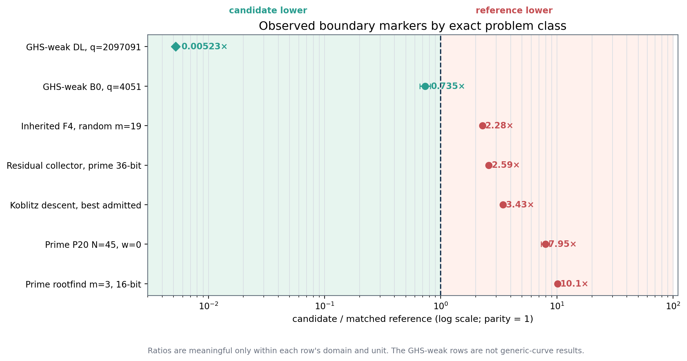
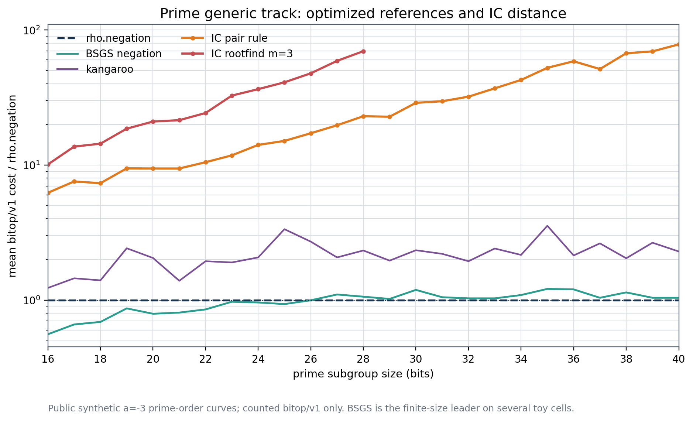
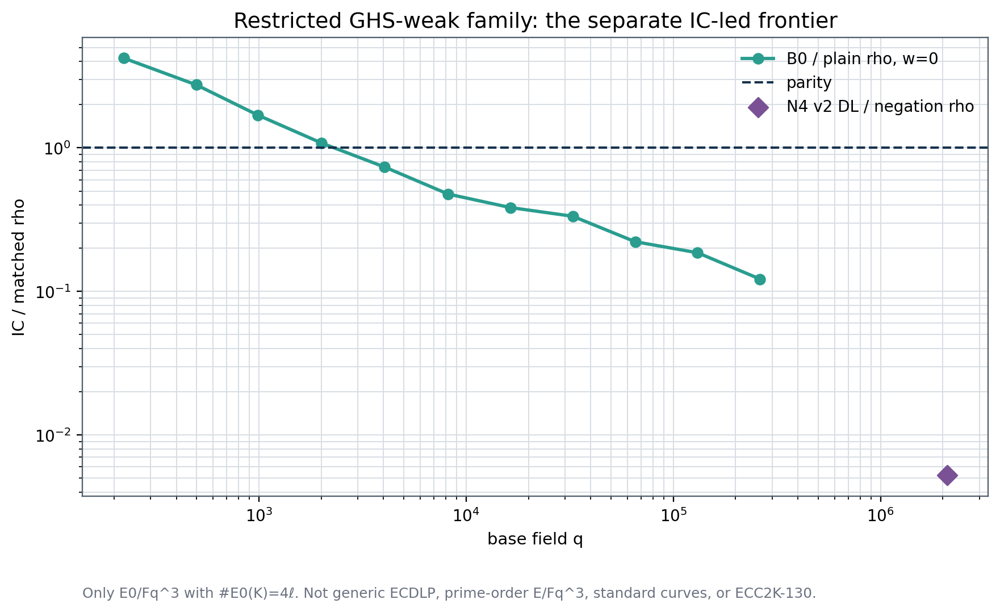
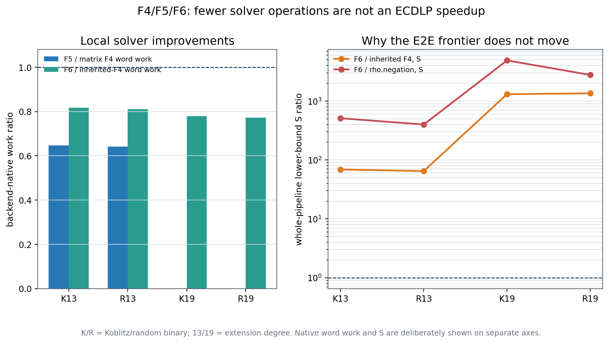

\newpage

# Executive answer

The repository does **not** have one global ECDLP performance frontier. It has
several frontiers indexed by curve family, target law, advice model, accounting
unit, and evidence class. Once those domains are kept separate, the boundary is
clear:

1. **Generic prime, random-binary, and medium/scaling Koblitz elliptic curves
   remain rho-led.** No admitted cold, one-target index-calculus result in
   those panels is below its strongest applicable matched generic reference.
   The closest current repository markers are 2.28× rho for inherited F4 on
   one tiny random-binary cell, 2.59× for the prime residual collector at 36
   bits, and 3.43× on the admitted Koblitz ladder. These are different studies
   and units, so they are boundary markers, not entries in one sortable table.
   A separate n=29 one-column generator-orbit panel does cross below rho-frob,
   but at one column it is a fixed-setup Frobenius-folded BSGS; the gap grows
   with r, so it is not a uniform-target or asymptotic IC crossing.
   The late-main prime-orbit relation collector is also rho-led in its new
   count-first cross-checks: its tuned affine arm costs 5.42× negation rho on
   the generic shape, 4.20× cubic rho on j=0, and 5.79× quartic rho on j=1728.
2. **One restricted curve family is IC-led.** The plane-quartic attack on the
   special GHS-weak family $E_0/\mathbb F_{q^3}$, with
   $\#E_0(\mathbb F_{q^3})=4\ell$, is below matched rho in its own cold,
   one-target comparison. The earlier N4 B0 arm crosses below rho at $q=4051$;
   the N4-v2 double-large-prime arm reaches 0.00523× negation-map rho at
   $q=2{,}097{,}091$. This is a real restricted-family result. It is **not** a
   generic-curve, standard-curve, prime-order $E/\mathbb F_{q^3}$, or
   ECC2K-130 result.
3. **The best newly validated factor-base change is engineering progress, not a
   frontier crossing.** On the 20-bit prime holdout, the selected low-x base
   grows from $N=32$ to $N=45$ and costs 0.836, 0.817, and 0.746 of the
   incumbent at native-operation prices $w=0,0.1,1$. It still costs 7.95,
   8.24, and 9.62 times matched `rho.negation`. The result was reproduced on a
   second L2 EKS host, but covers one curve and gives no exponent. A later
   19,887-job structural screen of Dickson, geometric-progression, and
   quadratic-progression bases found no useful growth in the coincidence
   multiplier: six five-rung slopes lie between -0.0047 and 0.0068, with the
   largest upper 95% limit 0.0147 versus the frozen 1/3 break-even slope. That
   narrows the factor-base search, but it prices neither E2E IC nor rho and
   therefore moves no ranked row.
4. **F5 and F6 improve local solver work without improving E2E ECDLP cost on
   the historical experiment binary.** F5
   uses 0.641–0.647 of matrix F4's word work at degree 13. F6 uses roughly
   0.77–0.82 of inherited-F4 word work and shortens the relation phase by
   1.7–1.9×, but its charged closure/addition work makes its whole-pipeline
   lower-bound cost 64.6–1,352.6× inherited F4 and 399–4,883× rho on the tested
   cells. A fresh current-binary all-replay audit reproduces only 72/144 rows,
   so these numbers remain bound to the original measured binary.
5. **The optimized rho comparison is materially stronger at the implementation
   level.** The trajectory-identical signed-Frobenius rho path uses 0.802155 of
   the same-binary legacy Callgrind instructions, a 1.246642× speedup, while
   counted GAE and all outcomes remain identical. Its native wall improvement
   remains unpromoted because no L2 wall session completed. The new campaign
   therefore uses accounting-v2 rho, a same-target A/A rho control, and also
   measures BSGS and kangaroo where they can be finite-size leaders.

{width=100%}

This report synthesizes versioned evidence; each performance row remains bound
to the source and binary that produced it. The October snapshot executable audit is at
source `ff7ad61cfed11908fb79de9dd485b696d0ada779`. It does not present blocked
jobs as measurements. The exact current-source image is published, but the
mandatory checkpoint gate has no upload credential. The replacement workload
is now split into 92 one-hour-safe planning shards and all 92 pass the exact
binary's planner. The deterministic analysis driver is hash-bound and passes
its check-only gate, but exact-image runtime preflight, prospective freeze, and
a current submission identity are still missing.
Consequently, there is no fresh 2026-10-31 wall-time leaderboard.

A follow-up executable establishment audit passes 19/19 artifact-consistency
checks. It recomputes the decisive ratios, verifies all 30 retained Callgrind
files, reproduces 720/720 optimized-rho rows with the current binary, and
retains a new F4/F5/F6 compatibility failure (72/144 rows reproduce). A pass
means the versioned evidence statements agree; it does not turn the draft EKS
campaign into data.

# 1 November 78-method snapshot addendum

The live registry has grown since the pinned October snapshot. The current
release binary at source `907d68631e79` has **78 top-level method IDs** plus
**24 explicitly audited nested engines**: 11 system solvers, nine PDP3
engines, and four prime PKM tower engines. A fail-closed optimization audit
admits 111 development specs with 78/78 methods and 24/24 nested algorithms;
fresh local sessions exercised all 72 runnable native methods and every nested
engine. The remaining six top-level entries are external CM wrappers without
a real hash-bound backend.

The exact release binary SHA-256 is
`e91c0ec79774af70c3b6af6aaac7b209e8edcdc0e42b1d18e1a92a14af065f65`.
Across 35 admitted L0 sessions it audited 1,005 records, 952 verified outcomes,
and reproduced all 782 eligible deterministic measured runs with zero
problems. These are diagnostic development sessions, not L2 holdouts, so no
leaderboard row changes.

The fresh, current-source performance boundary is:

- Koblitz n=29 generator-orbit IC is the only new holdout candidate, at 0.4405
  [0.363, 0.534] of signed-Frobenius rho in its one-target, full-price L0 cell.
  This remains a fixed-setup candidate, not a family-level or leaderboard win.
- Pair-index F6 reduces inherited-F6 work to 0.2792 [0.246, 0.317], yet remains
  139.30 [85.48, 227.02] times strong rho end to end. The prime PKM F4, F5,
  F6, and enumeration engines remain 4.62--5.03 times negation rho. The best
  matched n=17 system solver is wide FES/Gray-code at 4.28 times strong rho;
  SAT-CDCL, Crossbred, exhaustive, F4 variants, F5, F6, and all root-finding
  variants remain rho-led in their measured cells.
- The separate `ic bench` chained-x diagnostic is also rho-led: inherited F4
  costs 24.71, 144.09, and 794.37 times rho at m=2, 3, and 4. Matrix F5 cuts
  matrix F4 work at m=3 to 0.6276, but still costs 16,296.76 times rho; both
  m=4 matrix arms censor because this oracle ignores the solver wall budget.

Mainline also now contains a distinct end-to-end GHS study, outside ECBench.
It measured 30 applicable toy instances at N=12..28 and verified IC, rho, and
BSGS on all 600 planted logs. Every measured instance remains generic-led:
the best IC/best-generic ratio is 1.91 [1.72, 2.11], and the best IC/rho ratio
is 1.60 [1.25, 2.12]. The genus-4 n=4 fit crosses near N=32 [31, 33], but that
is extrapolated one step beyond the measured range. This does not invalidate
the older `E_0/F_(q^3)` result in its exact restricted family and accounting
domain; it does show that the historical exception cannot be generalized to
the new GHS roster. The new GHS study has no ECBench replay certificate and is
not leaderboard evidence.

Two later mainline packages extend the negative/control side of the frontier.
The skeptic-reviewed evaluation of 12 prime-field IC leads reports no exponent
movement. Sparse, dense, and Bochum-style factor bases match size-matched
random nulls within about 0.0003--0.005 at the tested sizes. A characteristic-2
SAT gadget has conflict slope about 2.58 against the 0.5 m=3 ladder bar and is
3 times slower in CPU at its largest cell. Per-adder multiplier encoding is
0.78 [0.67, 0.92] of schoolbook conflicts at one b=9 prime, but reverses at
b=6 and is censored at larger sizes. Clause retention moves a large setup into
advice, and the proposed ring-linear propagator was not run. The surviving
exponent questions are PKM at m>=4 and the contractor exponent; none of these
rows is an ECBench speed claim.

The subsequent PFDR structured-base census adds 19,887 deterministic jobs on
Dickson, geometric-progression, and quadratic-progression x-bases over
16--32 bits. All six family/theta lines pass the self-test and C3--C6 controls,
and all read `O-SUB-BE`: their fitted log2(kappa)-on-log2(N) slopes range from
-0.0047 to 0.0068, with no `ALIVE` line. This is strong negative structural
evidence against those base families in the tested envelope. It is not an
ECBench session, does not price a complete IC pipeline, and has no matched rho
arm, so the ranked leaderboard remains unchanged.

R7.4 provides a separate binary-Edwards structural control. It proves that
symmetrising by rational 2-power torsion gives the same algebraic system after
an F2-linear substitution and checks 11 identity families on 46 toy curves
with zero exceptions. The pair-table quotient sweep returns exactly the same
relations with 1/mu lookups in all 268,000 checks. Its toy finite-size yield
can lie on either side of parity depending on whether c or c+1 columns are
charged and trends toward the null at n=13,14. No Groebner/F4 oracle or matched
end-to-end rho run was performed, so this is not a new performance row.

## Late-main 79th-method reconciliation

After the 78-method snapshot, main added `ic.prime_orbit_relations_v1`. The
registry-wide optimizer now has an explicit finite-grid policy for its three
true knobs (`coordinates`, `orbits`, and `relations_per_orbit`) and keeps both
operation caps fixed as censoring/resource envelopes. The new fail-closed
receipt covers **114 development specs, 79/79 top-level methods, and 24/24
nested algorithms**: 11 system solvers, nine PDP3 engines, and four prime PKM
tower engines. It reports no missing entries, no structural errors, and no
development/holdout seed reuse. The two warnings only restate that clocks in
two older development specs are descriptive below L2.

The exact executable for the new sessions is source `68a78284` with release
binary
\nolinkurl{sha256:e6c1f5048acb071192f83ab996fd9577c152f136e8e62a301e50b62335ec7879}.
Three prospectively specified L0 sessions add 90 records, all verified, and
all 72 measured deterministic executions replay identically. Cumulatively,
the registry workstream now has 38 admitted L0 sessions, 1,095 records, 1,042
verified outcomes, and 854/854 eligible deterministic measured replays with
zero audit problems. All 73 runnable native methods and all 24 nested engines
have executed; the other six top-level methods remain external CM wrappers
without a real hash-bound backend.

On the one-target generic development grid, affine coordinates with eight
factor-base orbits and 1.5 requested relations/orbit use 0.8721 [0.754, 1.008]
of the charged operations of the 16-orbit affine baseline. At 16 orbits,
Jacobian uses 1.3351 [1.229, 1.450] times affine. This selects the eight-orbit
arm for further testing, but does not justify changing the shipped default
from one toy target.

The ECDLP comparison remains rho-led:

| prime shape | tuned orbit IC / matched rho | pricing-band ratios at w=0,0.1,1 | reading |
|:--|--:|:--|:--|
| generic a=-3 | 5.4169 [3.389, 8.658] | 5.4169 / 5.0235 / 3.0548 | negation rho leads |
| j=0, b=7 | 4.2011 [3.085, 5.721] | 4.2011 / 4.0005 / 2.8097 | cubic rho leads |
| j=1728 | 5.7901 [3.824, 8.768] | 5.7901 / 5.4343 / 3.5160 | quartic rho leads |

These intervals are indicative within-target operation intervals, not
curve-family generalization. Factor-base draws remain unpriced, making the IC
totals lower bounds. Every run is L0 and each comparison has only four measured
pairs, so local wall clocks are descriptive and no leaderboard row changes.
The machine-readable evidence is the
[79-method audit](../ecbench_registry_optimization_20261101/execution/full-development-audit-79.json),
[generic comparison](../ecbench_registry_optimization_20261101/execution/prime-orbit-grid-l0-20261101/comparisons/rho-reference__orbit-affine-o8-r1_5.json),
[j=0 comparison](../ecbench_registry_optimization_20261101/execution/prime-orbit-j0-crosscheck-l0-20261101/comparisons/rho-cubic-reference__orbit-affine-o8-r1_5.json),
and
[j=1728 comparison](../ecbench_registry_optimization_20261101/execution/prime-orbit-j1728-crosscheck-l0-20261101/comparisons/rho-quartic-reference__orbit-affine-o8-r1_5.json).

## Boundary by domain

| Domain | Current finite boundary | Leader | Evidence reading |
|:--|:--|:--|:--|
| Prime-field generic ECDLP | closest recent IC marker 2.59× matched rho; P20 validated base row 7.95–9.62× | generic algorithms | rho remains lower; BSGS can beat rho on several toy bitop cells |
| Random-binary generic ECDLP | inherited F4 2.28× rho on the tiny m=19 diagnostic; admitted ladder 10.6–38.2× | generic algorithms | no IC win |
| Koblitz generic ECDLP | admitted medium/scaling cold IC 3.43–11.5× matched rho; separate n=29 one-column fixed-setup ratio 0.366 [0.241, 0.523] | signed-Frobenius generic walk on the scaling object | no uniform-target/scaling IC win; fixed-setup BSGS engineering crossover retained separately |
| Special GHS-weak $E_0/\mathbb F_{q^3}$ | B0 0.735× at q=4051; N4-v2 DL 0.00523× negation rho at q=2,097,091 | plane-quartic IC | restricted-family IC win |
| Hyperelliptic Jacobians | genus-4 toy row 0.114× rho in bitop/v1 | Jacobian IC | not an elliptic-curve result |
| Standard cryptographic curves / ECC2K-130 | no complete break or scaling evidence | generic security boundary | unresolved by experiment; no claim of a break |

\newpage

# What “the frontier” formally means

## Domain key

A benchmark row is assigned to the exact domain

$$
D=(\mathcal C, G, \mathcal T, A, k, U, P, E),
$$

where $\mathcal C$ is the curve family and representation, $G$ is the
subgroup and cofactor treatment, $\mathcal T$ is the target distribution,
$A$ is reusable advice or preprocessing, $k$ is the number of targets
charged together, $U$ is the accounting unit, $P$ is the native-operation
pricing rule, and $E$ is the evidence class. Two observations from different
domain keys do not form a speed ratio. In particular:

- prime GAE, binary word XORs, SAT conflicts, FES Gray-code vector XORs, and
  native wall seconds are not interchangeable;
- a one-target cold run and a retained-setup online run are different objects;
- a transfer to a special weak curve family is not evidence about the original
  generic family unless an explicit, subgroup-preserving, costed map is part of
  the run;
- L0 shared-host wall time cannot displace L2 isolated wall evidence.

## Cost vector and dominance

For an admitted observation $x$ in a fixed domain, retain the vector

$$
C(x)=(W_0,W_{0.1},W_1,T_{L2},M,A,S,F),
$$

where $W_w$ is counted work with each unpriced native operation charged at
$w\in\{0,0.1,1\}$ GAE, $T_{L2}$ is isolated wall time, $M$ is peak memory,
$A$ is reusable advice, $S$ is success/censoring, and $F$ is the retained
failure set. Observation (x) dominates (y) only if both have the same domain
key, (x) is no worse on every required axis, and it is strictly better on at
least one axis. The frontier is the non-dominated set.

Unknown quantities remain unknown. They are never inserted as zero. A smaller
backend-local counter can move a component frontier without moving the ECDLP
frontier.

## Admission gate

The refreshed ranking requires all of the following:

- exact curve, subgroup, target, factor-base, binary, and algorithm identity;
- cold one-target cost as the primary object;
- strongest applicable rho reference with the same usable symmetry, plus a
  same-target rho A/A control;
- verified scalar recovery and replay of every measured record;
- at least eight public targets and at least five measured rounds;
- at least four sizes before fitting or describing scaling;
- failures, timeouts, work limits, and censored pairs retained;
- the $w=0,0.1,1$ pricing band whenever native operations are not fully
  converted;
- L2 or better isolation for a wall-time claim;
- no cross-ranking of backend-native units.

The full rules and machine-readable design are in [PROTOCOL.md](PROTOCOL.md)
and [protocol.json](protocol.json). The protocol validator reports zero
findings, but the document remains `draft` until the exact current-source ECR
identity, closed roster, and one-hour shard list are committed and frozen
before execution. The image digest itself is already published and recorded.

# Implementation census

The release binary exposes **74 top-level method IDs**:

| Family | Count |
|:--|--:|
| Index calculus and algebraic/transfer candidates | 31 |
| Rho and transfer references | 32 |
| BSGS | 7 |
| Kangaroo | 2 |
| Pair-claw | 2 |

The algebraic pipeline separately exposes **11 nested solver backends**:
`f4-f2`, Buchberger, matrix F4, matrix F5, inherited F4, Crossbred, XL,
SAT-CDCL, scalar FES, wide FES, and exhaustive search. These are not eleven
additional top-level ECDLP methods; they are solver choices inside a complete
pipeline.

Every ID and backend has an explicit disposition in [COVERAGE.md](COVERAGE.md)
and [coverage.json](coverage.json): 13 current-primary methods, 10 diagnostic
methods, 21 legacy controls, 6 pricing-sensitivity methods, and 24
domain-specialized methods. [IMPLEMENTATIONS.md](IMPLEMENTATIONS.md) closes the
additional factor-base, oracle, solver-engine, relation-matrix, target-source,
and symmetry axes hidden behind those IDs. “Legacy” does not mean incorrect,
and “blocked” does not mean slow; it records why the method is not in the fresh
primary campaign.

The exact native registry is preserved in [method-registry.json](method-registry.json).
This prevents “all implementations” from silently meaning only the arms that
appeared in an older report.

# Generic prime-field frontier

## Generic algorithms are the finite-size leaders

On the 16–40-bit prime `bitop/v1` ladder, rho, BSGS, kangaroo, the pair-table
IC rule, and the m=3 root-finding rule are measured on public synthetic
prime-order curves. BSGS is below the current rho implementation on many toy
cells (for example 0.558× at 16 bits), while rho approaches the better scaling
boundary. The IC pair rule ranges from 6.23× to 78.3× rho; root-finding ranges
from 10.1× to 69.7× through 28 bits.

{width=100%}

This is why the draft campaign includes `bsgs.negation_v2` and
`kangaroo.vow_v2` beside `rho.negation_v2`. Rho remains the asymptotic generic
reference; it is not assumed to win every tiny finite instance.

## Factor-base selection

The 2026-10-29 study jointly selected the low-x base size and exact pair oracle
on training curves, then decided each size on a fresh holdout curve. The pair
oracle stayed fixed; only (N) changed.

| Bits | Incumbent → selected $N$ | selected/incumbent at $w=0/0.1/1$ | selected/rho at $w=0/0.1/1$ | Decision |
|--:|:--|:--|:--|:--|
| 20 | 32 → 45 | 0.818 / 0.798 / 0.726 on frozen holdout; 0.836 / 0.817 / 0.746 on second host | 7.95 / 8.24 / 9.62 on second host | promote N=45 engineering baseline |
| 24 | 162 → 115 | 0.902 / 0.940 / 1.126 | 12.44 / 12.92 / 15.19 | pricing relabelling; keep N=162 |
| 28 | 407 → 288 | 0.929 / 0.974 / 1.193 | 20.25 / 20.98 / 24.33 | pricing relabelling; keep N=407 |
| 32 | 1024 → 1024 | 1 / 1 / 1 | 33.30 / 33.18 / 32.61 | null selection |

For P20, the second host admitted all 2,016 executions at L2, verified all
2,016, and matched 1,008/1,008 original records in every counted and
band-priced field. The independent validation is filed in
[`VALIDATION.json`](../prime_base_oracle_tuning_20261029/VALIDATION.json). The
leaderboard's stale “no validation exists” sentence was corrected at the
generator and generated Markdown/HTML/JSON surfaces.

The operational interpretation is narrow: increasing (N) helps the 20-bit
pipeline because the improved relation probability pays back the larger base
and table over that finite envelope. At 24 and 28 bits the decision changes
with the native-operation price, so those candidates do not dominate the
incumbent.

## Structured factor-base growth screen

The preregistered PFDR census tests a different question from the low-x size
sweep: whether structured x-base families make the coincidence multiplier
$\kappa$ grow with problem size fast enough to reach the frozen break-even
slope $\delta^*=1/3$. It ran 19,887 deterministic local jobs across 30 cells,
with five rungs from 16 to 32 bits. The null calibration and planted-growth
controls detect the slopes they are designed to detect; all blocking controls
C3--C6 pass.

| structured x-base | theta | fitted slope | 95% interval | reading |
|:--|--:|--:|:--|:--|
| Dickson | 0.30 | -0.0047 | [-0.0130, 0.0041] | SUB-BE |
| Dickson | 0.35 | -0.0014 | [-0.0088, 0.0070] | SUB-BE |
| geometric progression | 0.30 | 0.0054 | [-0.0031, 0.0136] | SUB-BE |
| geometric progression | 0.35 | 0.0024 | [-0.0049, 0.0098] | SUB-BE |
| quadratic progression | 0.30 | 0.0066 | [-0.0017, 0.0147] | SUB-BE |
| quadratic progression | 0.35 | 0.0068 | [-0.0004, 0.0144] | SUB-BE |

This closes a tested-family branch, not the factor-base problem. It does not
cover the absent FAM-1 MITM engine, a proper-subgroup arm, sizes above 32 bits,
or any E2E cost. The original study is
[source-linked here](../pfdr_other_families_20261101/README.md).

## Root finding: useful algorithm, wrong asymptotic label if overclaimed

`rootfind-subtract` and the m=3 root-finding arm are exact generic
table/search procedures. They can be optimized and ranked E2E, but they do not
receive the factor-base equations inside an algebraic system. They therefore
belong to the **generic decomposition track**, bounded by the square-root
frontier, rather than serving as evidence for a sub-square-root algebraic
attack. The repository's 16–28-bit measurements remain 10.1–69.7× rho in
`bitop/v1`.

The older root-finder replay audit also records an open regression: only
72/168 current-binary replays were identical on 2026-10-19. Affected historical
stage counters remain blocked from promotion. The fresh campaign measures the
current implementation from new records rather than inheriting those counters.

## Best recent prime marker and the missing algebraic baseline

The progress ledger's closest recent prime IC marker is the residual collector
at 36 bits, 2.59× `rho.negation` in cold one-target (S). It is closer than the
P20 factor-base study, but it is not a completed prime Gröbner-basis attack.

There is still no native prime-field ECBench arm that places the factor-base
constraint inside a Semaev system and then runs a complete F4/F5/root-extraction
pipeline against matched rho. Prime PKM/tower and GLV studies contain useful
component counts, but their units and systems do not form that missing E2E
baseline. This is the largest algorithmic coverage hole in the prime program.

## Standalone GPU explicit relations

The RTX PRO 6000 study completes both fixed public 62-bit fixtures, with cold
times 2,139.88 and 2,187.94 seconds in its V11 panel. Certificates replay and
corruption controls pass. It remains **unranked** here because it is a
standalone GPU implementation, its clocks are L0, and there is no same-fixture
ECBench rho arm. It establishes an operational capability boundary, not a
generic or matched-rho frontier.

# Binary and Koblitz frontiers

## Random binary

The admitted random-binary ladder remains 10.6–38.2× matched negation rho. In
the newer F4/F5/F6 cross-family diagnostic, inherited F4 is closer on the tiny
cells: 5.89× at m=13 and 2.28× at m=19. Two sizes do not establish an exponent,
and the study's (S) is a lower bound because backend-native work is unpriced.

The key result is negative but useful: Koblitz-specific structure does not
automatically improve the decomposer if the factor base is folded only by
negation. The same solver ordering and similar local ratios appear on Koblitz
and random-binary systems.

## Koblitz

The admitted cold, one-target Koblitz table covers subgroup sizes around
(2^{36.6})–(2^{47.2}). IC/rho ranges from 3.43× to 11.5×. Setup accounts
for roughly 98.7–99.6% of the cold IC pipeline on the central rows, so an
online-only view can look attractive while the primary cold object remains
rho-led.

The fixed-setup generator-orbit panel is a real but narrower exception. At
n=29 and one factor-base column, `mitm-frobenius-layout-counted` with
`stride-generator` has S=0.546/0.611/1.196 across the pricing band, versus
1.569 for rho-frob, and a paired ratio 0.366 [0.241, 0.523]. The same study
shows why this is not the Koblitz ECDLP frontier: at one column the construction
is Frobenius-folded BSGS, it uses a known generator-orbit column and a different
target source, and its advantage comes from rho's fixed setup at log2(r)=15.4;
the gap grows with r. It is retained as an engineering frontier rather than
pooled with the medium/scaling uniform-target ladder.

The correct Koblitz reference uses signed Frobenius and negation. The canonical
medium-tier counted boundary is 1.089× its floor, with interval
[0.927, 1.261], across six sizes and 144 runs. Pair-claw is a useful
memory/time frontier and reached 1.85× matched rho on one earlier cell, but did
not displace the walk.

The factor-base symmetry lesson is asymmetric:

- folding a base or pair table can reduce stored representatives and setup;
- the matched rho reference must receive the same usable automorphism group;
- a symmetry that helps only a representation stage is not an ECDLP speedup;
- orbit naming, canonicalization, and retained advice must be charged to both
  arms consistently.

# The restricted GHS-weak exception

The repository's only clear IC-led elliptic-curve domain is the special
GHS-weak family $E_0/\mathbb F_{q^3}$ with
$\#E_0(\mathbb F_{q^3})=4\ell$. The comparison is a whole cold one-target
pipeline in $\mathbb F_q$-multiplication equivalents, with no subgroup
enumeration hidden outside the interval.

{width=92%}

The earlier N4 B0 arm crosses below plain rho at $q=4051$, where its ratio is 0.735
[0.662, 0.816] at $w=0$, and falls to 0.122 [0.0987, 0.157] by
$q=262111$. N4-v2 adds double large primes, structured Gaussian elimination,
and block Lanczos; its DL arm reaches 0.00456× plain rho and 0.00523×
negation-map rho at $q=2{,}097{,}091$ in the recorded counted unit.

This result must travel with four restrictions:

1. the curves are intentionally GHS-weak and are not generic curves;
2. they are not generic prime-order $E/\mathbb F_{q^3}$ instances;
3. no standard cryptographic curve is in this family;
4. the result cannot be transported to another curve without an explicit,
   subgroup-preserving, costed map.

The correct synthesis is therefore not “IC never beats rho” and not “ECDLP is
broken.” It is: **IC beats rho on one special weak family; generic ECC remains
rho-led in the measured envelope.**

# F4, F5, F6, SAT, WDSAT, and FES

## F4/F5/F6 result

The cross-family experiment uses eight targets in each of K13, R13, K19, and
R19. Matrix F4/F5 at m=19 hit the retained 1,800-second timeout. At m=13:

| Cell | Matrix F4 word XORs | Matrix F5 word XORs | F5/F4 | Inherited F4 word XORs | F6 word XORs |
|:--|--:|--:|--:|--:|--:|
| K13 | 2.245e9 | 1.454e9 | 0.6465 | 1.112e7 | 9.10e6 |
| R13 | 2.325e9 | 1.495e9 | 0.6414 | 8.66e6 | 7.99e6 |
| K19 | timeout | timeout | unknown | 6.70e8 | 5.19e8 |
| R19 | timeout | timeout | unknown | 7.15e8 | 5.62e8 |

These are historical-binary measurements. The 2026-10-31 current-binary
`verify --replay-all` audit preserves every failure: K13 reproduces 16/48,
R13 32/40, K19 16/32, and R19 8/24 deterministic rows. The X19 timeout control
passes integrity but has zero replayable successful rows. In total, 72/144
rows reproduce and 72 differ; K13 differences include total GAE, phase GAE,
and unpriced accounting. Stored record integrity and original verification
still pass. Therefore the table establishes the ordering for the measured
October 11 binary, not for the current implementation.

F5's signature criterion removes about a third of matrix F4's elimination
work on the same tree. Inherited F4 is roughly 199–222× cheaper than matrix F4
on the m=13 systems. F6 further reduces word work and relation wall time, but
performs exact factor-base point additions for its closure, which dominate the
common priced pipeline.

\newpage

{width=100%}

The versioned frontier rule follows directly: on that measured binary, F5 and
F6 are component leaders in their native scopes, while inherited F4 is best of
these four in the common E2E lower-bound (S), and none beats rho. A new
current-source ranking requires the prepared all-backend rerun.

## SAT-CDCL

SAT-CDCL is live in the nested registry and supports CNF-expanded parity and
native-XOR parity. Existing n=17 records show why conflict counts cannot be a
universal unit: native parity reports thousands of conflicts while CNF parity
reports more than a million on related systems, with different clauses,
auxiliaries, and encodings. A conflict reduction is a solver diagnostic unless
CNF construction, XOR handling, relation yield, verification, and the whole
pipeline share a common priced boundary.

The new solver-backend spec pins encoding and budget and runs SAT beside the
same curve, factor base, target seeds, rho reference, and A/A control. Until
that L2 session completes, SAT is implemented but not a ranked E2E leader.

## WDSAT

WDSAT is a historical external path rather than a current native ECBench
method ID. XG/Gaussian-elimination mode can cut its own conflict count by tens
or hundreds of times, but “conflict” changes meaning with solver, encoding,
and XG mode. More importantly, a retained audit found a false-UNSAT result on
one of sixteen decomposable targets in the unfixed path. The historical WDSAT
evidence is therefore useful for regression and solver research, not for
promotion to the current E2E frontier.

## FES and Gray code

`fes-f2` uses scalar Gray-code enumeration; `fes-f2-wide` evaluates multiple
subcubes through AVX2/AVX-512 and is the strongest exhaustive reference where
its equation limit applies. Gray-code word XORs and vector XORs are native
units, not GAE. Past component studies show real implementation gains, but a
universal gate was not cleared on every cell. The fresh all-backend spec keeps
both implementations, their timeouts, and their native counters, while ranking
only common E2E outcomes.

## Crossbred, XL, Buchberger, and exhaustive controls

These backends remain important controls:

- Buchberger checks that matrix techniques are not winning by an incorrect
  algebraic shortcut;
- Crossbred tests hybrid specialization/elimination;
- XL provides a degree-lifted linearization baseline;
- exhaustive search supplies the correctness and small-system floor.

Their native counter definitions differ, so no report should divide one by
another and call the quotient a speedup. The common comparison starts at the
same ECDLP target and ends only after the recovered scalar verifies.

# Rho comparison: current optimized boundary

The optimized `rho.signed_frobenius_strong` path preserves the exact walk,
recovered scalar, counters, and GAE while reducing implementation instructions:

| Measurement | Result |
|:--|--:|
| Optimized / same-binary legacy Callgrind instructions | 0.802155 |
| Optimized / archived pre-change instructions | 0.804582 |
| Speedup over same-binary legacy | 1.246642× |
| Canonicalization share | 53.91% → 42.48% |
| Verified executions | 864 / 864 |
| Measured replays identical | 720 / 720 |
| GAE optimized / legacy | 1.0000 [1.0000, 1.0000] |
| Native L2 wall verdict | unknown |

The implementation win comes from paired coordinate maps, fixed common byte
shapes, and shared coefficient reduction. It does not change the mathematical
rho operations boundary. A fresh audit hash-checks all 30 raw Callgrind files
and independently recomputes 1,995,304,985 legacy versus 1,600,543,701
optimized instructions; the current binary also reproduces all 720 measured
deterministic rows. The old L0 wall ratio is not promoted.

For the new campaign:

- prime uses `rho.negation_v2` and a byte-identical A/A arm;
- Koblitz carries both `rho.signed_frobenius_strong_v2` and
  `rho.signed_frobenius_strong_escape`, with the former duplicated for A/A and
  the reference-selection rule frozen before data;
- BSGS and kangaroo are measured on prime cells to reveal finite-size leaders;
- every symmetry available to an IC arm is audited for the reference;
- setup, distinguished-point policy, table state, restarts, and verification
  stay inside the declared interval.

# Bottleneck map

| Bottleneck | Evidence now | Why it holds the frontier | Required next gate |
|:--|:--|:--|:--|
| Relation probability / trials | prime and binary IC gaps grow across several ladders | solver improvements do not change the probability of a useful decomposition | algebraic factor-base constraint inside the system; four-size E2E sweep |
| Structured factor-base yield | six PFDR lines over three families and 16--32 bits have slope -0.0047 to 0.0068; largest upper 95% limit 0.0147 versus 1/3 | the tested structures do not make useful coincidences grow fast enough | test a new mechanism or integrate the base constraint into a fully priced E2E solver; do not extend these families by default |
| Factor-base and pair-table setup | 98.7–99.6% of central cold Koblitz rows; $O(|F|^2)$ pair materialization | online-only improvements disappear when one target pays setup | cold primary result; equal-advice online secondary result |
| F6 closure additions | historical binary: 64.6–1,352.6× inherited F4 in lower-bound S; current replay 72/144 overall | local word-XOR savings are overwhelmed by exact group work, while current counts need remeasurement | price closure and solver in one common unit; rerun current source; change closure algorithm, not label |
| Matrix F4/F5 scale | m=19 matrix arms time out at 1,800 s | symbolic preprocessing and matrix construction explode before useful scaling | memory/degree receipts and retained timeout curve |
| Solver-counter mismatch | XORs, conflicts, vector steps, multiply-adds | cross-solver ratios lack semantic equality | E2E wall or complete common pricing; native counters remain diagnostics |
| Linear algebra | large stage-only speedups, small E2E changes in several pipelines | relation collection and setup dominate | measure phase share before further LA work |
| Rho reference quality | 19.8% instruction cut; toy BSGS sometimes below rho | a weak reference creates false IC wins | current accounting-v2 rho, A/A, BSGS/kangaroo finite-size controls |
| Prime algebraic coverage | no complete native prime F4/F5 factor-base-constrained arm | generic root finding cannot answer the algebraic claim | implement and validate a prime algebraic reference arm |
| Evidence portability | mixed L0/L1 historical wall, one-curve studies | host effects and curve effects are confounded | L2 second host, at least 8 targets, 5 rounds, and 4 sizes |
| GPU integration | verified 62-bit standalone result, no matched rho | capability result cannot enter the ECBench Pareto set | native adapter, same fixtures, matched reference, isolated clocks |

The dominant pattern is that improvements are arriving after the point that
currently controls total cost. Fast root extraction does not fix relation
probability; fast linear algebra does not fix pair-table setup; fewer F6 XORs
do not fix closure additions. The next useful optimization should be selected
from the measured whole-pipeline phase share, not from the largest isolated
microbenchmark speedup.

# Curve-by-curve interpretation

## Toy curves

Toy curves are valuable for exhaustive controls, replay, seed-law tests,
solver parity, and detecting fixed overhead. They do not establish a security
claim. At 16–26 prime bits, BSGS can beat rho in `bitop/v1`; at binary m=13,
fixed setup can make the “strong” parallel rho variant worse than simple
negation rho. The report therefore retains multiple generic controls.

## Medium experimental curves

The repository's most informative generic boundary comes from ladders with
enough sizes to reveal whether a fixed overhead is fading or a gap is growing.
Prime pair/rootfinding costs move away from rho through 40/28 bits. Koblitz
one-target IC remains several times rho through roughly 47 subgroup bits. The
62-bit GPU fixture is operationally larger but is not a matched frontier row.

## Special transfers and covers

Isogeny, quartic-cover, GHS-cover, three-leads genus-2, and hyperelliptic paths
must each retain the map, subgroup image, target transport, and inverse
recovery cost. A cheaper DLP on the destination object helps only when those
obligations are explicit and cheaper end to end. The GHS-weak family is a
direct restricted problem class, not a free transfer from arbitrary curves.

## Standard curves and ECC2K-130

No standard curve in the registry has a completed IC solve that changes its
security boundary. The repository's ECC2K-130 material is a feasibility and
solver program, not a demonstrated break. Claims about standard curves remain
bounded by generic algorithms and external cryptanalytic knowledge, not by
extrapolating toy ECBench fits.

# Fresh campaign status

The original nine exact-build specs remain preserved as the broad planning
draft: 4,704 processes, several per-child timeouts equal to the entire
one-hour queue deadline, and missing domains. They will not be submitted.

The replacement contains 92 candidate/reference/A/A specs. Two four-target
blocks give eight prospectively selected targets per comparison cell; each has
one warmup and six measured rounds in balanced alternating order. A shard with
$a$ arms uses child timeout
$\lfloor2400/(4\cdot7\cdot a)\rfloor$ seconds. The resulting range is 12–28
seconds, and the largest sum of timeout ceilings is 2,380 seconds. At least
1,220 seconds of the EKS deadline therefore remains for deterministic workload
construction, Karpenter provisioning, setup, audit, and upload.

| Panel | Jobs | Planned processes | Target law |
|:--|--:|--:|:--|
| Prime 20/24/28/32, IC and generic algorithms | 16 | 2,632 | public |
| Koblitz 13/19/23/31, rho/rootfinding/F4/F6/claw | 32 | 5,152 | public |
| Random binary 13/19/23/31, matrix F4/F5 and inherited F4/F6 | 16 | 1,792 | public |
| Eleven nested algebraic solver backends | 12 | 1,960 | public |
| j=0 and j=1728 symmetry | 4 | 672 | public |
| n=29 generator-orbit fixed-setup engineering | 2 | 392 | public |
| F_((2^m)^4), specialized m=10/12/15 and wide m=16 | 8 | 1,008 | planted known-answer |
| Binary n=11 double-large-prime v2 | 2 | 280 | public |

The exact pinned executable accepts all 92 specs, expands 13,888 processes,
and reports zero planning failures. The closed roster check covers all 13
top-level methods classified `current_primary` and all 11 nested solver
backends. Exact spec IDs and file hashes are retained in
[execution/shard-preflight-plans.json](execution/shard-preflight-plans.json),
and [SHARDS.md](SHARDS.md) gives the complete reference rules.

The extension-field target law is a disclosed limitation. Each
`f2m4_torsion` fixture exhausted the harness's fixed 10,000-attempt public
hash-to-subgroup constructor. Those eight specs therefore use planted
known-answer targets, with the scalar hidden from every solver. They can
compare implementations on matched targets but cannot enter the public-target
frontier. The wide m=16 arm is also expected to censor under the short queue
cap; historical executions took hours.

Trusted publication run 41241104247 built the exact static x86-64 binary,
SHA-256
\nolinkurl{924d090c1d83a20ce954848c04b116cee4d5a7cb04187bb618dff60958bfd64d},
and image digest
\nolinkurl{sha256:b8c20f9c151360b78f505360e8d47068c4068f00a8f6faa7ebd3086fa0a791c6}.
That run was publication-only; it submitted no experiment.

Paid execution remains blocked. `scripts/checkpoint.sh gate` is mandatory, but
this workspace has no checkpoint upload token, token file, AWS CLI, or AWS
identity. Repository authentication now succeeds for the authorized account,
but no direct Iso Lab tool is installed and GitHub access alone cannot satisfy
the checkpoint or execution-authority gates. The analysis driver is already
hash-bound; exact-image runtime preflight and the prospective protocol freeze
remain open. The exact state is in
[execution/BLOCKER.md](execution/BLOCKER.md). Local wall timing is not silently
substituted.

Before the first warmup, the executor must:

1. provision an authorized AWS/Iso Lab submission identity while retaining the
   working repository identity;
2. run exact-image preflight for each arm class and preserve the bound analysis script;
3. provision checkpoint transport and pass `scripts/checkpoint.sh gate`;
4. freeze and merge these exact 92 spec IDs to `main`;
5. reconcile existing receipts and submit each paid shard exactly once;
6. upload raw records, host capsule, replay receipt, A/A analysis, and hashes;
7. retain every timeout, failure, and unattempted cell;
8. regenerate the Pareto tables and this report from admitted records only.

# Conclusions and research priorities

The performance frontier is now explicit:

- **Generic ECC:** rho/BSGS/kangaroo remain the medium/scaling leaders; the
  n=29 one-column generator-orbit fixed-setup BSGS crossover is separate and
  does not establish a generic IC crossing.
- **Restricted GHS-weak ECC:** plane-quartic IC is the leader and must remain
  labelled as a special-family result.
- **Prime engineering:** P20 $N=45$ is the validated factor-base baseline,
  still roughly 8–10× rho. The newer orbit collector's best toy configuration
  is affine/eight-orbit, but remains 4.20–5.79× matched rho across its three
  L0 prime-shape checks. The PFDR screen also rejects useful coincidence-growth
  evidence for Dickson, geometric, and quadratic x-bases through 32 bits; it is
  structural evidence, not an E2E comparison.
- **Algebraic solvers:** F5 and F6 win component metrics; inherited F4 wins the
  tested common E2E lower-bound comparison; rho wins the ECDLP comparison.
- **SAT/WDSAT/FES:** implemented or historically explored, but not yet on one
  common, validated E2E frontier; WDSAT also carries a retained correctness
  failure in an old path.
- **Root finding:** valuable generic decomposition machinery, not evidence for
  an algebraic sub-square-root attack.
- **Rho:** instruction-level optimization is real and verified; isolated native
  wall promotion is still open.

The highest-value next work is therefore:

1. provision checkpoint/submission transport, finish runtime preflight,
   merge the closed shard protocol with its bound analysis driver, and execute its L2
   campaign;
2. implement the missing prime factor-base-constrained algebraic arm;
3. attack relation yield and cold setup before further optimizing stages that
   are already a small share;
4. integrate the GPU relation engine with a matched ECBench reference;
5. preserve the GHS-weak win as a separate domain rather than using it to
   headline generic curves.

# Reproduction and evidence index

The report is generated only from committed data and prior frozen evidence.
Presentation data are in [frontier_snapshot.json](frontier_snapshot.json), and
[`render_figures.py`](render_figures.py) renders all four figures. Important
sources are:

- [canonical IC leaderboard](../../docs/ic/LEADERBOARD.md);
- [ECBench contract](../../docs/ecbench/README.md);
- [backend-frontier contract](../../docs/ecbench/BACKEND_FRONTIER.md);
- [F4/F5/F6 result](../f4_f5_f6_cross_family_20261011/RESULT.md);
- [rho optimization](../ecbench_rho_optimized_20261014/README.md);
- [prime factor-base second-host replay](../prime_base_oracle_tuning_20261029/second-host/README.md);
- [PFDR structured-factor-base screen](../pfdr_other_families_20261101/README.md);
- [GPU explicit-relations result](../explicit_relations_e2e_20261030/RESULTS.md);
- [literature and prior-evidence ledger](LITERATURE.md);
- [live coverage](COVERAGE.md), [closed roster](IMPLEMENTATIONS.md), and
  [queue-safe shards](SHARDS.md);
- [campaign protocol](PROTOCOL.md) and [pre-data analysis driver](analyze_shards.py);
- [executable establishment certificate](establishment/README.md).

Primary mathematical references used to set the boundary include Shoup's
generic-group lower bound (EUROCRYPT 1997,
[DOI 10.1007/3-540-69053-0_18](https://doi.org/10.1007/3-540-69053-0_18)),
Faugère's F4
([DOI 10.1016/S0022-4049(99)00005-5](https://doi.org/10.1016/S0022-4049(99)00005-5))
and F5
([DOI 10.1145/780506.780516](https://doi.org/10.1145/780506.780516)),
Semaev's summation-polynomial work
([IACR ePrint 2004/031](https://eprint.iacr.org/2004/031)), and the
Faugère–Perret–Petit–Renault binary-field IC analysis
([DOI 10.1007/978-3-642-29011-4_4](https://doi.org/10.1007/978-3-642-29011-4_4)).

No sentence in this report converts a missing measurement into a loss, a local
counter into an E2E speedup, a special-family result into a generic break, or a
draft EKS plan into fresh benchmark data.
