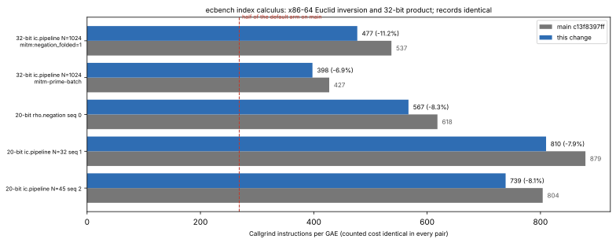

# ecbench index calculus: the 32-bit Euclid inversion in assembly, the 32-bit product by one `div`

**Date.** 2026-11-03. **Status.** Measured. Instruction counts are
Callgrind's (deterministic); no wall-time claim. **Class.** Engineering.

The counted record is identical to `main`'s for every measured child. The
only fields that differ are wall-clock, placement, fault and scheduler
fields. That covers the recovered logarithm, the GAE per phase, every
counter and the unpriced list, so no `S`, GAE or leaderboard row changes.

- **Baseline:** `main` c13f8397ff, built from the same tree without this
  change.
- **No `benchmarks/README.md` row** (validation gate). Browsing copies are
  in `benchmarks/20261103-ecbench-ic-asm-euclid/`.



## Target and outcome

The request was to halve the instructions per group operation (Ir/GAE)
of the index-calculus code. On the 32-bit `ic.pipeline` child (N = 1024,
1,446,809 GAE) this change gives:

| Arm | `main` Ir/GAE | This change | Change |
|:--|--:|--:|--:|
| default oracle `mitm:negation_folded=1` | 537.0 | 476.8 | −11.2% |
| existing `mitm-prime-batch` arm | 427.2 | 397.7 | −6.9% |

The prime-batch arm keeps the same GAE and logarithm, and builds the table
with one shared inversion per row. With this change it is 0.741 of the
default arm on `main`.

**Half is not reached.**

## What changed (`src/cryptanalysis/ic_boundary.rs`)

- **`invmod_u32` in x86-64 assembly (`euclid_u32_x86`).**
  - The 2026-11-03 disassembly of `PrimeCurve::add_raw` showed something
    unexpected. The compiler had folded round 3's two-half Rust loop back
    into one swapping loop with a sign flag: 13 instructions per step,
    and a run-time test of the operand width before every division.
  - The assembly is the two halves, eight instructions per step.
  - It produces the same quotients, remainders, Bézout magnitudes and
    sign, so the same inverse.
  - The portable loop (`euclid_u32`) remains for other targets.
- **`mulmod` below 2³² by one 64-by-32-bit `div` (`mulmod_u32`).** The
  compiler's `(a * b) % m` divides by a 64-bit register, after a run-time
  test of whether both operands fit 32 bits. The quotient `a·b / m` is
  below `m`, so the 32-bit divide is exact and gives the same remainder.
- **New test** `euclid_asm_and_32_bit_mulmod_match_the_portable_forms`.
  - Ten moduli, at and near 2³², primes and composites, 4,096 random
    operands each plus edge operands.
  - Checks the assembly against the Rust loop and the product against the
    128-bit remainder.
  - Passes, along with the existing `invmod_32_bit_path_matches_the_64_bit_loop`
    and `invmod_inverts_every_unit_of_small_moduli`.

## Instructions (Callgrind Ir, `data/ir.tsv`)

| Child | GAE | `main` | This change | Change |
|:--|--:|--:|--:|--:|
| 32-bit `ic.pipeline` N=1024, default oracle (whole child) | 1,446,809 | 776,953,078 | **689,798,132** | −11.2% |
| 32-bit `ic.pipeline` N=1024, `mitm-prime-batch` (whole child) | 1,446,809 | 618,139,505 | **575,394,244** | −6.9% |
| 20-bit `rho.negation` seq 0 (solve) | 1,706 | 1,054,694 | **967,499** | −8.3% |
| 20-bit `ic.pipeline` N=32 seq 1 (solve) | 14,101 | 12,399,287 | **11,420,269** | −7.9% |
| 20-bit `ic.pipeline` N=45 seq 2 (solve) | 10,632 | 8,547,378 | **7,851,935** | −8.1% |

The 20-bit rows are from `ecbench audit-ir`.

## What was tried and not kept (`data/negative_arms.tsv`)

- **Sizing the relation guard from `max_trials`.**
  - The aim was to stop it rehashing: 18.8M Ir on the 32-bit child.
  - That child improved to 670.87M, but the 20-bit `ic.pipeline` solves
    got worse: 13.17M and 9.93M Ir. Their `max_trials` is far above the
    trials they run, so the oversized table cost more to allocate and
    clear than the rehashing it saved.
  - Dropped.
- **`targets=walk-prime-fast` on the prime-batch arm.** Same GAE and
  logarithm, but 971.94M Ir. Not used.
- **`mitm-prime-blocked`** is the existing blocked-layout arm: 549.76M Ir
  with the guard variant. Recorded for reference.

## Where the instructions are now, and why half is not reached here

Profile of the prime-batch arm with the guard variant (556.46M Ir, by
function, `cgsum` over the per-part Callgrind dumps):

| Part | Ir | Unit cost |
|:--|--:|:--|
| table build | 178.8M | |
| shared inversion | 30.0M | |
| affine additions (walk and probe) | 111.7M | |
| relation collector | 98.5M | |
| guard inserts | 27.7M | |
| table lookups and probes | 35.0M | |
| per-trial phase trace (measurement protocol) | 44.2M | |

- The table build and its shared inversion come to about 199 Ir per
  table pair.
- Every walk step pays one Euclid inversion, about 144 Ir, inside its
  affine addition. A batched walk (`walk-prime-lanes`) would change the
  trajectories, so the relation count and GAE, so it is not an
  engineering change.
- Halving would need ≤ 268 Ir/GAE on the default arm's terms. That means
  removing roughly another 190M Ir from parts that each cost tens of
  millions.

## Next

1. **The prime-batch table build's map insert.** It is a hashbrown `entry`
   per pair, and an open-addressed packed table could replace it. Changing
   the layout is an engineering change if the witnesses are kept.
2. **The collector's per-trial bookkeeping.**
3. **A batched walk,** which needs its own protocol (algorithmic).

## Reproduce

```sh
cargo build --release --locked --bin ecbench
target/release/ecbench profile-input --spec research/ecbench_ic_asm_euclid_20261103/data/spec-p32-batch-arms.json --seq 2 > /tmp/pb.json
valgrind --tool=callgrind --cache-sim=no --combine-dumps=yes --callgrind-out-file=/dev/null \
  target/release/ecbench exec < research/ecbench_ic_asm_euclid_20261103/data/input-32bit-ic-default.json >/dev/null
valgrind --tool=callgrind --cache-sim=no --combine-dumps=yes --callgrind-out-file=/dev/null target/release/ecbench exec < /tmp/pb.json >/dev/null
target/release/ecbench audit-ir --spec research/ecbench_child_walk_ir_20261101/inputs/spec-p20-profile.json --seq 0 1 2 --out /tmp/p20-ir
cargo test --release --locked --lib -- euclid_asm invmod_32_bit invmod_inverts
/tmp/report-venv/bin/python research/ecbench_ic_asm_euclid_20261103/plot.py
```
