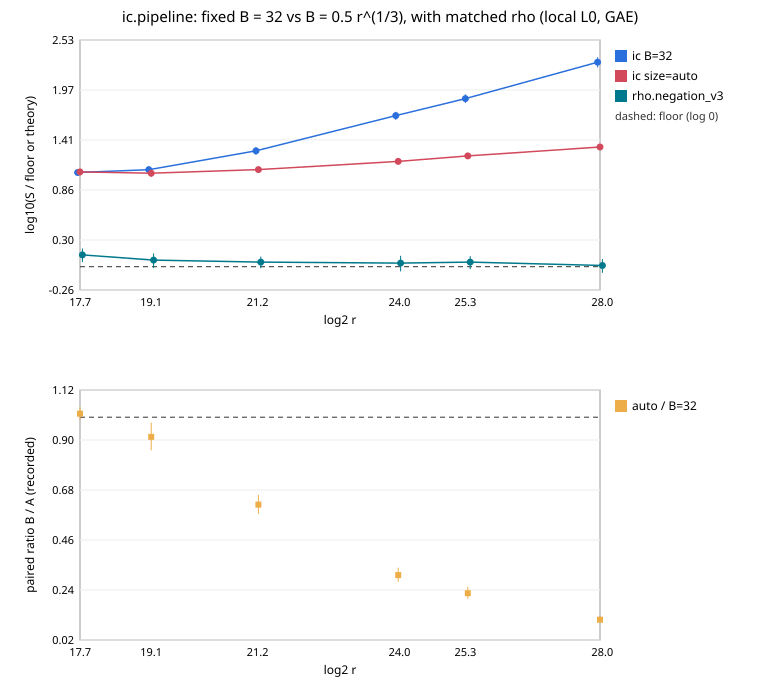

# ic.pipeline: a factor base sized to r moves the exponent from ~1 to the family's 2/3

**Result (measured, counted GAE, local L0 host).** `prime-abscissa:size=auto`
sets B = round(0.5·r^(1/3)) (commit `c047182e27`). With it, `ic.pipeline`
(pair-table MITM oracle, incremental Gauss) costs **0.247× the fixed
B = 32 cell** [0.207, 0.295]. The pairing covers 288 pairs on six prime
curves, 2^17.7 to 2^28, and the order holds across the §5a band (0.247 /
0.234 / 0.192 at w = 0 / 0.1 / 1). The fitted exponent moves from
**α = 0.908 [0.828, 0.989]** to **α = 0.598 [0.564, 0.631]**. The
intervals are disjoint over six sizes: by `docs/bounds/README.md` §2 this
is an exponent-level change. At 2^28 the ratio is 0.113 (S 19.2 against
169.7). [pcc:unverified]: no validator report or isolab L2 run yet.

## Theory, and where the measurement sits

Derived (a read-only subagent, from `ic_framework/plugins.rs` and the
2026-10-03 session records). With a fixed B the trial success probability
is about 2B²/r and the number of relations needed is independent of r. The
relation phase therefore grows like r: **α = 1**. The 2026-10-03
`subtract` cell measured 1.005. The m = 2 family optimum balances the
B(B+1) table against about 0.3·r/B relation trials: B ~ r^(1/3), cost
**r^(2/3)** (`ic_boundary.rs` `family_optimum_s`, "no choice of base size
escapes it"). The constant c = 0.5 comes from that balance; a 2^20 and
2^24 smoke with c = 0.3 / 0.5 / 0.8 put 0.5 lowest at 2^24.

Measured per phase (bound `ECBND1hd5b12bce4933`):

| phase | share of GAE | α [95 %] | theory |
|:--|--:|:--|:--|
| oracle_setup (table) | 0.318 | 0.663 [0.657, 0.666] | 2/3 |
| relations | 0.682 | 0.575 [0.530, 0.617] | 2/3 asymptotically (r/B) |
| verify | 0.000 | 0.069 | O(log r) |
| total | 1 | 0.598 [0.564, 0.631] | 2/3 |

The total sits slightly below 2/3, as a pre-asymptotic fixed share would
put it; it does not sit above. With the unpriced linear-algebra row
operations and table probes charged at 1 GAE each, α is 0.617 (bound
`ECBND1hff39ba4fe3d0`), and at 0.1 GAE it is 0.602 (`ECBND1h59db5790c7c9`).

The fixed-base incumbent measured α = 0.908 here, with its relation phase at
0.947 [0.888, 1.000]. That is the predicted 1 with a falling fixed share.

## Distance to rho (reported, not a gate)

On the same curves and targets, `ic.pipeline size=auto` costs 12.8×
`rho.negation_v3` [11.7, 14.0] pooled, and 11.4× `rho.negation_v2`. The
order holds at every band weight. By size, S is 10.1 / 9.8 / 10.7 / 13.3 /
15.3 / 19.2 against rho_v3's 1.20 / 1.05 / 1.00 / 0.97 / 1.00 / 0.91. The
gap grows like r^(1/6), which is the family's algorithmic limit on prime
fields, not an implementation shortfall.

## Run

| item | value |
|:--|:--|
| spec | `research/ecbench_ic_auto_base_20261107/spec.json`, spec id `ECS1h6ce730e2b4fb` |
| session | `ECBS1haaa9771f60b5`, `sessions/main/`, complete |
| commit / binary | `c047182e27` (tree dirty only in unrelated rustfmt rewrites) / sha256 `6a5f9e48…0529` |
| host / isolation | Claude Code cloud container, 4 vCPU, **L0**; wall figures diagnostic |
| arms | incumbent `ic.pipeline` B = 32, candidate `ic.pipeline` size=auto, A/A of the incumbent, `rho.negation_v2`, `rho.negation_v3` |
| workloads | `prime_search` bits 18–28 seed 59297, 16 planted targets each, target seed 20261108 |
| runs | 3 rounds + 1 warm-up; 1920 records, 1920 verified |
| audit | `audit.json`: `verify --replay-all`, 1440 replays reproduced, 0 problems |
| A/A | incumbent-aa / incumbent ops 1.0000 (deterministic), wall 1.009 [0.982, 1.037] |
| bounds | `bound-candidate.json` `ECBND1hd5b12bce4933`, `bound-incumbent.json` `ECBND1h845a21a63e0a`, `bound-rho-v3.json` `ECBND1ha760bd8e5744`, band fits `bound-candidate-w0.1.json`, `bound-candidate-w1.json` |

## Not established here

- Only the prime-field, m = 2, MITM pair-table configuration. Other oracles
  (`subtract`, `ksum`) and Koblitz bases do not read `size=auto`.
- Memory: the table holds about B² ≈ 0.25·r^(2/3) entries. The frontier's
  `memory` axis reports it; it is not priced in GAE.
- L0 container, no validator report, no independent-host replay. These are
  not leaderboard rows until the validation gate is met.
