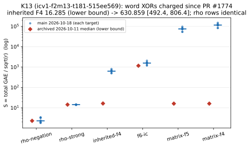

# ecbench instrument defects D1, D3, D5 (pilot 2026-10-30), fixed or written up

Status: **D3 and D5 fixed in `ecbench` with tests; K13 leaderboard entry
corrected with a dated note; D1 investigated read-only, with a remedy script
for the owner.** Class (AGENTS.md §3): instrument and accounting. Nothing
here changes the work any method does, and no row of tables A–C moves.

Source: the pilot report on `research/published-ic-reference-arm-20261024`
(`backlog/XP-20261024-published-ic-reference-arm/PILOT_20261030.md`,
section 6, commit `f1945d0b9a`).

## D3. Solver units `ecbench` does not recognise

### What was wrong

An IC record's solver block carries `ops` in the solver's own `op_unit`.
Two places priced a unit nobody had told `ecbench` about, without saying so:

1. `run_pipeline` prices any unit other than word XORs and field
   multiplications at wall time over `ns_per_add`. `ecbench` runs IC with
   `pinned_only_calibration` (`ns_per_add = 1`), so the "price" is wall
   nanoseconds read as GAE. The pilot's msolve arm (`op_unit` =
   `msolve instructions retired`) shows it:
   `framework_total_gae_before_solver_removal` = 95,534,344,150 =
   solver `wall_ns` 95,534,343,750 + 400. `ic_report` then removes the
   term and lists `solver_msolve_instructions_retired_uncharged`. That tag
   looks like any known unit left uncharged, so `S` (35.49 at n = 9) equals
   the lab arm's.
2. `band::unpriced_counts` (AGENTS.md §5a) counts every `solver_*` tag as
   `solver.ops`, whatever the unit. The band would have charged msolve's
   ~10¹² retired CPU instructions at `w` GAE each, as if they were native
   solver operations.

### Fix

- `band.rs`: `RECOGNISED_SOLVER_UNIT_FAMILIES` lists every `op_unit` in
  `src/` and in the committed records as of 2026-10-30: word XORs, word
  operations, vector XORs, row-by-row-equivalent 64-bit XORs, `mac_op`,
  F_p multiplications, F_p multiply-adds, F_q multiplications, monomial
  operations, monomial tests and conflicts, each bare or qualified as
  `family (…)`. `solver_unit_recognised` and `has_unrecognised_solver_unit`
  read it.
- **Refusal.** A record whose solver counted operations (`ops > 0`) in any
  other unit has no count for its `solver_*` entries. The band gives it no
  priced cost above `w = 0`, so `compare` and `band` report "unrankable
  (uncounted unpriced work)" instead of ranking it. This also covers
  records written before this change. `band.rs` reads only `ops` and
  `op_unit`, the only solver fields the backend-leaderboard reader has.
- `methods.rs` (`ic_report`): such a record (`ops > 0` or `calls > 0`)
  also carries `unrecognised_solver_unit` in `cost.unpriced`, hence
  `lower_bound`, so the record itself says why.
- `ic_framework` pricing, `detail` fields and every recognised unit are
  unchanged. Records with recognised units come out identical (checked
  below).
- **Effect on committed evidence: none.** I scanned all 10,910 committed
  `ecbench.record` lines on main (120 `.jsonl` files): 3,278 have a solver
  block, and 0 have `ops > 0` in an unrecognised unit. No row of
  `docs/ic/LEADERBOARD.md` or `docs/backend-leaderboard/` moves.
- **Consequence for msolve arms.** Records of an msolve arm (the
  published-IC-reference-arm work) become unrankable above `w = 0`. Records
  committed before this change also fail an exact replay afterwards,
  because the replay adds `unrecognised_solver_unit` to `cost.unpriced`.

Adding a new solver unit now needs a deliberate entry in the list. That
entry is where to decide whether the unit is a native operation count.

## K13: 16.29 on the leaderboard against 631 in the pilot

**Verdict: both are correct, under different pricing rules. Neither is a
measurement error. The leaderboard figure is the stale one; it is now
corrected with a dated note and kept.**

- **16.285** (`docs/ic/LEADERBOARD.md`, cross-family table, Koblitz
  m = 13) is the median inherited-F4 `S` of session `ECBS1h2b56c13eeaec`
  (2026-10-11, x86-64). It was recorded before PR #1774 (`cd226d0ce`,
  2026-10-14), when the qualified unit
  `word XORs (elimination, specialisation and linear elimination only)` did
  not match the pinned `ns_per_word_xor`. The word XORs were uncharged and
  the row is a lower bound, as its label says.
- **630.859 [492.449, 806.366]** is the same spec on the same 8 targets,
  re-run on main *as of 2026-10-18* (`abee07ee7`; `research/f4_pricing_jump_20261018/leaderboard_rerun/`,
  session `ECBS1h4badc043049a`, `lower_bound: false`). It charges the
  word XORs at the pinned 0.002304 GAE each. The pilot's `B13r` (631,
  492 to 806, aarch64) reproduces it. Both rho arms are identical to the
  archive, which confirms that the targets match.
- The 39-fold gap is one accounting change, PR #1774, already explained in
  `research/f4_pricing_jump_20261018/README.md`. That note left the
  leaderboard unregenerated.
- **Scope of "correct".** 631 is complete only under the pinned word-XOR
  ratio. Whether one ratio prices word XORs and group additions fairly is
  the cross-unit question owned by the published-IC-reference-arm work (the
  pilot's instruction-based control disagreed by ×20). It is not settled here.
- **Not today's main.** Today's main (`11173ecd02`) does not reproduce the
  2026-10-18 solver counts exactly (see "Replay check"). That drift is
  outside this verdict: it is not a 39-fold effect.
- **Distance to rho** (success criterion, owner 2026-10-15): inherited F4 at
  630.859 is 275× rho-negation (2.290) and 44× strong rho (14.318) on this
  cell.

The correction lives in the builder (`scripts/build_ic_leaderboard.py`):
`f4_f5_f6_cross_family_diagnostic.corrections` and a dated paragraph and
table under the cross-family section of `LEADERBOARD.md` and
`ic-leaderboard.html`. Every archived figure stays. The re-run records and
the pricing-jump note are new builder sources, added to the workflow
`paths:` as well.



*`k13_correction.svg` / `.png` / `.pdf` (source `plot.py`): every K13 arm,
archived median against each target on main, log scale.*

Generated-file note. In this sparse tree, main's builder output differs
from main's committed `docs/ic/LEADERBOARD.md` and HTML. It drops the
`f4_fp` component section, changes one validation-standing line, and
refreshes the `curves.yaml` hash. Some of that may come from inputs the
sparse set lacks. This branch applies only the difference between main's
builder output and this builder's output (same tree) onto main's committed
files. That drift is therefore neither fixed nor made worse here, and
`build_ic_leaderboard.py --check` fails on this branch exactly as it does
on main in the same tree.

The backend leaderboard (`docs/backend-leaderboard/`) compiles `band.rs`
and pins its bytes, and those of `methods.rs`, in
`reproduction.lock.json`. Main's lock is already stale on four other
producer inputs (`curve_aliases.json`, `canonical.rs`, the tool's
`main.rs` and `reproduction.rs`), so its `--check` already fails; this
branch adds `band.rs` and `methods.rs` to that list. I did not reseal the
reviewed lock. To show nothing else changes, I sealed two scratch copies,
main's sources against this branch's: `leaderboard.json` differs only in
the two `producer_input_hashes`, and every row is identical. The tool's CI
steps pass with this `band.rs`: `cargo fmt --check`, `cargo test` (33
passed) and `cargo clippy -D warnings`, all on rustc 1.99.1.

## D5. Per-run child cost

### Is the pilot's shim sound?

The pilot wrapped each child in `/usr/bin/time -l` (`ECB_TIME_DIR`).
Measured on this Mac, 2026-10-30:

| command under `time -l` | instructions retired | user s |
|---|--:|--:|
| `python3 -c <loop>` | 3,822,481,401 | 0.15 |
| `sh -c "python3 -c <loop>; true"` | 27,792,224 | 0.15 |

Retired instructions cover the direct child only. User time includes
waited-for descendants. So the shim measures `ecbench exec` itself, which
is right for every in-process engine. It never sees a solver subprocess
such as msolve, and it changes the process tree: pid, process group,
`prepare_child`, `arg0` and the `wait4` figures all belong to `time`.

### Product

No wrapper. On macOS the runner already waits for the child. It now waits
without reaping it (`waitid(WEXITED | WNOWAIT)`) and reads the exited
child's lifetime counts with `proc_pid_rusage(RUSAGE_INFO_V4)` into the new
optional record field `time.process_hw`:

```json
"process_hw": {"instructions": …, "cycles": …,
               "source": "macos.proc_pid_rusage.v4",
               "descendants_uncounted": false}
```

- `descendants_uncounted` is set when the child's waited-for descendants
  used CPU (`ri_child_user_time + ri_child_system_time > 0`). Their CPU
  time is in `user_ns`/`sys_ns` (from `wait4`), but their instructions are
  not in `instructions`.
- If either call fails, the field is absent (unknown), never 0.
- On Linux the field is absent. `hw_solve` (perf counters over the solve
  window) is unchanged there.
- The field is `#[serde(default, skip_serializing_if = "Option::is_none")]`,
  so every committed record reserialises identically.

Not done: whole-process instructions on Linux. That needs perf counters
opened on the child before exec (`enable_on_exec`), which needs a fork–exec
handshake. Descendant instructions are not counted on either OS; an engine
that shells out must count its own (the msolve engine already reports
`msolve instructions retired`, which D3 now refuses to rank).

## D1. Worktrees that share inodes (read-only)

Census (`d1_census.json`): `find` over `/Volumes/SSD990-2/crypto` and
`/Volumes/SSD990-2/crypto-worktrees` (pruning `target*/`, `.git/`,
`node_modules/`), APFS.

- 1,385,900 paths with link count > 1, on 104,245 inodes, in 19
  worktrees. Almost every inode is shared by several worktrees (5 to 12
  each; histogram in `d1_links.svg`). Only 17 inodes are linked within a
  single tree. By path, 1,206,431 are under `research/` and 12,601 under
  `src/`.
- The main checkout `/Volumes/SSD990-2/crypto` has none.
- 100 inodes have more links than the scan found. Their other links are in
  other `*-worktrees` directories on the volume.
- Files named in the pilot: `inherited_f4.rs` with link counts 2, 5 and
  6, `pdp3_koblitz.rs` 12, `binary_semaev_s4.rs` 15.

**Cause: a hard-link dedup pass, not worktree creation.**

- Every sampled inode's ctime falls between 2026-10-24 18:11 and 19:11.
  The 19 worktrees were created between 2026-10-15 and 2026-10-24 14:57.
- Process listings captured in Codex session logs that day show
  `jdupes -r -L cairn-worktrees crypto-autoresearch-worktrees crypto-autoresearcher-worktrees crypto-worktrees math-worktrees`
  (pid 99008) and a wider run, pid 52746, that adds `cryptanalysis-`,
  `ecc-challenges-` and `ml-…worktrees`. Both ran under an interactive
  login shell (`-zsh`, pid 87914).
- `-L` replaces duplicate files with hard links.
- `git` itself never links working-tree files, and the worktree reaper
  (`~/.local/share/worktree-reaper/reaper.sh`, launchd job now
  `.disabled`) and `ssd990-cleanup.sh` contain no linking command.

Why it bites: `git checkout` writes new files, which separates the links
naturally. An editor or the Edit tool rewrites the same inode, so an edit
in one worktree appears in every worktree that shares it.

### Remedy (for the owner; not run here)

`d1_unlink_worktree.sh <worktree>` lists the linked files and flags the
ones that are dirty. A dirty linked file may hold another worktree's edit.
`--apply` gives each linked file its own inode as an APFS clone:
`cp -c -p f f.tmp && mv f.tmp f`. A clone shares blocks copy-on-write, so
it costs almost no space. Plain `cp` would need about 93 GB across these
19 trees; the volume had 9.8 GiB free, and 0.85 GiB at the time of the
probe. `--apply` refuses while dirty linked files exist, unless `--force`
is given. Tested on a scratch repository with planted links, and probed
with a 200 MB file on SSD990-2: free space did not drop, and an append no
longer reached the other link.

```bash
for wt in /Volumes/SSD990-2/crypto-worktrees/*/; do bash research/ecbench_instrument_defects_20261030/d1_unlink_worktree.sh "$wt"; done
```

```bash
bash research/ecbench_instrument_defects_20261030/d1_unlink_worktree.sh /Volumes/SSD990-2/crypto-worktrees/<name> --apply
```

The same should be done for the other `*-worktrees` trees the jdupes runs
covered.

### Prevention

1. Never hard-link dedup a directory that holds git working trees. On
   APFS, `jdupes -r -B` (clone dedup) frees the same space and keeps files
   independent. Make it the only allowed form, e.g. a shell function that
   refuses `jdupes -L` / `--link-hard` under `*-worktrees`.
2. Add a pre-edit guard that refuses an edit to a file whose
   `stat -f %l` is above 1 inside a worktree, and prints this remedy. A
   PreToolUse hook for Edit/Write is the natural place. Not added here:
   `.claude/hooks` is outside this session's write scope.
3. Sessions that must edit a possibly linked file give it a new inode
   first (the remedy's clone-and-rename), as the pilot did.

## Tests and checks

- `cargo test --lib` (Rust 1.98.0, aarch64-apple-darwin), 7 of 7 pass:
  - `band::tests::every_solver_unit_in_use_is_recognised_and_others_are_not`
  - `band::tests::an_unrecognised_solver_unit_is_uncounted_not_priced`: a
    committed R13 inherited-F4 record, counted as is, becomes uncounted at
    w = 0.1 and 1 once its unit is renamed to msolve's.
  - `band::tests::exact_sums_reproduce_the_band_means` (existing)
  - `methods::tests::an_unrecognised_solver_unit_is_tagged_and_known_units_are_not`
  - `methods::tests::solver_stats_read_the_sat_and_macaulay_figures_by_their_names` (existing)
  - `runner::process_hw_tests::the_exited_child_is_counted_and_a_descendant_is_flagged`
  - `runner::exact_record_reader_tests::…` (existing)
- `scripts/check_ic_leaderboard_paths.py` covers all 965 files the builder
  reads, and `scripts/test_build_ic_leaderboard.py` passes (8 OK).
  `build_ic_leaderboard.py --check` fails here, as on main, because of the
  pre-existing drift described above.
- Backend leaderboard on rustc 1.99.1: fmt, tests (33) and clippy pass. The
  rows are identical to main's (lock not resealed).
- `rustfmt --check` passes for the four changed files, as it does for
  main's versions.
- Replay check (`replay_check.json`). This branch's release `ecbench` was
  built alongside today's main (`11173ecd02`), both on Rust 1.98.0.
  - **Committed session.** The K13 re-run session was recorded on
    2026-10-18. Replaying its seqs 4, 5, 10 and 11 (inherited F4, F6-IC)
    fails with *both* binaries, identically: "differs in total_gae, phase
    counts, phase gae". That is solver-count drift on main since 2026-10-18,
    present without these changes, and worth its own look.
  - **Paired session.** I ran the K13 spec reduced to rho-negation,
    inherited F4 and F6-IC, on 2 targets, once with each binary. The 6
    records are identical in cost, phases, counters, solver block (wall
    times excluded) and outcome. Only the branch records carry
    `time.process_hw`: the inherited-F4 child retired 2.1 × 10⁹
    instructions, with no descendants.
  - **Audits.** The branch session passes
    `ecbench verify --replay-all` (6/6 reproduced). Main's binary also
    verifies it, so the new optional field does not break older auditors.

## Files

`README.md` (this note), `REPORT.pdf`, `plot.py`, `k13_correction.{svg,png,pdf}`,
`d1_links.{svg,png,pdf}`, `d1_census.json`, `d1_unlink_worktree.sh`, `replay_check.json`.
