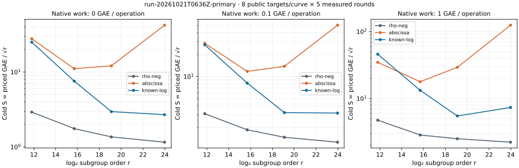
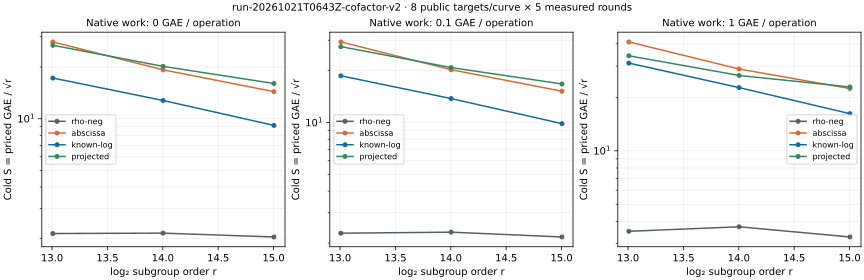

# Arbitrary-target known-log recovery, 2026-10-21

The new target-blind known-log two-sum method recovered public targets without
receiving their logarithms. On the frozen 16-, 20- and 24-bit prime fixtures,
its cold **counted** cost was lower than the specified abscissa pipeline on
both the primary and holdout panels throughout the native-work sensitivity band.
**Negation rho remained cheaper at every measured size.** The 12-bit comparison
changed ordering within the band and is unresolved under the protocol's rule.

These are results for the named implementations and accounting model. Native
work is not fully calibrated, wall measurements are L0, and the receipts are
same-host replays. Independent validation and a fastest-external-tool comparison
remain open. No validated leaderboard or benchmark-index row is added.

[Protocol](PROTOCOL.md) · [requirements](REQUIREMENTS.md) ·
[results PDF](RESULTS.pdf) · [source](../../examples/known_log_targets.rs) ·
[solver](../../src/cryptanalysis/ecbench/known_log.rs) ·
[validation problem](../../problems/known-log-recovery-cost-and-validation.md)

## Measured cold costs

Each panel uses eight public targets per curve, five measured rounds and one
warmup per arm. Setup is charged afresh for each target and round. The factor
base has 32 unsigned pairs, or 64 signed points. The comparator is the unchanged
`ic.pipeline` with `prime-abscissa:size=32`, folded two-sum MITM and incremental
Gaussian elimination. This does not identify the best possible IC configuration.
The matched generic reference is `rho.negation` in the same executable.

`S = GAE / sqrt(r)`, where GAE counts group additions and doublings. The three
native-work prices are 0, 0.1 and 1 GAE per emitted unpriced operation. The
following means are native recorded-value outputs, rounded for display.

| Curve (log₂ r) | Abscissa S at price 0 | Known-log S at price 0 | Rho S at price 0 | Abscissa / known-log at prices 0, 0.1, 1 | Holdout abscissa / known-log at prices 0, 0.1, 1 |
| --- | ---: | ---: | ---: | --- | --- |
| `icv1-fp12-tm53-6c9ff4bb` (11.807) | 27.7819 | 25.0571 | 2.9177 | 1.1087, 1.0488, 0.7550 | 1.1105, 1.0504, 0.7565 |
| `icv1-fp16-t295-8d3c3165` (15.697) | 11.1004 | 7.5688 | 1.7587 | 1.4666, 1.4472, 1.3476 | 1.4254, 1.4012, 1.2765 |
| `icv1-fp20-t727-cd198a38` (19.101) | 12.0860 | 2.9616 | 1.3624 | 4.0810, 4.2953, 5.3357 | 3.8128, 3.9973, 4.8877 |
| `icv1-fp24-t1059-6df599df` (23.974) | 42.2267 | 2.6984 | 1.1584 | 15.6487, 15.9587, 16.9821 | 16.6589, 17.0190, 18.2168 |



Source: [primary native summary](reports/run-20261021T0636Z-primary/summary.json),
[holdout summary](reports/run-20261021T0636Z-holdout/summary.json).
The [paired primary comparison](reports/run-20261021T0636Z-primary/compare-abscissa-known-log.json)
reports candidate/baseline counted-GAE ratios and 95% target-cluster bootstrap
intervals: 0.901923 [0.893548, 0.908959], 0.681852 [0.658537, 0.703560],
0.245040 [0.216511, 0.282737], and 0.063903 [0.044228, 0.087908], respectively.
These intervals apply to price zero; the band is a sensitivity check, not a
confidence interval. Do not pool curve sizes to infer an exponent.

The native [receipt cross-check](verification/study-audits.json) finds no
per-workload band-ordering exception at 16, 20 or 24 bits in either panel.
All eight 12-bit workloads in each panel fail the across-band advantage rule.
At 24 bits, rho / known-log S is 0.4293, 0.3998 and 0.3025 in the primary panel,
so the candidate still costs more than rho.

## Useful relations, generators and cofactors

Preparation takes the group, generator, subgroup order and public base seed;
it accepts no target. It builds distinct signed scalar classes and a folded
pair table. Recovery queries `Q + [a+t]H`, checks the full-point decomposition,
converts the known base logs to a target scalar and verifies `[d]G = Q`.
The harness checks the scalar again. Known-log setup scalar multiplications,
query work and verification are charged.

A successful candidate run has one useful equation in the sole unknown target
log, target-equation rank one, zero unknown base logs and zero matrix work.
It does not equate sumset size with independent unknown-base equations. The
baseline retains final matrix rank, dependent rows and elimination work in the
sealed records. A time series of baseline rank growth is not implemented.

The generator panels use the same curve with `G`, `[2]G` and `[7]G`. Rebuilding
the base and transporting it by the inverse generator multiplier are separate
arms. All transported point-set hashes equal the original base hash
`26b5715258b2b96d5e63ff816d0bdf8343723241168ea52187f541b43d53f4be`.
The exhaustive correctness control also fixes the query seed and checks scalar
conversion. The measured harness includes the generator in the workload ID,
so its algorithm seeds differ across representations: timing differences here
do not establish generator-dependent hardness or identical query trajectories.

The corrected cofactor panel fixes `p = 65519` and uses subgroup targets. Every
base has 1,024 nonidentity pair attempts (1,056 including 32 identity sums).
The first-run counters, constant across targets for this frozen base, are:

| Cofactor | Curve | Subgroup r | Distinct signed sum classes | Colliding nonidentity attempts |
| ---: | --- | ---: | ---: | ---: |
| 2 | `icv1-fp16-tm166-90917c6c` | 32,843 | 993 | 31 |
| 4 | `icv1-fp16-tm124-317fecaa` | 16,411 | 957 | 67 |
| 8 | `icv1-fp16-tm328-cbf43d6b` | 8,231 | 911 | 113 |



Source: [cofactor-v2 summary](reports/run-20261021T0643Z-cofactor-v2/summary.json).
The subgroup-matched projected-abscissa / known-log ratios at the three prices
are 1.7542/1.6982/1.4133 (h=2), 1.5799/1.5124/1.1707 (h=4), and
1.5519/1.4762/1.0994 (h=8). Rho remains cheaper. Because r shrinks as h increases
and the curve model also changes, these observations do not isolate a causal
cofactor effect. The table is already negation-folded; no separate automorphism
or symmetry decomposition is established. Standard NIST P-192 and P-224 have
cofactor one; this synthetic panel supplies no result for arbitrary targets on
those curves.

## Execution and retained failures

| Session/report | Records | Verified | Errors | Identical measured replays |
| --- | ---: | ---: | ---: | ---: |
| [smoke](reports/run-20261021T0636Z-smoke/REPORT.md) | 20 | 20 | 0 | 10 |
| [primary](reports/run-20261021T0636Z-primary/REPORT.md) | 960 | 960 | 0 | 800 |
| [holdout](reports/run-20261021T0636Z-holdout/REPORT.md) | 960 | 960 | 0 | 800 |
| [generator 1](reports/run-20261021T0636Z-generator-1/REPORT.md) | 240 | 240 | 0 | 200 |
| [generator 2](reports/run-20261021T0636Z-generator-2/REPORT.md) | 288 | 288 | 0 | 240 |
| [generator 7](reports/run-20261021T0636Z-generator-7/REPORT.md) | 288 | 288 | 0 | 240 |
| [cofactor, original](reports/run-20261021T0636Z-cofactor/REPORT.md) | 864 | 720 | 144 | 600 |
| [cofactor-v2](reports/run-20261021T0643Z-cofactor-v2/REPORT.md) | 864 | 864 | 0 | 720 |
| Total, including warmups, A/A and repeated controls | 4,484 | 4,340 | 144 | 3,610 |

The original projected control rejected `scan_cap=65536`, which exceeds
`p=65519`. Its 144 errors remain untouched. Version two changes only that limit
to 65518 and retains the same targets, seeds and all other arm settings.
These totals are executions, not 4,484 distinct targets. `--replay-all` replays
the verified measured executions, not warmups or recorded setup errors.
Every receipt has `ok: true`; all 3,610 measured replays are identical.

Identical-seed A/A operation comparisons give ratio 1 with interval [1, 1].
Wall comparisons admit zero L2 pairs, so no wall-speed claim is made. This does
not reproduce or explain the original screenshot's approximately 0.971 A/A
observation: the screenshot and its raw records were not supplied.

The measuring host is virtual Linux x86_64, AMD EPYC 9V74, with five visible
logical CPUs. Executions used one thread, no reserved CPU, the same 120-second
timeout and inherited 4 GiB address-space limit. Process RSS, host telemetry,
exact commands, phase clocks and descriptive wall values are retained beside
each run. The measured binary is SHA-256
`d6081b00ac2bc6c30d871e6b4507f8a075b0dd8d228fab67ff0b3e8e0a286c8d`.
Its source/build bindings are in [verification](verification/).

Sealed session files remain loose because the ecbench verifier hashes their
paths in place (AGENTS.md §13a exception). These in-process records reference
no stderr files; final packaged-session audits confirm the complete file set.
Reports sit outside those sealed trees. The benchmark directory contains
rendered browsing copies; this study holds the sources and records.

## Reproduce and validate

```sh
cargo build --release --locked --bin ecbench --example known_log_targets
# Creates new session/report paths; refuses existing report directories.
(ulimit -v 4194304; bash research/ecbench_known_log_targets_20261021/run.sh)
# To replay one retained session without changing it:
target/release/ecbench verify --dir research/ecbench_known_log_targets_20261021/sessions/20261021T0636Z-primary --replay-all --exit-code --out /tmp/known-log-primary-audit.json
cargo test --release --locked --lib --example known_log_targets
cargo test --release --locked --test ecbench --example known_log_targets
```

Specs, target seeds and original hashes are retained in [specs](specs/).
`cofactor-v2.json.sha256` separately freezes the corrected spec. The native
example emits the summaries; [audit_totals.rs](audit_totals.rs) cross-checks
receipt totals, A/A counted costs and transported point sets. [render.py](render.py)
only lays out those recorded values; it performs no crypto or result analysis.

Validation: 4,478 library tests passed (119 ignored), 17 ecbench integration
tests passed, and three touched-example tests passed. Clippy with CI's Rust
1.98 passed, including the final example correction. Five curve-identity tests
passed. Rust 1.99 clippy encountered an unchanged PMAC lint; the global
curve-name lint reports seven unchanged historical findings, with logs and
empty source-diff proofs retained. These are reported, not patched here.
Touched Rust files pass formatting. The optional whole-workspace formatter
check reports changes in two untouched historical examples; its empty base diff
and the full diagnostic are retained. The validation gate passes without a
base comparison; its base comparison reports five already-archived baseline
entries. No benchmark-index, archive or gate logic changes are made here.

The registry update preserves existing models and representations and adds
three recounted synthetic models. The guarded native incremental trait refresh
preserves all 2,748 existing trait rows and recomputes the changed representation
to the same traits. A subsequent full native release rebuild of all 2,751 rows
matched it byte for byte; the earlier bounded serialized attempt timed out and
is retained in verification.
The [versioned cover-catalog report](catalog-update/README.md) records the three
new models, five generator representations, regenerated geometry certificates
and updated live assessment bindings. The older catalog report is preserved.

## Limits and next experiment

The emitted-cost band omits any operation not serialized by an arm and assigns
an illustrative common price to diverse native primitives. It is not a fully
calibrated machine-cost model. The strongest available rho implementation,
optimized BSGS and external tools have not all been compared. Actual shared
precomputation across many targets was not measured. Target derivation, curve
construction and registration are common fixture preparation, outside every
solver interval. This fixed-B toy study proves no asymptotic improvement or
standard-curve security conclusion. The known-log arm is a generic table-search
construction, not evidence of a new algebraic trapdoor.

Next: serialize and calibrate remaining native work, independently replay and
recompute this frozen study, and compare a predeclared B sweep against optimized
negation BSGS and the strongest matched rho on fresh holdout targets. Keep cold
and actual reused-setup measurements separate. Admission criteria and remaining
gaps are tracked in the [problem record](../../problems/known-log-recovery-cost-and-validation.md).
The independent-host follow-up has an unfunded, blocked
[backlog card](../../backlog/XP-20261021-known-log-independent-replay/README.md);
no external run is scheduled by this study.

The registry-derived leaderboard roster and lab browser are regenerated in this
change. Validated best-of and progress plots receive no numerical promotion:
the independent-validation gate is unmet. Original screenshot yield ratios are
unverified and are not copied into any canonical graph.
