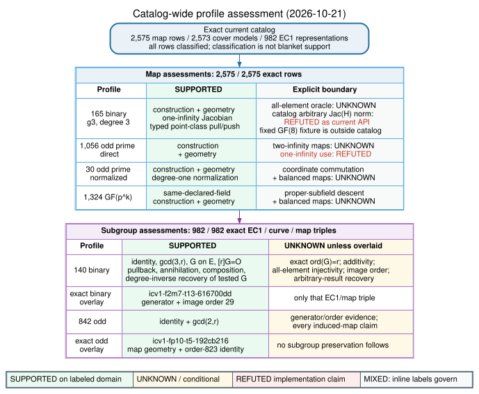
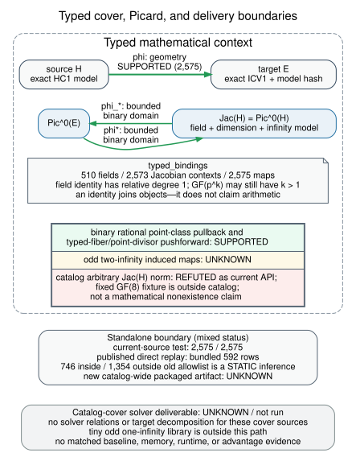

# Cover catalog update for the benchmark fixtures

2026-10-21. This versioned report extends the
[previous catalog report](../../cover_transfer_assessment_20261013/README.md)
with three synthetic cofactor models and five additional exact generator
representations. The old report, diagrams, PDF and replay receipt are preserved.
The registry, covers and cover graph are frozen in commit
`9be2f56ac440b5eeedf1438094a59e8795d66936`.

| Catalog item | Before | Current |
| --- | ---: | ---: |
| Curve/map rows with verified cover geometry | 2,572 | 2,575 |
| Unique cover models and Jacobian contexts | 2,570 | 2,573 |
| Exact EC1/curve/map triples | 977 | 982 |
| Declared-field contexts | 509 | 510 |
| Direct odd-prime quadratic maps | 1,053 | 1,056 |
| Odd-characteristic subgroup representations | 837 | 842 |

The new models are `icv1-fp16-tm166-90917c6c`,
`icv1-fp16-tm124-317fecaa` and `icv1-fp16-tm328-cbf43d6b`, with p=65519 and
cofactors 2, 4 and 8. The other two new representations use generators [2]G
and [7]G on `icv1-fp16-t295-8d3c3165`. Existing models and representations
are retained. All three added covers use the existing direct odd-prime
quadratic profile. Claim statuses and their implementation boundaries are
unchanged; only exact membership and its source bindings grow.

The native cover checker regenerated 2,575 valid geometry certificates with
zero unsupported/invalid rows and replayed them byte for byte. Its 11 tests
passed, including the entire catalog replay. The separate native standalone
constructor test checks that every current catalog input reaches the constructor.
Logs are in [verification](../verification/). The full native trait rebuild of
2,751 rows matched its guarded incremental refresh exactly.

Geometry support is not a certificate of catalog-general Jacobian transfer,
an arbitrary-element norm, exact source subgroup order, a cover-integrated IC
solver or an ECDLP advantage. Binary bounded point-class and exact fixed-field
controls retain their previous domains. Odd two-infinity induced maps remain
unimplemented/unknown as specified by the existing profiles. The known-log
benchmark solves on E directly and uses none of these cover transfers.

The [live ledger](../../../docs/curves/cover-transfer-assessments.json) binds
every current model, map and representation to its profile. Its verifier's
population pins and semantic digests are updated for this explicit expansion;
the status matrix and algebraic checks remain. The original standalone artifact
replay receipt remains historical evidence for its own 592-row bundled catalog
and the old 746/1,354 static allowlist split; it is not a new packaged-artifact
receipt for 2,575 rows.

[PDF](CATALOG.pdf) · [render source](render.py) ·
[main arbitrary-target study](../README.md)
