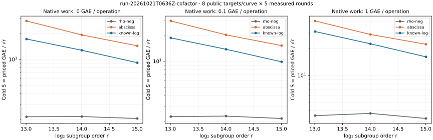

# run-20261021T0636Z-cofactor

Native recorded-value analysis; one public target per workload, cold setup charged.

[PDF](REPORT.pdf) · [native summary](summary.json) · [all-run replay](audit.json) · [commands](COMMANDS.txt) · [resources](resources.json)

Records SHA-256: `c4cd0d7a97d153bd6018053e8776061f2f31a834fcff9dd8bc8cf94ef3de9674`. Paired uncertainty and wall-time admission are in the comparison JSON files. This same-host replay is not independent hardware validation.
