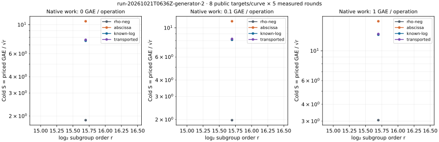

# run-20261021T0636Z-generator-2

Native recorded-value analysis; one public target per workload, cold setup charged.

[PDF](REPORT.pdf) · [native summary](summary.json) · [all-run replay](audit.json) · [commands](COMMANDS.txt) · [resources](resources.json)

Records SHA-256: `756006e86bbc8b03c0b7b7ccb78dc0492b4c1436604649be6bf5212ec591460b`. Paired uncertainty and wall-time admission are in the comparison JSON files. This same-host replay is not independent hardware validation.
