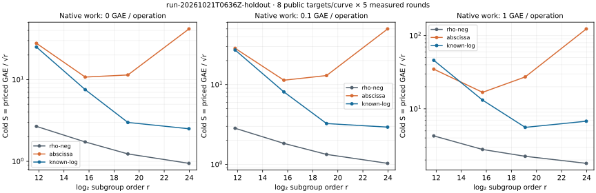

# run-20261021T0636Z-holdout

Native recorded-value analysis; one public target per workload, cold setup charged.

[PDF](REPORT.pdf) · [native summary](summary.json) · [all-run replay](audit.json) · [commands](COMMANDS.txt) · [resources](resources.json)

Records SHA-256: `949656c5d69558827f73545e329690daf79d80bc76146c4d01b16466964bd660`. Paired uncertainty and wall-time admission are in the comparison JSON files. This same-host replay is not independent hardware validation.
