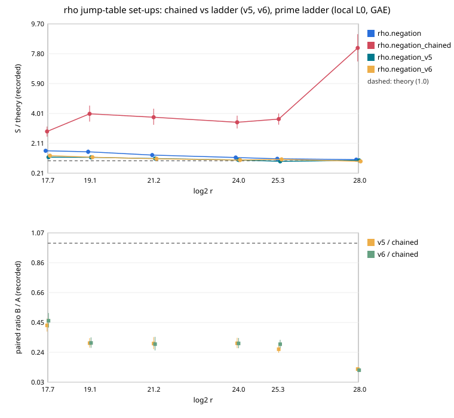

# Two cheap rho jump tables compared: chained against the ladder table (v5, v6)

**Result (measured, counted GAE, local L0 host) [pcc:unverified].**
`rho.negation_chained` (from `research/curve25519_engine_items_20261110`) and
this lab's `rho.negation_v5` / `rho.negation_v6` all build the negation-map
rho jump table more cheaply than `rho.negation`. They were paired here on
six prime curves, 2^17.7–2^28, with 32 targets × 6 rounds (1152 pairs per
comparison) and an A/A control.

| comparison | paired ratio [95 %] | band (w = 0 / 0.1 / 1) |
|:--|:--|:--|
| v5 / chained | **0.256 [0.236, 0.277]** | 0.256 / 0.257 / 0.261 |
| v6 / chained | **0.261 [0.240, 0.284]** | 0.261 / 0.263 / 0.269 |
| chained / rho.negation | 3.25 [2.98, 3.54] | 3.25 / 3.28 / 3.42 |
| v5 / rho.negation | 0.831 [0.797, 0.865] | 0.831 / 0.841 / 0.894 |
| v6 / rho.negation | 0.849 [0.814, 0.885] | 0.849 / 0.861 / 0.919 |
| chained A/A | 1.0000 | — |

Every order holds across the §5a band. The bounds (fit version 2, 6 sizes):

| bound | id | ops × floor | α |
|:--|:--|--:|--:|
| rho.negation_v5 | `ECBND1hbd448fdd4fba` | 1.103 | 0.461 |
| rho.negation_v6 | `ECBND1h61c3456f18f0` | 1.127 | 0.451 |
| rho.negation | `ECBND1h434d5b9180f8` | 1.328 | 0.426 |
| rho.negation_chained | `ECBND1ha265c33c87d3` | 4.312 | 0.597 |

## Why: the same set-up saving, opposite walks

The counters below are per √r, as recorded means:

| arm | set-up (adds + doublings) | walk operations | cycle escapes | look-ahead additions |
|:--|--:|--:|--:|--:|
| rho.negation | 0.122 | 1.009 | 0.003 | 0.051 |
| rho.negation_chained | 0.051 | **3.708** | **0.045** | 0.167 |
| rho.negation_v5 | 0.046 | 0.884 | 0.000 | 0.011 |

Both cheap tables cut the set-up by the same amount, to about 0.05 √r.
The chained table's jumps satisfy `M_j = M_{j−1} + M_{j−2}`, a three-term
integer relation. Under the negation map that becomes a short fruitless
cycle: cycles and escapes rise 15× and the walk runs 3.7× longer. The v5
table refuses every three-term relation among its jumps before spending
an operation (`c = x ± y`, `c = y − x`, `c = 2x`, `2c = x`), and it uses
k ≈ √F jumps instead of 4–16. Its walk comes to 0.88 √r, and cycles are
rare: 270 of its 1,152 runs escaped one, with a mean of 0.0004 √r
doublings, about 100× fewer than chained's 0.045 √r. The 0.000 in the
table above is that value rounded.

This agrees in direction with the chained method's own study, which
found 1.532× rho.negation at 20 bits and 2.738× at 24 bits and rejected
it. Here the ratio is 3.25× pooled, and 8.2× theory at 2^28.

## Validation

An independent validator (`validation/`) recomputed every pooled ratio
and band value to within rounding (v5 / chained 0.255689, chained /
rho.negation 3.247918), and every mechanism mean (walk 3.70798 /
0.88383 / 1.00899). It re-checked [d]G = Q and recovered = planted on
all 6,720 records. It corrected one sentence of the first version of
this report, which said v5 "records no cycle" (see above).

It also found the band asymmetric. chained and rho.negation do not
declare their distinguished-point table probes as unpriced work, while
v5 and v6 do. Charging every arm's table work at 1 GAE gives v5 / chained
0.258–0.260 (instead of 0.261) and chained / rho.negation 3.38–3.40
(instead of 3.42). No ranking changes at any weight. Per curve,
chained / rho.negation rises from 1.75 at 2^17.7 to 7.62 at 2^28. The
producer's replay ran on the same host class, so it is not a cross-host
replay.

## Run

| item | value |
|:--|:--|
| spec / session | `spec.json` / `ECBS1h56930a35f003`, 6720 records, all verified |
| commit / binary | `c7c4c2874f` (main, clean tree) / sha256 `55289451c555…` |
| audit | `audit.json`: replay-all 5760 reproduced, 0 problems |
| isolation | L0 container; counted GAE only |
