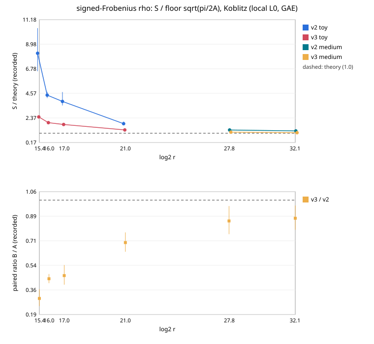

# signed-Frobenius rho v3: the Koblitz walk at its floor

**Result (measured, counted GAE, local L0 host).**

- `rho.signed_frobenius_v3` costs **0.459× `rho.signed_frobenius_v2`
  [0.418, 0.504]**, over 864 pairs on six Koblitz curves from 2^15.4 to
  2^32.1. The order holds across the §5a band: 0.459 / 0.475 / 0.571 at
  w = 0 / 0.1 / 1.
- On the medium tier (2^27.8 and 2^32.1) v3 is **1.076× the floor
  √(π/2A) [0.998, 1.147]**; v2 is 1.249× [1.163, 1.333].
- Its search phase is 1.04×, 1.04× and 1.03× the floor (±0.045) at 2^21,
  2^27.8 and 2^32.1.
- On the toy tier v3 is 1.876× the floor; v2 is 4.574×.

[pcc:unverified]: no validator report or isolab L2 run yet.

## What changed (commit `3592f4a172`)

The signed-Frobenius walk had the legacy shape: 8 jumps by joint
multiplication and ⌊bits(r)/4⌋ distinguished-point bits. Those bits assume
A = 2. With A = 2n the search is only √(πr/4n) steps. At 2^15.4 (n = 29,
A = 58) that is about 30 steps, against a 16-step tail per walk.

`rho.signed_frobenius_v3` runs `rho_walk_v3` on the same classes with
`RhoV3::frobenius()`:

- the ladder-built table, k ≈ √(F/2) jumps;
- distinguished-point bits round(½·log₂F − 0.8), with F = √(πr/2A),
  fitted on the diagnostic: F = 30, 73, 268 gave best dp 2, 2, 3;
- the charged check [d]G reads its low bits from the set-up's G ladder.

The two options are off for `rho.negation_v3` and `rho.plain_v3`. A
600-run replay of that committed session reproduced identically after
this change.

## Measured values (S / floor; floor = √(π/2A))

| curve | log2 r | A | v2 total | v3 total | v3 search ± SE | v3 set-up | v3 check | paired v3/v2 [95 %] |
|:--|--:|--:|--:|--:|--:|--:|--:|:--|
| 1:29 | 15.37 | 58 | 8.17 | 2.47 | 1.34 ± 0.05 | 0.74 | 0.39 | 0.302 [0.248, 0.368] |
| 1:17 | 16.00 | 34 | 4.41 | 1.95 | 1.16 ± 0.05 | 0.57 | 0.22 | 0.442 [0.410, 0.475] |
| 0:19 | 17.00 | 38 | 3.85 | 1.79 | 1.14 ± 0.05 | 0.45 | 0.19 | 0.464 [0.400, 0.539] |
| 0:23 | 21.00 | 46 | 1.86 | 1.30 | 1.04 ± 0.04 | 0.19 | 0.07 | 0.699 [0.633, 0.771] |
| 0:37 | 27.78 | 74 | 1.29 | 1.10 | 1.04 ± 0.04 | 0.05 | 0.01 | 0.852 [0.758, 0.958] |
| 1:43 | 32.11 | 86 | 1.21 | 1.05 | 1.03 ± 0.05 | 0.02 | 0.003 | 0.871 [0.789, 0.962] |

The totals come from `ecbench table`. The phase columns are derived as
the mean recorded phase GAE / √r divided by the floor
(`phase_constants.json`).

At 2^15.4 the whole floor is about 30 operations. The charged check
[d]G alone (about 12 operations with the ladder) is 0.39 of it, and the
set-up 0.74. These are O(log r) and O(k) and fall away with r, as the
2^21 to 2^32 rows show.

## Run

| item | value |
|:--|:--|
| spec | `research/ecbench_rho_v3_frobenius_20261107/spec.json`, `ECS1h1df58f076f8b` |
| session | `ECBS1h58ab29ffaaca`, complete; 3024 records, 3024 verified |
| commit / binary | `3592f4a172` / sha256 `5094bd45…f4a2` |
| host / isolation | Claude Code cloud container, **L0**; wall diagnostic only (ns/GAE v3/v2 1.12, within the A/A noise of 1.08) |
| audit | `audit.json`: `verify --replay-all`, 2592 replays reproduced, 0 problems |
| A/A | ops 1.0000 (deterministic) |
| bounds | toy `bound-candidate-toy.json` `ECBND1h83c2a9e181c5` (α 0.340, set-up dominated) and `bound-incumbent-toy.json` `ECBND1h0388eb67beda`; medium `bound-candidate-medium.json` `ECBND1h536bc7c1f99e`, `bound-incumbent-medium.json` `ECBND1h5f63bae16e78` (two sizes: constant bounds) |

## Not established here

- No L2 isolation, no validator report: not a leaderboard or
  `benchmarks/README.md` row.
- The `_strong`, `_full` and `_wordram` Frobenius variants were not changed.
