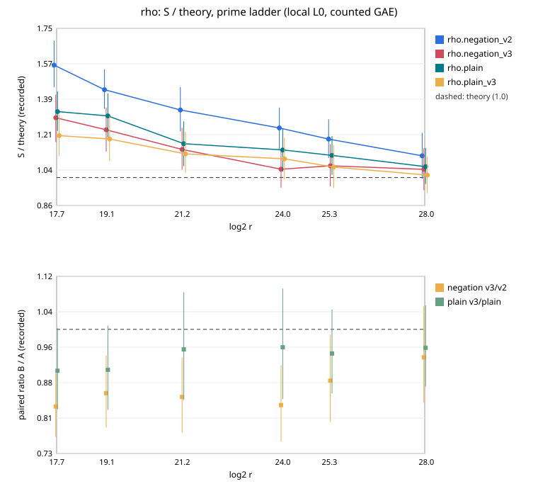

# rho v3: a ladder-built jump table brings tuned rho to its theoretical constant

**Result (measured, counted GAE, local L0 host).** `rho.negation_v3` costs
0.864× `rho.negation_v2` [0.832, 0.898] in a paired comparison over 1152 pairs
on six prime curves, 2^17.7 to 2^28. The order holds across the AGENTS.md §5a
band (0.864 / 0.869 / 0.888 at 0 / 0.1 / 1 GAE per unpriced operation).
`rho.plain_v3` costs 0.939× `rho.plain` [0.901, 0.979]. At 2^24 and 2^28,
v3's total S is 1.042× and 1.041× √(π/4), the generic floor for A = 2.
Its search phase is 1.000×, 1.028× and 1.024× (±0.04) the floor at 2^24,
2^25.4 and 2^28. It meets theory within the measurement error.
[pcc:unverified]: no validator report or isolab L2 run yet.

## What changed

The tuned walks (`rho.negation`, `rho.plain` and their `_v2` ids) build each
jump `M_j = [a_j]G + [b_j]Q` with a joint double-and-add on 6–12-bit
coefficients, about 1.75·w operations a jump. At that price the calibrated
table stops at 4, 8 or 16 jumps (`ic_boundary.rs`, `rho_jumps_for`). The
walk then pays three costs:

- the r-adding walk's excess, √(k/(k−1));
- under negation, a look-ahead addition about every 2k steps;
- the set-up itself, 0.30 √r at 2^17.7 (decomposed from the committed
  2026-10-06 prime-toy session).

`rho_walk_v3` (commits `1d03f077eb`, `1d15eae240`) builds two ladders
[2^i]G and [2^i]Q once, at 2(t−1) doublings. Each jump is the sum of three
rungs, at two additions. The set-up refuses three-term integer relations
among the jumps before spending an operation. The jump count is
k = round(√(F/2)) with F = √(πr/2A), the minimiser of set-up plus walk
excess. The search is the legacy code, factored out unchanged
(`rho_search_from`). Every legacy id replays bit-for-bit: 288/288 replays of
the committed `prime-toy-reference-e1` session reproduced with the new binary.

## Run

| item | value |
|:--|:--|
| spec | `research/ecbench_rho_v3_ladder_20261107/spec.json`, spec id `ECS1h8c471f0ba3cd` |
| session | `ECBS1h82f92968d112`, `sessions/main/`, status complete |
| commit | `c047182e27` (tree dirty only in files the change does not touch: rustfmt rewrites of unrelated examples, left uncommitted) |
| binary | sha256 `6a5f9e48ed38da503252381c9111a8f16bf84a3a543afbbef25497b62bb30529` |
| host / isolation | Claude Code cloud container, 4 vCPU, `--cpus none --allow-busy`: **L0**. Wall figures are diagnostics; GAE is deterministic. |
| arms | incumbent `rho.negation_v2`, candidate `rho.negation_v3`, A/A `rho.negation_v2`, `rho.plain`, `rho.plain_v3` |
| workloads | `prime_search` bits 18–28 seed 59297 (registered ICV1 curves), 32 planted targets each, target seed 20261107 |
| runs | 6 rounds + 1 warm-up, 6720 records, 6720 verified, 0 failed |
| audit | `audit.json`: `verify --replay-all`, 5760 replays reproduced, 0 problems |
| bounds | `bound-candidate.json` `ECBND1hecb55b1c26b1`, `bound-incumbent.json` `ECBND1hed21715036b5`, `bound-plain-v3.json` `ECBND1h2531a4001537`, `bound-plain.json` `ECBND1h3ecd56bc1462` |
| comparisons | `sessions/main/comparisons/*.json` |

## Measured values

S / theory per size. These are the mean S of the bound records divided by
the registry's declared S: √(π/4) for negation, √(π/2) for plain. The
search phase column is derived: the mean of the recorded `search` phase GAE
over √r, divided by the same constant (`phase_constants.json`).

| log2 r | v2 total | v3 total | v3 search (±SE) | plain total | plain_v3 total | plain_v3 search |
|--:|--:|--:|--:|--:|--:|--:|
| 17.70 | 1.563 | 1.299 | 1.111 ± 0.043 | 1.331 | 1.210 | 1.059 |
| 19.10 | 1.440 | 1.239 | 1.102 ± 0.042 | 1.309 | 1.193 | 1.087 |
| 21.22 | 1.339 | 1.141 | 1.060 ± 0.039 | 1.170 | 1.118 | 1.056 |
| 23.97 | 1.248 | 1.042 | 1.000 ± 0.038 | 1.138 | 1.094 | 1.061 |
| 25.35 | 1.193 | 1.059 | 1.028 ± 0.038 | 1.111 | 1.052 | 1.028 |
| 27.96 | 1.109 | 1.041 | 1.024 ± 0.040 | 1.055 | 1.012 | 0.998 |

Paired, per curve (v3 / v2): 0.831, 0.860, 0.852, 0.834, 0.888, 0.939.
Every interval is below 1 except at 2^28 ([0.84, 1.05]).

Fitted exponents (bound records, fit version 2, 6 sizes):

| bound | total α [95 %] | search α |
|:--|:--|:--|
| v3 | 0.459 [0.432, 0.480] | 0.485 |
| v2 | 0.441 [0.425, 0.459] | 0.482 |

The search phase is at the declared α = ½. The total's α is below ½
because set-up (O(k + log r)) and the charged check (O(log r)) are a falling
share of a growing total. This is the "fixed costs pull α below the law"
case of `docs/bounds/README.md`, not a faster algorithm.

Wall time (L0, diagnostic): v3 / v2 ns per GAE 1.056 [1.034, 1.077]; whole
run 0.953 [0.898, 1.011].

## What remains, and where

- At 2^17.7 v3 still totals 1.30× theory. The excess is set-up at 0.117 √r,
  the charged check `[d]G` at 0.051 √r, walk starts at 0.055 √r, and a
  search phase 1.11× (±0.04) the floor. The first three are O(log r) or
  O(r^¼) and vanish as r grows. At 2^28 they total 0.02 √r.
- The local diagnostic (`examples/rho_v3_diag.rs`, 30k runs at 2^17.7)
  puts the walk steps at 1.036× the floor. That is √(k/(k−1)) = 1.038 for
  k = 14, the r-adding walk's own excess.
- Rejected on data: resuming the walk from each new distinguished point
  instead of a fresh start (+0.010 ± 0.003 S at 2^17.7). Larger or smaller
  k than the rule gave no gain within noise (k = 20, 80, 160 at 2^24 and
  2^28).

## Not established here

- Isolation: this is an L0 container run. The validation gate (validator
  report, `VALIDATION.json`, an independent-host replay) and an isolab-eks
  L2 rerun were not done; this container has no AWS identity. The rows are
  therefore not leaderboard rows.
- Koblitz curves and the Frobenius walks were not changed or measured.
