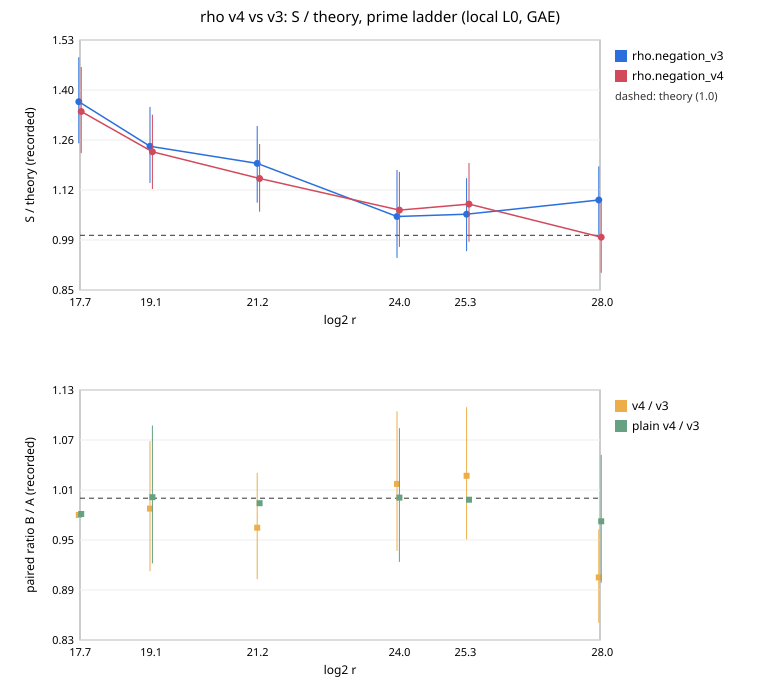

# rho v4 on prime curves: the ladder-read check saves 2 % at 2^17.7; pooled change unresolved

**Result (measured, counted GAE, local L0 host).** `rho.negation_v4` is
`rho.negation_v3` plus two options: distinguished-point bits from the floor,
and the charged check [d]G read from the set-up's G ladder.

- Pooled over 1152 pairs on six prime curves (2^17.7 to 2^28), v4 costs
  **0.980× v3 [0.956, 1.005]**. The interval includes 1, so the pooled
  change is **not resolved**.
- At 2^17.7 the ratio is 0.9805 [0.979, 0.982]. The DP rule leaves the walk
  unchanged there, and the difference is the deterministic saving of the
  check.
- At 2^28 the ratio is 0.908 [0.855, 0.964], where the DP rule takes 6 bits
  instead of 7.
- At 2^24 and 2^25.4 the ratios are 1.017 and 1.026, both with intervals
  across 1.
- `rho.plain_v4` / `rho.plain_v3`: 0.992 [0.971, 1.013], unresolved.
- `rho.negation_v4` at 2^28: S = 0.882, **0.995× √(π/4)**.

[pcc:unverified].

## Reading

The local diagnostic (8000 runs a size) had put the two options 2–5 %
under v3. This session's per-size intervals (32 workloads × 6 rounds) are
too wide to confirm more than the check's 2 % at the smallest size. The
2^28 ratio of 0.91 is resolved on its own but is not matched at 2^24 and
2^25.4. Neither id is promoted over the other here.

## Run

| item | value |
|:--|:--|
| spec | `spec.json`, `ECS1hbbcd0f830a4d` |
| session | `ECBS1haa16d992422a`; 6720 records, 6720 verified |
| commit / binary | `db068f17a5`, the pre-rebase hash of `6184cdec89` (identical tree) / sha256 `6f0a70d1…36c8` |
| isolation | L0 container |
| audit | `audit.json`: replay-all, 5760 reproduced, 0 problems |
| A/A | ops 1.0000 |
| bounds | v4 `ECBND1hc99b2b1d32c8` (1.145× floor, α 0.452), v3 `ECBND1h0916aa291351` (1.168×, α 0.458) |
