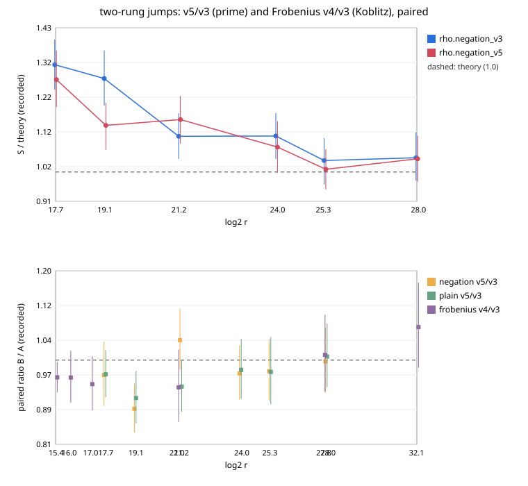

# Two-rung jumps: rho v5 and signed-Frobenius v4 against v3

**Result (measured, counted GAE, local L0 host) [pcc:unverified].** Each
jump is now the sum of two ladder rungs (one addition) instead of three,
with k ≈ √F jumps.

| comparison | pairs | paired ratio [95 %] | band (w = 0 / 0.1 / 1) |
|:--|--:|:--|:--|
| rho.negation_v5 / rho.negation_v3, prime 2^17.7–2^28 | 2304 | **0.972 [0.945, 0.999]** | 0.972 / 0.976 / 0.995, order holds |
| rho.plain_v5 / rho.plain_v3 | 2304 | **0.963 [0.938, 0.988]** | 0.963 / 0.964 / 0.978 |
| rho.signed_frobenius_v4 / v3, Koblitz 2^15.4–2^32.1 | 1728 | **0.969 [0.943, 0.994]** | 0.969 / 0.969 / 0.974 |

Bounds (fit version 2):

| bound | id | ops × floor | α |
|:--|:--|--:|--:|
| rho.negation_v5, prime | `ECBND1h08935fdd1600` | 1.114 | 0.468 |
| rho.negation_v3, prime | `ECBND1h648847681537` | 1.147 | 0.457 |
| rho.signed_frobenius_v4, Koblitz toy | `ECBND1h1c9be634d75c` | 1.813 | 0.340 |
| rho.signed_frobenius_v3, Koblitz toy | `ECBND1h2f3867007530` | 1.900 | 0.351 |

**Weighting caveat (from the validator).** The pooled ratio weights
each curve's S equally. Summed over every run, rho.signed_frobenius_v4
spends **5.5 % more** total GAE than v3 (ratio 1.0546). The two medium
curves carry most of the operations, and v4 is not faster there. On the
prime session the candidate is 1.045 at 2^21.2, and plain_v5 is 1.008 at
2^28; both intervals include 1.

The Koblitz gain sits on the toy tier: 0.939–0.962 per curve. On the two
medium curves the ratios are 1.012 and 1.074 [0.983, 1.173], unresolved,
so v4 is not claimed there. rho.negation_v5 has S = 0.921 at 2^28, 1.04×
√(π/4).

## Validation

An independent validator recomputed the three pooled ratios and their
band values to 4.9e-05. It re-verified [d]G = Q on all 13,440 prime and
6,048 Koblitz records, and rejected 240/240 wrong scalars per session
(`validation/`). `benchmarks/20261107-rho-v5/VALIDATION.json` covers the
prime negation row and reads valid.

## Run

| item | value |
|:--|:--|
| specs | `specs/prime.json`, `specs/koblitz.json` |
| sessions | prime `ECBS1h288d047c6183` (13,440 records), koblitz `ECBS1h882e6d561549` (6,048); all verified |
| binary | sha256 `9fde9d8babe2…`, built from `8b8d30884f` (source of the v5 ids) |
| audits | `audit-prime.json`: replay-all 11,520; `audit-koblitz.json`: 5,184; 0 problems |
| A/A | ops 1.0000 in both sessions |
| isolation | L0 container |
