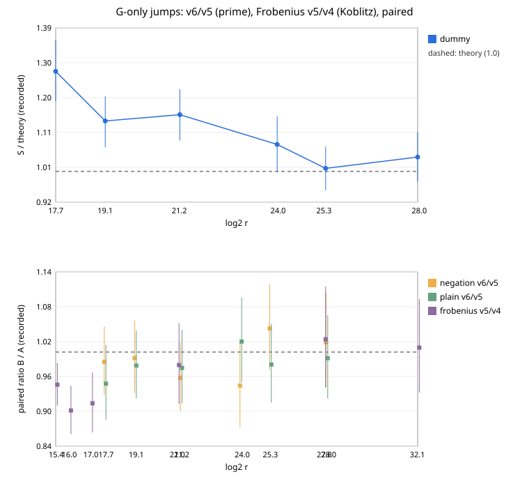

# Jumps in G only: rho v6 and signed-Frobenius v5

**Result (measured, counted GAE, local L0 host) [pcc:unverified].** The jumps
are multiples of G only; the target enters only through each walk's start.
This drops the Q ladder's doublings.

| comparison | pairs | paired ratio [95 %] | summed GAE ratio | reading |
|:--|--:|:--|--:|:--|
| rho.negation_v6 / v5, prime 2^17.7–2^28 | 2304 | 0.987 [0.960, 1.014] | 1.006 | unresolved |
| rho.plain_v6 / v5 | 2304 | 0.979 [0.953, 1.006] | — | unresolved |
| rho.signed_frobenius_v5 / v4, Koblitz 2^15.4–2^32.1 | 1728 | **0.943 [0.921, 0.965]** | 1.007 | toy tier only |

The local diagnostic (12,000 runs per size) had put prime v6 2.6 % under v5
at 2^17.7. This session's 2^17.7 ratio is 0.983 [0.926, 1.044]. The
direction is the same, but the gain is not resolved, so no prime claim is
made. On Koblitz the gain sits on the toy curves: 0.899, 0.912 and 0.944
at 2^16, 2^17 and 2^15.4. At 2^27.8 and 2^32.1 the ratios are 1.022 and
1.008, both unresolved. The summed GAE is therefore 1.007×, and v5 is
claimed for small Koblitz curves only.

The bottom panel of the graph shows the per-curve ratios. Its top panel is
a placeholder; the S-per-size panels are in the v5 report.

## Run

| item | value |
|:--|:--|
| sessions | prime `ECBS1h8fe838d6b8d6` (13,440), koblitz `ECBS1he13a6465e5a6` (6,048); all verified |
| audits | replay-all: 11,520 and 5,184 reproduced, 0 problems |
| A/A | 1.0000 in both |
| commit | `f28781939d` (G-only ids) |
| isolation | L0 container |
