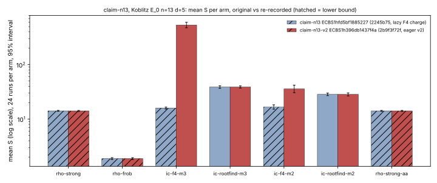

# claim-n13 re-recorded under eager (version 2) inherited-F4 accounting

Run report, 2026-10-28. Descriptive. No speedup claim. The original session is frozen and was not edited.

## What ran and why

- **Decision (owner, 2026-10-28):** the eager inherited-F4 specialisation charge (post-#2043, `INHERITED_F4_ACCOUNTING_VERSION = 2`) is the method identity. The original `sessions/claim-n13` (`ECBS1hfd5bf1885227`, recorded at `2245b75` with the lazy charge and no accounting-version field) is marked **pre-#2043**. Only its recording binary (`1e972df4…`) can replay it.
- **Spec:** `docs/ecbench/specs/claim-koblitz-rootfind-n13.json`, unchanged. Its `spec_sha256` `4b02cd06…` and `plan_sha256` `0b109338…` are identical to the original session's. Koblitz `E_0`, `n=13`, `d=5`, 8 public targets, 3 rounds plus 1 warm-up, 7 arms, 224 executions.
- **Command:** `target/release/ecbench run --spec docs/ecbench/specs/claim-koblitz-rootfind-n13.json --out research/ecbench_rootfind_engine_20261012/sessions/claim-n13-v2 --cpus none --allow-busy --lock /tmp/crypto-bench.lock`. Wall 16 s.
- **Source and binary:** `main` at `2b9f3f72f`, not dirty. `ecbench` SHA-256 `5011c39c8d52f54039cf344df0027ce4bdd97d20ad41d0da4a16b7c50b2e2efc`.
- **Session:** `ECBS1h396db1437f4a`, 224/224 verified. `accounting_versions = {inherited_f4_specialise: 2}`. `records_sha256` `0b5e0124…`.
- **Host:** cloud container, Intel Xeon @ 2.10 GHz, 4 vCPUs, Linux, env class `ECBENV3h4b21368b3262`. Every run is **L0**, as in the original (`--cpus none --allow-busy` on a shared macOS host).
- **Route:** run locally, not through isolab-eks. The isolab ecbench path admits only specs with at least 5 measured rounds. This spec has 3, and changing it would change the spec and plan hashes this re-record exists to keep. The run's purpose is counted-work identity; wall times are descriptive.

## Replay, run twice

| audit | records | verified | replays reproduced | problems | file |
|---|---:|---:|---:|---:|---|
| run 1 | 224 | 224 | 168 | **0** | `audits/audit-claim-n13-v2-run1.json` |
| run 2 | 224 | 224 | 168 | **0** | `audits/audit-claim-n13-v2-run2.json` |
| original on main (2026-10-23, for reference) | 224 | 224 | 168 | 96 | problems record |

Both audits used the same binary as the run. The two audit files differ only in `audited_unix_ms`.

## Measured values (mean S, 24 measured runs per arm, harness 95% interval)

| arm | original (lazy) mean S | lower bound | v2 (eager) mean S | 95% interval | lower bound |
|---|---:|---|---:|---|---|
| `rho-strong` (reference) | 14.118 | yes | 14.118 | [13.846, 14.396] | yes |
| `rho-frob` | 1.871 | yes | 1.871 | [1.801, 1.945] | yes |
| `ic-f4-m3` | 15.928 | yes | **534.859** | [476.513, 600.350] | **no** |
| `ic-rootfind-m3` | 38.822 | no | 38.822 | [37.117, 40.605] | no |
| `ic-f4-m2` | 16.642 | yes | **35.758** | [30.519, 41.895] | **no** |
| `ic-rootfind-m2` | 28.383 | no | 28.383 | [26.652, 30.227] | no |
| `rho-strong-aa` (A/A) | 14.118 | yes | 14.118 | [13.846, 14.396] | yes |

*Figure: mean S per arm from `tables/table-claim-n13.md` and `tables/table-claim-n13-v2.md`, log scale, 24 runs per arm, with the 95% interval each table recorded. Hatched bars are lower bounds. Sessions `ECBS1hfd5bf1885227` and `ECBS1h396db1437f4a`.*

## What changed between the recordings (observed in paired records)

- **Rho and root-finder arms:** S identical in every arm. Root-finder records now also carry `pair_table_kind` and `pair_table_points` (outcome counts from `c8bd952c4`, priced at 0). Those counters were the second drift; this re-record carries them, so the drift no longer applies.
- **Inherited-F4 arms:** one example is `ic-f4-m3` at seq 56.
  - `solver.ops` went from 8,412,139 to 10,914,662 (the eager v2 charge plus other code drift since `2245b75`, per the problem record).
  - The v2 record also carries complete Boolean-work accounting (`solver.extra.bitop_word_ops` 73,752,894, `work.complete = true`). The recorded `cost.lower_bound` went from `true` to `false`, and the solver is priced `pinned` rather than `measured`.
  - So most of the F4 S increase comes from charging work the original counted but did not charge. These are accounting changes; they neither improve nor regress the method (CLAUDE.md success criterion).

## Comparisons the harness admitted (`ecbench compare`, §5a band at 0, 0.1 and 1 GAE per unpriced operation)

- Every IC arm is above `rho-strong` at every weight: `ic-f4-m3` 37.9×, `ic-rootfind-m3` 2.75×, `ic-f4-m2` 2.53×, `ic-rootfind-m2` 2.01× (ops ratio).
- `ic-rootfind-m3 / ic-f4-m3`: ops 0.0726 [0.067, 0.078]. The band (w=0 2.447, w=0.1 0.0018, w=1 0.0003) is **unresolved**: the order flips inside it.
- `ic-rootfind-m2 / ic-f4-m2`: ops 0.7938 [0.719, 0.876]. The band (w=0 1.710, w=0.1 0.034, w=1 0.0044) is also **unresolved**.
- The A/A ops ratio is 1.0000. Wall time is descriptive only, with 0 admitted pairs (L0).
- Comparison JSON is in `sessions/claim-n13-v2/comparisons/`. The log is `logs/compare-claim-n13-v2.log`.

## Limits

- One host, L0, with the same spec. Two Koblitz sizes are not a scaling claim, and this run adds no size.
- The original session is untouched and still fails to replay on `main` by design: it is pre-#2043.
- The backend leaderboard still cites the original session through its pinned-binary plan; whether to cite v2 there is not decided here.
- Raw records: `sessions/claim-n13-v2/records.jsonl`. Run log: `logs/run-claim-n13-v2.log`.
