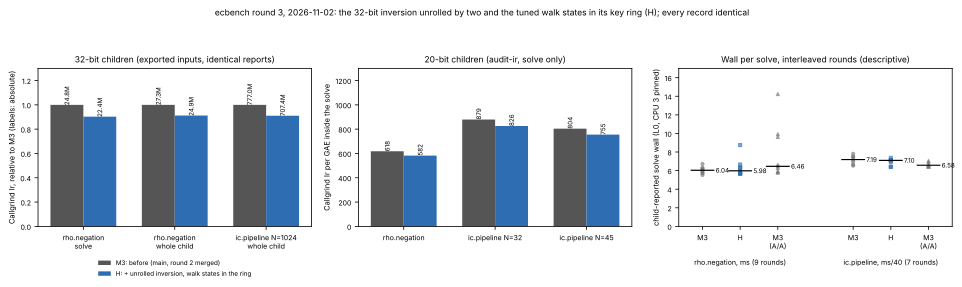

# ecbench round 3: the 32-bit inversion unrolled, the tuned walk's states in its key ring

**Date.** 2026-11-02 (run 2026-11-01T23:20Z). **Status.** Measured.
Instruction counts are Callgrind's (deterministic); wall time is descriptive
(shared 4-vCPU cloud VM, Intel Xeon @ 2.10 GHz, L0, CPU 3 pinned, no
hardware counters). **Class.** Engineering. Every child report is identical
to the baseline's apart from wall-clock, scheduler and placement fields,
and every record of the two scratch sessions replays under the new binary
(`verify --replay-all --exit-code`: 36/36 at 20 bits, 4/4 at 32 bits), so
no counted cost (GAE), `S` or leaderboard row changes. The baseline (M3)
is `main` 8931f24b88 (round 2,
[`ecbench_walk_trace_ir_20261101`](../ecbench_walk_trace_ir_20261101/README.md),
merged), built from the same tree with only this round's file reverted.
**No `benchmarks/README.md` row** (validation gate); browsing copies are in
`benchmarks/20261102-ecbench-walk-round3/`.

## What changed (`src/cryptanalysis/ic_boundary.rs`)

Profiling round 2's binary per instruction: the 32-bit `rho.negation`
solve spends about 387 instructions per affine addition, 229 of them in
the inversion's Euclid loop (about 19 iterations of 12 instructions, five
of which only move the remainder and coefficient pairs between registers
and flip the sign flag), and about 290 straight-line instructions of
walker bookkeeping per step besides the key-ring scan; the 20-bit
`ic.pipeline` relation collector is about 250 straight-line instructions
per relation with no hot loop (left as it is).

- **`invmod_u32` unrolled by two.** The two halves of an iteration update
  one pair each and trade roles; the parity of the step count, which is
  the sign of the Bézout coefficient, is which half stops. The same
  quotients and remainders in the same order, so the same inverse, in
  fewer instructions. Checked against the 64-bit loop by the existing
  equivalence test (moduli at and near the 32-bit edge, random operands)
  and, before the build, against a reference model on 210,000 inputs.
- **`TunedWalker`'s recent points in one ring.** Round 2 kept their keys in
  a ring and their `(point, a, b)` in a `VecDeque` beside it; the states now
  sit in the ring too, written in place each step and read in age order
  only when a key repeats. The deque's push, pop and length checks go.
  The cycle's position, length and smallest-key member are found in age
  order exactly as before.

## Instructions (Callgrind Ir)

32-bit children (`data/ir_32bit.tsv`; inputs in `data/`):

| child | M3 | H | change |
|:--|--:|--:|--:|
| `rho.negation` solve (34,156 GAE) | 24,782,086 (725.6/GAE) | **22,368,502 (654.9/GAE)** | −9.7% |
| `rho.negation` whole child | 27,311,486 | **24,902,908** | −8.8% |
| `ic.pipeline` N=1024 whole child (1,446,809 GAE) | 776,961,624 | **707,398,246** | −9.0% |

20-bit children, `ecbench audit-ir` (`data/ir_20bit.tsv`):

| child | M3 solve (Ir/GAE) | H solve (Ir/GAE) | change |
|:--|--:|--:|--:|
| `rho.negation` (1,706 GAE) | 1,054,694 (618.2) | **993,690 (582.5)** | −5.8% |
| `ic.pipeline` N=32 (14,101 GAE) | 12,399,287 (879.3) | **11,647,495 (826.0)** | −6.1% |
| `ic.pipeline` N=45 (10,632 GAE) | 8,547,378 (803.9) | **8,026,386 (754.9)** | −6.1% |

## Wall per solve (descriptive, L0)

The child's own `solve_wall_ns`, interleaved rounds M3 / H / M3 (A/A),
CPU 3 pinned (`data/wall_rounds_32bit.tsv`):

| child | M3 median | H median | M3 again (A/A) |
|:--|--:|--:|--:|
| 32-bit `rho.negation` (9 rounds) | 6.04 ms | 5.98 ms | 6.46 ms |
| 32-bit `ic.pipeline` N=1024 (7 rounds) | 287.6 ms | 284.0 ms | 263.2 ms |

No wall-time difference is resolved: the A/A pairs differ by 7% and 9%,
more than any difference between M3 and H. That is the expected shape: the
unrolled loop removes register moves but keeps the same chain of dependent
divisions, which is what sets the time, and the deque's work was cheap
next to it. The improvement this round is in instructions only.

## Reproduce

As in round 2's README (same inputs and commands), with the binaries built
from `main` 8931f24b88 with and without this change.
