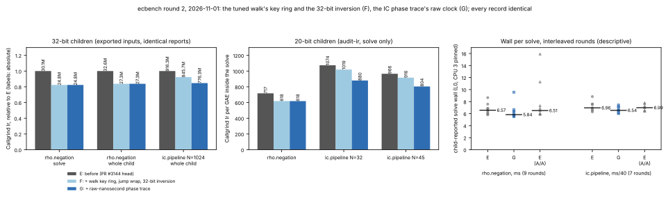

# ecbench round 2: the tuned walk's cycle window, the 32-bit inversion, the IC phase trace

**Date.** 2026-11-01. **Status.** Measured. Instruction counts are
Callgrind's (deterministic); wall time is descriptive (shared 4-vCPU cloud
VM, Intel Xeon @ 2.10 GHz, L0, CPU 3 pinned, no hardware counters).
**Class.** Engineering. Every child report is identical to the previous
build's apart from wall-clock, scheduler and placement fields, and every
record of the two scratch sessions replays under the new binary
(`verify --replay-all --exit-code`: 36/36 at 20 bits, 4/4 at 32 bits), so
no counted cost (GAE), `S` or leaderboard row changes. Stacked on
[#3144](../ecbench_child_walk_ir_20261101/README.md) (its head is arm E
here). **No `benchmarks/README.md` row** (validation gate, as for #3144);
browsing copies are in `benchmarks/20261101-ecbench-walk-trace-ir/`.



## What changed

Profiling arm E (Callgrind, per instruction) put the 32-bit
`rho.negation` solve at 33,899 additions of about 480 instructions each
and about 400 instructions of walker bookkeeping per step, a quarter of
which was the cycle-window scan; and the 20-bit `ic.pipeline` solve at 19%
in its own phase trace (about 140 instructions at each of 22,323 relation
boundaries).

- **F, `TunedWalker` (`src/cryptanalysis/ic_boundary.rs`).** The keys of
  the last `cycle_window` points are kept in a ring beside the deque and
  scanned every step without a branch per key (the pattern the lane
  walker's `Recent` already uses); the deque is read only when the ring
  holds the key, a cycle. The jump wrap `(j0 + tried) % jump_count` is one
  subtraction (both terms are below `jump_count`), not a division per
  attempt. Same points, same cycles, same escapes.
- **F, `invmod`.** For a modulus that fits 32 bits (every curve ecbench
  registers) the same extended Euclid runs on 32-bit words: identical
  values, fewer instructions, and 32-bit divisions, several times faster
  than 64-bit ones on x86-64. A new test compares the 32-bit path with the
  64-bit loop at and near the 32-bit edge. The tallied field operations do
  not change: one inversion is one inversion.
- **G, the IC phase trace (`src/cryptanalysis/ic_measurement.rs`).** The
  trace keeps `CLOCK_MONOTONIC` as raw nanoseconds (the clock
  `std::time::Instant` reads on unix) instead of `Instant`, so an interval
  is one subtraction rather than `Instant`'s checked difference, `Duration`
  normalisation and 128-bit nanosecond conversion. The same two clock reads
  bound every interval, so every recorded phase duration is the same
  quantity; the instrument itself is cheaper, so it disturbs the measured
  wall less.

## Instructions (Callgrind Ir)

32-bit children, exported inputs of `research/ecbench_child_walk_ir_20261101/inputs/spec-p32-profile.json`
(`data/ir_32bit.tsv`; the inputs are in `data/`):

| child | E (#3144 head) | F | G | E → G |
|:--|--:|--:|--:|--:|
| `rho.negation` solve (34,156 GAE) | 30,092,881 (881.0/GAE) | 24,782,352 | **24,781,851 (725.6/GAE)** | −17.6% |
| `rho.negation` whole child | 32,598,131 | 27,330,279 | **27,318,553** | −16.2% |
| `ic.pipeline` N=1024 whole child (1,446,809 GAE) | 916,254,438 | 845,735,563 | **776,313,670** | −15.3% |

20-bit children, `ecbench audit-ir` (`data/ir_20bit.tsv`):

| child | E solve (Ir/GAE) | F | G | E → G |
|:--|--:|--:|--:|--:|
| `rho.negation` (1,706 GAE) | 1,222,979 (716.9) | 1,054,933 | **1,054,467 (618.1)** | −13.8% |
| `ic.pipeline` N=32 (14,101 GAE) | 15,144,353 (1,074.0) | 14,373,889 | **12,409,320 (880.0)** | −18.1% |
| `ic.pipeline` N=45 (10,632 GAE) | 10,267,488 (965.7) | 9,737,258 | **8,551,931 (804.4)** | −16.7% |

The pre-solve counts move by under 0.1M (2.17–2.25M in every arm).

## Wall per solve (descriptive, L0)

The child's own `solve_wall_ns`, interleaved rounds E / G / E (A/A), CPU 3
pinned, quiet host (`data/wall_rounds_32bit.tsv`):

| child | E median | G median | E again (A/A) |
|:--|--:|--:|--:|
| 32-bit `rho.negation` (9 rounds) | 6.57 ms | **5.84 ms** | 6.51 ms |
| 32-bit `ic.pipeline` N=1024 (7 rounds) | 278.6 ms | **261.7 ms** | 279.6 ms |

The A/A pairs differ by 1% and 0.4%; the round-to-round spread is ±10–15%
on this host, so these say "faster, by roughly the instruction saving or
a little less", not a number to quote.

## The C library's rho step (no change)

`aburan28/cryptanalysis` `main` 6ad8b68d8 (after #1353) was profiled the
same way: 292.7 Ir per step on the 44-bit curve, about 3.6 instructions
per cycle, of which about 165 are Montgomery products and the inline
group law and about 120 the walk's bookkeeping spread over a dozen small
items (each 1–3%). The remaining large levers all change the walk's
output: a cheaper point hash (two `mix64` per step), restarts by one
addition instead of two scalar multiplications (4.6% of the solve), or
dropping per-step coefficient tracking. None is an identical-output
speedup, so this round changes nothing there.

## Reproduce

```sh
cargo build --release --locked --bin ecbench
S=research/ecbench_child_walk_ir_20261101/inputs
for s in 0 1; do target/release/ecbench profile-input --spec $S/spec-p32-profile.json --seq $s > /tmp/in$s.json; done
ECBENCH_CALLGRIND_SOLVE=1 valgrind --tool=callgrind --cache-sim=no --branch-sim=no --callgrind-out-file=/tmp/cg0 \
  target/release/ecbench exec < /tmp/in0.json >/dev/null && target/release/ecbench callgrind-ir --prefix /tmp/cg0
valgrind --tool=callgrind --cache-sim=no --branch-sim=no --combine-dumps=yes --callgrind-out-file=/dev/null \
  target/release/ecbench exec < /tmp/in1.json >/dev/null        # whole child: the "Collected" line
target/release/ecbench audit-ir --spec $S/spec-p20-profile.json --seq 0 1 2 --out /tmp/p20-ir
/tmp/report-venv/bin/python research/ecbench_walk_trace_ir_20261101/plot.py
```
