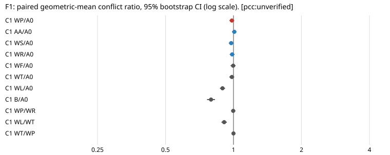
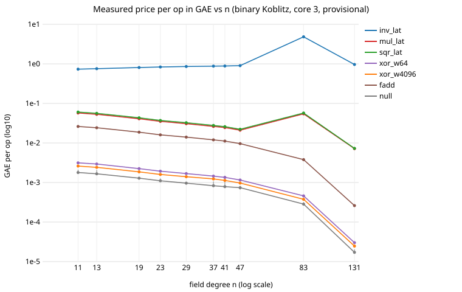
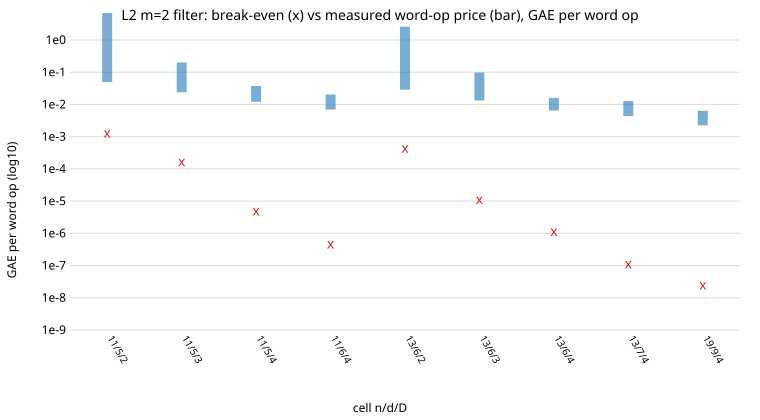
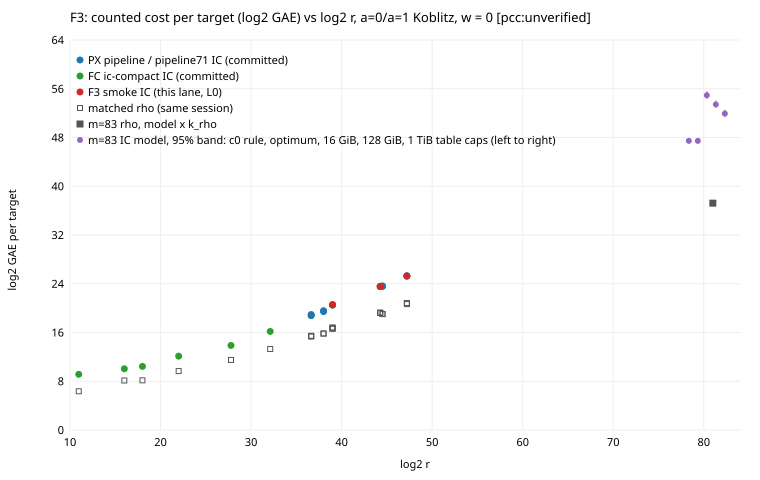

# ECC2K-130 follow-ups F1–F3 (2026-11-16)

The three follow-ups named by the 2026-11-14 open-items sweep
(`research/ecc2k130_open7_20261114/README.md`) ran as parallel lanes. Rules are in `COMMON.md`:
Rust only; F2 had CPU core 3 to itself; no paid compute. Every claim is `[pcc:unverified]`:
these are local producer runs, with no signed claims and no independent replay.

## Verdicts

| Lane | Question | Outcome | Key numbers |
|---|---|---|---|
| F1 | Cold SAT solve with R folded in as constants, seeded with warm heuristic state | **NO-CHANGE (primary).** Strong secondary lead: carried target-free learnt clauses | At C3 (m=23), warm-phase seeding WP/A0 = 1.006 [0.986, 1.025]. Random phases do as well (WR/A0 0.994). The same-target positive control also fails (WS/A0 0.992), so phase seeding does not show up in a full enumeration that ends in refutation. **WL** (carry learnt clauses whose LRAT cone uses only R-independent core clauses) gives **0.903 [0.883, 0.922]** in conflicts and 0.852 in propagations at C3, and 0.894 at C1. It ranks ahead of A0 across the §5a band. 2,394 carried clauses were rechecked as implied by the core alone, with 0 failures. WL is a pre-registered *secondary* arm, so it needs a confirmatory run before it counts. B (L3's persistent solver) reads 1.02 on positions 1–39, exactly L3, then 0.74 on positions 40–79. L3's NO-CHANGE was a 40-target artefact. |
| F2 | GF(2^n) w_cal: price of unpriced native ops in GAE | Instrument built; provisional local calibration; all controls pass in 11/11 cells | Per GAE at n = 11 / 29 / 47: mul (latency) 5.7e-2 / 3.1e-2 / 2.1e-2; word XOR at row width 1 5.0e-2 / 2.7e-2 / 1.9e-2, at width 64 about 3e-3 to 1e-3. Prices fall as n^-0.69, because the addition time grows while mul and XOR stay flat. At n = 131 the measurement uses a three-word addition 13.4× slower than ecbench's wide one at n = 83; rescaled, mul is about 0.096 GAE and word XOR about 4e-4. Cross-check against `ecbench price-units` (`full_prices.json`, n = 13–41): mul/sqr/inv/double agree within 0.96–1.11×. |
| F3 | Complete m = 83 counted IC row against matched rho | **Blocked on method, not only budget.** Launch specs frozen; smoke run at n = 41/53/61 | Smoke IC/rho at w=0: 14.96 [10.3, 21.8], 19.38 [14.3, 26.2], 24.42 [16.6, 36.0]; rho ahead at every §5a weight. Projected m = 83 with the planner's own recipe: pair table about 1.1 PiB, IC/rho about 1,200× (476× with drift). With a 128 GiB table cap: about 7.6·10^4×. Matched rho alone: 2^37.2 GAE, about 28 single-core hours per target. |

## What changes

- **The one measured gain in this round is learnt-clause reuse at the decomposition stage.** The
  heuristic-state idea from the 2026-11-14 sweep does not survive. Carrying target-free learnt
  clauses (F1 WL) cuts conflicts about 10% and propagations about 15% against today's cold
  solve, with tight intervals, and it reverses L3's reading that clause reuse does not help. It
  is a constant at one stage, not an exponent, and it is a secondary arm. Next: a pre-registered
  confirmatory run (200+ targets, k=3, a clause-quality filter).

- **L2's open trade from the 2026-11-14 sweep is settled at measured prices.** The m=2 degree-4
  filter loses in every cell. At the nearest cell the measured word-op price is 37× above
  break-even, and up to 8.7·10^4× above it elsewhere. Under the frozen §5a rule the pair is
  still not ranked, because the filter is ahead at w = 0.
- **L4's gcd-vs-inherited-f4 order stays open, now for a known reason.** A field multiplication
  costs 18.2 word XORs latency-bound and about 5.7 throughput-bound. The order flips between
  those two: I/G is 0.46–0.56 with latency-bound muls and 1.38–1.63 with throughput-bound ones.
  It is settled only by timing both side by side, or by porting G onto the shared `bitop/v1`
  tally.
- **An m=83 counted IC row is not a budget question yet.**
  - ecbench has no IC method for n ≥ 64 (`methods.rs::solve_wide`), and `ic plan --koblitz 0:83`
    has no recipe.
  - Even after a port, the nearest-to-rho Koblitz arm scales to 10^3–10^5× rho at m=83.
  - No isolab contract can host it: request/v1 jobs are capped at 3,600 s, and resumable/v1
    has a 24 h deadline and requires L2 with 5 rounds.
  - The owner decision needed first is scientific: a better-scaling wide IC method, or a
    different §8a reading.
  - A cheap rate-probe request (`requests/request-v1-rate-probe-l2.json`, under 30 minutes)
    passes `remote/validate-request` and could go given a live budget readback.

## Figures

## Integrity notes
- **F2 freeze not verifiable from Git.** The frozen PROTOCOL (`38cab9bf…`, its own copy in
  `raw/PROTOCOL.frozen.md`) first reached Git at 01:46:08Z, 40 s after F2's first measurement
  file (01:45:28Z). The version Git recorded before data (01:21Z, `56768d99…`) differs only by
  disclosed changes that came from an unscored smoke run: curve availability, known op limits,
  the n=131 unit, and a secondary range that decides nothing. No decision rule moved. The freeze
  rests on the lane's own hash, not on Git.
- **`main` does not compile** (`koblitz_index_calculus.rs:1646`, from merge `16aa66283b`).
  - F2 built against a scratch copy carrying the two-line fix in
    `F2-binary-wcal/crypto-head-build-fix.patch`.
  - F3 built from `70b57c2b81`, the last commit that compiles.
  - F2's `Cargo.toml` points at an absolute scratchpad path and must be repointed to `../../..`
    once `main` builds.
- **F1's freeze is verifiable from Git:** `cee8ccfb…` was committed at 01:09:02Z, before the
  first rows (01:10Z).
  - F1's process p3 {WT, WL} at C3 stopped after position 61 at about 01:34Z. That was when
    the main session rebased the branch with `--autostash`, which rewrote F1's live raw files
    under the running process. This is the likely cause.
  - The rerun `rows_m23k2w2_p3v2.jsonl` is recorded in a dated amendment. Its first 125 rows
    equal the stopped run's in every counted field (only `*_ms` timing fields differ), so no
    data was lost.
  - F1 bridges cadical-sys through a patched copy (`tool/cadical-sys-f1.patch`) to read and
    seed saved phases. CaDiCaL itself is unchanged.
- F3's freeze is verifiable from Git: `5d14d9bb…` was committed at 01:09Z, before the smoke runs.

## Files
- `F2-binary-wcal/`: `RESULTS.md` (§7 holds the isolab task card for the authoritative
  calibration), `tables.md`, `results.json`, `fig_prices_vs_n.svg`, `fig_l2_breakeven.svg`,
  `raw/` (`SHA256SUMS`, 86 entries).
- `F3-m83-counted/`: `RESULTS.md`, `specs/`, `requests/`, `results.json`,
  `fig_cost_vs_log2r.svg`, `raw/` (sessions, audits, `validators.txt`, `SHA256SUMS`).
- `F1-warm-cold-sat/`: `RESULTS.md`, `results.json`, `figures/fig_ratios.svg`,
  `figures/fig_phase_agreement.svg`, `raw/` (`SHA256SUMS`), `tool/` (Rust and the cadical-sys
  patch).
