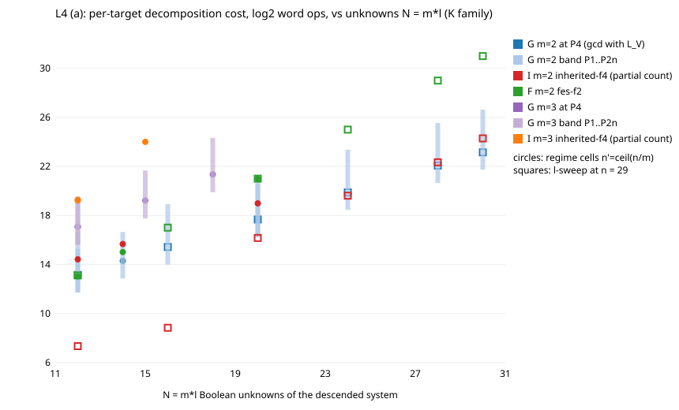

# L4: missing baselines for Koblitz decomposition (2026-11-14) [pcc:unverified]

**Question.** The owner said three baselines were never compared: (a) fixing m-1
factor-base points and taking gcd(f, L_V mod f); (b) libFES Gray-code exhaustive
search; (c) polynomial-method solvers (Dinur 2021, BKW 2019).

**Prior work, audited by repository grep.** research-kb and the lead atlas are
unavailable in this container.

* (b) is **closed by prior work**. FES is implemented (`mq_fes.rs`, `fes-f2`,
  `fes-f2-wide`) and compared with `inherited-f4`, the default Koblitz descent engine,
  on identical seeded targets: `research/inherited_f4_next_20261112` and
  `research/fes_then_batched_20261112`. A validated run is frozen but blocked
  (`fes_k13_validated_20261112`).
* (c) is **closed by prior work**. `research/blindspots_20261018/03-polynomial-method`
  implements Dinur's MultParityCount and LPTWY, with real calls and a validated counted
  model. Its model puts the crossover with FES at N = 80 (Dinur, 2^71 bits of memory)
  and N = 128 (LPTWY), with none under a realistic memory cap. That study's verdict was
  INCONCLUSIVE on a sensitivity control.
* (a) **exists** as `src/cryptanalysis/semaev_decomp.rs` (S4 pairs-and-solve with
  gcd(quartic, L_V mod quartic)). It had never been counted against the descent
  engines on the same instances. The owner is right on (a) only in that narrow sense.

**What was measured here, for (a).** A lane-local Rust harness (`src/l4bench.rs`)
counts the field operations of the literal gcd-with-L_V oracle. It runs on exactly the
targets that the repository's `ic descent` drew and solved with `inherited-f4` and
`fes-f2`: 13 cells on the Koblitz family K, n from 11 to 29, m = 2 and 3, 136 targets.
Solution sets agree exactly with every engine and with brute force. A wrong-subspace
negative control differs on 45 targets.

**Findings.**

* m = 2: G costs about 2^l (2l + 8) multiplications. It is below FES at all three
  prices from l = 10, and 231× below at P4 at l = 15. Against `inherited-f4` it has
  the same exponent (log2 slope 1.11 against 1.10 per unit of l in the regime cells).
  The ratio is a flat factor of 2.2 to 2.6 at P4, and its sign flips inside the
  pricing band. On overdetermined cells (n = 29, l ≤ 10), `inherited-f4` is up to
  1000× cheaper than G.
* m = 3: G is |V|^2 quartic gcds, about 110 mul each. It beats `inherited-f4` at every
  price at l = 5 (27× at P4). At l = 6, `inherited-f4` did not finish in 120 s.
* G is 7 to 14× (m = 2) and 300 to 1500× (m = 3) above the pair-table / subtract
  oracles that the current IC baseline rows actually use.

**Verdict.** The frozen rule is ambiguous. Its literal clause gives IMPROVES as a
stage result against `inherited-f4` at m = 3. Against the baseline rows' own oracle the
result is NEGATIVE. In either reading, **no improvement of the index-calculus
baseline**, and no change to the exponent.

## Files
PROTOCOL.md (frozen; amendments 1 before data, 2 after), RESULTS.md, results.json, REPORT.md/.pdf,
cost_vs_unknowns.svg, run.sh, src/l4bench.rs, summary/, raw/ (+SHA256SUMS).
Binaries (not in repo): $SP/lanes/L4/l4bench, $SP/lanes/L4/ic.pinned.

## Open threads
* Validated (isolated, replayed) run: none possible here (no EKS budget).
* G counts its own field ops while I's count comes from the repository tally. A shared-instrument
  bitop/v1 port of G into ic_framework as a `SystemSolver`-adjacent oracle would remove the pricing band.
* m = 3 at l >= 6 needs a larger I budget to get a finished comparison.
