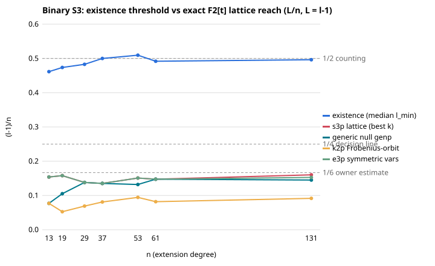
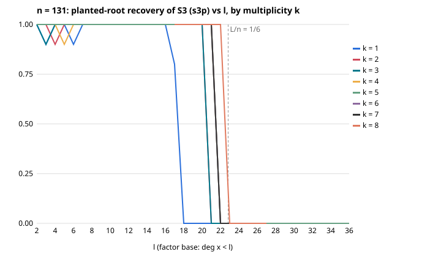

Lane L5 of `research/ecc2k130_open7_20261114/`. Every claim is `[pcc:unverified]`. The protocol `PROTOCOL.md`
was frozen before the measured seed; two dated amendments followed (an instrument hang and an extraction
fix), and neither changed a rule. The instrument `ffcop/` is Rust only. Tables come from `ffcop summarize`.

## 1. Answer

- **Setting.** Polynomial basis F2[t]/(f), factor base {x : deg x < l}, L = l − 1. The exact (weak-Popov)
  Coppersmith box lattice is built on S3(X1, X2, x(R)) mod f^k.
- **Lattice reach.** The lattice recovers a planted 2-term decomposition up to:
  - l = 21 at n = 131 for k = 4..7;
  - l = 22 at k = 8, which is L/n = 0.160, still under 1/6.
- **Existence.**
  - Decompositions of a random R appear at l ≈ n/2.
  - This was measured exactly for n ≤ 53: median l_min = 7, 10, 15, 19.5, 28 at n = 13, 19, 29, 37, 53.
  - Counts match 2^{2l−n} to within a few percent.
  - At n = 131 the threshold is l ≈ 66.
- **Gap.** The gap at n = 131 is 44 levels of l, a factor 3.1 in L. The owner's estimate ("2l < n/3 vs 2l ≈ n")
  is confirmed: the measured 2L/n is 0.32.
- **Koblitz structure does not narrow the gap.**
  - Frobenius-conjugate equations are the square of S3 mod f, and the reduced lattices were identical in 72/72 cells.
  - A Frobenius-orbit factor base is strictly worse: l = 13 vs 22.
- **What moves the reach is the X1↔X2 symmetry of S3.**
  - A generic polynomial with the same support stops 2–3 levels lower at k ≤ 3.
  - A generic *symmetric* polynomial matches S3 exactly in every cell.

## 2. Prior art

| source | settled | here |
|---|---|---|
| `crypto:research/coppersmith_s3_theta2_20261023/REPORT.md` | Prime field, LLL, ℓ ≤ 3: recovery stops at β 0.12–0.16; closed at measured level | prime only |
| `crypto:research/ic_mega_pass_20261031/ideas/lattices.json` (MP-lattices-5), `verdicts/MP-lattices-5.*.json` | This exact F2[t] / weak-Popov item: designed and reviewed, "verification item only" | **never run** (no experiments dir); run here with the reviewer's fixes |
| `crypto:research/prime_leads_chase_20261113/L2-lattice/REPORT.md` | Prime-field small roots beyond Coppersmith: KILL (desk) | not binary |
| `crypto:research/lattice_bnb_design_20261110/DESIGN.md` | B&B past HG loses in the exponent (derived) | over F2[t] HG is exact; nothing to branch on |

research-kb and the lead atlas are unavailable in this container. Instead I grepped both repositories for
coppersmith, small root, popov, mulders, polynomial lattice and F_2[t]. The gap had never been measured.

## 3. Method

- **Curve.** y² + xy = x³ + 1 (ECC2K-130 family) with S3 = (x1x2+x1x3+x2x3)² + x1x2x3 + 1.
- **Moduli.** f is the lowest-weight irreducible polynomial; n = 131 uses t^131 + t^13 + t^2 + t + 1.
- **Lattice basis.** Box basis at multiplicity k: monomials X1^a X2^b with a, b ≤ 2k, each row X^{m−2s(1,1)} g^s f^{k−s}.
  Columns are scaled by t^{L·weight}.
- **Reduction.** Mulders–Storjohann weak Popov, exact. The cost is counted as simple transformations and
  64-bit word XORs.
- **Short rows.** A row is short when its degree is < kn. A short row then vanishes exactly at the root (no √dim
  factor), and this was checked in every lattice.
- **Extraction (v2).** It never uses the planted root:
  1. strip factors of g and monomial factors from the short rows;
  2. screen pairs by random-specialization gcds;
  3. take resultants in both variables over F_{2^D};
  4. find the roots;
  5. solve the partner coordinate by half-trace from g mod f;
  6. verify mod f.
- **Arms.** Nine arms are interleaved per trial:
  - S3 planted and unplanted;
  - generic same-support, planted and unplanted;
  - symmetric generic, planted and unplanted;
  - (e1, e2) form, planted and unplanted;
  - Frobenius-orbit pair.
- **Controls.**
  - univariate positive control (d = 2, 3);
  - Koblitz conjugate augmentation;
  - A/A run;
  - existence enumeration (u64 field, ascending-degree x1, half-trace for x2).

## 4. Results

| n | l_ex | l_rec S3 (k) | Δ | L-ratio | (l_rec−1)/n | generic | sym. generic | (e1,e2) | Frobenius pair |
|---:|---:|---:|---:|---:|---:|---:|---:|---:|---:|
| 29 | 15 | 5 | 10 | 3.50 | 0.138 | 5 | 5 | 5 | 3 |
| 37 | 19.5 | 6 | 13.5 | 3.70 | 0.135 | 6 | 6 | 6 | 4 |
| 53 | 28 | 9 | 19 | 3.38 | 0.151 | 8 | 9 | 9 | 6 |
| 61 | 31* | 10 | 21 | 3.33 | 0.148 | 10 | 10 | 10 | 6 |
| 131 | 66* | 22 (k=8) | 44 | 3.10 | 0.160 | 20 | 22 | 21 | 13 |

\* Heuristic median from 2^{2l−n−1}. The heuristic was validated at n ≤ 37, where measured/predicted counts
are 0.93–1.02.

Recovery at n = 131 by multiplicity k:

| k | l_rec |
|---:|---:|
| 1 | 17 |
| 2 | 20 |
| 3 | 20 |
| 4 | 21 |
| 5 | 21 |
| 6 | 21 |
| 7 | 21 |
| 8 | 22 |

Recovery is zero above these values in every cell. The floor(det/N) guarantee (8, 14, 16, 17, 18 for k ≤ 5)
is a lower bound and is exceeded everywhere. In polynomial lattices the reduced degrees spread by monomial
weight.

**Why the symmetry helps (derived, matches the data).**
- At k = 1, a short vector is u·g + f·w with deg u < n − 4L. Every weight-2L coefficient u·r mod f must have
  degree < n − 2L, which imposes 2L F2-linear conditions per distinct coefficient.
- S3 has two distinct coefficients (c² on X1² and X2², c on X1X2), so 4L conditions. A generic polynomial has
  three, so 6L.
- Two short vectors therefore need L ≲ (n−2)/8 for S3 and L ≲ (n−2)/10 for a generic polynomial.

| n | 29 | 37 | 53 | 61 | 131 |
|---|---:|---:|---:|---:|---:|
| S3 predicted l | 4 | 5 | 7 | 8 | 17 |
| S3 measured l | 4 | 5 | 7 | 8 | 17 |
| generic predicted l | 3 | 4 | 6 | 6 | 13 |
| generic measured l | 3 | 4 | 6 | 6 | 14 |

The generic prediction is within ±1. The symmetric generic arm equals S3 everywhere. The (e1, e2) rewriting
equals the x-form, even though its box determinant is worse.

## 5. Koblitz structure

1. **Frobenius is semilinear in a polynomial basis.** x(t)² = x(t²), σ: t ↦ t². It is not F2[t]-linear and
   doubles the degree bound (deg < l ↦ ≤ 2l − 2; 2^j(l − 1) after j steps).
2. **Conjugate equations are redundant.** The relation φR = φP1 + φP2, written in the original unknowns, is
   H = S3(X1², X2², c² mod f). In characteristic 2, H ≡ g² (mod f) coefficientwise, so H ∈ (f, g²).
   - Measured: H ≡ g² held in 72/72 cells, and adding every g^i H^j f^{k−i−j} X^m row left the reduced profile
     identical in 72/72 lattices.
   - Verdict: **NO-CHANGE**.
3. **Frobenius-orbit factor base.** A relation P1 + φ^d Q2 has degree bounds (L, 2^d L). For d = 1 the
   measured reach is 13 vs 22 (n = 131), 6 vs 10 (n = 61) and 6 vs 9 (n = 53). Verdict: **NEGATIVE**.
   - d = 0 is the plain problem, and target conjugates φ^{−i}R are only re-randomizations.
   - The orbit enlarges the existence side by at most log₂(n)/2 ≈ 3.5 levels at n = 131, against Δ = 44.
4. **Subfields and trace.** n is prime, so there are no subfields. Tr is one F2-linear functional and is not
   F2[t]-linear, so it gives no lattice row.
5. **Normal basis.** A normal basis makes Frobenius linear (an F2[T]/(T^n−1)-module) but destroys the degree
   filtration, and field multiplication is not T-linear. Degree-shortness and Frobenius-linearity live in
   incompatible bases. The only Frobenius action compatible with F2[t] is σ-semilinear, and its equations
   are squares mod f.

## 6. Distance to rho (AGENTS.md §5a, derived; no end-to-end solve)

- **Route.** Best l is 21–22. Relations needed ≈ |FB| ≈ 2^{20}. P(decomposition | R) = 2^{2l−n−1} ≈ 2^{−90},
  so the route needs about 2^{110} targets.
- **Cost per target.** One group op plus a k = 4 reduction: 1.29·10⁷ word XORs and 8.1·10⁴ transformations (measured).
- **Priced relation phase.** At 0, 0.1 and 1 GAE per word XOR it costs 2^{110}, 2^{130.3} and 2^{133.6}.
- **Comparison.** Matched rho for ECC2K-130 is 2^{60.9} iterations (`crypto:RESEARCH_ECC2K130_IC_FEASIBILITY.md` §3).
- **Distance remaining.** At least 49 bits at every price in the band; the order holds across the band.
- **Scope.** This changes no baseline and is not an improvement.

## 7. Verdict

- **Validity checks that pass:**
  - reducer identity and weak-Popov property in all 64,500 lattices;
  - short rows vanish at the planted root;
  - univariate control 24/24;
  - A/A byte-identical;
  - unplanted genuine roots: one real decomposition at n = 19, which is legitimate.
- **Positive control: one cell fails.** n = 29, k = 4, l = 3 recovered 7/10, below the ≥ 8/10 threshold. It is a degenerate,
  over-provisioned cell in which one short polynomial generates the short space.
- **Strict verdict: INCONCLUSIVE.** Under the frozen validity clause, that one failing cell makes the verdict INCONCLUSIVE.
- **Decision set (n ≥ 53): every NEGATIVE criterion holds.**
  - max (l_rec − 1)/n = 0.160 ≤ 1/4;
  - Δ ≥ n/4 at 53, 61 and 131;
  - all positive controls at n ≥ 37 pass;
  - no recovery at L/n > 1/4. The falsifier was not triggered.

  The route is closed at the measured level for the box lattice with k ≤ 8.
- **Sub-verdicts.** K1 NO-CHANGE; K2 NEGATIVE; P3 (S3 = symmetric generic > generic) confirmed;
  P2 (reach ≤ 1/6 + 1/n) confirmed.

## 8. Open threads

- Other shift sets beyond k = 8. The prime-field strategy-independent bound
  (`crypto:research/smallroot_optimal_reach_20261026`) was not re-derived for F2[t].
- S4 over F2[t] at k = 1 (dimension 125) was not run.
- The extraction miss in degenerate tiny-l cells.
