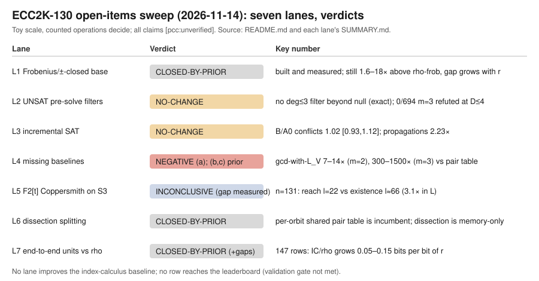

# ECC2K-130 open-items sweep (2026-11-14)

The owner listed seven items they believed were open for index calculus on binary Koblitz
curves of the ECC2K-130 type, then asked for all of them to run in parallel. Each item went to
one lane (L1–L7). Every lane first audited the prior work in `crypto` and `cryptanalysis`,
then either measured the question still left open or declared it closed by prior work
(CLOSED-BY-PRIOR).

- Shared rules: `COMMON.md`, including Amendment 1 (no Python; AGENTS.md).
- Toy scale only, on a local machine.
- Counted operations decide every verdict. Seven lanes shared 4 vCPU, so wall time was
  confounded and is not used.
- Every claim is `[pcc:unverified]`: there are no signed claims, no independent replay, and
  no EKS run.
- research-kb and the lead atlas were unavailable, so no lane makes a novelty claim.

## Verdicts

| Lane | Item | Verdict | Finding |
|---|---|---|---|
| L1 | Frobenius- and negation-closed non-linear factor base | CLOSED-BY-PRIOR | Already built (`compact-orbit-scan`, the Hamming-weight base `onb-weight`, goal22 `decomp.py`) and measured end to end. It saves a constant factor (2n fewer columns, the same yield per point) and stays 1.6–18× above signed-Frobenius rho. The gap grows with r. Under SAT or Gröbner oracles it costs more per trial than a subspace base. |
| L2 | UNSAT dominates the workload; cheap pre-solve filters | NO-CHANGE (measured) | Exact and exhaustive: no polynomial of degree ≤ 3 in the bits of x(R) separates decomposable from non-decomposable targets better than the random-subset null (24 cells, with positive controls). Linearisation refutes 0 of 694 m=3 UNSAT targets up to degree D=4. At m=2, D=4 refutes them but costs 3e3–7e7 word ops against a 1-probe oracle. The UNSAT fraction is 0.75–0.92 only for undersized bases, and 0.001–0.03 at d = ⌈n/m⌉+1. |
| L3 | Cross-instance amortisation (incremental SAT) | NO-CHANGE (measured) | CaDiCaL in Rust; all 812 target rows enumerated to completion and checked against brute force. On the deciding cell (m=23, all targets non-decomposable), a persistent solver with the target as assumptions costs 1.02× [0.93, 1.12] the conflicts of a cold solve with constants, and 2.23× the propagations. Keeping R as assumptions costs 2.2× up front, and reuse only wins that back. 94% of learnt clauses mention target bits; most of the reuse gain is warm heuristic state, not clause reuse. Compiling the factor-base template once was already done (`polynomial_reuse_20260914`). |
| L4 | Missing baselines | (a) NEGATIVE (measured); (b), (c) CLOSED-BY-PRIOR | (a) The gcd of the summation polynomial with the subspace polynomial L_V: solution sets agree with all engines on 136 targets. It costs 7–14× (m=2) and 300–1500× (m=3) more than the pair-table oracle the baseline rows use. Against `inherited-f4` it is cheaper at m=3 and tied in exponent at m=2, with the order flipping inside the price band: a stage-level constant only. (b) FES was already compared head to head (`inherited_f4_next_20261112`, `fes_then_batched_20261112`). (c) Dinur and LPTWY were implemented with a counted model (`blindspots_20261018/03-polynomial-method`); the crossover against FES is at N ≥ 80. |
| L5 | Function-field Coppersmith on S3 | INCONCLUSIVE by the frozen rule; the gap is measured | First binary F2[t] measurement, from an exact weak-Popov lattice up to n=131 with the Certicom field polynomial. The idea was proposed as MP-lattices-5 in `ic_mega_pass_20261031` and never run. Largest l at which planted roots are recovered: 9, 10 and 22 at n = 53, 61 and 131 (k=8 at n=131). Decompositions only exist from l ≈ n/2 (28, 31, 66). Gap: 19, 21 and 44 levels, 3.1–3.4× in L. Your estimate (2l < n/3 vs 2l ≈ n) holds. Frobenius-conjugate equations equal g² mod f and leave the lattice unchanged in 72/72 cases. An orbit factor base lowers reach (13 vs 22). The extra reach over a generic polynomial comes from the X1↔X2 symmetry, not from Koblitz structure. Distance to rho is at least 49 bits at every price. INCONCLUSIVE only because one degenerate positive-control cell (n=29, k=4, l=3) recovered 7/10 against a required 8/10; every NEGATIVE criterion holds at n ≥ 53. |
| L6 | Gröbner-free splitting / dissection | CLOSED-BY-PRIOR | The m=4 2+2 pair-table MITM with the table shared across targets is the incumbent (`ic_m4_mitm_scaling_20261031`: planted exponent 0.41; on uniform targets B⁴/p rarity dominates). The table is already stored per ⟨σ,−1⟩ orbit. Dissection would cut memory only, not operations. Further table engineering is ruled out by Dinur–Keller–Marmor (`ic_leads_review_20261018` §2.5). |
| L7 | End-to-end units against rho | CLOSED-BY-PRIOR (method); coverage gaps | 147 complete rows in one table against matched rho. **Every prime-degree Koblitz IC arm moves away from rho as r grows**: +0.05 to +0.15 log2(IC/rho) per bit of r, at most 4% of draws crossing by log2 r = 129. Relation search is 50–92% of S, table build 5–45%, LA ≤ 1.2%. 2LP is never better across the band. |

## What the sweep changes in the owner's picture

- **Items 1, 4b, 4c, 6 and 7 were already in this repository**, built and measured. The
  owner's notes underestimate the lab's own prior work, so the open list needs pruning.
- **Item 2's premise holds only for undersized factor bases.** At balanced or larger bases
  most targets decompose. Exact filters on x(R) of degree ≤ 3 do not exist beyond the
  trace/2E filter, which ⟨G⟩ already satisfies.
- **Item 3's amortisation saving is not there in counted units.** The persistent incremental
  solver only recovers what its own assumption encoding loses. What reuse does recover is
  mostly warm heuristic state, not learnt clauses. A cold solve with warm phases is the one
  untested variant worth a follow-up.
- **Item 5's gap is now measured and holds at n=131.** The lattice reach (l = 22) sits about
  3.1× below the existence threshold (l ≈ 66). Koblitz structure does not narrow it: conjugate
  equations are redundant and an orbit base lowers reach.
- **The binding constraint is the scaling of relation search, not any phase constant.**
  L7's phase shares and slopes say a win must lower cost per trial or trials per relation by
  a factor that grows with r. Constant-factor wins (L1, L4a, dissection) cannot close a gap
  that widens by 0.05–0.15 bits per bit of r.

## Open threads collected from the lanes
- A validated Koblitz row in counted GAE with a real §5a band. The validated LB-A rows are
  timed.
- A complete m=83 counted IC row against matched rho (§8a gate).
- A GF(2^n) w_cal instrument (`ecbench wcal` covers prime fields only). It would also settle
  L2's m=2 word-op trade and L4's price band.
- Porting L4's gcd arm into `ic_framework`, so it shares one tally with `inherited-f4`.
- Low-degree refutation tests for the symmetrised S4 and Gaudry e-variable encodings (L2).
- A size-matched SAT comparison of the weight base against a random subspace at m ≥ 3 (L1).
  It is not expected to change the verdict.
