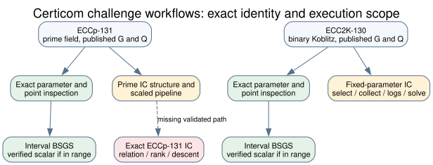

# Certicom 130-bit challenge workflow integration

**Recorded:** 2026-10-20; validation updated 2026-10-21. **Scope:** implementation and correctness checks, without a performance comparison or scientific state transition.

**Citation provenance:** the Certicom curve and challenge pages and the Petit–Kosters–Messeng paper linked below were retrieved for this report; repository source files, raw outputs, diagrams, and problem records linked below are internal artifacts.

## Question and exact inputs

Expose the published Certicom [ECCp-131 and ECC2K-130 challenge groups](https://www.certicom.com/en/curves-list) to the ECDLP and index-calculus command paths. ECCp-131 is the prime-field curve identified by the full `p`, `a`, `b`, `G`, `n`, cofactor and published `Q` in the [curve constructor](../../src/ecc/curve.rs) and [IC parameters](../../src/bin/ic/params.rs). ECC2K-130 is the distinct binary Koblitz group already carried by the [binary curve implementation](../../src/binary_ecc/curve.rs) and the fixed-parameter file in `aburan28/cryptanalysis` (`suite/docs/ic/params/ecc2k130-fixed.json`). A matching bit count does not identify a curve.

## Implemented paths and limits

The [workflow diagram](workflow.svg) records the execution boundary; its editable source is [workflow.dot](workflow.dot).
Green marks exact-parameter checks or a bounded solver, yellow marks the existing scaled or staged IC workflow, and the red box marks the unvalidated exact prime IC path.

| Path | Scope in this change |
| --- | --- |
| `ecdlp-nist solve ECCp-131 --challenge` | Imports the published prime-field point, with the solver's subgroup and result verification. |
| `ecdlp-nist solve ... --method bsgs --interval-bits N` | Uses exact ECCp-131 or ECC2K-130 group operations for a bounded interval; the in-memory table holds at most 1,048,576 baby-step entries. Every 64-bit point-key collision retains its candidate indices. |
| `ic inspect --curve eccp-131` and `icx inspect eccp-131` | Inspect the exact prime-field parameters and target. The `cryptanalysis` `ca-ic` inspector performs curve-equation and `[n]P = O` checks on both published points. |
| `crax ecdlp --curve eccp-131 --q X,Y --analyze-only` | Accepts the exact prime group and supplied point for structural weak-curve analysis. |
| `ca-ic prime --curve eccp-131` | Reports exact-curve structure, then runs its existing prime IC experiment on a generated smaller curve. |
| `ca-ic fixed --params docs/ic/params/ecc2k130-fixed.json` | Uses the existing staged ECC2K-130 fixed-parameter IC engine. This integration changes no relation, rank, or descent algorithm in that engine. |

The exact ECCp-131 relation-to-scalar path is an open [implementation problem](../../problems/eccp131-full-parameter-index-calculus.md). A bounded BSGS check needs a justified interval; the full 131-bit subgroup exceeds the table cap. This change makes no attack-speed, asymptotic, or full-parameter IC cost claim.

## Validation record

The source revisions are `crypto` `07dd1d97fa` (implementation commit) and `cryptanalysis` `3ac3f59363` (PR [#1011](https://github.com/aburan28/cryptanalysis/pull/1011)). The local validation host is Darwin arm64 with Rust/Cargo 1.93.1. The test points are generated from known scalars; they are separate from the published challenge point. The published point is checked for curve and subgroup membership without assuming its logarithm.

| Check | Exact command or action | Observed status |
| --- | --- | --- |
| Cryptanalysis release unit checks | From `cryptanalysis/suite`: `CARGO_TARGET_DIR=/private/tmp/codex-eccp131-build-cryptanalysis CARGO_BUILD_JOBS=2 cargo test --release --lib eccp131 -- --nocapture` | 2 passed, 0 failed; 3,102 other tests filtered. The sole compiler warning was in untouched `f4_fp_tower.rs`. |
| Cryptanalysis `ca-ic` | From `cryptanalysis/suite`: `CARGO_TARGET_DIR=/private/tmp/codex-eccp131-build-cryptanalysis CARGO_BUILD_JOBS=2 cargo run --release --bin ca-ic -- inspect --curve eccp-131 --json` | Exit 0, `checks_passed`; both published points passed curve-equation and subgroup checks. General prime-field point counting remained `not_checked`. |
| Cryptanalysis `ca-icx` | `ca-icx inspect eccp-131 --json`; `ca-icx estimate eccp-131 --json` | Exit 0; inspection `checks_passed`; estimate reports `regime: scaled`. |
| Cryptanalysis `crax` | `crax ecdlp --curve eccp-131 --q 0x03AA6F004FC62E2DA1ED0BFB62C3FFB568,0x009C21C284BA8A445BB2701BF55E3A67ED --analyze-only` | Exit 0; structural analysis accepted the published point. |
| ECC2K-130 fixed status | `ca-ic fixed --params docs/ic/params/ecc2k130-fixed.json --dir /private/tmp/codex-ecc2k130-status-recorded-20261020 --stage status --json` | Exit 0, `status: stopped`, zero saved relations, no logarithm database. Raw [JSON](ecc2k130-status.json), [SQLite state](ecc2k130-status.sqlite3), and [stderr](ecc2k130-status.stderr) retained. |
| Crypto bounded BSGS unit check | From `crypto`: `CARGO_TARGET_DIR=/private/tmp/codex-eccp131-build-crypto CARGO_BUILD_JOBS=2 cargo test --release --lib certicom_131_prime_and_130_binary_bsgs_use_exact_groups -- --nocapture` | 1 passed, 0 failed; 4,574 filtered. The test verifies planted scalars on both exact groups, the published ECCp-131 point's subgroup relation, and refusal of an oversized BSGS interval. |
| BSGS point-key collision regression | Run the same release library test binary with filter `bsgs_retains_all_indices_when_point_keys_collide` | 1 passed, 0 failed; all baby-step indices sharing a deliberately constant point key remained eligible for full-point verification. |
| Crypto full release library suite | `CARGO_TARGET_DIR=/private/tmp/codex-eccp131-build-crypto CARGO_BUILD_JOBS=2 cargo test --release --lib` | Initial run: 4,445 passed, 11 failed, 119 ignored in 1,351.83 s. Seven failures were missing frozen CryptoPro-B JSON files in the sparse checkout; four were unchanged `jv_cover` cases with 120-second per-run limits under host contention. The run is retained as a failed validation, not rewritten as a pass. |
| Sparse fixture reruns | Add tracked `research/cryptopro_b_chain_sweep_20261006/frozen_inputs/` to the sparse checkout; rerun `cargo test --release --lib cryptopro_b_chain_set -- --test-threads=1` and `cargo test --release --lib endo_generic_chain_set -- --test-threads=1` | 5 and 4 passed respectively, 0 failed. This covers all seven fixture-related failures. |
| Timed `jv_cover` reruns | Run each failed test by name with `cargo test --release --lib <test-name> -- --test-threads=1` | `nagao_finds_planted_six_sums_and_agrees_with_the_oracle`, `stopped_f4_agrees_with_the_full_solver_and_the_oracle`, and `replayed_f4_agrees_with_the_full_solver_and_the_oracle` passed. `hilbert_stop_agrees_with_the_full_solver_and_the_oracle` first failed with 28 qualifying samples against 30, then passed on the next isolated rerun. These tests are outside the implementation diff. |
| Crypto prime BSGS CLI | `ecdlp-nist solve ECCp-131 --secret 12345 --interval-bits 16 --method bsgs --json` | Exit 0; planted scalar 12345 returned, `verified: true`, table size 183. Raw [JSON](bsgs-eccp131.json) retained. |
| Crypto binary BSGS CLI | `ecdlp-nist solve ECC2K-130 --secret 12345 --interval-bits 16 --method bsgs --json` | Exit 0; planted scalar 12345 returned, `verified: true`, table size 183. Raw [JSON](bsgs-ecc2k130.json) retained. |
| Published prime target table-cap check | `ecdlp-nist solve ECCp-131 --challenge --interval-bits 64 --method bsgs --json` | Exit 1 as an intentional refusal; imported target coordinates match the published point, `failure: BSGS interval exceeds the 1048576-entry table limit`, `group_ops: 0`, `table_size: 0`. Raw [JSON](bsgs-eccp131-challenge-limit.json) retained. |
| Crypto IC CLI | `/private/tmp/codex-eccp131-build-crypto/release/ic inspect --curve eccp-131 --json` | Exit 0, `checks_passed`; published generator and target passed curve-equation and subgroup checks. General prime-field point counting is explicitly `not_checked`, and the prime/order screens are not primality proofs. Raw [JSON](ic-eccp131-inspect.json) retained. |

Initial cryptanalysis compiler attempts stopped on omitted sparse-checkout files (`include/`, both CUDA directories, `suite/fixtures/`, and `challenges/elliptic/`). The files were materialized before the successful release unit run; those setup failures provide no result about the ECCp-131 implementation.
The first crypto compile likewise stopped at omitted committed research and documentation paths. Those paths were materialized before the passing bounded BSGS release test. The frozen CryptoPro-B fixture omission in the initial full-suite run was repaired separately, as shown in the rerun rows.

The crypto release compiler took 96 minutes of wall time under concurrent host builds before the targeted test ran. The initial full-suite failures are separated by cause above. The `jv_cover` source and its time-limit settings are unchanged by this branch; the observed per-run timeout and the passing isolated reruns support a host-concurrency explanation, without proving that every future full-suite run will pass.

The retained ECC2K-130 status JSON has SHA-256 `0a2285955dbf9417c846c743603bd607e3925e8948a584a3f37c44b70f1fd967`; its SQLite state has SHA-256 `0a368c404d092a5099f397e23a89ddcd67e58e3ce0c2658c1266d48adf813e4e`. An earlier unarchived status smoke in a separate temporary directory returned the same stopped stage and is excluded from evidence and comparison. The retained command is a workflow check, not a relation-collection or speed experiment; its operation counters are uncalibrated for an attack-cost comparison.

The retained prime and binary BSGS CLI JSON files have SHA-256 `b1b0fb866204604ecbc18b06c74a9163faf25ff4cc998a22949c2d7b8c962ec4` and `836d5c373efcd75a595df21b4a4c721aad9689b0165f1ac447c8fdc3b46efb3a`, respectively. The published-prime table-cap JSON has SHA-256 `bae405a4fcec45ac14fd0659208569f8eca36e71e78daae4897486f343cc3007`. These correctness checks are not timing comparisons.
The crypto IC inspection JSON has SHA-256 `8d704ab6f3d8f53e90e086e6230f2e9fc4a6b1f1bd5eadc9ceb505ac1e4b3d80`.

## Graph and evidence scope

The existing `docs/index-calculus-scoreboard.html` and `docs/ic/progress-timeline.json` were checked for ECC2K-130 coverage. Neither receives a new result or measurement from this integration, so their canonical data and rendered copies remain current. The diagram distinguishes exact-parameter validation, bounded interval solving, the existing scaled or staged IC paths, and the missing prime-field path. Its arrows assert command flow only; they do not claim a transferred attack or a measured improvement.

## Exact ECCp-131 two-sum probe added 2026-10-20

This section adds an exact-curve implementation and bounded diagnostic to the earlier integration record. Its [protocol](EXACT_IC_PROBE_PROTOCOL.md) was committed before the exact `ic prime` run. The published-point acceptance criterion remains a scalar independently checked by `[x]G=Q`, obtained through natural relations, useful rank, and target descent with complete cold cost. A completed diagnostic is not a completed challenge solution.

| Requested component | Current state | Direct evidence |
| --- | --- | --- |
| Exact field, curve, group order, generator and target | Independently checked | [PARI/GP raw output](eccp131-pari-check.out): `ellcard(E)=n`, `G` and `Q` on curve, `[n]G=[n]Q=O`; a separate [primality check](eccp131-primes.out) returned `isprime(p)=isprime(n)=1`. The [group script](eccp131-pari-check.gp), [primality script](eccp131-primes.gp), [group resource log](eccp131-pari-check.err), and [primality resource log](eccp131-primes.err) are retained. |
| Exact small-x factor base and two-sum support | Checked at `B=512` | [PARI/GP enumeration](eccp131-pari-pair-sums.out): largest selected `x=1084`; `262144` raw and distinct sum abscissae, covering `524288` nonzero points; published `Q` is not a direct pair sum. The `ic prime` [raw JSON](ic-prime-eccp131-b512-seed131.json) agrees exactly and records base SHA-256 `364e2ffe036e3d113e7c07a7a1a116abec13bc7bfb6af23543dc67b0976c0929`. |
| Natural setup relations and useful rank | Bounded attempt completed; zero rows | 128 seeded nonzero `[a]G` candidates, zero checked hits, setup rank 0 in the raw JSON. The separate generated prime-order control recovered a planted scalar with full setup rank. |
| Published-point descent | Bounded attempt completed; zero hits | 128 candidates, starting with `Q` and continuing with `Q+[a]G`, zero checked hits, combined rank 0. |
| Published scalar and complete cold solution cost | Open | The target column was undetermined and `recovered_scalar` is `null`; a full relation corpus, scalar reconstruction, and whole-solution cost have not been produced. |

| Measured part of the one-thread diagnostic | Wall time or count | Scope |
| --- | ---: | --- |
| Enumerate 512 base abscissae | 7.33 ms | Initial yield-measurement pass. |
| Enumerate and deduplicate 262,144 pair-sum keys | 59.28 ms | Initial yield-measurement pass. |
| Recover eight planted decompositions | 18.84 ms | Positive controls, separate from natural relation rows. |
| Rebuild base and keys, check 128 setup and 128 target candidates, compute rank | 420.88 ms | The bounded `ic_probe` pass, including its repeated setup. |
| Whole executable process | 1.12 s; maximum RSS 24,477,696 bytes | Startup, executable hashing, both passes, JSON serialization and output. |

The exact command was the protocol command with standard streams redirected to [stdout](ic-prime-eccp131-b512-seed131.stdout) and [stderr/resource log](ic-prime-eccp131-b512-seed131.stderr), plus an [exit-code file](ic-prime-eccp131-b512-seed131.exit). It exited 0. The JSON has SHA-256 `36c8b4192b4852c943d081c52d576e6923f0e90ff98847efe9cb28f6802cccd7` and reports executable BLAKE3 `d6c0f1498f3a8b5b0fca5d33c52be8f9061e570e23d5d91b9725acad2cdcdcb0`. The executable's embedded `git_commit` and `git_dirty` fields are `null`; source attribution therefore comes from the committed implementation `191bc9f3bb`, CLI import fix `e642691b13`, and the retained executable hash and command chronology, rather than an embedded commit attestation. The host was Darwin 25.6.0 arm64 with Rust/Cargo 1.93.1 and `Cargo.lock` SHA-256 `bf9f2d9eae5f6bfea66b0473d44bf77d63141dcc335fad01b30c420be444ea42`. The run used one Rayon thread; the JSON records 0.507 s inside the command, including repeated base setup, while `/usr/bin/time -l` recorded 1.12 s process wall and 24,477,696 bytes maximum RSS. These are costs of this bounded probe only. Its eight planted two-sum controls were detected and geometrically recovered, 8/8.

The raw JSON retains the seed, candidate counts, and every successful relation witness, but does not list the missed scalar draws. The independent PARI/GP enumeration validates the factor-base support and the direct `Q` check; it does not independently replay all 255 random scalar-derived candidates. Such a replay is still required before treating the bounded miss transcript as independently verified. The exact support count and its probability calculation do not depend on those missed draws.

For `B` distinct base abscissae, at most `B` doublings and `2·C(B,2)` pair sums yield at most `B²` distinct abscissae, hence at most `2B²` nonzero group points. The independent enumeration reaches this cardinality at `B=512`, so a uniformly selected nonzero group point has exact hit probability `524288/(n−1) ≈ 3.3824×10⁻³⁴ = 2⁻¹¹¹·¹⁸⁷⁵`. Even granting every hit independent rank, `B+1=513` rows would require about `2¹²⁰·¹⁹⁰³` candidates in expectation under independent uniform sampling. At the CLI's `B=8192` limit the general two-sum upper bound is `2⁻¹⁰³·¹⁸⁷⁵` per candidate. These are derived coverage and optimistic trial calculations for this two-sum construction, not timings, a general lower bound for index calculus, or a negative result about other factor bases. Zero hits in the fixed candidates add no meaningful population-rate estimate beyond the exact enumerated support.

The first independent GP pair-enumeration scripts printed invalid zero counts after parser errors ([attempt 1](eccp131-pari-pair-sums-attempt1.err), [attempt 2](eccp131-pari-pair-sums-attempt2.err)); a corrected script exceeded GP's default 8 MB stack ([attempt 3](eccp131-pari-pair-sums-attempt3.err)). The retained [final script](eccp131-pari-pair-sums.gp), run with `gp -s 512000000 -q`, finished in 2.53 s process wall with 76,333,056 bytes maximum RSS. Only its successful output supports the count. PARI/GP version 2.17.3 and host information are retained in [tool output](pminus1-tool.txt).

A [separate PARI/GP factorization](pminus1-output.txt) gives `p−1 = 2·5·155003179783434785924857641481313994241`, with `isprime` returning 1 for the 127-bit cofactor. The direct large smooth-divisor construction described in the retrieved [Petit–Kosters–Messeng prime-field IC paper](https://people.maths.ox.ac.uk/petit/files/16PKC_primeECDLP.pdf) therefore has no large smooth divisor of this `p−1` to use; the paper's auxiliary-curve route and other relation methods remain untested here. This is a structural check, not a proof against prime-field IC.

The current [problem record](../../problems/eccp131-full-parameter-index-calculus.md) now distinguishes the proved support bound for this method from the still-open challenge requirement. The refreshed [workflow diagram](workflow.svg) shows the implemented exact probe ending at zero natural rank and the separate full-solution requirement. No new performance leaderboard row or progress-fidelity claim follows from these observations.
