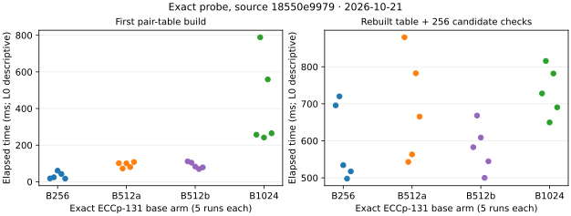
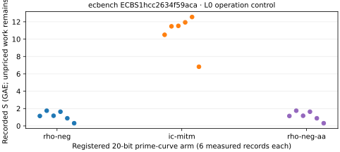

# ECCp-131 exact-stage and separate ecbench control run

**Run start:** 2026-10-21 15:34:05 UTC. **Source commit:** `18550e99791ab7edaa380f3f4f61624ea7bccab6`. **Protocol:** [ECBENCH_20261021_PROTOCOL.md](../../ECBENCH_20261021_PROTOCOL.md). **Status:** both bounded programs finished; the exact published-target scalar remains undetermined.

## What ran

| Requirement | Execution and direct record |
| --- | --- |
| Exact ECCp-131 stage matrix | Twenty fresh `ic prime --curve eccp-131` processes: five each at `B=256`, `B=512a`, `B=512b` (identical command for drift), and `B=1024`. All used the published target, seed 131, eight planted controls, 128 setup candidates, 128 target candidates, zero Monte Carlo trials, one Rayon thread, and the 600-second per-process watchdog. The [driver](../../bench_20261021/run_exact.sh), [raw JSON/streams/exit files](../../bench_20261021/exact/raw), [per-run values](../../bench_20261021/exact-values.tsv), [summary](../../bench_20261021/exact-summary.json), and [resource values](../../bench_20261021/exact-resources.tsv) are retained. |
| Native `ecbench` control | A different, registered 20-bit prime curve with two planted targets, `rho.negation`, `ic.pipeline` using a 32-abscissa small-x base and a negation-folded MITM oracle, and a repeated rho A/A arm. Three measured rounds and one warmup produced the sealed [session](../../bench_20261021/ecbench-session), [plan](../../bench_20261021/ecbench-plan.json), [host capsule](../../bench_20261021/ecbench-host.json), and [resource vectors](../../bench_20261021/ecbench-resources.json). This control does **not** run on ECCp-131 and does not call `exact_ic_probe`. |

The `ic` binary SHA-256 was `7ba4fa4477d94ecd4bf120bf15f6b41ae68acfaf170f58a746ce6576bce66d8b`; the `ecbench` binary SHA-256 was `db6de9c19512eec664b16a95336024c0faff41a580e2c5f5582ae7f15d50088d`. [Manifest](../../bench_20261021/manifest.txt) and [post-run host record](../../bench_20261021/postrun-host.txt) retain macOS 26.6, Apple M4 Pro, 48 GiB RAM, Rust 1.93.1, `Cargo.lock` hash, and host load around 78–83 at run boundaries. macOS provided no CPU affinity: all wall values are L0 descriptive observations.

## Exact ECCp-131 observations

Each arm had five completed runs and 8/8 controls detected and recovered per run. All 20 runs reported zero setup relations, zero target relations, setup rank zero, and combined rank zero. The same seeded candidate sequence was used at every base size. The pair-sum support was exactly `B²` distinct abscissae in each arm: 65,536 at B256, 262,144 at B512, and 1,048,576 at B1024.

| Arm | Runs | Median first pair-table build (ms) | Median probe interval (ms) | Median whole CLI interval (ms) | Whole CLI range (ms) |
| --- | ---: | ---: | ---: | ---: | ---: |
| B256 | 5 | 24.47 | 534.13 | 624.70 | 559.60–769.09 |
| B512a | 5 | 100.42 | 665.37 | 835.47 | 649.52–1,020.65 |
| B512b, identical command | 5 | 83.07 | 582.67 | 720.66 | 598.26–815.93 |
| B1024 | 5 | 264.88 | 727.92 | 1,051.25 | 950.79–1,683.09 |

The whole CLI interval includes two base/table constructions, the planted controls, candidate generation and checks, rank handling, JSON serialization, and executable hashing. The probe interval includes the second table construction plus all 256 candidates. The B512 A/A medians differ on this busy L0 host, so these values are not an admitted speed comparison. External `/usr/bin/time -l` reported maximum RSS from 13.65–15.50 MB at B256, 24.49–24.79 MB at B512, and 65.63–66.13 MB at B1024. These are process peaks, not a complete ECDLP memory bound. The raw JSON omits missed scalar draws; prior independent group and pair-support checks apply, but a candidate-by-candidate replay of this matrix was not performed.

## Native ecbench control observations

`ecbench` session `ECBS1hcc2634f59aca` contained 24 verified records, including six warmups. The [full audit](../../bench_20261021/ecbench-audit.json) was `ok`; all 18 measured records replayed identically. The [table](../../bench_20261021/ecbench-table.txt) records mean lower-bound `S=1.1483` for rho and `S=10.8027` for IC on the 20-bit fixture. The [paired comparison](../../bench_20261021/ecbench-compare-ic.json) reports IC/rho `S=9.4076` with 95% cluster interval `[7.2188, 12.9316]` across six pairs. The [rho A/A comparison](../../bench_20261021/ecbench-compare-aa.json) is exactly `1.000` in deterministic `S`. All arms have unpriced native work, so the comparison is marked `bounded` and does not bound full cost.

The [uniform pricing band](../../bench_20261021/ecbench-price-band.json) adds 0, 0.1, or 1 GAE to each unpriced counter on both arms. It uses 66,627 IC counters (Legendre 342, square-root solves 192, lookups 32,319, row operations 1,310, target-guard probes 32,464) and 4,205 rho canonicalisations. The resulting IC/rho arithmetic ratios are 9.4076, 9.8920, and 12.2958 for this control only. L0 wall data and the broad rho A/A wall interval are descriptive; they are not promoted to a wall-time claim.

## Failures and limits

The first `ecbench run` wrapper used zsh's read-only variable `status` to save an exit code and exited 1 **after** the native child had completed and sealed its 24-record session. Its [stderr](../../bench_20261021/ecbench-run.stderr) and [wrapper exit](../../bench_20261021/ecbench-run.wrapper-exit) are retained; the native session's `complete` status and full replay establish its validity, so the session was not rerun. A first `jq --argfile` pricing calculation failed because the installed jq lacks that option; its empty output, [error](../../bench_20261021/ecbench-price-band-attempt1.err), and exit code remain beside the corrected `--slurpfile` output.

The standard `ecbench run` prime instance stores `p`, coordinates, and subgroup order as `u64`, which excludes this 131-bit curve. The exact stage matrix is therefore a native `ic` diagnostic, and its wall intervals are not interchangeable with the small-prime `ecbench` session's `S`. Neither run produced a full ECCp-131 natural relation corpus, useful rank, published-target scalar, or complete cold solution cost. The [open problem](../../../../problems/eccp131-full-parameter-index-calculus.md) and original [challenge report](../../REPORT.md) retain those requirements. No benchmark leaderboard row or progress-fidelity claim is made from this diagnostic.

**Visual source:** [plot.py](plot.py) renders only the retained per-run stage values and measured `ecbench` record `S` values. Existing scoreboard and progress timeline were checked; this session adds no eligible full-solution or verified improvement point to either.
