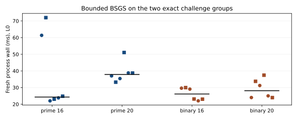

# Exact-curve bounded BSGS measurement

**Run start:** 2026-10-21 15:53:16 UTC. **Source:** `4259adc16bf97549d6c94b2001e348d99e0844dd`. **Protocol:** [BSGS_20261021_PROTOCOL.md](../../BSGS_20261021_PROTOCOL.md). **Status:** 24/24 fresh processes completed and verified their planted scalar; no execution timeout or invalid record.

## Question and execution

How does the new bounded BSGS CLI behave on the exact published ECCp-131 and ECC2K-130 groups at two interval widths? The [driver](../../bsgs_bench_20261021/run.py) ran `ecdlp-nist solve CURVE --secret 12345 --interval-bits W --method bsgs --threads 1 --seed 131 --json` for each curve and `W∈{16,20}`, three rounds and an identical A/A process per cell per round. It rotated cell order and reversed repeat order in round two. Every invocation used a new process, `/usr/bin/time -l`, and a 120-second cap. The [manifest](../../bsgs_bench_20261021/manifest.json) fixes the exact source commit and release binary SHA-256 `ca2422f3639d4ce75f14ec789173d8ae655b5a1eea300d2b04e90d9b873eb987`; each [raw record](../../bsgs_bench_20261021/raw) has command, JSON stdout, resource stderr, external wall and exit code. The [completion marker](../../bsgs_bench_20261021/COMPLETE) names 24 verified processes.

The host was macOS 26.6 on Apple M4 Pro, Rust 1.93.1, Python 3.13.1. Concurrent compute and no macOS CPU affinity make this an L0 timing session. The release binary was built from the exact-group implementation in this branch. No solver was handed the planted scalar as a solve hint; the CLI constructed `Q=[12345]G` and verified the returned scalar. The same target point is used within each curve/width cell.

## Results

The [analysis source](plot_bsgs.py) recomputes the [machine summary](summary.json) from every raw JSON and stderr record and checks the saved command, curve, scalar, method, verification status and exit code. All six processes per cell returned `planted_recovered=true`, `verified=true`, scalar `12345`, and method `bsgs`.

| Exact curve | Interval bits | n | Group ops, every run | Table entries, every run | Median native interval (ms) | Median fresh process (ms) | Fresh process range (ms) | Peak RSS range (MiB) |
| --- | ---: | ---: | ---: | ---: | ---: | ---: | ---: | ---: |
| ECCp-131 | 16 | 6 | 291 | 183 | 7.0 | 24.29 | 22.01–72.01 | 7.50–7.61 |
| ECCp-131 | 20 | 6 | 813 | 726 | 20.5 | 37.85 | 33.22–51.05 | 7.56–7.72 |
| ECC2K-130 | 16 | 6 | 291 | 183 | 4.0 | 26.11 | 22.03–29.99 | 7.47–7.59 |
| ECC2K-130 | 20 | 6 | 813 | 726 | 7.0 | 28.12 | 23.98–37.42 | 7.50–7.61 |

The paired A/A absolute fresh-process differences by round were 10.63, 1.03, 1.02 ms for ECCp-131/16; 3.79, 15.64, 0.11 ms for ECCp-131/20; 0.36, 5.94, 1.01 ms for ECC2K-130/16; and 9.73, 6.19, 1.03 ms for ECC2K-130/20. The 61–72 ms first prime/16 pair is a visible cold/load outlier and remains in the data. The widths change the bounded interval and operation count; they do not sample the full challenge group.

## Interpretation and limits

These records establish that the bounded BSGS path operates on each exact challenge group at the frozen widths and recovers the planted logarithm. The identical operation counts reflect the same bounded search shape, while field arithmetic and process conditions differ. We make no prime/binary speed ratio. External process time includes command startup, curve audit, planted-target construction, solve and JSON output; native `report.elapsed_ms` covers the solver's own interval. The A/A drift makes wall estimates descriptive. There is no matched whole-group rho reference, complete-solution cost, or benchmark-admission row from this session. The published challenge-point scalar and the [ECCp-131 full-parameter IC chain](../../../../problems/eccp131-full-parameter-index-calculus.md) remain unresolved. The existing workflow graph was checked: it already distinguishes bounded BSGS from full challenge-point and IC paths, so this run adds observations but no new graph edge.
