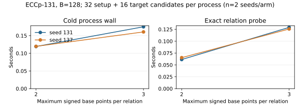

# ECCp-131 exact three-point relation diagnostic

**Recorded:** 2026-10-22 UTC. **Run ID:** `run-20261022T0523Z`. **Status:** observations only. This report does not make a research-state or performance-advantage decision.

## Question, inputs, and controls

The [frozen protocol](../../THREE_POINT_PROTOCOL.md) compares the existing signed two-point small-x relation oracle with a checked three-point oracle on Certicom [ECCp-131](https://www.certicom.com/en/curves-list). Both use the exact published curve, prime subgroup, generator, and target in the [constructor](../../../../src/ecc/curve.rs) and [CLI parameter file](../../../../src/bin/ic/params.rs). The base has 128 abscissae, with both point signs allowed, and SHA-256 `56e9c05ec56a36001c305268d545007e2b5a4e45370e22d8f51a50097b8150d7` in all four arms. The complete two-point table has 16,384 distinct abscissae. Each arm draws 32 natural setup candidates and 16 published-target shifts, with the first target candidate equal to the unshifted published point; seeds 131 and 137 are paired across the arities. Eight planted *pair* decompositions check the common table and detector in every process. The three-point positive control is a separate release unit test, not a natural challenge relation.

The implementation commit is `f58ff0d400`; the exact [raw run manifest](raw/manifest.json) records source commit `9a8a1055e00dfec40cd80261c6a6b9dfe26bc574`, binary SHA-256 `2351733ada467b8e8743e7c2af9a23b7fd05e2d2b1ca5c017ddbe745a6b27f4e`, exact commands, UTC times, environment, output digests, and process wall. The only intervening commits corrected the PARI script and pinned one Rayon thread; the Rust execution source did not change. The [host snapshot](host-before.json) records macOS 26.6, Apple M4 Pro, 48 GiB, Rust/Cargo 1.93.1, PARI/GP 2.17.3, and load. Four cold processes completed with zero failed or timed-out arms. Each had a 300-second watchdog. The [build record](build.meta.json) and [compiler stderr](build.stderr.txt) are retained.

## Raw observations

| Seed | Arity | Planted pair controls | Natural setup rows / rank | Published-target rows / combined rank | Probe seconds | Cold wall seconds | Max RSS MiB |
| ---: | ---: | ---: | ---: | ---: | ---: | ---: | ---: |
| 131 | 2 | 8/8 | 0 / 0 | 0 / 0 | 0.06139 | 0.11920 | 10.66 |
| 131 | 3 | 8/8 | 0 / 0 | 0 / 0 | 0.12911 | 0.17503 | 10.22 |
| 137 | 2 | 8/8 | 0 / 0 | 0 / 0 | 0.06533 | 0.11962 | 10.55 |
| 137 | 3 | 8/8 | 0 / 0 | 0 / 0 | 0.12576 | 0.16049 | 10.30 |

The table is transcribed from the four [raw JSON and resource logs](raw/) listed in the manifest. Median recorded probe intervals were 0.06336 seconds for arity 2 and 0.12744 seconds for arity 3; median cold process walls were 0.11941 and 0.16776 seconds. These are L0 process observations with two seeds per arm under concurrent host work. They do not price a completed relation corpus, rank system, or target logarithm. Every JSON has `target_log_determined: false`, `recovered_scalar: null`, and `verified: false`; zero rank is reported directly, with no division by zero or inferred solution cost.

The graph is generated from the raw manifest by [plot.py](plot.py). Its two panels keep the entire cold process wall separate from the probe interval, which rebuilds the base and pair table and checks the 48 candidates. The broader `ic prime` process also runs the separate two-point yield and planted controls. The native `ecbench` prime instance uses `u64` and cannot hold this 131-bit group; its earlier [20-bit control](../run-20261021T1534Z/REPORT.md) remains a different curve and execution path.

## Independent control and implementation check

The new exact-curve release unit test constructs a signed three-point target outside the 16-abscissa two-point table and checks the returned terms. A separate small-prime regression test checks that natural three-point rows reach full rank and target reconstruction; the existing two-point natural-row test still passes. All three targeted [test commands, stdout, and stderr](tests.meta.json) passed. Independent [PARI/GP output](pari-attempt2.stdout.txt) on the exact ECCp-131 equation found 256 distinct two-point abscissae at B16 and constructed a three-point sum whose abscissa is outside that set. The [script](../../eccp131-three-point-check.gp) and [resource log](pari-attempt2.stderr.txt) are retained. The first GP attempt parsed its multiline loops incorrectly while GP itself exited zero; its [stdout](pari.stdout.txt), [stderr](pari.stderr.txt), and [metadata](pari.meta.json) remain as a failed validation attempt. The corrected attempt has no GP error marker. The independent PARI control checks existence of a three-only relation; it does not replay a natural setup row from this run, because none was found.

## Interpretation and boundary

The three-point oracle extends the exact representable set without materializing cubic storage: for each signed base point it subtracts that point, queries the complete pair table, recovers the pair, and verifies the resulting EC identity before adding a row. It then uses the same modular rank and target-column solver. At B128, the ordered signed triple list has at most `8B³ = 2^24` points, so a uniform nonzero candidate has hit probability at most about `2^-106.1875`; the unshifted published target is a fixed point and is not assigned this random-model probability. At the CLI's B8192 cap, the corresponding upper bound is about `2^-88.1875`, and even the optimistic `B+1` independent-row count would need at least about `2^101.188` uniform candidate trials in expectation. These are support bounds for this small-x three-point method, not lower bounds for other index-calculus constructions.

The raw JSON fixes seeds and candidate counts but does not include a per-candidate scalar transcript for misses; no independent candidate-by-candidate replay is asserted. The named-curve relation, independent-rank, and published-target descent chain in the [problem record](../../../../problems/eccp131-full-parameter-index-calculus.md) remains unresolved. The next discriminating implementation needs an exact-curve relation oracle whose measured independent-row rate can escape this bounded support regime, with independent row replay and complete setup, miss, verification, memory, and solve accounting. The existing [workflow diagram](../../workflow.svg) was updated for this exact three-point path; no full-solution scoreboard or frontier graph gains a new row from these observations.
