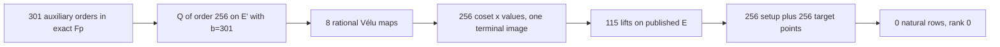

# ECCp-131 full-width auxiliary tower and relation screen

**23 October 2026.** A rational eight-step 2-isogeny tower was constructed over the exact published ECCp-131 prime field on an auxiliary curve. Its 256 coset abscissae and maps were independently replayed; 115 abscissae lifted to the published curve. The bounded screen found zero natural setup or published-target rows and rank zero. This is an exact-field construction result, not a complete relation, rank, target-descent, or scalar chain.

## Protocol, host, and retained execution

The [frozen protocol](PROTOCOL.md) fixed 512 ordered auxiliary candidates, `t=8`, deterministic point scans, seed 131, 256 setup and 256 target samples, eight planted controls, 120/60-second wall limits and 2048 MiB RSS limits. Commands in worktree `/private/tmp/eccp131-structured-ic-20261022`, source revision `c813aea6044bdc88ec4a1af3a659e8e538798a00` plus uncommitted study files:

```sh
python3 research/eccp131_full_width_20261023/run_bounded.py --wall-seconds 120 --rss-mib 2048 --stdout research/eccp131_full_width_20261023/runs/search.stdout --stderr research/eccp131_full_width_20261023/runs/search.stderr --receipt research/eccp131_full_width_20261023/runs/search.receipt.json -- gp -q research/eccp131_full_width_20261023/search.gp
python3 research/eccp131_full_width_20261023/run_bounded.py --wall-seconds 60 --rss-mib 2048 --stdout research/eccp131_full_width_20261023/runs/replay.json --stderr research/eccp131_full_width_20261023/runs/replay.stderr --receipt research/eccp131_full_width_20261023/runs/replay.receipt.json -- python3 research/eccp131_full_width_20261023/replay_and_screen.py research/eccp131_full_width_20261023/runs/search.stdout
python3 research/eccp131_full_width_20261023/plot.py > research/eccp131_full_width_20261023/runs/plot.stdout
```

Independent GP checks were generated and executed with:

```sh
python3 research/eccp131_full_width_20261023/make_identity_check.py
python3 research/eccp131_full_width_20261023/run_bounded.py --wall-seconds 30 --rss-mib 2048 --stdout research/eccp131_full_width_20261023/runs/identity_check.stdout --stderr research/eccp131_full_width_20261023/runs/identity_check.stderr --receipt research/eccp131_full_width_20261023/runs/identity_check.receipt.json -- gp -q research/eccp131_full_width_20261023/runs/identity_check.gp
python3 research/eccp131_full_width_20261023/make_planted_replay.py
python3 research/eccp131_full_width_20261023/run_bounded.py --wall-seconds 30 --rss-mib 2048 --stdout research/eccp131_full_width_20261023/runs/planted_replay.stdout --stderr research/eccp131_full_width_20261023/runs/planted_replay.stderr --receipt research/eccp131_full_width_20261023/runs/planted_replay.receipt.json -- gp -q research/eccp131_full_width_20261023/runs/planted_replay.gp
python3 research/eccp131_full_width_20261023/audit.py > research/eccp131_full_width_20261023/runs/audit.stdout 2> research/eccp131_full_width_20261023/runs/audit.stderr
```

Host metadata and exact source state are in [environment.txt](runs/environment.txt). The host was macOS arm64 Mac16,7 with 48 GiB RAM; PARI/GP 2.17.3, Python 3.13.1 and matplotlib 3.10.3. The GP [order and tower output](runs/search.stdout) and [receipt](runs/search.receipt.json) record 83.927 s wall, 15,584 KiB maximum sampled RSS, exit 0. The independent [replay JSON](runs/replay.json) and [receipt](runs/replay.receipt.json) record 8.276 s wall, 35,280 KiB maximum sampled RSS, exit 0. Both stderr files are empty. RSS was sampled every 0.2 s, so a shorter peak could be missed. Neither process hit a watchdog limit.

An earlier run on a separate T7 worktree observed the same candidate and screen counts, but that external volume disconnected before its uncommitted files could be saved. The present run is a fresh reconstruction with complete retained raw output. No number below depends on the inaccessible first run.

## Observations and certificate scope

| Item | Result |
| --- | ---: |
| Auxiliary orders computed | 301 |
| Orders divisible by 256 | 2 (`b=278,301`) |
| First accepted curve | `E': y²=x³+x+301` |
| Exact-order witness | `128Q≠O`, `256Q=O` |
| Distinct coset abscissae | 256/256 |
| Vélu kernels and codomains checked | 8/8 |
| Abscissae mapping to one terminal x | 256/256 |
| Published-curve lifted columns | 115 |
| Distinct signed pair points | 26,450 |
| Planted three-point controls | 8/8 |
| Natural setup rows / rank | 0 / 0 |
| Published-target rows / combined rank | 0 / 0 |

PARI/GP computed auxiliary curve orders and coset points. The separate [Python replay](replay_and_screen.py) uses integer field and affine EC arithmetic to check the witness point, all 256 coset values, each rational Vélu map, every codomain point and one terminal image. It checks the published generator and target against the source curve and prime subgroup. It does not independently recompute each auxiliary curve's full cardinality; the point-order witness itself is checked independently.

An additional PARI/GP [identity check](runs/identity_check.gp), generated by [make_identity_check.py](make_identity_check.py), independently returned `IDENTITY_OK`: both field and subgroup order prime, `#E(F_p)=n`, both published points on the curve and killed by `n`. Its [stdout](runs/identity_check.stdout), [stderr](runs/identity_check.stderr) and [receipt](runs/identity_check.receipt.json) are retained.

The eight planted point identities were also replayed by PARI/GP from the published-curve coordinates and coefficients. [The generated GP script](runs/planted_replay.gp), [generator](make_planted_replay.py), [stdout](runs/planted_replay.stdout), [stderr](runs/planted_replay.stderr), and [bounded receipt](runs/planted_replay.receipt.json) retain that separate check; stdout is `PLANTED_REPLAY_OK 8`.

The [cross-artifact audit](audit.py) checks raw-order sequence, input digest, tower and screen counts, both independent GP outputs, watchdog receipts and the general support bound. Its [stdout](runs/audit.stdout) is `AUDIT_OK`; [stderr](runs/audit.stderr) is empty.

The [quantitative SVG](order_valuations.svg) and its editable [source](plot.py) use the 301 retained order lines. The diagram shows the checked path; the auxiliary curve defines an abscissa set and is not asserted isogenous to the published prime-order curve.



## Bound, next gate, and requirement status

The 115 lifted columns yield 230 signed points and 26,450 distinct nonidentity signed pair points. The implemented pair-table oracle visits at most `230×26,450=6,083,500` three-point sums. Allowing the identity pair as well, **any** three-point solver on this exact base covers at most `230×(26,450+1)=6,083,730` group points, regardless of whether it enumerates or solves equations. Against the published subgroup order, a uniformly sampled point has hit probability at most `3.9249066×10⁻³³`; the 512-candidate union bound is `2.0095522×10⁻³⁰`. These derived bounds do not apply to the fixed unshifted published target, a larger base, higher arity, or a different mechanism. A faster solver alone cannot raise this base's three-point support.

| Requested gate | Status | Evidence or remaining work |
| --- | --- | --- |
| Full-width isogeny-form tower | Verified for `t=8` | Exact GP output, independent point and map replay |
| Natural published-curve relation | Open | Zero among 256 setup candidates; current support bound |
| Independent useful rank | Open | Zero natural rows entered the matrix |
| Published-target descent | Open | Zero among 256 target candidates |
| Scalar check `[d]G=Q_pub` | Open | Requires determined descent and reconstruction |
| Complete cold-cost comparison | Open | Construction and screen wall/RSS measured; no full pipeline or matched rho run |

The next relation experiment needs a larger certified base and arity with a frozen support calculation that makes natural hits measurable, or a different relation mechanism. It must charge auxiliary search, setup, misses, solver, verification, rank and descent. The current `t=8` tower can calibrate solver correctness on planted points, but it cannot supply a measurable three-point natural-row rate. The [problem record](../../problems/eccp131-full-parameter-index-calculus.md) remains open. The canonical cost-frontier graphs were checked conceptually and are unchanged: this run has no measured end-to-end IC gain or ECDLP cost bound to add.

## Repository validation

`CARGO_TARGET_DIR=/Volumes/SSD990-2/crypto/target cargo test --release --lib` completed with 4,477 passed, zero failed and 119 ignored; [stdout](runs/cargo-test.stdout) and [stderr](runs/cargo-test.stderr) are retained. `python3 scripts/test_validation_gate.py` passed 49 tests, and `python3 scripts/validation_gate.py check --base origin/main` reported every row validated or frozen; their stdout and stderr are retained in `runs/`. The [CI checkout report](CI_GATE.md) records a separate sparse-worktree control for the hosted-runner disk repair. The PR's new current-head checks remain the merge gate.
