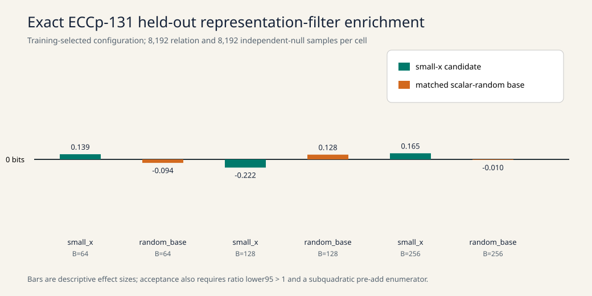

# Exact ECCp-131 representation-filter search

## Outcome

The frozen Rust sweep evaluated 3,450 coordinate-filter configurations in each
of six exact Certicom ECCp-131 base/size cells. No held-out cell qualified: all
six recorded lower confidence ratios were below 1, and the two superficially
positive small-x winners at `B=64` and `B=256` were post-addition filters that
require enumerating all Θ(`B²`) elliptic-curve pair sums. The exact verdict is
`no_qualifying_filter_in_frozen_family`.

The mechanism tested here is a representation-aware Wagner filter: train a
small coordinate-bit predicate on true four-sum relations versus a rotated
independent null, freeze the winner, and evaluate it once on held-out data with
a matched random-subgroup base. This is an implemented and measured lead in
this repository. It is **not** established as globally novel; a claim that it
has never appeared anywhere would require an independent exhaustive
paper/patent/code search that this run did not perform.

## Held-out results

| Base | `B` | Selected predicate | Relation / null hits (`N=8192` each) | log2 enrichment | recorded lower ratio | Enumerability |
|---|---:|---|---:|---:|---:|---|
| small-x | 64 | `pair_sum_y add`, 6 bits @ 120 | 130 / 118 | +0.1392 | 0.7770 | post-add, Θ(`B²`) |
| random | 64 | `endpoint_xor sub_either`, 7 bits @ 72 | 118 / 126 | −0.0943 | 0.6587 | pre-add |
| small-x | 128 | `endpoint_xor target_equal`, 7 bits @ 0 | 120 / 140 | −0.2215 | 0.6093 | pre-add |
| random | 128 | `endpoint_xor xor`, 6 bits @ 0 | 129 / 118 | +0.1281 | 0.7705 | pre-add |
| small-x | 256 | `pair_sum_x add`, 6 bits @ 56 | 120 / 107 | +0.1647 | 0.7783 | post-add, Θ(`B²`) |
| random | 256 | `endpoint_xor xor`, 6 bits @ 88 | 137 / 138 | −0.0105 | 0.7130 | pre-add |



The SVG plots recorded values from `raw/local/result.json`; no timing result is
plotted. Every one of the six A/A repeats reproduced identical counts.

## End-to-end phase ledger

| Phase | Exact ECCp-131 evidence | Result |
|---|---|---|
| Curve and subgroup | canonical curve digest `9d386a…c2db`; field 131 bits; cofactor 1 | passed |
| Factor-base construction | small-x and distinct scalar-random bases, `B=64,128,256` | completed |
| Hyperparameter selection | 4,096 true + 4,096 null training samples per cell; held-out labels not used | 3,450 configs/cell |
| Held-out relation filter | 8,192 true + 8,192 null samples per cell | no qualifying filter |
| Relation finding, arity 2 | 256 setup + 256 target candidates, `B=256` | 0 rows, rank 0 |
| Relation finding, arity 3 | 256 setup + 256 target candidates, `B=256` | 0 rows, rank 0 |
| Relation solving | exact 16×16 modular known-answer system | rank 16; exact recovery |
| F4 | no exact-width decomposition backend dispatched | unavailable, not measured |
| F5 | no exact-width decomposition backend dispatched | unavailable, not measured |
| F6 geometric pair index | 256 signed points, 32,768 pair entries/distinct points | completed |
| Root finding, planted | signed four-term witness `(0,+),(1,−),(2,+),(3,+)` | found and replayed |
| Root finding, published target | same bounded `B=128` pair index | no witness in bounded probe |
| Published discrete logarithm | requires sufficient natural rows and rank | not recovered |

Both natural relation runs recovered all 8/8 planted controls, so their zero
natural rows are bounded null observations rather than a dead-code result. The
factor-base digest was:

```text
74dcea140d03f56c4487baa39429fe0103f9bddfd6ec949b206eed397cfcf654
```
The generic rho reference derived from the exact subgroup order is about
`2^65.094` group operations; it is a cost reference, not a measured clock.

## Controls, determinism, and custody

- Planted signed four-sum: found and independently replayed.
- Modular solver: all 16 unknowns determined and recovered exactly.
- A/A: 6/6 selected-filter repeats were bit-identical.
- Invalid-metadata rerun comparison: timing-free projections are byte-identical;
  SHA-256 `5a63e30e69cd…acd817389` (full value below).
- Instrument commit: `33355ba6aed5fbb175211a757f0cc6da460f72ab`.
- Release binary SHA-256: `3a7738ab378c…4c5a7219` (full value below).
- Frozen protocol SHA-256: `6e56a761622d…e1baa4e` (full value below).
- Pre-run checkpoint bucket: `s3://crypto-autoresearcher/`.
- Checkpoint key prefix:
  `checkpoints/crypto/codex__eccp131-representation-filter-20261102/`.
- Checkpoint run directory: `20261102T180106Z-7ad718962f50/`.

Full hashes, in the order counted projection, release binary, frozen protocol:

```text
5a63e30e69cd7414f60374f8406e665c66cbef29a210d8c96440c22acd817389
3a7738ab378c460c06775adf1829ad9a74d3d7508d0a702c4d75bb2d4c5a7219
6e56a761622da5ab41aaff666c248b0a28bb062893f319440e074e20de1baa4e
```

The admitted run earned only local `L0` isolation. Its elapsed times are
descriptive and invalid for performance or speedup claims. See
[`DEVIATIONS.md`](DEVIATIONS.md) for backend, interval-label, and export-shape
deviations. The canonical export checker retains six coverage findings rather
than inventing missing executions.

## Scope and next experiment

This negative result covers only simple 1–8-bit slices of five coordinate tag
sources and four combiners at the frozen offsets. It does not rule out learned
multibit hashes, algebraic bucket generators, larger structured factor bases,
or exact summation-polynomial decomposition. The next technical step is a
coordinate-visible bucket generator whose qualifying pairs can be generated in
`O(B + output)` (or another proved subquadratic bound), followed by the same
train/held-out/random-base controls. Exact-width F4/F5 work remains a separate
backend implementation dependency.

## Evidence and reproduction

Raw source of truth:

- `raw/local/result.json` — sweep, A/A, root, and solver controls;
- `raw/local/ic-prime-arity2.json`, `ic-prime-arity3.json` — natural rows/rank;
- `audit/*counted-projection.json` — deterministic custody comparison;
- `experiment-export.json` — unified aggregate flow record;
- `raw/local/SHA256SUMS` and `raw/invalid-source-revision/SHA256SUMS` — inventories.

Reproduce the native sweep at the pinned source revision:

```sh
RAYON_NUM_THREADS=1 cargo run --release --example eccp131_representation_filter -- \
  research/eccp131_representation_filter_20261102/raw/local
```

Prior-art framing and exact-curve context are recorded in
`docs/ecdlp-hardness-corpus/GALBRAITH_BOOK_AUDIT.md`,
`docs/ecdlp-hardness-corpus/GENERIC_INTERFACE_AUDIT.md`,
`docs/ic/CERTICOM131_IC_PROGRAM.md`, and
`problems/eccp131-full-parameter-index-calculus.md`.
