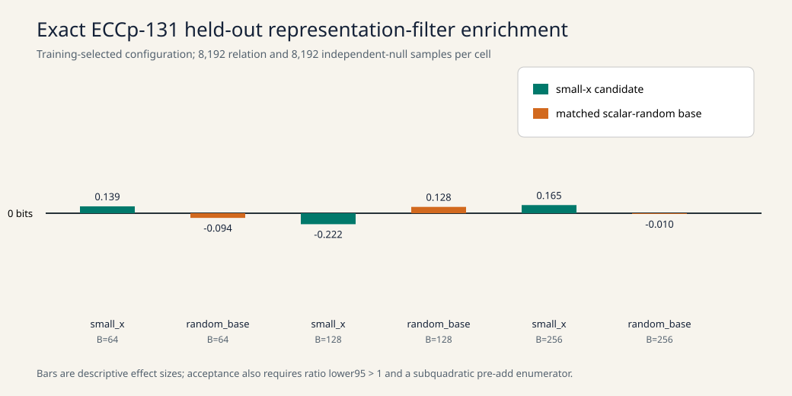

# Run report: ECCp-131 representation-filter sweep

Run scope: exact counted execution at instrument commit
`33355ba6aed5fbb175211a757f0cc6da460f72ab`, protocol version 5, frozen hash
`6e56a761622da5ab41aaff666c248b0a28bb062893f319440e074e20de1baa4e`.

Six of six planned base/size filter cells completed, as did the single planted
root probe, published-target bounded probe, modular solver control, and two
natural relation/rank probes. The six held-out lower enrichment ratios were
0.7770, 0.6587, 0.6093, 0.7705, 0.7783, and 0.7130; none exceeded the frozen
threshold 1. The planted root, solver control, and all six A/A repeats passed.

The host was a shared KVM VM with five visible Intel Xeon Platinum 8573C CPUs,
18,882,662,400 bytes of memory, kernel 6.18.57, and Rust 1.99.1. Isolation was
`L0`; every clock is invalid for comparative performance.

Inputs and evidence are in `../../raw/local/`. The full interpretation, phase
ledger, deviations, and scope are in [`../../REPORT.md`](../../REPORT.md).
