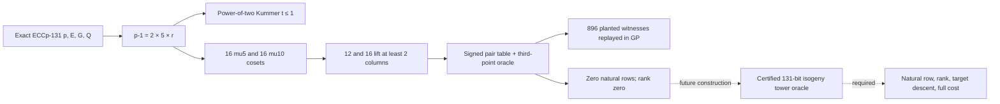

# ECCp-131 structured-coset relation screen

**Status:** bounded exact-curve observation, 2026-10-22. The frozen [protocol](PROTOCOL.md)
and executable [screen](screen.py) bind this record. Its input source is Git
`6ed792e860c9c8249eb1ac6f10a3e4beec130e1a`, and the screen's pre-run
SHA-256 was `6ca47f18cda51fb2764eab4cc7db13a6d5d741e6c470b93cfef512cb6ea9f235`.
Both published points passed full-coordinate curve and `[n]P=O` checks. GP
independently found `#E(F_p)=n`, prime `p,n`, and prime cofactor `r` in
`p-1=2·5·r`, with `r=155003179783434785924857641481313994241`.

## Question and method

Does a multiplicative-coset factor base on the published prime field expose
natural three-point relations missed by an equal-size small-abscissa base?
For `g=1,…,16`, the candidate base lifts `g·mu_5` to ECCp-131; four cosets
had fewer than two points and were excluded by the frozen rule. Each of the
12 other cosets was paired with a small-abscissa base of the same column
count. Both arms use a complete signed pair table and subtract a signed base
point from each scalar-derived candidate. For each of seeds 131 and 132,
each arm tested 256 setup candidates `[a]G` and 256 target candidates
`Q+[a]G` (including `Q` first). Every discovered row would be checked as a
point equation and ranked modulo the published prime order.

The Kummer tower `g·mu_(2^t)` used by the existing prime IC program cannot
have `t≥2` on this field: `v_2(p-1)=1`. The `mu_5` coset is an available
structured control, not a large tower or a proposed scale-up path. A
separately frozen [follow-up](PROTOCOL_MU10.md) tested the maximal
smooth subgroup `mu_10`; a prime isogeny tower uses auxiliary curves
and remains a distinct open construction.

## Raw observations

| Subgroup / seed | Complete pairs of arms | Coset columns | Planted controls | Natural setup / target rows | Setup / combined rank | Cold wall | Peak RSS |
|---:|---:|:---|---:|:---:|:---:|---:|---:|
| `mu5` / 131 | 12 | 2–5 | 192/192 | 0 / 0 | 0 / 0 | 12.82 s | 23,248,896 B |
| `mu5` / 132 | 12 | 2–5 | 192/192 | 0 / 0 | 0 / 0 | 19.03 s | 23,347,200 B |
| `mu10` / 131 | 16 | 3–8 | 256/256 | 0 / 0 | 0 / 0 | 38.44 s | 24,231,936 B |
| `mu10` / 132 | 16 | 3–8 | 256/256 | 0 / 0 | 0 / 0 | 43.05 s | 22,806,528 B |

The first screen had 24 coset arms and 24 controls; the follow-up had 32
of each. Every arm covered 256+256 candidates. Every same-size pair had
the same number of distinct signed pair points, `2B²` for its `B` in 2–8;
no collision-derived coverage advantage appeared. GP replay checked all
384 and 512 planted full-coordinate point equations and the parameter and
factorization claims: [`replay.stdout`](runs/replay.stdout) and
[`mu10-replay.stdout`](runs/mu10-replay.stdout). Raw JSON, time logs,
and generated GP source are in [`runs/`](runs/). The four runs have
separate records and were not pooled into a speedup claim.

**Execution:** `Apple M4 Pro`, Darwin 25.6.0, Python 3.13.1, PARI/GP 2.17.3;
the host was shared. Exact commands:

```sh
/usr/bin/time -l timeout 120 python3 research/eccp131_structured_ic_20261022/screen.py --seed 131 > research/eccp131_structured_ic_20261022/runs/seed131.json 2> research/eccp131_structured_ic_20261022/runs/seed131.stderr
/usr/bin/time -l timeout 120 python3 research/eccp131_structured_ic_20261022/screen.py --seed 132 > research/eccp131_structured_ic_20261022/runs/seed132.json 2> research/eccp131_structured_ic_20261022/runs/seed132.stderr
python3 research/eccp131_structured_ic_20261022/make_gp_replay.py research/eccp131_structured_ic_20261022/runs/seed131.json research/eccp131_structured_ic_20261022/runs/seed132.json > research/eccp131_structured_ic_20261022/runs/replay.gp
/usr/bin/time -l timeout 120 gp -q research/eccp131_structured_ic_20261022/runs/replay.gp > research/eccp131_structured_ic_20261022/runs/replay.stdout 2> research/eccp131_structured_ic_20261022/runs/replay.stderr
/usr/bin/time -l timeout 120 python3 research/eccp131_structured_ic_20261022/screen_mu10.py --seed 131 > research/eccp131_structured_ic_20261022/runs/mu10-seed131.json 2> research/eccp131_structured_ic_20261022/runs/mu10-seed131.stderr
/usr/bin/time -l timeout 120 python3 research/eccp131_structured_ic_20261022/screen_mu10.py --seed 132 > research/eccp131_structured_ic_20261022/runs/mu10-seed132.json 2> research/eccp131_structured_ic_20261022/runs/mu10-seed132.stderr
python3 research/eccp131_structured_ic_20261022/make_gp_replay.py research/eccp131_structured_ic_20261022/runs/mu10-seed131.json research/eccp131_structured_ic_20261022/runs/mu10-seed132.json > research/eccp131_structured_ic_20261022/runs/mu10-replay.gp
/usr/bin/time -l timeout 120 gp -q research/eccp131_structured_ic_20261022/runs/mu10-replay.gp > research/eccp131_structured_ic_20261022/runs/mu10-replay.stdout 2> research/eccp131_structured_ic_20261022/runs/mu10-replay.stderr
```

The initial screen script SHA above and complete raw-file hashes are in
[`MANIFEST.sha256`](MANIFEST.sha256). `screen.py` was unchanged between
the two frozen screens; `screen_mu10.py` adds only the separate base
construction and delegates the point arithmetic and oracle to it. Its
pre-run SHA-256 was `b15c827b54263b1689fbb44697078ee97e977d38b4f6251b528d236ce18cb8a7`.
No native profiler was invoked. Cold wall includes Python startup, factor
base setup, planted controls, candidates, relation checks and rank updates;
GP verification is separate. The process RSS stayed below the 1 GiB cap,
and each process finished before the 120-second watchdog. No process was
censored. Timing differs across seeds on a shared host and cannot establish
a speed advantage. This is an operation/coverage screen, not an `ecbench`
end-to-end row; the existing prime `ecbench` instance is `u64` limited.

## Interpretation and next action

The complete signed three-point list for any base of `B` abscissae has at
most `8B³` entries. At `B≤8`, its uniform-candidate support fraction on
ECCp-131 is below `2^-118`; a null natural-row count is expected even if
the oracle is correct. The planted witnesses and GP replay check the code
path, while the zero independent rank restricts only these screened cosets,
two seeds per subgroup and candidate budgets. The published target scalar remains
undetermined by this screen.

The next discriminating construction needs a base whose relation oracle
can act without enumerating a tiny `g·mu_d` set. The isogeny form of the
PKM tower is a candidate only after an exact 131-bit auxiliary-curve and
map certificate, a measured point preimage/decomposition cost, and a
full-coordinate natural relation. Its first acceptance gate is one natural
ECCp-131 row independently replayed; then freeze a rank/descent trial and
complete cold accounting. Repeating this coset screen at a larger candidate
count cannot overcome its support cardinality.



The PDF [one-page record](REPORT.pdf) and [diagram source](workflow.svg)
are the visual record. The dashed edges are proposed future work.
