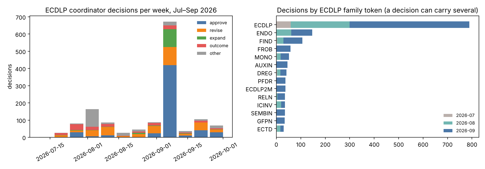

## What this is

These files index every coordinator decision on ECDLP and index calculus that the sibling `crypto-autoresearcher` ledger recorded from 19 July to 30 September 2026. Each row gives:

- the decision date;
- the verdict;
- the goal;
- the hypotheses and experiments it rules on;
- the evidence it cites;
- the run-data directories of its experiments (`crypto-autoresearcher:experiments/EXP-*/runs/`).

All values are copied from the ledger. Nothing is inferred except the scope rule below.

| file | contents |
|:--|:--|
| `INDEX.json` | one row per decision, with the 400-character context and the source YAML path |
| `INDEX.tsv` | the same rows without the context, for grep and spreadsheets |
| `SUMMARY.json` | counts by month, verdict and family |
| `build_index.py` | the generator; set `AUTORESEARCHER=` to point at the ledger checkout |
| `plot_index.py` | the figure, drawn from `INDEX.json` only |
| `jul_sep_decisions.{svg,png,pdf}` | decisions per week by verdict class, and per family |

**Scope rule.** A decision counts as ECDLP work in either of two cases:

- its `goal_id` is one of 19 ECDLP goals;
- it has no goal, but one of its target or evidence IDs carries an ECDLP family token, such as SEMAEV, MONO, DREG, FROB or ICPERF.

Both lists are in `build_index.py`, and the rule is a choice. Twenty-three decision files do not parse as YAML and are not indexed. Seven decisions filed under late-September names carry October dates. They are in `INDEX.json` and are left out of the figure.

## Counts (verified from `SUMMARY.json`)

| month | decisions | distinct experiments | run directories |
|:--|--:|--:|--:|
| 2026-07 | 74 | 20 | 977 |
| 2026-08 | 364 | 92 | 321 |
| 2026-09 | 964 | 449 | 776 |

Verdicts across the three months:

| verdict | decisions |
|:--|--:|
| approve | 561 |
| revise | 267 |
| expand | 124 |
| some outcome on a hypothesis | 157 |

The outcome verdicts are support, reject, weaken, inconclusive, supersede, pause and replicate. Of the 1,402 decisions, 690 point to at least one run directory. The week of 7 September holds 672 decisions, mostly approvals of frozen stage-0 contracts.



## Where the findings are written up

The themed account of what these decisions concluded is Chapter 15 of the treatise, [`papers/ecdlp-index-calculus-treatise/`](../../papers/ecdlp-index-calculus-treatise/) ("The summer record"). It covers:

- the retracted July wins;
- the August yield, monodromy, oracle and transfer closures;
- the September distinguished-point tables, canonical lift, Semaev 2015 and Nagao audits, Frobenius-stable bases and the first ICPERF costing against rho.

Every claim there cites a `DEC-*` identifier that can be looked up in `INDEX.json`.

**Not in this index.** Some September run files live outside the ledger:

- `docs/ic/runs/`: 92 September files, mostly Koblitz and binary index-calculus runs;
- `cryptanalysis/experiments/`: `groebner-perf-20260924`, `hamming-ic-e2e-20260929` and `prime-j0-tau-20260930`.

The index does not join them to decisions.

## How to find a run

```
python3 -c "import json;[print(r['date'],r['verdict'],r['run_paths']) for r in json.load(open('INDEX.json'))['rows'] if 'H-FROB-6774fb' in r['hypotheses']]"
```
