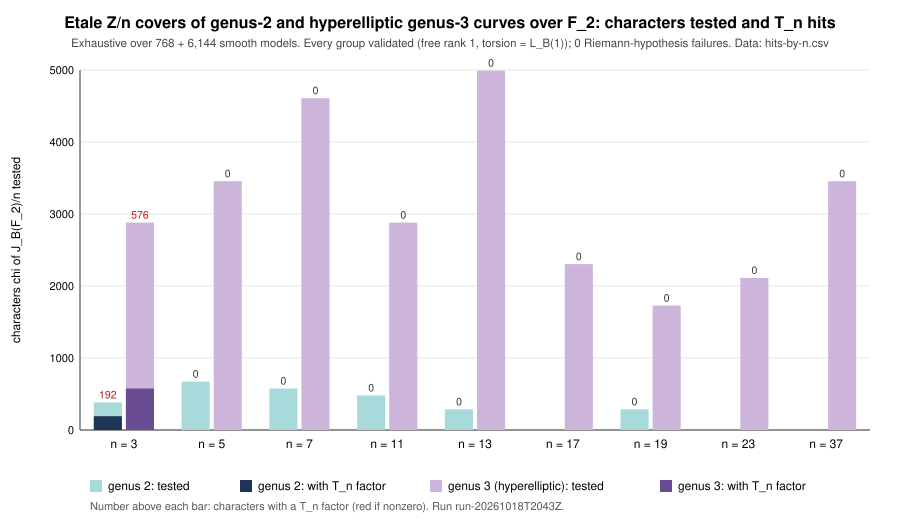

# Run report: étale-cover search for T_n (lead L8), run-20261018T2043Z

**Kind.** Exact enumeration, not a timing or statistical measurement. **Study.**
[`research/ecdlp_leads_20261018`](../../README.md), lead L8. **Code.**
[`etale_search/`](../../etale_search/src/main.rs) at commit
`bd694bf236626575b5b456052b91842015fc3f78`. **Host.** Shared cloud container,
Intel Xeon @ 2.80 GHz, Linux 6.18, rustc 1.97.0. Isolation L0. Wall time is
recorded in `RUN.txt` but is not a result.

## What ran

```sh
ETALE_VERBOSE=1 etale-search 2 > genus2.jsonl
ETALE_VERBOSE=1 etale-search 3 > genus3.jsonl
```

Each curve is B: y² + h(x)y = f(x) over F₂. The program enumerates every
model with deg h ≤ g + 1 and deg f ≤ 2g + 2, and keeps the smooth ones of
genus g:

- genus 2: h from 1 to 15, f from 0 to 127;
- genus 3: h from 1 to 31, f from 0 to 511.

For each curve the program:

1. Counts points over F_{2^k} for k ≤ g and builds the L-polynomial
   L_B(X). That gives #J_B(F₂) = L_B(1).
2. Builds the factor base of all places of degree ≤ 4. The relations are the
   divisors of functions a(x) + b(x)·y whose norm is smooth over places of
   degree ≤ 4: deg b ≤ 2, deg a ≤ 5 (genus 2) or ≤ 6 (genus 3), gcd(a, b) = 1,
   plus the irreducible polynomials in x. Diagonalising the relation lattice
   over Z gives the group. The curve counts as validated only if the free
   rank is 1 and the torsion order equals L_B(1).
3. For each odd prime n dividing #J_B(F₂), and each nontrivial character χ
   of J_B(F₂)/n: computes N_k(χ) = Σ_{deg v | k} deg v · χ([v − deg v·P₀])^{k/deg v}
   for k ≤ 2g − 2. From these it builds L(B, χ, X) by Newton's identities.
4. Checks |top coefficient| = 2^{g−1} (Riemann hypothesis), then tests
   whether L(B, χ, X) vanishes at X = 1/(cπ) and X = 1/(cπ̄) (tolerance 1e-7).
   Here c runs over μ_n, π = (t ± i√7)/2, and t = ±1 for the a = 1 and a = 0
   Koblitz curves.

## Recorded values

| quantity | genus 2 | genus 3 (hyperelliptic) |
|:--|--:|--:|
| smooth models | 768 | 6,144 |
| models with an odd prime dividing #J and validated | 520 | 4,128 |
| models failing validation | 0 | 0 |
| twisted L-functions failing the RH check | 0 | 0 |
| largest #J_B(F₂) among them | 19 | 56 |
| characters with a T_n factor | 192 (all n = 3) | 576 (all n = 3) |

Characters tested and hits, per n ([`hits-by-n.csv`](hits-by-n.csv)):

| n | genus 2: tested / hit | genus 3: tested / hit |
|--:|--:|--:|
| 3 | 384 / 192 | 2,880 / 576 |
| 5 | 672 / 0 | 3,456 / 0 |
| 7 | 576 / 0 | 4,608 / 0 |
| 11 | 480 / 0 | 2,880 / 0 |
| 13 | 288 / 0 | 4,992 / 0 |
| 17 | – | 2,304 / 0 |
| 19 | 288 / 0 | 1,728 / 0 |
| 23 | – | 2,112 / 0 |
| 37 | – | 3,456 / 0 |

Isogeny classes of B with a hit ([`hit-isogeny-classes.csv`](hit-isogeny-classes.csv)):

| genus | L_B(X) coefficients | #J | models |
|--:|:--|--:|--:|
| 2 | [1, −1, 1, −2, 4] | 3 | 48 |
| 2 | [1, −2, 4, −4, 4] | 3 | 24 |
| 2 | [1, 2, 4, 4, 4] | 15 | 24 |
| 3 | [1, −1, 1, −1, 2, −4, 8] | 6 | 96 |
| 3 | [1, −2, 4, −5, 8, −8, 8] | 6 | 96 |
| 3 | [1, 1, 1, 1, 2, 4, 8] | 18 | 96 |

The n = 3 hits cover both t = +1 (a = 1) and t = −1 (a = 0). They come in two
kinds. With c = 1 the Prym is E² and its twist carries T₃. With c primitive
the Prym is T₃ itself.

Genus-2 L-polynomials with 5 or 7 dividing #J (from the verbose curve records):

- [1, −1, 3, −2, 4], #J = 5
- [1, 0, 0, 0, 4], #J = 5
- [1, 0, 2, 0, 4], #J = 7
- [1, 1, 2, 2, 4], #J = 10
- [1, 2, 3, 4, 4], #J = 14
- [1, 2, 4, 4, 4], #J = 15



## Records

- `RUN.txt`: commit, host, timing and SHA-256 of both outputs.
- `genus2.jsonl` and `genus3.jsonl`: one record per validated curve (`kind:
  curve`), one per curve with hits (`kind: hit`), and a final `summary`.
- `hits-by-n.csv` and `hit-isogeny-classes.csv`: tables derived from the
  JSONL by `grep` and `awk`.
- `hits-by-n.plot.awk`: the graph source.

## Not covered

- Non-hyperelliptic genus-3 curves (plane quartics). These are needed for
  #J ≥ 57, and so for n = 131 and 163 at genus 3.
- Genus 4 and above.
- Ramified covers.
